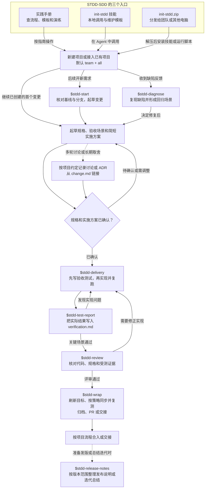

# 使用 init-stdd

下载 [最新版 `init-stdd.zip`](https://github.com/zhgqwx-del/stdd-sdd/releases/latest/download/init-stdd.zip)。解压得到完整的 `init-stdd/`，其中包含 `SKILL.md`、脚本和模板资源。以下命令适用于 macOS 和 Linux，需要 Python 3.9 或以上版本。请按实际情况调整 ZIP 下载路径。

## 方式一：在项目外运行脚本（已有项目优先）

将 `stdd_target` 改为已有项目根目录的绝对路径。以下命令可从任意目录运行，每次解压到 `~/stdd-tools/` 下的新目录。

```sh
stdd_target="/path/to/existing-project"
stdd_tools="$HOME/stdd-tools"
mkdir -p "$stdd_tools"
stdd_bundle="$(mktemp -d "$stdd_tools/bundle.XXXXXX")"
unzip "$HOME/Downloads/init-stdd.zip" -d "$stdd_bundle"
stdd_script="$stdd_bundle/init-stdd/scripts/init_stdd.py"
python3 -B "$stdd_script" "$stdd_target" --dry-run
```

检查预览中的 `CREATE`（新增）、`KEEP`（保留同名文件）和 `BLOCKED`（跳过受阻路径），确认后在同一终端执行。

```sh
python3 -B "$stdd_script" "$stdd_target"
```

默认 `team` + `all` 会把项目文档、变更模板、三个脚本、PR 模板和三个工具的七个研发技能放入目标项目。`init-stdd` 留在解压目录，可复用。脚本生成协作骨架和变更草稿。准备开始首个需求时，用 `stdd-start` 核对现有行为、记录接入基线，并完善生成的首个变更草稿。 [已有项目接入流程](existing-project.md)

首次初始化成功后，脚本把包的发布标签写入项目根目录的 `.stdd-version`。将这个文件随项目提交，团队成员可用同一个版本作为升级基准。

## 方式二：在项目里安装并调用技能

如果希望 Agent 根据目标起草规格和验收，可以将完整的 `init-stdd/` 解压到目标项目的技能目录。在目标项目根目录执行以下命令。Codex 用 `.agents/skills`，Claude Code 换成 `.claude/skills`，Qoder 换成 `.qoder/skills`。已经解压到该目录的项目可以直接调用。

```sh
stdd_skills=".agents/skills"
mkdir -p "$stdd_skills"
unzip "$HOME/Downloads/init-stdd.zip" -d "$stdd_skills"
```

在 Agent 里打开目标项目根目录。Codex 用 `$init-stdd`，Claude Code 和 Qoder 用 `/init-stdd`。

```text
用 $init-stdd 初始化一个会议室预约项目到 room-booking。目标是让员工按时段预约会议室，避免重复占用。先给产品、设计、研发和测试一个可评审的起点。
```

也可以只说「用 `$init-stdd` 给当前项目接入 STDD」，或「用 `$init-stdd` 初始化 `design-kickoff`，先搭产品和设计评审所需文档」。

已有代码的项目可以说「用 `$init-stdd` 给当前项目接入 STDD。先核对现有行为和测试入口，再为『消息发送失败后可重试』起草规格和验收计划」。接入时记录实际运行基线，并把本次目标与需要保留的行为写清楚。 [已有项目接入流程](existing-project.md)

### 初始化后移出 init-stdd

项目内安装的 `init-stdd/` 在运行后仍留在原位。若由团队统一维护，可在初始化完成后从目标项目根目录运行以下命令。将 `stdd_skills` 设置为实际安装目录。

```sh
stdd_skills=".agents/skills"
stdd_tools="$HOME/stdd-tools"
mkdir -p "$stdd_tools"
if [ -e "$stdd_tools/init-stdd" ] || [ -L "$stdd_tools/init-stdd" ]; then
  printf '%s\n' "已有 $stdd_tools/init-stdd，请将 stdd_tools 改成另一个项目外目录。" >&2
else
  mv "$stdd_skills/init-stdd" "$stdd_tools/"
fi
```

移动的是 `init-stdd/` 整个目录。七个 `stdd-*` 技能、`docs/stdd/`、`changes/`、脚本和 PR 模板都可以随项目提交。`init-stdd` 之前已提交时，把移出后的删除变更一并提交。以后需要时，可从项目外直接运行移动后的 `init-stdd/scripts/init_stdd.py`。

## 三个入口与七个技能

这张图把团队拿到手册、项目内技能或 ZIP 后的操作连到同一条研发流程。项目选用 `team` 或 `demo` 后，进入生成的 `docs/stdd/workflows.md` 查看项目内的使用顺序。图中以 Codex 的调用前缀为例。



项目已经生成首个变更时，先完善并确认规格和 `tasks.md` 中的实施方案，再进入开发。直接调用 `stdd-delivery` 时也会检查确认记录。团队先开 PR 时，可以先用 `stdd-wrap` 准备草稿，再在 PR 中用 `stdd-review`。

## 配置决定要生成什么

命令从解压后的 `init-stdd` 目录运行，需要 Python 3.9 或以上版本，使用标准库。Windows 可把示例中的 `python3` 换成 `py -3`。`team` 可以用于任意业务的初始化，技术栈、构建和应用测试由项目决定。

```sh
python3 -B scripts/init_stdd.py ../room-booking --name "会议室预约" --goal "员工按时段预约会议室，避免重复占用"
python3 -B scripts/init_stdd.py /path/to/existing-repo --agent claude --dry-run
python3 -B scripts/init_stdd.py ../design-kickoff --profile spec
python3 -B scripts/init_stdd.py ../stdd-training --profile demo
```

| 配置 | 包含内容 |
| --- | --- |
| `spec` | 项目入口、四角色工作导航、规格和交付模板、首个变更及验收计划 |
| `team`（默认） | `spec` 的全部内容，加原脚手架的通用 Skill、脚本和 PR 模板。项目测试和 CI 使用团队实际技术栈 |
| `demo` | `team` 的全部内容，加运费示例、四个可运行验收用例、`Makefile` 与 GitHub Actions。适合空目录或复跑同一教学项目 |

`--name` 缺省使用目标目录名，`--goal` 缺省标记待定义。起始变更目录为 `changes/001-first-slice/`，可用 `--change-id` 选其他 ID，用 `--change-title` 指定首个切片名称。CLI 将目标带入草稿，并在 `tasks.md` 提供实施方案起点。复杂变更加 `--design`，生成单独的 `design.md`。通过 Skill 调用时，Agent 会根据目标和项目事实起草方案。

## 方案和 Git 工作方式

`stdd-start` 默认先写简短实施方案，说明修改入口、关键取舍和如何验收。方案确认后，`stdd-delivery` 先写测试，再实现和复跑。已经有同范围确认记录时可以直接引用。

基线、真实合入目标、远端和同步策略记录在 `change.md` 或仓库规则中。功能分支的 upstream 不一定是合入目标。`stdd-start` 以远端为基线时先刷新并记录 SHA，离线时注明本地来源和未刷新状态。

准备提交或 PR 时，`stdd-wrap` 默认 fetch 真实目标并固定本轮 SHA，按提交关系跳过、快进或 rebase。未发布的本次提交和项目允许改写的个人分支适用 rebase；共享历史、脏工作区和已有 Git 操作按初始化后的 `docs/stdd/git-workflow.md` 处理。语义冲突保留现场并列出待决定事项。同步及冲突处理完成后，同步发生变化的依赖，重跑定向验收和项目要求的检查，再记录受测候选及交付状态。已有项目规定 merge、仅中途交接或没有远端时，沿用实际范围并注明状态。

七个技能可由 Agent 直接执行，不依赖参考项目的 `ptal`、固定任务号、Bun 或发布平台。squash、提交、推送和创建 PR 沿用项目策略及已有任务授权。`stdd-review` 固定目标与候选版本并从候选读取代码；`stdd-test-report` 核对用例数量和旧证据版本；缺陷诊断记录资料来源与复现状态，版本说明区分快照差异和时间窗内的合入记录。

## 讨论与架构决策

单次待决事项留在 `change.md`。跨角色、跨变更或多轮讨论可用 `docs/discussions/`，长期架构决策沿用项目指定的目录或已有的 `docs/adr/`、`docs/decisions/`。初始化后的 `docs/stdd/decisions-and-discussions.md` 说明目录选择和归档时怎样修正双向链接。

`stdd-start` 在 `change.md` 的「关联讨论与 ADR」链接相关记录。`stdd-wrap` 归档时复核变更、讨论和 ADR 之间的链接。已有项目合入新版时，可补上该规则及 `docs/stdd/templates/discussion.md`、`adr.md`、`change.md` 中相应的字段。

## 运行运费教学配置

在新生成的 `demo` 项目根目录运行 `make check`。示例用 Python 标准库 `unittest`，初始免邮门槛是 99 元。对照 `specs/shipping/spec.md`、`tests/acceptance/test_shipping_quote.py` 和 `changes/archive/001-shipping-quote/verification.md`，可以从需求和场景 ID 找到具体断言。在练习副本里将 `shipping/quote.py` 的 `>=` 改为 `>`，运行 `make test-acceptance` 会看到恰好达到门槛的场景失败。恢复比较方式后再跑 `make check`。

没有 Make 时，在项目根目录依次运行以下命令。

```sh
python3 -B scripts/check_traceability.py
python3 -B -m unittest discover -s tests -t . -v
```

教学模式的 GitHub Actions 在推送和 PR 时运行 `STDD checks`。真实项目通常用 `team`，按项目技术栈设置本地和 CI 的验证命令。

## Agent 选项决定技能目录

| 工具 | 初次在项目里调用时放置 `init-stdd` 的目录 | 初始化参数与后续调用 |
| --- | --- | --- |
| Codex | `.agents/skills/init-stdd/` | `--agent codex`，使用 `$init-stdd`、`$stdd-start` 等。 [模板位置](https://learn.chatgpt.com/docs/build-skills) |
| Claude Code | `.claude/skills/init-stdd/` | `--agent claude`，使用 `/init-stdd`、`/stdd-start` 等。 [技能位置](https://code.claude.com/docs/en/skills) |
| Qoder | `.qoder/skills/init-stdd/` | `--agent qoder`，使用 `/init-stdd`、`/stdd-start` 等。 [技能位置](https://docs.qoder.com/extensions/skills) |

省略 `--agent` 时默认 `all`，为 Codex、Claude Code、Qoder 一次布置七个后续技能。只需要一种工具时可显式指定。`--agent auto` 按 `init-stdd` 的安装位置识别工具，位置无法识别时使用 `all`。选了 Claude Code 时，初始化器可新增 `CLAUDE.md` 引用共享的 `AGENTS.md`，已有 `CLAUDE.md` 按原文件处理。 [Claude Code 项目说明](https://code.claude.com/docs/en/memory)

团队新建不同项目时可以共用同一份 ZIP。在同一个项目里协作时，把生成的项目文档与技能目录一起提交到仓库。同事克隆后从项目根目录打开所用工具，即可使用对应的研发技能。

其他支持 `SKILL.md` 的工具可传宿主规定的项目相对目录，例如 `--skills-dir .my-agent/skills`。如果工具没有技能发现功能，用 `--agent portable`，从 `docs/stdd/workflows.md` 找到文件，明确让它读取相应 `SKILL.md` 并按步骤执行。它需要能访问项目文件，执行脚本时还需要终端权限。各工具的技能扫描方式由其产品支持决定。

已初始化的项目若要补装缺失技能或接入新的 Agent，可以用 `--skills-only`。以下命令可补齐混用团队的技能目录，也可把 `all` 换成某个工具。

```sh
python3 -B scripts/init_stdd.py /path/to/existing-repo --skills-only --agent all --dry-run
python3 -B scripts/init_stdd.py /path/to/existing-repo --skills-only --agent all
```

`team` 或 `demo` 项目后续可用 `stdd-start`，也可运行 `python3 -B scripts/new_change.py 002-next-change "下一项变更" --roles` 为下一项变更生成四角色文档。需要单独的技术设计时叠加 `--design`。现行规格检查覆盖 `specs/` 中已交付的行为，草稿在变更评审时核对。

生成器会将目标中不同内容的同名文件标为 `KEEP`，内容相同标为 `UNCHANGED`，无法作为目录使用的路径标为 `BLOCKED`。重跑可补缺失项。目标子路径上的符号链接会保留并跳过。已有 `AGENTS.md` 或 README 时，可以根据现行写法增加指向 `docs/stdd/project.md` 的入口。`spec` 和 `team` 可以接入已有项目，应用代码、测试和交付命令沿用当前仓库。

## 升级已初始化的项目

新版本解压到项目外，从新包运行升级。脚本读取项目根目录的 `.stdd-version`，从 GitHub 下载该发布标签的 ZIP 用于比对。上次采用的版本和当前包相同时，脚本直接用当前包作基准。先预览，再执行同一命令。

```sh
stdd_target="/path/to/existing-project"
stdd_script="/path/to/new-bundle/init-stdd/scripts/init_stdd.py"
python3 -B "$stdd_script" "$stdd_target" --upgrade --dry-run
python3 -B "$stdd_script" "$stdd_target" --upgrade
```

旧项目可以用 `python3 -B "$stdd_script" "$stdd_target" --record-version v1.4.0` 补录。把示例标签换成已确认的实际版本。重复运行普通初始化或 `--skills-only` 时，升级基准仍由项目的版本记录决定。已有旧 ZIP 时，可用 `--upgrade --from-bundle /path/to/previous/init-stdd.zip` 指定本地包，优先级高于版本记录。 [历史发布](https://github.com/zhgqwx-del/stdd-sdd/releases)

升级默认识别项目内的 Codex、Claude Code、Qoder、便携技能目录，以及工作流中链接的自定义目录。可以用 `--agent codex` 等选项指定范围，自定义布局也可显式传原来的 `--skills-dir`。仅升级共用文档和模板时传 `--profile spec`。升级范围包括共用工程约定、`docs/stdd/templates/`、已选目录的研发技能及其配套工作流、脚本和 PR 模板。业务规格、在途变更和历史验收证据继续由项目维护。

| 状态 | 含义 |
| --- | --- |
| `UPDATE` | 项目文件和旧包生成内容逐字节一致，新版有变动，执行时更新 |
| `CREATE` | 新版新增的文件在项目中也缺失，执行时新增 |
| `MERGE` | 新版有变动，项目已有另一份内容，依据预览里的旧版到新版差异手动合并 |
| `KEEP` | 项目有定制，该文件的上游内容相同 |
| `UNCHANGED` | 项目文件已与新版一致，或上游和项目均已移除 |
| `MISSING` / `RETIRED` | 项目已移除旧文件，或新版退役了项目仍保留的文件，按需复核 |
| `BLOCKED` / `CHANGED` | 路径受阻，或执行时发现项目内容有变动，处理后重新预览 |

预览显示 `UPDATE`、`CREATE`、`MERGE` 的上游文本差异。完整升级成功后，脚本把新版标签写入 `.stdd-version`。如果存在待合并、受阻或执行中变化的路径，或升级范围排除了已安装的技能目录，脚本会保留原有基准。处理完差异后可重新运行升级，或运行项目检查后用 `--record-version` 确认实际采用的新版标签。若找不到可信的旧包，用新版在临时目录生成同配置的参考项目，逐项合并并确认采用的版本。
