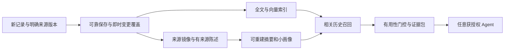

# 个人记录 Agent 独立记忆服务：调研、开发与验收规格

调研日期：2026 年 10 月 26 日，美国东部时间。

当前整体方案与开发入口是[独立记忆服务 V1.2 修订1整体方案与开发入口](docs/spec-v1/README.md)。已结合点滴 demo、现有 agent-service 和前期调研，细化服务边界、Agent 调用时序、数据模型、API、状态机、故障恢复及评测合同。本次[整体审查](docs/spec-v1/07-v1.2-review.md)收紧实时/离线同源、更正、删除和取消恢复，明确A首发与B/C后置切片。**本轮仅交付设计文档，尚未实现服务或执行运行验收。**

独立服务保存有来源、有版本、可撤回的记忆与来源镜像，向获授权 Agent 提供预算化上下文和取证。正式记录、完整产品时间线和精确统计归产品后端；记忆服务不形成第二份业务台账。点滴产品每次发送进入通用记录 Agent，由内部可信 MemoryAdapter 决定是否使用历史；需要时在首轮模型前准备上下文，模型按需用工具补查；其他 Agent 可经 API、MCP、Hook 或插件接入，并分别声明生命周期保证。

以下正文保留前期研究结论及选型依据。旧架构草案中的时间线/统计接口等已由 V1 收紧边界，开发时以 `docs/spec-v1/` 为准。第一版采用关系数据库、用户内混合检索、同步基础应用与异步富化；Hindsight 和 Mem0 可做统一合同下的效果对照，MemT 1.0 属于模型原生记忆研究路线。

最关键的产品能力是：用户发来一条短记录时，服务能找到会改变本次回应、工具参数或追问的历史，并允许不交付无关历史。只把历史相似片段交给 Agent，或只优化“用户显式问过去”的 QA 分数，都不足以验证这个能力。

## 1 阅读入口与研究范围

| 材料 | 内容 |
|---|---|
| [docs文档状态索引](docs/README.md) | 区分现行合同、决策说明与已废止的历史方案，明确开发依据 |
| [V1 开发与验收规格（当前合同）](docs/spec-v1/README.md) | 边界与不变量、数据字典、API、内部调用与恢复、跨 Agent 接入及可执行验收条件 |
| [历史参考：技术与产品方案](docs/独立记忆服务技术与产品方案.md) | 开发合同已废止；保留早期架构推导、产品假设和原设计评审 |
| [历史参考：点滴demo完备性分析](docs/点滴demo调用链与完备性补充.md) | 开发合同已废止；保留demo证据与当时的缺口分析，当前合同见V1.2 |
| [七个 Agent 和 Harness 的实现研究](research/agent-systems-notes.md) | OpenCode、OpenClaw、Hermes、DeepSeek Harness、Codex、Harness²、OpenHarness 的读写触发、存储检索及源码入口 |
| [开源记忆框架研究](research/memory-frameworks-notes.md) | MemGPT 与当前 Letta、Mem0、LangGraph/LangMem、Graphiti/Zep、Hindsight 的架构、边界和选型 |
| [论文与前沿研究](research/papers-frontier-notes.md) | MemT 1.0、分层记忆、笔记演化、策略学习、主动记忆、过度个性化及评测 |
| [Demo 源码核对](research/demo-product-audit.md) | 输入、卡片、回顾、多主体、最新交互规则和演示数据边界 |
| [定向补充研究](research/targeted-gaps-notes.md) | MemOS 接入与纠错、Mastra 观察式记忆、EverOS 的阶段可见性 |
| [持久聊天摄取与补偿合同](docs/spec-v1/06-history-ingestion-and-repair.md) | V1.2新增：历史原消息补采、回填、修复、重抽、删除和预算 |
| [agent-service聊天存储核查](research/chat-storage-audit.md) | 固定源码下MySQL、原消息、分页、终态、压缩及生命周期的可用能力与缺口 |
| [Hermes/OpenClaw后台记忆专项](research/offline-memory-mechanisms.md) | background review、Dreaming、session-backfill的实际输入、触发和边界 |

实现结论来自官方文档和固定版本源码的静态审阅，性能与中文效果仍需原型验证。七个 Agent 中，五个采用本地 2026 年 9 月快照并与当前官方文档交叉核对；Harness²、OpenHarness 及记忆框架临时下载核对。每份研究列出 commit 或版本。未运行厂商 benchmark，也未改变现有 agent-service 或启动真实模型调用。

参考输入包括现有 agent-service 和桌面的《05 记忆层设计》。远期 5000 万用户、固定维度、云模型价格和旧微基准均未自动继承为本服务约束。

## 2 从需求反推记忆的类型

Agent 项目中的 memory 经常指四种不同能力：会话恢复与压缩、用户事实与事件、可复用执行经验、待办与未来意图。它们可以协作，但数据更新方式不同。

对于个人记录，还应把“当下值”和“历史观察”分开。今天 72.4 kg 与昨天 72.8 kg 是两次观测；“刚才不是 72.8，是 72.6”是纠正；“现在不喝咖啡了”是状态变化；“打算减到 65 kg”是目标。统一用向量相似度驱动的覆盖或去重，会直接破坏记录完整性。

用户说“妈妈最近失眠”时，记忆所有者仍是当前用户，陈述对象是母亲；说“我担心自己血糖高”时，事实是用户表达了担忧。事实主体、语气、否定和时间，往往比采用什么向量数据库更决定产品是否可信。

## 3 代表性 Agent 的机制和适用性

| 系统 | 核心实现机制 | 对本服务最值得借鉴的部分 | 适配判断 |
|---|---|---|---|
| OpenCode | 指令/技能发现、持久会话、摘要压缩；当前文档另有后台与原生压缩 | 当前任务上下文与长期数据分离，按需加载技能 | 更适合作为客户端，外接事实服务；会话摘要不能代替体重或账目来源。[压缩文档](https://dev.opencode.ai/v2/docs/compaction/) |
| OpenClaw | Markdown 分层、SQLite 全文/向量索引、来源标记、dreaming 巩固、快慢召回与结构化意图 | 精选记忆与事件原料分层，来源随派生传播，召回预算 | 是完整个人助手的重要参考，但工作区与网关耦合较深；需另建多租户记录语义。[架构](https://docs.openclaw.ai/concepts/memory-architecture) |
| Hermes | 小容量常驻记忆、SQLite FTS5 会话搜索、技能、MemoryProvider 生命周期 | prefetch、同步 turn、工具、压缩前 checkpoint、会话结束等薄适配层 | 外部服务接入方式很贴近本需求；冻结的会话快照需要补每轮版本与增量。[Provider](https://hermes-agent.nousresearch.com/docs/user-guide/features/memory-providers) |
| DeepSeek Harness | 原始事件日志与模型可见投影分离，压缩是可替换能力，长期记忆经 MCP 扩展 | 原事件作为依据、上下文作为投影；领域记忆不侵入主循环 | 身份已核实为 deepseek-ai 官方项目；MCP 只提供工具，自动预取仍需适配。[记忆接入](https://github.com/deepseek-ai/deepseek-harness/blob/ddefc45fbc7f8e46dd73185e68295696d1297887/docs/user/guide/mcp-memory.md) |
| Codex | 后台逐会话抽取，再全局巩固；summary 到细节文件分级读取 | 抽取与巩固分离、任务租约、来源与删除传播 | 确有本地长期 memories，当前官方文档为默认关闭；coding 经验的刷新时机不能直接当个人记录新鲜度。[官方 memories](https://learn.chatgpt.com/docs/customization/memories) |
| Google Harness² | 固定模型权重，探测和采纳 harness 变更；分域保留 adopted harness 与 cue/lesson/evidence | 经验要有适用线索和执行证据；个人事实与程序经验分开 | 主要优化 Agent 的做事方式，不是个人事件记忆库。[官方仓库](https://github.com/google-research/harness2) |
| HKUDS OpenHarness | 带生命周期字段的 Markdown 对象、索引、启发式召回、可选抽取和检查点 | 一条记忆一个可管理对象，小规模起步可观测 | 固定版本自动抽取默认关闭；候选只看最近有限文件及预览，不宜直接承接大量中文记录。[搜索源码](https://github.com/HKUDS/OpenHarness/blob/9b2efd795c6aa09f88b0c257d269a9e518da6ae7/src/openharness/memory/search.py) |

这些项目共同说明：持久化、检索、上下文装配、后台巩固与程序经验是不同模块。可借鉴它们之间的边界，但无需同时引入七个 runtime。

## 4 开源记忆系统的技术取舍

### 4.1 候选能力对照

| 系统 | 记忆组织与读取 | 写入和演化 | 适合本项目的位置 |
|---|---|---|---|
| MemGPT 与 Letta | 论文是虚拟上下文分层；当前 Letta 已转 Git-backed MemFS，根文件常驻、深层按需读取 | Agent 可编辑，后台 dreaming 整理，Git 处理版本和合并 | 学习如何消费和管理小记忆；可生成可读画像投影，不作为数值台账。[当前 MemFS](https://docs.letta.com/concepts/memfs) |
| Mem0 | 面向外部调用的 add/search API；当前语义候选加关键词/实体评分，可选 rerank | 本次 2.2.1 主自动写入为 additive extraction，显式 update/delete 另在 | 轻量抽取与检索对照；业务时间、来源片段和精确数值层由我方提供。[固定源码](https://github.com/mem0ai/mem0/blob/26cdefb46600c0fa5953c4b5ee5003c125539fc4/mem0/memory/main.py#L881) |
| LangGraph 与 LangMem | Checkpointer 保存 thread 状态，Store 提供跨 thread JSON/搜索；LangMem 负责结构化抽取 | 可定 schema、增量 patch、插入更新删除控制、后台归纳 | 可用作服务内部抽取库；独立 API、权限、时间和生命周期仍自行建设。[长期记忆](https://docs.langchain.com/oss/python/langchain/long-term-memory)、[LangMem](https://github.com/langchain-ai/langmem) |
| Graphiti 与 Zep | Episode、entity、带有效时间和系统时间的事实关系，混合语义/全文/图召回 | LLM 增量抽取、实体解析、关系去重、冲突失效及群组摘要 | 关系和状态演变复杂时的可选引擎；测量和交易保持专用 schema。[Graphiti](https://github.com/getzep/graphiti) |
| Hindsight | retain/recall/reflect，原文、事实、observations、mental models；语义/词法/图/时间召回 | 后台有证据归纳和主题缓存；发生时间与提及时间分离 | 最值得做完整服务对照；默认使用 recall 证据，reflect 按需。[官方仓库](https://github.com/vectorize-io/hindsight) |

### 4.2 三个需要明确的版本边界

**Mem0 论文不等于当前 OSS。** 2025 论文中的 ADD/UPDATE/DELETE/NOOP 与 graph 方案，不能直接概括本次 2.2.1 主写入路径；当前自动写入是 ADD-only，旧冲突不因此自动失效。业务时间参数也有 Cloud 与 OSS 差异。适配前应固定版本，而不是按照一篇旧架构文章接入。

**MemGPT 不等于当前 Letta 产品形态。** 本次 Letta 原仓库 main 已迁移，V1 block/archival 文档为 legacy；当前 Letta Code 使用 MemFS。论文中的分层原理仍有价值，当前代码选型应看 MemFS 和运行时的实际边界。

**Graphiti 不等于完整 Zep Cloud。** Graphiti 是可自托管图引擎；Zep 的用户/线程、上下文装配与其他产品能力不能自动算进 Graphiti。Hindsight、Mem0 的本地身份空间同样不自动成为我方跨 Agent 的权限体系。

上述限定及许可证的固定版本证据见[框架研究](research/memory-frameworks-notes.md)。与其选一套框架承包所有记忆，更稳妥的做法是自有来源与领域模型、统一协议，再接一到两个可替换的语义实现。

## 5 论文中哪些方向适合落地

| 技术方向 | 代表工作 | 可借鉴的机制 | 在本需求下的边界 |
|---|---|---|---|
| 上下文分层 | [MemGPT](https://arxiv.org/abs/2310.08560) | 小型常驻状态与按需检索，工具补查 | 不要求宿主迁入整个 Agent 调度器 |
| 记忆流与巩固 | [Generative Agents](https://arxiv.org/abs/2304.03442)、[MemoryBank](https://arxiv.org/abs/2305.10250) | 当前情境触发历史，后台摘要和反思 | 日常小事也是记录产品核心数据；不能用 importance/遗忘曲线决定原始记录是否保存 |
| 短记录语义丰富化 | [A-MEM](https://arxiv.org/abs/2502.12110) | 原子笔记的关键词、语义说明和链接 | 原话与模型补充解释分开，建立来源；生成解释可撤销 |
| 学习写入和使用策略 | [Memory-R1](https://arxiv.org/abs/2508.19828)、[Mem-α](https://arxiv.org/abs/2509.25911) | 根据反馈学习操作与预算分配 | 初期先收集追加/纠正/有用性的标注；QA 奖励不覆盖删除与打扰 |
| 闲时计算 | [Sleep-time Compute](https://arxiv.org/abs/2504.13171) | 预计算可复用的结果，读取时摊销 | 按活跃度和可复用性触发，后台成本也要计入 |
| 主动记忆与适度个性化 | [ENPMR-Bench](https://arxiv.org/abs/2605.27240)、[OP-Bench](https://arxiv.org/abs/2601.13722)、[MemoProAgent](https://arxiv.org/abs/2610.22671) | 召回后判断是否值得使用，允许沉默，惩罚重复和无关历史 | 与本场景更贴近，但多数为合成、英文或视频任务；需中文真实交互验证 |
| 持续偏好更新与执行 | [VitaBench 2.0](https://arxiv.org/abs/2605.27141) | 在碎片交互中提取、更新和使用偏好，必要时澄清 | 同时评价工具选择和追问过程，而非只看最终答案 |

### 5.1 MemT 1.0 的准确定位

本次确认是 MemTensor 的 **MemT-1.0 Towards Memory-Native Evolution**，2026 年 10 月 19 日初版。它在 attention 旁加入 Native Memory Block，以每轨迹动态 Local Memory 矩阵、训练得到的 Hyper Memory 读写投影及门控、Stable GDN-2 更新和 Mixture-of-Storage 扩展记忆。推理时变化的是轨迹状态，不是每次都训练共享权重。[论文](https://arxiv.org/abs/2610.26825)

它解决的是模型如何在固定容量潜在状态中长期保留信息；任意外部 Agent 不能直接读取这些矩阵。它可以有推理服务和会话状态管理，但这与模型无关、可查证据、可按用户纠正和删除某条事实的外部记忆 API 是不同问题。作者也说明强文本记忆系统在细粒度证据任务上仍有优势。[作者说明](https://github.com/MemTensor/MemT-1.0)

当前仓库软件采用 PolyForm Noncommercial 1.0.0，商业使用需要另行许可；报告、权重和第三方部分另有条款。适合跟踪研究，现阶段不选作这个商业服务的实现基座。[许可](https://github.com/MemTensor/MemT-1.0#%EF%B8%8F-license)

### 5.2 公开评测怎样使用

LongMemEval 的信息提取、时间、更新和拒答，LoCoMo 的跨事件关系，ConvoMem 的多事实与偏好，MemoryAgentBench 的顺序摄取，都适合用来检查机制。LongMemEval-V2 转向 Web Agent 经验与 context gathering，不能直接续接 V1 的分数。[各基准范围与版本](research/papers-frontier-notes.md)

这些任务不能直接回答“新记录到来时这段历史有没有帮助”。需要额外测无关历史、重复提醒、单位歧义、纠正、缺测、权限和删除；还要比较近期原文与小用户全量原文，防止复杂框架连简单基线都没超过。分数需固定 reader、输入权限、token 预算、数据版本与 scorer。

## 6 推荐的服务方案

### 6.1 数据与执行边界

写入先保存，不依赖模型觉得“值得记住”。新记录之后，数值、单位、主体与时间逐步富化，显式更正和删除先改变可见状态。画像、摘要、向量、图都是派生视图，每项有来源与版本。

当前MemoryService提供context及证据读取，search/facts按能力扩展；正式Metrics/Timeline属于产品后端，Agent经产品工具查询。服务交付证据与信息缺口，主Agent决定回复、追问和工具行动；不再采用旧稿的Memory Metrics/Timeline API。

### 6.2 第一版技术栈

独立新服务优先考虑 PostgreSQL 加 pgvector、选定的中文词法检索实现、异步 worker 与对象存储。先按用户缩小集合再精确计算相似度，必要时再加 ANN。pgvector 支持精确与近似两种搜索；选择取决于用户内规模、过滤选择性和真实执行计划。[官方说明](https://github.com/pgvector/pgvector#filtering)

REST合同以V1.2为准，区分来源/记忆、context、取证、更正、删除与控制面；MCP及Agent插件是适配层。首发不引入通用知识图谱或自建向量块，自动摘要等扩展单独验收。

### 6.3 与现有 agent-runner 接入

目标链路为“产品发送 → 通用记录Agent → Agent内可信记忆适配器 → 独立记忆服务”。需要历史或模型理解时，适配器在首次模型请求前准备context；确认且不依赖历史的快捷输入可持久skip。补查先采用HTTP受控工具，MCP包装可后置。现有[记录助手参考](/Users/zhangguoqiang/ai-workspace/claude-workspace/meetyou/agent-service/examples/record-assistant/reference.ts:124)仅作兼容接入和测试参考，尚未实现内部适配器。

现有 `memory-injection` 固定包只把配置的 prefix/append 拼入 systemPrompt，并未实现远程动态查询；模型 middleware 还约束输入 messages 不变。因此不能把现有 hook 名称理解成接入能力已经完成。[当前实现](/Users/zhangguoqiang/ai-workspace/claude-workspace/meetyou/agent-service/packages/core/src/hooks/middleware.ts:225)

独立服务不绑定runtime contextEpoch。动态记忆使用版本、连续水位及两类bundle；删除/撤权须处理工具历史、原消息恢复抑制和会话副本。合同见[V1.2 API](docs/spec-v1/02-api-contract.md)与[Agent时序及恢复](docs/spec-v1/03-agent-sequences-and-recovery.md)。

## 7 自建与采用现成系统的决策

| 路径 | 得到什么 | 仍需承担什么 | 判断 |
|---|---|---|---|
| 自有记录模型加混合检索 | 最小依赖、数值语义可控、兼容当前 TypeScript 接入 | 中文抽取、检索效果、来源与生命周期 | 建议作为基线和稳定服务边界 |
| 自有记录模型加 Hindsight | 现成多路召回、归纳和独立服务接口 | bank 权限映射、即时纠正、数值查询、中文实测及删除传播 | 最值得完整原型对照；不要每条都运行 reflect |
| 自有记录模型加 Mem0 | 轻量事实抽取与搜索接口，容易嵌入 | 事件语义、当前状态失效、补记时间、溯源与统计 | 适合较轻的对照和语义投影 |
| 在上述路径增 Graphiti | 可查询实体关系和时间演进 | 图写入成本、实体消歧、领域事件与数值层 | 等关系类任务证明收益后引入 |

如果自有混合检索已经满足质量和成本，继续自建少量缺口即可；若 Hindsight 显著改善长历史、时间关联和归纳，采用它作为派生记忆引擎；两种结果都保留统一 API 与权威记录模型。LangMem 可按团队语言和抽取需求选为内部组件，无需为了它把整个 Agent 改成 LangGraph。

## 8 对旧设计最重要的修正

1. **统计口径先于 SQL。** 记录数、事件数和提及天数不同；未记录不是没有发生。抽取和覆盖不完整时，即使 SQL 精确也不能声称掌握真实总量。
2. **同步最小化不等于所有写入零 LLM。** 即时/微批/日终按用途选择；比较新增记录数 N 与读取次数 Q 的全周期成本，不能默认把模型调用移到读侧一定省钱。
3. **精确向量搜索只保证距离排序。** 不保证相关证据召回完整；微基准不包括冷加载、缓存、序列化、权限与网络。
4. **事实新鲜度优先于画像缓存。** 用户纠正立即影响当前视图；把动态个人数据放在每轮输入，避免周更画像与 runtime epoch 深度耦合。
5. **冷启动按字段与覆盖判断。** 一条明确单位或偏好就可能有用；趋势要看跨度与可比性，不按总记录数统一开关。
6. **删除包括派生视图和接入会话。** 只删 memory 主表，旧摘要、缓存和已注入模型历史仍可能持续传播旧内容。

原文中的具体价格、声学/情绪数据、竞品benchmark争论与刷星指控不作为本方案事实依据。早期逐项评审见[历史方案第9节（研究依据）](docs/独立记忆服务技术与产品方案.md)；边界修订见[V1.1整体审查记录](docs/spec-v1/05-review-notes.md)，持久聊天补充见[V1.2新增合同](docs/spec-v1/06-history-ingestion-and-repair.md)。

## 9 当前开发下一步

按[V1.2整体入口](docs/spec-v1/README.md)及[04交付顺序](docs/spec-v1/04-evaluation-and-acceptance.md)实施D1–D4：基础来源与合同、召回与记忆、删除与完整适配、质量与P0容量。第三方框架对照、MCP和P1容量属于按需扩展，不作为首发前置。

验收不仅看答对多少历史问题，还要看：记录不丢且不重复；单位和主体不被猜错；纠正后检索与统计一致；不该提历史时保持简短；缺证据会追问或说明未知；删除与跨 Agent 权限真实生效。记录总成本、p95/p99 和富化滞后，再决定摘要、图索引或学习策略是否值得加入。

首发默认范围、限额及基准已写入V1.2，不再按本文早期建议重新选择接口。真实业务规模、预算或共享范围超出基线时，更新相关合同及验收，不另维护第二份现行方案。
