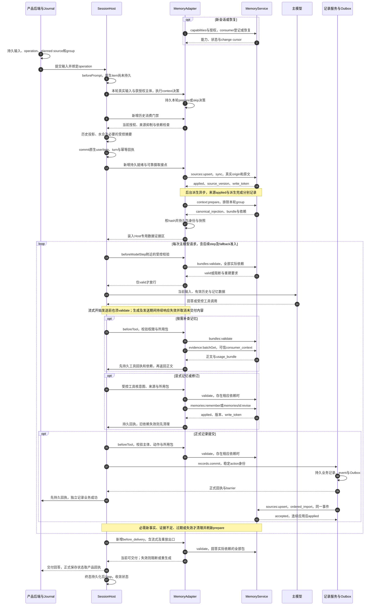
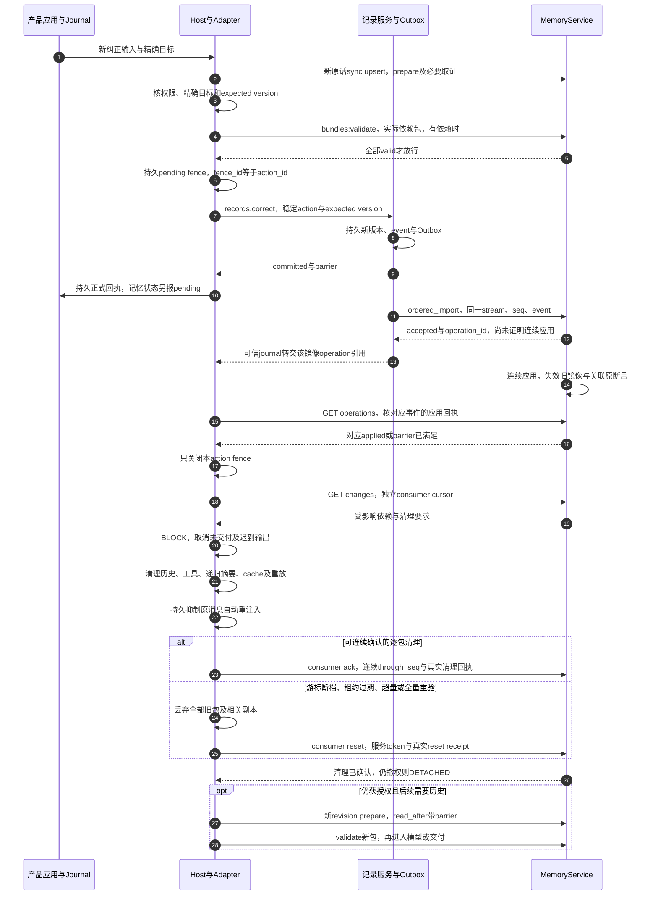

# agent-service 记忆接入 Hook 与调用时序

核对日期：2026-11-16（America/Los_Angeles）。本文把现行 MemoryService 合同映射到 agent-service 的实际接点，用于流程阅读和开发拆分。核心安排是：**每轮持久化 prepare/skip 决策，需要历史时在首个主模型请求前召回；每个使用关口校验；来源、显式记忆和正式记录镜像分别写入；更正通过版本与失效闭环处理。**

本文是说明性接入地图，不定义另一套 API 或 Runtime 协议。权威仍为 [00 边界](../spec-v1/00-boundaries-and-invariants.md)、[02 API](../spec-v1/02-api-contract.md)、[03 时序](../spec-v1/03-agent-sequences-and-recovery.md)、[04 验收](../spec-v1/04-evaluation-and-acceptance.md)及 [06 身份与生命周期](../spec-v1/06-history-ingestion-and-repair.md)。

## 1 当前实现与实际顺序

本轮以本仓 `main / 6d25a58dbd4be263f1cbbd7ff5fbc7fd997d026c` 的现行合同及工作区待提交的本文、索引和交接记录为复核范围；MemoryService 仍只有设计，没有可运行 API、worker、迁移或已执行的集成验收。agent-service 位于 `/Users/zhangguoqiang/ai-workspace/codex-workspace/agent-service`，核对为干净 `main / 6870e7346d98ef193de51e8f328e1f967066da2a`。以下源码链接固定到该提交。

agent-service 使用 Pi agent-core，由 SessionHost 管理执行。已有 `beforePrompt`、`beforeModelStep`、`beforeTool` middleware，以及生命周期 observer；现有 `memory-injection` 仅把静态 prefix/append 拼到 systemPrompt。没有动态 MemoryAdapter。[类型][hook-types]、[静态注入][static-memory]、[装配][runner]

```text
预分配turn/item ID → provider/工具准备 → beforePrompt
  → 读取历史、水合、必要时maybeCompact
  → commit原生userItem、turn及幂等回执 → observe(UserPromptSubmit)
  → engine.start → beforeModelStep → 主模型
  → 模型生成工具调用 → beforeTool → 审批/started持久标记 → 执行工具
  → canonical toolResult持久化 → PostToolUse observers → 后续模型step
  → 输出/终态持久化 → observe(Stop)
```

三个限制直接影响接入：

- `beforePrompt` 的 turn/item ID 尚未持久化，不能据此发布带原生 `origin_ref` 的来源；真实就绪点在 firstBatch commit 后。[预处理][host-preflight]、[输入提交][input-commit]
- Host 强制 `beforeModelStep` 返回的 input 与原 messages 相同。动态记忆需要新增受控数据证据区及依赖接口，保留现有任意历史改写禁令；记忆正文不提升成静态 system 指令。[模型准备][model-gate]
- summariser 不经过主引擎的 `beforeModelStep`，工具结果水合还可能早于 `PreCompact` observer。来源门禁必须早于历史消费、相关 Blob 水合和摘要派发。[历史准备][host-preflight]、[摘要路径][summary]

## 2 Hook 映射与职责

Hook 决定时机，HTTP/SDK 或受控 Tool/MCP 决定调用方式。自动 prepare、可靠摄取和消费者清理由可信应用/Host 承担；模型工具负责按需补查和显式记忆。下表“拟新增”均为职责名称，不是当前已支持的 Hook 配置或公共接口。

| 阶段 | 当前接点 | 接入职责及接口 | 状态 |
|---|---|---|---|
| 会话开始/恢复 | `SessionStart`仅创建后尽力observer；恢复走应用session编排 | 能力发现/授权、consumer register、恢复journal；复核租约/游标/抑制目录，必要时reset | 需可靠初始化/恢复适配；创建后的尽力observer不承包可靠登记 |
| 可靠输入写入 | 应用输入journal；Host firstBatch commit后 | 绑定operation、planned source/group和真实origin；可靠排队，`sources:upsert(sync)` | 需提交后持久任务/可恢复核对；当前UserPromptSubmit只有观察信息 |
| 每轮context决策 | 逻辑`prepare_turn/beforeTurn`；beforePrompt可供早期意图判断 | 持久prepare/skip；自由输入需理解/消歧时prepare，确定性无历史路径skip；主体未知先澄清 | 决策journal待实现；无skip HTTP接口 |
| 历史/摘要消费前 | listItems、历史投影、水合、compaction路径 | 查来源依赖和持久抑制，包含旧工具结果及递归摘要 | 拟新增Host来源消费门禁；只拦主模型偏晚 |
| 首次召回/入模 | 原生输入就绪后、首次主模型前的受控组装 | `context:prepare`，核canonical字节/hash并持久包身份；装入数据证据区 | 动态证据/依赖接口待实现，不复用静态memory-injection装正文 |
| 每次主模型前 | engine `prepareModelStep`，beforeModelStep附近，含fallback | `bundles:validate`全部实际依赖；失效先清理，必要时新revision prepare | 已有关口，Memory校验/重建待接 |
| 工具执行前 | beforeToolCall/gateToolCall、beforeTool | 核身份、主体、参数、动作版本和依赖包；更正/删除前持久pending fence | 工具准入已有；Memory和业务action/fence待接 |
| 模型按需读写 | 原生受控工具或MCP wrapper | get_evidence→`evidence:batchGet`；remember/revise；search/facts按启用能力开放 | 具体工具/wrapper待实现与注册 |
| 工具返回 | persistToolResult、engine result callback | 先持久回执；补查正文登记usage_bundle才入历史；正式回执交journal/Outbox，按需带barrier刷新 | 当前无可改结果的afterTool middleware，需可靠正文/依赖接点 |
| 交付前 | delta publish、GET turn/items、SSE replay | 当前权限与全部依赖validate；阻断失效正文、撤销未发队列、抑制迟到输出 | 拟新增统一before_delivery；Stop太晚 |
| 结束/中断 | Stop/Interrupt observer | 收敛回执、未知动作和待补任务；worker从可靠来源派生 | 不默认把完整回答/卡片/检索块写成用户事实 |
| 异步失效 | 拟新增change listener | changes→BLOCK/取消→清理历史/工具/摘要/cache/重放→ack/reset | 缺完整反向消费者生命周期 |

beforeModelStep 在 fallback 重选后还可能再次调用；beforePrompt 在 steer 时也可再运行。重复callback复用持久决策/任务身份，不按回调次数认定新turn或重新检索计费。[fallback][model-fallback]、[steer][steer]

PostToolUse observer只有工具元数据、isError和item ID，Stop只有outcome；它们不是带正文的可靠业务管道。另一套操作员postToolUse还有callback异常后继续的边界，不能用这种通知承包可靠摄取。[Hook类型][hook-types]、[结果持久化][tool-results]

## 3 每轮接口清单与次数

以下均是目标合同接口。records.commit/correct/metrics只表示产品工具职责，本仓不定义它们的HTTP路径。

| 接口 | 触发及约束 | 频率 |
|---|---|---|
| `POST /v1/sources:upsert`，sync | 原生输入可靠持久后镜像获授权原始content，带稳定source/group、CAS、caller_revision_key和真实origin；effectiveContent/合成记忆不冒充原话 | 按输入/来源版本，同身份可靠补送 |
| `POST /v1/context:prepare` | 首次主模型前；带turn_ref、preparation_revision、consumer_id、真实主体、purpose及read_after；current_input仅查询，不自动写入 | 通常1；确定性skip为0；必要刷新增加 |
| `POST /v1/bundles:validate` | 首次及后续模型请求、依赖记忆的工具、基于记忆的交付前；校验全部实际使用包 | 按使用关口；每批最多32包，超过分批全验 |
| `POST /v1/evidence:batchGet` | 按获授权refs补正文/结构化证据；wrapper补consumer_context和真实purpose；返回usage_bundle | 0..N |
| `POST /v1/memories:remember` | 显式偏好/约束或合规候选需持久化；引用可信source/version | 0..N，不是固定尾钩 |
| `POST /v1/memories/{memory_id}:revise` | 新证据支持的纠正/状态变化/撤回；同memory ID、expected_memory_version CAS | 0..N；不能代替产品更正 |
| `POST /v1/sources:upsert`，ordered_import | 正式提交/更正的唯一Outbox流，带external_record_ref、upstream_change；加速投递与重试同一event | 按业务事件，可异步完成 |
| `GET /v1/operations/{operation_id}` | 已有operation的进度/未知结果核对；其他写入按合同稳定身份核对 | 条件调用，unknown不盲重执行 |
| `POST /v1/forget` | 明确个性化排除/遗忘意图；erase按可信权限处理 | 条件调用，与产品删除分开 |
| `POST /v1/search`、`POST /v1/facts:query` | 发布清单实际启用后按需开放 | 可后置；MCP同样不是A前置 |

会话级另有capabilities、consumer register；持续运行changes和heartbeat，需要清理时ack/reset。授权初始化按[02§15](../spec-v1/02-api-contract.md#15-能力发现与授权控制面)完成，不机械算每turn一次。

初始prepare默认排除当前输入及同group镜像；canonical_injection按UTF-8确切字节/hash注入，不据items重拼。包最长5分钟，过期/失效用新preparation_revision和key；补查hash当opaque值。旧工具结果依赖也要校验；有效lease、heartbeat或未收到change均不能替代validate。[03§2–3](../spec-v1/03-agent-sequences-and-recovery.md#2-memoryadapter-的宿主接入点)、[02§12](../spec-v1/02-api-contract.md#12-bundle复核post-v1bundlesvalidate)

以下4次/7次示例均按每次validate不超过32包、仅一次最终交付校验（如非流式或整体缓冲）计算，不计会话初始化、后台控制、摘要、重试或异步派生。额外工具、分批validate、刷新prepare，以及流式开始、中间交付或GET/SSE重放所需的新增校验均另计：

- 一个主模型请求、无工具、使用历史，且同步镜像一个新来源：upsert 1＋prepare 1＋模型前validate 1＋交付前validate 1＝**4次Memory请求**，不是统一下限。
- 两个主模型请求、中间一次证据补查，持续使用相关记忆：来源1＋prepare 1＋补查1＋模型前2/工具前1/交付前1的validate＝**7次**；包分批/刷新另计。
- 已确认picker或可信确定性metrics，主体/字段/回应不依赖历史：持久skip，检索和Memory bundle validate可为**0**；可靠来源计划/镜像、产品回执和删除控制仍分别执行。普通POST turn或stream=false目前不能实现无模型picker。

## 4 正常一轮完整时序

这是目标接入图，保留当前“历史准备早于原生输入commit”的顺序，并新增相应门禁与持久就绪接点。自由输入需要模型理解时执行prepare。正常路径按来源sync成功展开；失败/unknown转持久等待、补偿或明确安全降级，不伪造正常空历史。



流式输出的交付控制发生在模型循环内，图末表示最终或非流式交付；GET/SSE重放也独立经过同一类门禁。不能等待Stop再检查；缺少生成与发送的并发取消能力时，按03缓冲相关回答并校验后交付。最后若仅依当前输入和成功回执确认，不凭空创建Memory bundle，也不能继续把已失效历史送入主模型。正式记录成功不因后续Memory/模型失败而重复提交。图中optional块按模型实际请求执行，未请求的工具不调用。[03§4](../spec-v1/03-agent-sequences-and-recovery.md#4-代表调用时序)

## 5 写入 更新与失效

| 情况 | 应执行的链路 |
|---|---|
| 新原话 | 原生item可靠持久→sync upsert→基础派生；来源镜像与正式事件分开 |
| “以后回复简短些” | 原话source→remember引用该source/version→成功回执后确认 |
| “以后改详细” | 新原话、新source/group→读当前目标→同memory ID CAS state_change；新要求不是旧来源重送 |
| “这一次详细” | 本轮指令/覆盖，不自动改长期偏好 |
| “刚才500ml改300ml” | 新来源与精确目标→pending fence→产品correct→Outbox同事件ordered_import→旧镜像及关联原断言失效 |
| 记忆抽取/主体等有误 | 新可靠依据→source版本或memory CAS修订→派生与消费者失效；自动worker遵守人工头及slot保护 |
| 排除/忘记 | 明确目标和用途→forget相应模式→失效与清理；产品删除、Memory失效、物理清理分别回执 |
| 后台富化 | 从可靠source/version触发抽取、索引和重试；不把助手回复/卡片/召回结果当新用户事实；全库重抽/巩固按C启用 |

正式记录只能由产品更正工具修改，memory.revise不能替代。原始500ml文本保留其历史表达，通过有效性门禁阻止旧主张继续成为当前事实；不能只更新正式镜像而任旧原话或迟到worker重新发布旧值。



工具前完成实际依赖包的在线validate，再持久建立pending fence，然后发起产品变更。**已committed动作**只有对应Memory applied回执或连续barrier满足，才能关闭本action的fence；不能用另一个动作的回执解除整个范围的阻断。**未提交动作**若尚未发出请求且已持久取消，或有权威终态证明未提交且不会迟到提交，可按该依据关闭；unknown、普通超时、NOT_FOUND或lease到期均不构成这种证明，仍须保持fence。消费者清理另行确认，覆盖所有受影响full消费者，不能把关闭本action的fence当作所有副本已清理。[03§3.3](../spec-v1/03-agent-sequences-and-recovery.md#33-更正与删除的跨系统边界)

上游聊天删除/撤权还有相反方向：**Host生命周期Outbox→受保护Adapter的read_control→Memory独立ledger/gate applied→ack_control**。这些是内部Adapter方法，没有已定义公共HTTP路径，不能用consumer ack代替。A就必须覆盖已摄取和已计划会话的迟到输入，关闭历史扫描不免除它。[02§3.1](../spec-v1/02-api-contract.md#31-原聊天生命周期控制ab共用)、[06§6.1](../spec-v1/06-history-ingestion-and-repair.md#61-agent-service实际接口与控制链的映射)

## 6 当前接入缺口与实施顺序

| 工作包 | 已有基础 | 仍需补齐 |
|---|---|---|
| MemoryService | 01/02/04合同 | API/版本库/worker/索引/权限、幂等、屏障、删除及部署材料；服务整体未实现 |
| 可信应用适配 | Host原生item/turn幂等、记录助手参考 | 持久operation/topic映射、授权/主体、source/group/origin绑定、提交后可靠任务及unknown核对 |
| 动态入模/校验 | prepareModelStep、beforeToolCall | 数据证据区、所有补查usage依赖、hash、两条模型分支及工具/交付validate、刷新不重执业务 |
| 历史/摘要依赖 | items、summary、水合、lease/epoch | 历史/Blob/自动与显式摘要前准入、assistant及递归依赖、旧无依赖历史隔离、持久suppression；配置epoch不替代来源版本 |
| 业务及工具 | registry/MCP、started marker、canonical结果持久化 | memory/records wrappers、正文/依赖接点、稳定action、receipt query、Outbox、fence及读屏障 |
| 全生命周期/交付 | interrupt、runtime fencing、读取/SSE基础 | consumer全套、上游独立控制、在途取消及迟到结果抑制、历史/工具/摘要/cache/GET/SSE重放统一清理与交付门禁 |
| 确定性路径/创建恢复 | 创建、原生commit及turn读取 | 无模型picker可信接收/执行；session创建身份回执与精确只读核对协议，unknown先pending |
| 实际验收 | 现有参考测试基础 | HTTP/DB真实集成、中文效果、并发更正/撤权、unknown、迟到输出、恢复及P0容量证据 |

HostDeps没有memory接口，runner虽已装配registry/MCP和PiEngine/PiSummariser，仍需注册具体memory/records工具；参考应用operations是内存Map，不能当生产持久journal。[Host依赖][host-deps]、[runner][runner]、[内置工具][builtins]、[参考应用][reference]

当前delta由Host直接发布，GET turn/items读store，events另走订阅重放；前端单独缓冲不足以保护这些内部出口。[流式发布][delivery]、[读取出口][reads]。外仓设计11标为规划，其首包排除动态memory、工具/MCP及steer；将来实现该首包也不自动等于本方案full_lifecycle。[设计11][source-design]

按04的D1–D4推进：D1冻结工程/来源/持久journal与Host边界；D2交付召回和动态证据；D3闭合失效及完整接入；D4提供真实质量/P0/恢复证据。D2假模型通过不能代替D3；B扫描、C巩固、search/facts/MCP不成为A的隐含前置。

## 7 本次核查范围

本次核读两个checkout、现行合同和固定源码，执行文档静态及图示检查；实际命令、结果和Git状态见[交接记录](../cross-computer-handoff.md)本轮条目。未调用Memory/产品端点、真实模型或生产服务，未修改agent-service源码。两张图是目标设计，不是运行trace或集成通过报告。

[hook-types]: https://github.com/zhgqwx-del/agent-service/blob/6870e7346d98ef193de51e8f328e1f967066da2a/packages/core/src/hooks/lifecycle-types.ts#L21
[static-memory]: https://github.com/zhgqwx-del/agent-service/blob/6870e7346d98ef193de51e8f328e1f967066da2a/packages/core/src/hooks/middleware.ts#L226
[runner]: https://github.com/zhgqwx-del/agent-service/blob/6870e7346d98ef193de51e8f328e1f967066da2a/apps/agent-runner/src/main.ts#L877
[host-preflight]: https://github.com/zhgqwx-del/agent-service/blob/6870e7346d98ef193de51e8f328e1f967066da2a/packages/core/src/session/host.ts#L2558
[input-commit]: https://github.com/zhgqwx-del/agent-service/blob/6870e7346d98ef193de51e8f328e1f967066da2a/packages/core/src/session/host.ts#L2733
[model-gate]: https://github.com/zhgqwx-del/agent-service/blob/6870e7346d98ef193de51e8f328e1f967066da2a/packages/core/src/session/host.ts#L3186
[model-fallback]: https://github.com/zhgqwx-del/agent-service/blob/6870e7346d98ef193de51e8f328e1f967066da2a/packages/core/src/session/host.ts#L3254
[summary]: https://github.com/zhgqwx-del/agent-service/blob/6870e7346d98ef193de51e8f328e1f967066da2a/packages/core/src/session/host.ts#L3955
[steer]: https://github.com/zhgqwx-del/agent-service/blob/6870e7346d98ef193de51e8f328e1f967066da2a/packages/core/src/session/host.ts#L3812
[tool-results]: https://github.com/zhgqwx-del/agent-service/blob/6870e7346d98ef193de51e8f328e1f967066da2a/packages/core/src/session/host.ts#L3090
[host-deps]: https://github.com/zhgqwx-del/agent-service/blob/6870e7346d98ef193de51e8f328e1f967066da2a/packages/core/src/session/host.ts#L183
[builtins]: https://github.com/zhgqwx-del/agent-service/blob/6870e7346d98ef193de51e8f328e1f967066da2a/packages/core/src/tools/builtin/index.ts#L64
[reference]: https://github.com/zhgqwx-del/agent-service/blob/6870e7346d98ef193de51e8f328e1f967066da2a/examples/record-assistant/reference.ts#L122
[delivery]: https://github.com/zhgqwx-del/agent-service/blob/6870e7346d98ef193de51e8f328e1f967066da2a/packages/core/src/session/host.ts#L3321
[reads]: https://github.com/zhgqwx-del/agent-service/blob/6870e7346d98ef193de51e8f328e1f967066da2a/apps/agent-runner/src/app.ts#L1467
[source-design]: https://github.com/zhgqwx-del/agent-service/blob/6870e7346d98ef193de51e8f328e1f967066da2a/docs/design/11-source-context-invalidation.md#L5
