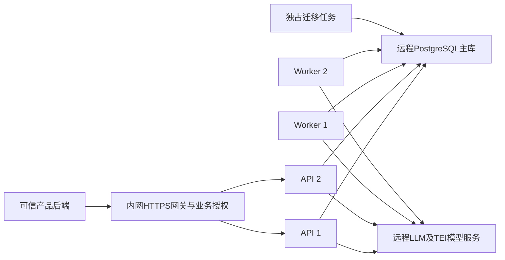

# Hindsight生产环境部署Handbook

适用日期：2026-11-18。固定Hindsight源码为 [`b92ceb180e349a456d2b5454575067b6ff0f6306`](https://github.com/vectorize-io/hindsight/tree/b92ceb180e349a456d2b5454575067b6ff0f6306)，API-slim 1.2.1。面向将数据库和模型服务远程化、分离API与worker，并准备多实例发布的研发和运维人员。

**Hindsight原版已支持共享PostgreSQL、独立worker及多个API实例。** 它不需要先做Mem0式的SQLite history/messages迁移；但部署拓扑成立不代表故障接管、幂等计费、业务授权或完整遗忘已经通过验收。本手册及模板是生产候选材料，本轮没有构建镜像、连接数据库、部署服务或调用模型。[运行服务][services]、[持久队列][worker-poller]。

单机入门见[自部署Handbook](hindsight-self-hosted-deployment.md)，业务宿主接入见[agent-service Handbook](hindsight-agent-service-integration.md)。本页不修改[MemoryService合同](../spec-v1/README.md)，也不交付新的Runtime或Hindsight引擎功能。

## 1 主线拓扑与支持范围

主线使用远程PostgreSQL 17主库及pgvector、PGroonga，远程LLM与两个TEI服务，API和worker使用同一固定镜像。先部署一个API和一个worker完成验收，再增加第二组实例。Control Plane不在主线，Redis、Kafka和独立图数据库也不是这条部署路线的必需依赖。



| 组件 | 主线选择 | 需要保持的边界 |
|---|---|---|
| 数据库 | 远程PG17主库、专用库/schema、pgvector与PGroonga | 数据、事实关系、配置、异步任务共用权威主库；不以本地pg0替代 |
| API | 每容器一个`hindsight-api`，关闭内置worker和启动迁移 | 无状态请求处理可复制；每进程仍有连接池、缓存及后台维护 |
| worker | 独立`hindsight-worker`，明确唯一稳定ID | 共享PG领取任务；硬崩后换身份不自动证明旧processing任务已回收 |
| 抽取/生成 | 远程OpenAI或已受控的兼容模型服务 | retain、reflect和归纳费用独立于主Agent；不把网关超时当未计费 |
| embedding | 独立TEI、固定BGE-M3 revision、1024维 | 全部实例使用同一表示空间，启动会发送探测embedding |
| reranker | 独立TEI、固定中文可用模型revision | 与embedding是不同服务；模型和推理参数分别登记 |
| 网关 | 已有HTTPS入口、健康摘除、请求/并发限额及可信owner映射 | 不把共享API key交给浏览器或任意Agent，不对变更请求自动重试 |
| 文件/界面 | native数据库存储，上传API先关闭；不部署Control Plane | 后续S3、附件、MCP或界面须增加相应持久化和准入验收 |

托管PG未提供PGroonga时，应在选型阶段确认扩展政策。可改为支持中文tokenizer的pg_search并重新验证索引、迁移和中文质量，或使用自管数据库；不能把默认native英文词法当成等价中文BM25。pgvector并不提供PGroonga，安装一个扩展不会得到另一个扩展。[中文后端][multilingual]、[检索说明][retrieval]。

主线不配置`READ_DATABASE_URL`，也不在应用和数据库之间先加transaction-mode pooler。读副本延迟可能影响来源更正、删除和操作核对；PgBouncer等池化会改变session设置、advisory lock和DDL行为。确需启用时，单独验证真实路径，并将迁移URL指向直连主库。[PG连接实现][pg-backend]、[迁移锁][migrations]。

## 2 准备远程数据库及TLS

需要已有Docker/Compose v2宿主、私有镜像仓库、受控网络与HTTPS网关；DBA环境需兼容PG17的psql、pg_dump、pg_restore。数据库DNS必须与证书一致，应用/worker/迁移宿主均需能够解析并连接。记录PG补丁版本、扩展版本、证书、备份和故障切换责任，不将“PG17”视作完整版本锁定。

由DBA为**全新专用环境**准备以下对象。密码交互设置，不写进SQL或命令参数：

```sql
\set ON_ERROR_STOP on
CREATE ROLE hindsight_service LOGIN;
\password hindsight_service
CREATE DATABASE hindsight_prod OWNER hindsight_service;
REVOKE ALL ON DATABASE hindsight_prod FROM PUBLIC;
GRANT CONNECT ON DATABASE hindsight_prod TO hindsight_service;
\connect hindsight_prod
CREATE EXTENSION IF NOT EXISTS vector;
CREATE EXTENSION IF NOT EXISTS pgroonga;
REVOKE CREATE ON SCHEMA public FROM PUBLIC;
CREATE SCHEMA hindsight AUTHORIZATION hindsight_service;
```

示例以专用非超级用户作为应用schema及表的owner。运行时会按bank惰性建立向量索引，不能仅授予已有表的SELECT/INSERT/UPDATE/DELETE就宣称可运行。迁移步骤独占并不意味着运行角色已经纯DML化；如组织要求严格分离迁移owner与运行角色，须先完成动态DDL/索引的预建、授权和回归，必要时调整引擎。不要为绕过权限问题授予数据库超级用户。[bank索引创建][bank-ddl]、[迁移入口][migration-cli]。

样例使用无密码DSN，并明确指定CA与passfile：

```text
postgresql://hindsight_service@pg-primary.example.invalid:5432/hindsight_prod?sslmode=verify-full&sslrootcert=/etc/hindsight/postgres-ca.pem&passfile=/etc/hindsight/postgres.pgpass
```

这是保留域名示例，不能直接连接。`postgres.pgpass`由秘密管理流程提供，内容为`host:port:database:user:password`，Unix权限0600且容器UID 1000可读；密码中的冒号或反斜杠按pgpass规则转义。主线DSN不带password，避免固定worker启动横幅打印完整URL时把数据库密码带入日志。API key、模型key、证书私钥等同样不放进URL。[worker启动日志][worker-main]、[asyncpg连接参数][asyncpg-api]、[密码文件][pgpass]。

运行连接由asyncpg处理，迁移由SQLAlchemy/psycopg2处理；两条路径都要验证`verify-full`、CA和passfile。迁移代码支持独立`HINDSIGHT_API_MIGRATION_DATABASE_URL`并规范化PG URL；不能仅验证psql成功就认定应用连接也采用同样TLS策略。[PG运行连接][pg-backend]、[迁移URL转换][migrations]、[PG证书校验][pg-ssl]。

## 3 固定镜像及准备发布目录

采用[生产模板](examples/hindsight/production/README.md)中的Compose及配置样例。部署目录与源码目录分开，运行宿主只拉固定镜像，不挂源码、不在启动时pip安装。已有目录、私有配置或数据应先检查，不覆盖。

在构建环境使用新checkout，并在任何私有配置进入目录之前完成构建。源码准备可复用[单机手册§3](hindsight-self-hosted-deployment.md#3-固定源码并复制模板)的拒绝覆盖方式，将源码固定到本页commit。生产构建选`api-only`，不包含界面和本地ML依赖：

```sh
(
set -eu
git rev-parse HEAD
test "$(git rev-parse HEAD)" = b92ceb180e349a456d2b5454575067b6ff0f6306
docker build --file docker/standalone/Dockerfile --target api-only \
  --build-arg INCLUDE_LOCAL_MODELS=false --build-arg PRELOAD_ML_MODELS=false \
  --tag registry.example.invalid/ai/hindsight:b92ceb1 .
docker push registry.example.invalid/ai/hindsight:b92ceb1
docker buildx imagetools inspect registry.example.invalid/ai/hindsight:b92ceb1
)
```

命令中的仓库地址须替换为自己的私有仓库。将仓库返回的完整`repo@sha256:digest`填入生产`.env`，API、worker、迁移任务使用相同digest。构建保留上游uv/npm锁文件，但基础镜像tag、系统仓库等仍可能变化；发布时另保存基础镜像digest、依赖/SBOM、源码及模型revision，不能把固定Git当成完全可重现构建。[上游Dockerfile][dockerfile]。

模板以命令覆盖上游`/app/start-all.sh`，API/worker直接运行对应CLI，迁移运行admin CLI；不再从standalone同时拉起界面或内置数据库。上游镜像已把CLI加入PATH，默认用户是`hindsight`、UID1000。运行根目录可只读，保留临时目录；主线没有本地SQLite或必须共享的模型cache卷。[镜像运行段][dockerfile]。

## 4 配置远程模型和各实例

部署目录包含非秘密`.env`、Compose和`private/`。由安全配置流程提供runtime、migration环境文件及两份passfile，所有私有文件不提交Git；不要用shell `source`加载秘密。CA只读挂载，passfile0600/UID1000可读，环境文件和curl凭证同样受保护。准确路径及拒绝覆盖的准备命令以[样例说明](examples/hindsight/production/README.md)为准。

| 配置 | 候选值/规则 |
|---|---|
| `HINDSIGHT_API_DATABASE_URL` | 上节无密码、verify-full的主库DSN |
| `HINDSIGHT_API_DATABASE_SCHEMA` | `hindsight`，所有实例完全一致 |
| `HINDSIGHT_API_MIGRATION_DATABASE_URL` | 原版可选直连迁移URL；样例留空，migrate通过自己的DATABASE_URL及独立passfile连接主库 |
| `HINDSIGHT_API_VECTOR_EXTENSION` / `TEXT_SEARCH_EXTENSION` | `pgvector` / `pgroonga`，与DBA预装一致 |
| `HINDSIGHT_API_RUN_MIGRATIONS_ON_STARTUP` | API和worker均false；独立migrate任务执行 |
| `HINDSIGHT_API_WORKER_ENABLED` | API为false，专用worker通过CLI启动；不靠复制API顺便起worker |
| `HINDSIGHT_API_SKIP_LLM_VERIFICATION` | true，只跳过启动生成LLM验证 |
| `HINDSIGHT_API_DB_POOL_MIN_SIZE` / `MAX_SIZE` | 显式小池起步，如1/10；依据容量实测调整 |
| `HINDSIGHT_API_WORKER_MAX_SLOTS` | 显式限制每worker并发；全部worker与模型端限流共同核算 |
| `HINDSIGHT_API_WORKER_CONSOLIDATION_RESERVED_SLOTS` | 样例0；配合总槽2保留普通任务共享槽，不能沿用默认归纳预留2而占满总池 |
| `HINDSIGHT_API_BANK_INFO_CACHE_TTL_SECONDS` | 候选基线0；若保留默认缓存，必须记录跨实例传播时限 |
| `HINDSIGHT_API_TENANT_EXTENSION` / `TENANT_API_KEY` | 内置共享Bearer key或已验证tenant扩展；共享key不自动绑定业务owner |
| `HINDSIGHT_API_EMBEDDINGS_PROVIDER` / `EMBEDDINGS_TEI_URL` | `tei`及受控私网TEI地址；固定BGE-M3、1024维及其revision |
| `HINDSIGHT_API_RERANKER_PROVIDER` / `RERANKER_TEI_URL` | `tei`及另一个reranker TEI地址；不是embedding服务同一模型 |
| `HINDSIGHT_API_DECISION_MODEL_PROVIDER` | none起步，后续启用另验成本和行为 |
| 观察、文件与日志能力 | 初始归纳关闭、上传关闭、native存储、LLM trace关闭；按明确能力另启用 |
| `HINDSIGHT_API_OPERATION_RETENTION_DAYS` | 样例30天，仅为留存策略示例；超出保留期的not_found不证明未执行 |

远程TEI不是任意OpenAI兼容接口：embedding客户端会访问`/info`及`/embed`，reranker访问`/info`与`/rerank`。固定版本的TEI客户端没有一个通用`TEI_API_KEY`配置；主线使用受控私网端点和正确TLS信任。需要Bearer、私有CA或mTLS时，应按实际客户端和网关方案配置并验收；若原版无法传递所需凭证，应补受控适配，不能发明环境字段。[TEI embedding][embedding]、[TEI reranker][reranker]。

`SKIP_LLM_VERIFICATION=true`不等于启动完全不推理：API/worker初始化TEI embedding会发送`inputs:["test"]`探测维度，reranker会读模型信息。模型服务应先准备好，启动阶段也要有预算、容量及出网许可。健康请求本身不发新增模型请求，但不能抹去启动已发生的探测。[TEI初始化][embedding]、[启动验证][engine-init]。

Compose宿主环境可覆盖`.env`插值；Hindsight CLI又会搜索`.env`并用文件覆盖环境。模板不把部署`.env`挂进容器工作目录；发布前按样例检查镜像digest、路径、文件权限及环境覆盖，不打印完整`compose config`、`docker inspect`或环境文件。所有实例保持同一模型/表示/词法和策略版本，bank持久覆盖另行核对。[配置加载][config]。

## 5 独占迁移与最小启动

以下命令在生产部署目录执行，仅供以后实施；保持失败即停。先按样例README确认全新部署命名、镜像digest和私有文件，再检查离线配置并拉取镜像：

```sh
(
set -eu
docker compose config --quiet
docker compose --profile migration pull migrate api-1 worker-1
)
```

随后在同一镜像与实际环境中做只读DB探测。两种driver在runtime及migration配置下分别检查TLS；这里只输出连接标签，失败时不回显连接串或底层异常正文，不初始化记忆引擎或模型：

```sh
(
set -eu
for HINDSIGHT_DB_PROBE_SERVICE in api-1 migrate; do
  printf '%s\n' "$HINDSIGHT_DB_PROBE_SERVICE"
  docker compose --profile migration run --rm --no-deps -T "$HINDSIGHT_DB_PROBE_SERVICE" python - <<'PY'
import asyncio
import os
from urllib.parse import parse_qs, urlsplit
import asyncpg
from sqlalchemy import create_engine
from sqlalchemy.pool import NullPool
from hindsight_api.db_url import to_libpq_url

query = "SELECT ssl FROM pg_stat_ssl WHERE pid = pg_backend_pid()"
try:
    dsn = os.environ["HINDSIGHT_API_DATABASE_URL"]
    parsed = urlsplit(dsn)
    options = parse_qs(parsed.query)
    if parsed.password is not None or options.get("sslmode") != ["verify-full"]:
        raise ValueError("Expected password-free verify-full URI")
    if not options.get("sslrootcert") or not options.get("passfile"):
        raise ValueError("CA and passfile are required")
    async def check_asyncpg():
        connection = await asyncpg.connect(dsn, timeout=10)
        try:
            if await connection.fetchval(query) is not True:
                raise ValueError("TLS is required")
        finally:
            await connection.close()
    asyncio.run(check_asyncpg())
    engine = create_engine(to_libpq_url(dsn), poolclass=NullPool)
    try:
        with engine.connect() as connection:
            if connection.exec_driver_sql(query).scalar() is not True:
                raise ValueError("TLS is required")
    finally:
        engine.dispose()
except Exception:
    raise SystemExit("Database probe failed; inspect privately, no URI or credential printed.") from None
print("asyncpg and psycopg2 TLS connections succeeded; no credential printed.")
PY
done
docker compose --profile migration run --rm --no-deps migrate
)
```

真实管理命令是`hindsight-admin run-db-migration --schema hindsight --embedding-dimension 1024`，模板把它放在migrate服务。首次必须正常运行扩展/索引reconcile；不要为了快而直接加`--skip-extension-reconcile`。迁移有schema advisory lock，但主线仍由部署任务独占执行，先停写/备份并确认版本兼容，再迁移；失败不启动新API或worker。[管理命令][migration-cli]、[迁移锁及直连URL][migrations]。

migrate只运行指定schema的CLI、不提供HTTP；模板在该服务中清空tenant扩展，避免为单schema迁移加载共享API key扩展。API与worker仍启用认证。以后接自定义tenant、operation validator或自动schema provisioning时，需要按实际扩展重新评审迁移配置，不能把migrate的空扩展复制到API，也不能只迁一个schema便宣称多tenant全部就绪。

进入模型预算阶段后，再启动一组API与worker。以下URL沿用默认18889；若修改`HINDSIGHT_API_1_PORT`，须同步替换URL。管理命令同样沿用默认schema `hindsight`，自定义schema须替换后续CLI中的`--schema`：

```sh
(
set -eu
docker compose up -d --wait api-1
docker compose up -d --wait worker-1
docker compose ps api-1 worker-1
curl --fail-with-body http://127.0.0.1:18889/health/live
curl --fail-with-body http://127.0.0.1:18889/health/ready
)
```

worker健康端口8889只在容器内，使用编排器内部检查或同容器探针；不把它作为用户流量入口。API ready、worker ready、模型探测、数据库TLS、合成业务请求是不同证据。初期仍封闭网关，不让真实owner成为首轮smoke。

无key的bank列表应被拒，有key在受控curl配置中读取，不把key放命令参数。复用[自部署手册§6–8](hindsight-self-hosted-deployment.md#6-创建合成bank并核对生效配置)建立全新合成bank、记录operation UUID/body、retain并只读轮询，再recall。生产样例的归纳开关与生效bank配置应先核对；原operation completed不证明其它归纳/主题刷新或消费者清理完成。

迁移成功也不证明运行角色能创建新bank的部分向量索引，必须在合成bank上验证实际写入/更新/删除。TLS应分别检查asyncpg运行连接、psycopg2迁移连接的`pg_stat_ssl`，并做错误CA和错误主机名负例；仅看到`ssl=true`不能证明客户端校验了证书身份。不要通过设置`sslmode=require`或关闭证书验证让负例“通过”。[TLS模式][pg-ssl]。

## 6 API与worker横向扩展

模板把第二个API和worker放在scale profile，先显式启动，避免用单一worker ID执行`--scale worker-1=2`：

```sh
(
set -eu
docker compose --profile scale up -d --wait api-2 worker-2
docker compose --profile scale ps
)
```

候选端口18889和18890只绑定本机。网关在同一宿主时可按健康检查分流；网关在另一台机器则需明确私网监听、TLS或受控隧道，不能把另一台机器的127.0.0.1当可达地址。worker不接用户请求，LB只指向API。

生产网关职责是：认证可信后端、强制tenant/owner/project到bank/scope映射、限制请求体和并发、为每次执行保留调用关联、屏蔽管理端点及`/mcp/`。API普通共享key是后台访问凭证，不是每个用户的权限。现有服务端scope扩展应按具体部署核对，不能只在客户端按tag过滤。[认证与scope](hindsight-agent-service-integration.md#3-准备连接-凭证和稳定身份)。

主线只暴露REST白名单，避开默认stateful MCP的会话路由需求。以后开放MCP时，默认stateful模式需要黏性/重连验证；选择`HINDSIGHT_API_MCP_STATELESS=true`会改成POST-only，应重新核对客户端与SSE行为，不能把两个模式混称为无状态等价。[MCP配置][mcp]。

同主机两个API能验证进程级扩展，不能证明宿主故障可用性。多主机部署将各节点loopback替换为明确受控网络，每台部署同digest、证书和配置，各worker使用全局唯一ID，再接外部LB。生产HA还需要数据库故障切换、模型服务冗余、节点/区域故障预算和实际演练；Compose profile不会自动创建这些能力。

### 6.1 连接池与并发预算

DB池按**进程**计数。若API/worker各2个进程、每个主池max10，应用主池上界为40，再加迁移、监控、DBA及其它连接余量。启用read URL还会为每个MemoryEngine增加read pool；增加uvicorn进程也会倍增池，不能只按容器数量计算。[池配置][config]、[PG池实现][pg-backend]。

worker并发、API同步retain、reflect、embedding批次、TEI及LLM供应方并发共同限制吞吐。`WORKER_MAX_SLOTS`不是全局模型限流，多个worker各有自己的槽；不能简单把单实例值乘副本数后承诺线性吞吐。记录DB连接等待、队列积压、运行时长、模型429/503及费用，再调池、slots、API限流和副本数。

预留槽不是通用并发上限：普通任务只使用未被预留的共享池。总槽2同时沿用默认归纳预留2会使retain没有共享槽，即使观察归纳关闭也如此。后续增加预留时必须让总槽仍有共享余量，并验证不同任务类型不会饥饿。[槽位调度][worker-slots]。

### 6.2 配置发布与后台维护

模型名、embedding维度/归一化、词法后端、schema、认证扩展、策略及release版本应一致发布。bank配置是PG持久覆盖，不会因重新部署环境自动消失；应按受控管理接口核对global→tenant→bank的解析结果。候选基线关闭bank info缓存，若改回默认TTL，应把跨进程传播时限写入发布策略。[bank缓存][bank-cache]。

每个API/worker引擎仍可能运行后台maintenance；没有一个通用leader election开关把所有维护集中给某一worker。代码的幂等删除/入队去重能减少冲突，但维护扫描和调度成本随实例/schema增加，需测量并按已支持配置调频。不要把“关闭API内置worker”解释成API不再做任何后台工作。[维护实现][maintenance]。

## 7 worker身份 关闭及故障接管

worker ID是运行身份，不是随每次任务生成的request ID。模板的两个ID必须不同，多主机也不能重复；使用稳定ID才能在重启时识别自身遗留任务。容器随机hostname不是完整的自动故障接管方案。[worker入口][worker-main]。

**再次启动worker或释放processing之前，先核对遗留任务及未知付费结果。** 固定poller启动时会把本worker ID遗留的processing任务按重试上限恢复为pending或failed，并与领取循环并行运行；它没有暂停队列等待人工核对供应方结果的门禁。候选模板因此关闭worker容器自动重启，由受控流程显式启动；外部编排器也须按同一条件放行。运行中的原版重试仍需另验，`restart: "no"`不提供恰好计费一次。[自身任务恢复][worker-recovery]、[恢复与领取并行][worker-start-recovery]。

正常关闭还会回交未完成任务，其它活worker可能随即领取；只停一个worker不能冻结队列。若要求未知付费结果核对前禁止重执行，需要额外的受控消费门禁覆盖所有相关worker及同步API路径，并处理在途调用；逐个stop、稳定ID或admin释放都不等于原子冻结。这部分属于待开发/验收能力。[关闭回交][worker-release]。

| 场景 | 操作与证明 |
|---|---|
| 正常缩容 | 先从入口降低写入/排队量，SIGTERM并等待drain和退出，记录仍在处理的operation |
| 原进程重启 | 确认旧进程已停止，先核自身遗留任务及未决收费，再复用稳定ID启动；仍未知时保持隔离 |
| 硬崩且ID丢失 | 确认旧进程在任何节点都不再运行，核对未决模型结果后，再按受控恢复决定是否释放其processing任务 |
| DB/模型短暂故障 | 保留原operation，不盲换UUID；区分排队、重试等待、失败终态及未决费用 |
| 主机被网络隔离 | 先隔离/停止旧worker，不能仅凭健康超时把同一任务交给第二个活进程 |

正常关闭示例：

```sh
docker compose stop --timeout 120 worker-2
docker compose --profile migration run --rm --no-deps migrate \
  hindsight-admin worker-status --schema hindsight
```

确认旧worker确已终止、未决模型结果已核对且允许重执行后，使用其**实际稳定ID**释放遗留任务：

```sh
docker compose --profile migration run --rm --no-deps migrate \
  hindsight-admin decommission-worker prod-host-a-worker-2 --schema hindsight --yes
```

命令会把该worker的processing任务重置回pending，属于写操作并可能导致模型任务再次执行，不是只读状态查询。不要在旧worker仍活着时释放；也不要用`decommission-workers --yes`作为日常恢复，它会释放所有worker的任务，包括健康实例的任务。[worker管理CLI][worker-admin]。

SIGTERM和drain降低重复处理风险，但外部模型调用的结果可能已产生、尚未可靠记录。队列认领、同bank串行或operation重放均不提供供应方恰好计费一次。unknown应保留请求body、operation/子任务、attempt及账单证据，并通过受控恢复处理；不能用新UUID或retry端点掩盖未决结果。

原版已有取消和重试操作：取消可以标记pending/processing，但跨worker在后续检查点协作退出，不能撤回已经发生的模型调用；失败分类、限流、延后和重试预算各有路径，不能概括为任何异常都自动重试三次。取消、重试及终态operation清理分别记录，不把删除operation行视为删除来源记忆。[取消与重试实现][operation-control]。

## 8 备份 恢复及升级

远程PG备份应覆盖schema、来源、事实、观察/主题、bank配置、异步operation及其payload、控制/授权数据，并记录扩展版本。native文件在DB内；以后启用S3等外部对象存储，必须增加对象版本、删除标记及一致性恢复。模型权重和镜像可以重取，但当前删除/撤权控制与来源依据不能用cache代替。[存储模型][models]。

DBA使用平台PITR或停写一致性备份。若采用手动逻辑备份，先停止外部写入者、所有API/worker及其它维护/调度，再由DBA使用兼容PG17的客户端执行。下面假定DBA已建立名为`hindsight-production-backup`的libpq service配置，内含正确数据库、verify-full及CA/passfile路径，不在命令行放密码；输出目录由DBA选择为受保护且尚不存在的位置：

```sh
export HINDSIGHT_BACKUP_DIR=/absolute/protected/backups/hindsight-release-001
(
set -eu
umask 077
mkdir "$HINDSIGHT_BACKUP_DIR"
pg_dump --dbname='service=hindsight-production-backup' --format=custom \
  --file="$HINDSIGHT_BACKUP_DIR/database.dump.partial"
mv "$HINDSIGHT_BACKUP_DIR/database.dump.partial" "$HINDSIGHT_BACKUP_DIR/database.dump"
sha256sum "$HINDSIGHT_BACKUP_DIR/database.dump" > "$HINDSIGHT_BACKUP_DIR/SHA256SUMS"
touch "$HINDSIGHT_BACKUP_DIR/EXPORT_COMPLETED"
)
```

目录已存在或任何命令失败即停止。完成标记只代表导出及摘要命令成功，不证明恢复可用；数据库备份、libpq service/passfile及证书分别按安全流程保管，业务密钥不与公开交付材料混存。

跨系统恢复还需要App journal、source/document映射和本项目独立控制日志，不能只恢复Hindsight数据库便开放Agent召回。为隔离新库恢复准备同版本PG/扩展和相同schema，API/worker保持关闭，先补当前删除/撤权及应抑制内容，再核operation/预算和数据摘要。备份中的pending/processing可能在worker启动后再次产生模型费用。

生产升级顺序为：冻结发布manifest与bank覆盖→停止新写入及网关重试→排空或记录在途任务→停止全部API/worker及维护→备份→独占迁移→启动封闭API/worker→合成/故障验证→逐步放量。数据库迁移不保证可逆；已经改变schema/embedding/索引后，不能仅将镜像tag改回旧版作为回退。使用隔离副本验证恢复和回退边界，禁止用删除卷或重建空库掩盖失败。

文档删除会处理来源和相关观察，但operation payload、trace、自动主题、Host历史、工具结果、递归摘要、缓存和备份有不同生命周期；终态operation默认无固定TTL上限。按保留政策配置和验证，并将逻辑不可交付、物理清理、消费者ACK和恢复防复活分别记录。[删除及主题处理](../../research/hindsight-design-review.md#5-接入和生命周期需要逐项核验)、[operation保留][operations]。

## 9 已有支持与待开发边界

| 能力 | 固定原版状态 | 上线前仍需完成 |
|---|---|---|
| 远程PG与共享状态 | 已有，包含任务队列；非SQLite history/messages路线 | TLS、扩展、权限、备份及故障切换实测 |
| API/worker分离 | 已有CLI与内置/独立worker配置 | 独立资源预算、健康、关闭和恢复编排 |
| 多worker认领和串行 | 已有PG任务claim及相关串行键 | 同bank并发/部分提交/模型unknown故障测试 |
| 多API共享读取 | 已有服务架构 | 配置传播、bank首次创建、滚动混版本和连接预算验证 |
| 硬崩worker回收 | 有稳定ID恢复与admin释放操作 | 旧进程隔离、身份编排及受控接管；不能只靠超时自动抢任务 |
| 未知付费结果隔离 | 启动恢复、停止回交及运行中重试可能继续执行任务 | 跨worker/同步API消费门禁、供应方结果核对及attempt预算；关闭容器自动重启仅是运维前置 |
| 多租户/域权限 | 有扩展点及服务端scope | 我方可信owner/主体/域/grant映射与全部读取/工具出口校验 |
| 严格迁移/运行角色分离 | 不能仅用纯DML授权保证全部运行路径 | 动态DDL/索引预建、权限验收，必要时修改引擎 |
| 远程TEI鉴权 | stock TEI客户端不是任意Bearer/mTLS网关客户端 | 与网络/TLS架构对齐，缺能力时补受控适配 |
| 日志秘密保护 | worker会输出配置URL；主线使用无密码DSN/passfile | 其它错误、模型URL、header、正文与trace脱敏检查，必要时修日志 |
| 完整删除及恢复门禁 | 原版删除机制不等同我方full_lifecycle | 自有控制日志、来源闭包及Host validate/changes/ACK/reset实现 |
| 完整HA/SLO | 模板未提供已验收结论 | DB/LB/模型/节点故障、容量、费用、恢复与生产准入证据 |

## 10 后续验收顺序

先做离线检查和DB验证，再进入模型预算阶段。每份报告绑定同一镜像、配置、模型、数据版本和拓扑：

1. 镜像digest、CLI入口、非root、只读根目录、端口、私有文件及同名环境覆盖检查。
2. PG运行与迁移两条连接的正反TLS、passfile权限、扩展、schema及动态建bank/索引权限。
3. 单API/worker下合成retain、原UUID核对、recall、更新/删除及重启，不把样例成功当中文验收。
4. 多API/multiworker下并发同bank、部分提交、配置更新、模型限流/未知、SIGTERM、硬崩和重复ID拒绝。
5. DB故障切换、LB摘除、worker接管及隔离恢复，验证旧内容与旧任务不会无授权重新交付或盲目计费。
6. 按现行D1–D4及真实声明能力完成中文收益、总成本、容量和消费者生命周期验证。

本轮只完成候选文档与静态核对；没有运行上述部署、数据库或模型步骤。模板、进程健康和多实例示意分别证明不同范围，均不能代替生产验收。

[services]: https://github.com/vectorize-io/hindsight/blob/b92ceb180e349a456d2b5454575067b6ff0f6306/hindsight-docs/docs/developer/services.md
[worker-poller]: https://github.com/vectorize-io/hindsight/blob/b92ceb180e349a456d2b5454575067b6ff0f6306/hindsight-api-slim/hindsight_api/worker/poller.py
[worker-slots]: https://github.com/vectorize-io/hindsight/blob/b92ceb180e349a456d2b5454575067b6ff0f6306/hindsight-api-slim/hindsight_api/worker/poller.py#L575
[worker-recovery]: https://github.com/vectorize-io/hindsight/blob/b92ceb180e349a456d2b5454575067b6ff0f6306/hindsight-api-slim/hindsight_api/worker/poller.py#L1657
[worker-start-recovery]: https://github.com/vectorize-io/hindsight/blob/b92ceb180e349a456d2b5454575067b6ff0f6306/hindsight-api-slim/hindsight_api/worker/poller.py#L1957
[worker-release]: https://github.com/vectorize-io/hindsight/blob/b92ceb180e349a456d2b5454575067b6ff0f6306/hindsight-api-slim/hindsight_api/worker/poller.py#L1711
[multilingual]: https://github.com/vectorize-io/hindsight/blob/b92ceb180e349a456d2b5454575067b6ff0f6306/hindsight-docs/docs/developer/multilingual.mdx
[retrieval]: https://github.com/vectorize-io/hindsight/blob/b92ceb180e349a456d2b5454575067b6ff0f6306/hindsight-docs/docs/developer/retrieval.md
[pg-backend]: https://github.com/vectorize-io/hindsight/blob/b92ceb180e349a456d2b5454575067b6ff0f6306/hindsight-api-slim/hindsight_api/engine/db/postgresql.py#L299
[migrations]: https://github.com/vectorize-io/hindsight/blob/b92ceb180e349a456d2b5454575067b6ff0f6306/hindsight-api-slim/hindsight_api/migrations.py#L412
[migration-cli]: https://github.com/vectorize-io/hindsight/blob/b92ceb180e349a456d2b5454575067b6ff0f6306/hindsight-api-slim/hindsight_api/admin/cli.py#L640
[bank-ddl]: https://github.com/vectorize-io/hindsight/blob/b92ceb180e349a456d2b5454575067b6ff0f6306/hindsight-api-slim/hindsight_api/engine/memory_engine.py#L18198
[worker-main]: https://github.com/vectorize-io/hindsight/blob/b92ceb180e349a456d2b5454575067b6ff0f6306/hindsight-api-slim/hindsight_api/worker/main.py#L247
[asyncpg-api]: https://magicstack.github.io/asyncpg/current/api/index.html#asyncpg.connect
[pgpass]: https://www.postgresql.org/docs/17/libpq-pgpass.html
[pg-ssl]: https://www.postgresql.org/docs/17/libpq-ssl.html
[dockerfile]: https://github.com/vectorize-io/hindsight/blob/b92ceb180e349a456d2b5454575067b6ff0f6306/docker/standalone/Dockerfile#L173
[embedding]: https://github.com/vectorize-io/hindsight/blob/b92ceb180e349a456d2b5454575067b6ff0f6306/hindsight-api-slim/hindsight_api/engine/embeddings.py#L806
[reranker]: https://github.com/vectorize-io/hindsight/blob/b92ceb180e349a456d2b5454575067b6ff0f6306/hindsight-api-slim/hindsight_api/engine/cross_encoder.py#L520
[engine-init]: https://github.com/vectorize-io/hindsight/blob/b92ceb180e349a456d2b5454575067b6ff0f6306/hindsight-api-slim/hindsight_api/engine/memory_engine.py#L6432
[config]: https://github.com/vectorize-io/hindsight/blob/b92ceb180e349a456d2b5454575067b6ff0f6306/hindsight-api-slim/hindsight_api/config.py#L28
[mcp]: https://github.com/vectorize-io/hindsight/blob/b92ceb180e349a456d2b5454575067b6ff0f6306/hindsight-api-slim/hindsight_api/api/mcp.py#L397
[bank-cache]: https://github.com/vectorize-io/hindsight/blob/b92ceb180e349a456d2b5454575067b6ff0f6306/hindsight-api-slim/hindsight_api/engine/bank_info_cache.py
[maintenance]: https://github.com/vectorize-io/hindsight/blob/b92ceb180e349a456d2b5454575067b6ff0f6306/hindsight-api-slim/hindsight_api/engine/maintenance.py
[worker-admin]: https://github.com/vectorize-io/hindsight/blob/b92ceb180e349a456d2b5454575067b6ff0f6306/hindsight-api-slim/hindsight_api/admin/cli.py#L1615
[models]: https://github.com/vectorize-io/hindsight/blob/b92ceb180e349a456d2b5454575067b6ff0f6306/hindsight-api-slim/hindsight_api/models.py
[operations]: https://github.com/vectorize-io/hindsight/blob/b92ceb180e349a456d2b5454575067b6ff0f6306/hindsight-docs/docs/developer/api/operations.mdx
[operation-control]: https://github.com/vectorize-io/hindsight/blob/b92ceb180e349a456d2b5454575067b6ff0f6306/hindsight-api-slim/hindsight_api/engine/memory_engine.py#L22683
