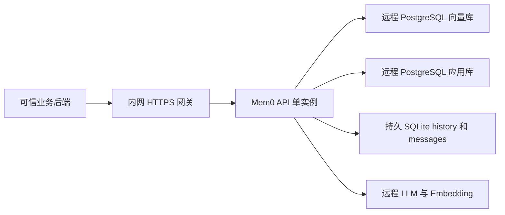

# Mem0 生产环境部署 Handbook

适用日期：2026-11-15。基线为 Mem0 OSS Python 2.2.1，固定源码 commit `f1791daa86d469249c9b002f62644d58a1eb96a0`。面向需要将数据库、模型服务与 Mem0 应用分开部署，并准备高可用或横向扩展的研发和运维人员。

**原版可以连接远程 PostgreSQL／pgvector，但 history 和近期 messages 仍使用 SQLite。** 本文先给出单实例、远程中间件的部署步骤，再说明全部数据库远程化及多实例需要开发的部分。附带模板是生产部署候选材料，未经过镜像构建、远程数据库连接或真实模型验收；不能据此宣称已经具备生产可用性。

入门实验见[单机自托管手册](mem0-self-hosted-deployment.md)，业务接入见[agent-service 接入手册](mem0-agent-service-integration.md)。本文不修改本项目 [MemoryService 合同](../spec-v1/README.md)，也没有交付改造后的 Mem0 引擎。

## 1 部署路线与依赖

| 路线 | 持久化和运行方式 | 适用条件 |
|---|---|---|
| A 原版单实例 | 一个 API 进程，远程 PostgreSQL 保存向量及管理数据，实例侧持久 SQLite | 接受本地应用状态和停机维护窗口；完成本手册验收后自行决定上线 |
| B 全部数据库远程化 | 在 A 上开发 PostgreSQL history/messages 适配，替换 SQLite | 完成第9节存储改造与迁移后，才满足“所有数据库远程部署” |
| C 多实例共享记忆 | 在 B 上补配置发布、写入协调、幂等和故障恢复 | 完成多副本验收后，才允许多个实例共同读写同一用户空间 |

本文 A/B/C 仅为 Mem0 部署路线，与本项目 spec-v1 的发布切片无关。A 不满足“实例可随时销毁、全部状态都在远程数据库”的要求。若这是硬性要求，应先完成 B；不能把 history_db_path 填成 PostgreSQL URL，也不能删除 history/messages 来假装服务无状态。[引擎初始化][memory]、[SQLite 存储][storage]。



| 依赖 | 本文主线 | 说明 |
|---|---|---|
| 向量存储 | 远程 PostgreSQL + pgvector | 正文、metadata、向量及实体 collection；也可另配远程 Qdrant 等 provider |
| Server 应用库 | 远程 PostgreSQL，库名 mem0_app | 账号、key hash、refresh 状态、配置覆盖和请求日志；换向量 provider 不会移除该库 |
| history/messages | A 使用实例侧 SQLite，B/C 迁至远程库 | messages 参与抽取上下文，不只是审计日志 |
| LLM 与 Embedding | 远程模型 API 或独立推理服务 | 模型预算单列；infer:false 仍可能调用 embedding |
| 网关 | 已有负载均衡／反向代理 | TLS、网络准入、业务授权、请求大小、超时和限流 |
| Redis／消息队列 | A 不要求 | C 可按协调方案引入；并非安装后自动获得分布式一致性 |
| Dashboard | 可选，主线不部署 | 本文用 API 初始化；基本功能不需要 Neo4j |

原版默认依赖和 provider 以[官方说明][overview]及[固定 Compose][upstream-compose]为准。两个 PostgreSQL 逻辑库可在同一个远程集群；默认 Server 共用 POSTGRES_HOST/PORT/USER/PASSWORD，向量库名由 POSTGRES_DB、应用库名由 APP_DB_NAME 指定。需要不同集群或角色时须单独装配向量配置及应用库连接，不能假设存在 APP_DB_HOST 配置。[Server 配置][server]、[应用库连接][app-db]。

## 2 准备远程数据库与网络

主线使用常规 Linux Docker 宿主、支持样例字段的 Docker Compose v2、Python 3.10+、私有镜像仓库及已有 TLS 网关；DBA／备份环境另需兼容版本的 psql、pg_dump。先在隔离的预生产环境执行本节。应用服务器只运行 Mem0，数据库由已有数据库平台提供；限定应用到数据库、模型服务的网络访问，并确认 DNS、证书、时间同步和备份责任。数据库采用已验证兼容的 PostgreSQL 与 pgvector 版本，记录实际版本，不把实验镜像 pg17 当成所有远程数据库必须相同的版本。

由 DBA 为全新专用环境创建非超级用户及两个库。以下是交互式 psql 示例，名称与后续 runtime.env 保持一致；不是对已有生产库重复执行的迁移脚本。密码由安全渠道生成并设置，不写进 SQL 文件或命令参数。

```sql
CREATE ROLE mem0_service LOGIN;
\password mem0_service
CREATE DATABASE mem0_vectors OWNER mem0_service;
CREATE DATABASE mem0_app OWNER mem0_service;
\connect mem0_vectors
CREATE EXTENSION IF NOT EXISTS vector;
```

当前 db.py 直接拼接数据库 URL，因此样例采用 URL-safe 数据库密码；任意包含 @、:、/、% 的密码不能未经编码直接套用。需要沿用复杂密码时，先改造 URL 构造为 SQLAlchemy URL.create，并核对 Alembic 的 URL 转义路径，再进行连接验收，不为适配样例擅自轮换已有生产密码。

应用库表由 Alembic 创建；向量库的 collection、实体表及索引由引擎在实际操作中按需创建，不属于同一套 Alembic 迁移。DBA 预装 vector，运行角色还需目标 schema 建表、建索引和读写权限。本文样例使用专用库 owner，不使用数据库超级用户。若要求迁移角色与纯 DML 运行角色分离，须先按固定版本预建全部引擎对象并验证初始化行为，再收紧权限。[Alembic][alembic]、[向量初始化][pgvector-impl]。

两条 PostgreSQL 连接都要验证 TLS。模板统一设置 libpq 的 PGSSLMODE=verify-full 和 PGSSLROOTCERT，CA 只读挂载；POSTGRES_HOST 应为证书覆盖的 DNS 名称。已有持久化 vector_store 覆盖配置如显式指定 sslmode/connection_string，可能覆盖环境默认值，必须一并核对。[libpq 环境变量][libpq-env]、[证书校验][libpq-ssl]。

## 3 构建并固定发布镜像

使用独立的 Mem0 checkout，不在本仓库或已有 agent-service 目录里安装 Mem0。以下从本仓库根目录开始；目标源码目录必须尚不存在。

```sh
export MEM0_EXAMPLES="$(pwd)/docs/handbooks/examples/mem0"
export MEM0_PROD_SOURCE="$HOME/ai-workspace/mem0-production-source"
git clone https://github.com/mem0ai/mem0.git "$MEM0_PROD_SOURCE"
git -C "$MEM0_PROD_SOURCE" checkout f1791daa86d469249c9b002f62644d58a1eb96a0
git -C "$MEM0_PROD_SOURCE" rev-parse HEAD
mkdir -p "$MEM0_PROD_SOURCE/deploy.handbook" "$MEM0_PROD_SOURCE/deploy.production"
cp "$MEM0_EXAMPLES/Dockerfile" "$MEM0_PROD_SOURCE/deploy.handbook/Dockerfile"
cp "$MEM0_EXAMPLES/dockerignore.example" "$MEM0_PROD_SOURCE/.dockerignore"
cp "$MEM0_EXAMPLES/production/compose.yaml" "$MEM0_PROD_SOURCE/deploy.production/compose.yaml"
cp "$MEM0_EXAMPLES/production/.env.example" "$MEM0_PROD_SOURCE/deploy.production/.env.example"
cp "$MEM0_EXAMPLES/mem0-smoke.py" "$MEM0_PROD_SOURCE/deploy.production/mem0-smoke.py"
```

为新 checkout 的 .git/info/exclude 追加以下目录，避免私有配置、数据及备份进入 Git；已有 checkout 先核对并合并，不覆盖其忽略规则。

```text
/deploy.production/.env
/deploy.production/private/
/deploy.production/state/
/deploy.production/backups/
```

在构建环境将镜像推送至自己的私有仓库。替换下面保留域名；它不是可直接使用的仓库。

```sh
cd "$MEM0_PROD_SOURCE"
docker build -f deploy.handbook/Dockerfile -t registry.example.invalid/ai/mem0:f1791daa .
docker push registry.example.invalid/ai/mem0:f1791daa
docker buildx imagetools inspect registry.example.invalid/ai/mem0:f1791daa
```

将 registry 返回的完整 repo@sha256:digest 填入部署 .env 的 MEM0_IMAGE。每次发布记录源码 commit、镜像 digest、pip freeze、基础镜像及依赖清单。复用的 Dockerfile 已固定源码安装和引擎版本，但基础镜像 tag、传递依赖未完全锁定；正式发布流程应锁基础 digest／依赖并保存构建材料。相同源码不保证日后重建得到相同镜像。

Dockerfile 的默认 CMD 包含迁移，生产 Compose **覆盖该 CMD**：迁移独立执行，API 只启动单 worker uvicorn。构建时只对明确复制的代码目录归一可读／可遍历权限，确保严格 umask 的源码 checkout 也能由非 root UID 读取；不对挂载的 private/state 放宽权限。运行期没有 pip install、源码挂载或 reload。[生产样例说明](examples/mem0/production/README.md)。

## 4 配置并启动单实例

生产样例：[Compose](examples/mem0/production/compose.yaml)、[非秘密配置样例](examples/mem0/production/.env.example)。它不启动数据库容器，也不发布数据库端口；API 只绑定宿主 loopback。部署者应确保应用网关与该 loopback 监听在同一宿主；网关在另一台机器时，改为明确的私网监听或受控隧道，同时限制来源，不能直接改成公开暴露。

```sh
cd "$MEM0_PROD_SOURCE/deploy.production"
```

先进入独立 checkout 的 deploy.production 目录，再按样例 README 的全新目录准备命令创建 private/state 并复制 .env.example 为 .env，再填入镜像 digest 和路径；不要把凭证放入这份 Compose 插值文件。凭证单独放在 private/runtime.env，权限0600，交给密钥管理流程分发。模板以非 root UID/GID 10001 运行，state/history 与 state/mem0 必须由这个 UID/GID 写入；数据库 CA 应为该 UID 可读。具体创建命令及变量含义见样例 README。

runtime.env 至少包含下列字段，实际值由安全配置提供，不在聊天、日志或 Git 中回显：

```text
POSTGRES_HOST=远程数据库证书对应的DNS名称
POSTGRES_PORT=5432
POSTGRES_DB=mem0_vectors
APP_DB_NAME=mem0_app
POSTGRES_USER=mem0_service
POSTGRES_PASSWORD=通过安全渠道设置的URL-safe密码
POSTGRES_COLLECTION_NAME=memories
JWT_SECRET=通过安全渠道生成的长随机值
OPENAI_API_KEY=通过安全渠道提供的模型key
ADMIN_API_KEY=
MEM0_DEFAULT_LLM_MODEL=gpt-5-mini
MEM0_DEFAULT_EMBEDDER_MODEL=text-embedding-3-small
REQUEST_LOG_RETENTION_DAYS=30
```

这是字段清单，不是直接可用的 env 文件。采用 Docker dotenv 格式；包含 $ 等字符的值使用单引号字面值并检查解析，不用 shell source 加载秘密。模型可改用其他 provider，但需先按[实验手册组件配置](mem0-self-hosted-deployment.md#8-更换模型或完全本地运行)核对依赖、维度及配置覆盖，不能只更改模型名称。

样例强制 AUTH_DISABLED=false、MEM0_TELEMETRY=false、单 worker，设置 HOME／MEM0_DIR 和持久 history 路径。MEM0_DIR 的 config.json 可能由引擎初始化创建，因此只读根文件系统之外仍需要可写目录。JWT_SECRET、数据库及模型凭证均没有自动 *_FILE 读取约定；若组织要求只以 Secret 文件交付，需增加受控入口将其装配到现有环境或修改配置加载器，不能只挂文件后假设代码会读取。

先按样例 README 校验镜像 digest 并排除 shell 环境对 Compose 配置的覆盖，再在同一部署 shell 中检查配置；不要输出完整 docker compose config 或 docker inspect 环境，其中可能展开秘密。

```sh
cd "$MEM0_PROD_SOURCE/deploy.production"
docker compose config --quiet
docker compose --profile migration pull mem0 migrate
docker compose --profile migration run --rm --no-deps migrate
docker compose up -d mem0
docker compose ps mem0
curl --fail-with-body http://127.0.0.1:18888/auth/setup-status
```

迁移由一个部署任务独占执行，失败就停止发布，不能让多个 API 同时迁移。Alembic 只处理 mem0_app，外置 PostgreSQL 不会自动执行官方 Docker init-db.sh；两个库必须先存在。API 启动创建 Memory/provider 客户端和 SQLite；pgvector collection 在实际向量操作中按需建立，实体存储也惰性初始化。单独迁移或 setup-status 成功不等于向量库就绪。尚无账号时 setup-status 应为 needsSetup:true；创建首个管理员账号后为 false，单纯启动 API 不会关闭注册。

## 5 初始化认证与配置网关

首次管理员初始化只允许在受控 loopback／SSH 隧道中进行。可按[实验手册初始化步骤](mem0-self-hosted-deployment.md#5-构建启动和首次设置)临时运行同版本 Dashboard；或由受控客户端依次调用以下已有 API：

1. GET /auth/setup-status，只有 needsSetup=true 才执行首次注册。
2. POST /auth/register，提交 name、email、password，得到 access_token；首次账号成为管理员。
3. 用该 access_token 作为 Bearer 调用 POST /api-keys，提交 label，取回仅显示一次的 key。
4. 将 key 存进可信业务后端的秘密存储，确认 setup-status=false，再开放网关准入。

密码通过交互输入或秘密存储读取，不出现在命令参数；token/key 不写普通请求日志。注册／创建 key 超时后先核对账号和 key 状态，不自动重试或重新初始化数据库。该认证流程不调用模型。不要运行会打印管理员密码和 key 的 seed.sh，也不要通过向导 Generate instructions 或 Run Test 来做无费用健康检查。[认证路由][auth-router]、[API key 路由][keys]。

对首次空环境，可以在 API 宿主上使用下面的交互式客户端；它不回显密码、token 或 key，也不调用模型。目标 key 文件须尚不存在。先停止终端录制／HTTP正文采集，并确保只有自己的管理员能访问注册入口。

```sh
python3 - <<'PY'
import getpass
import json
import os
from pathlib import Path
from urllib.error import URLError
from urllib.request import Request, urlopen

base = 'http://127.0.0.1:18888'
console_in = open('/dev/tty', 'r')  # 无交互终端时停止，不退回管道读取秘密
console_out = open('/dev/tty', 'w')

def ask(prompt):
    console_out.write(prompt)
    console_out.flush()
    value = console_in.readline()
    if not value:
        raise EOFError('No interactive input')
    return value.strip()

target = Path('private/agent-service-mem0.key')
fd = os.open(target, os.O_WRONLY | os.O_CREAT | os.O_EXCL, 0o600)

def call(path, payload=None, token=None):
    headers = {'Content-Type': 'application/json'}
    if token:
        headers['Authorization'] = 'Bearer ' + token
    body = None if payload is None else json.dumps(payload).encode()
    with urlopen(Request(base + path, data=body, headers=headers), timeout=30) as response:
        return json.load(response)

with os.fdopen(fd, 'w') as output:
    try:
        if call('/auth/setup-status')['needsSetup'] is not True:
            raise SystemExit('已有账号；使用已有管理员登录管理，不重新注册。占位key文件保持为空。')
        name = ask('Admin display name: ')
        email = ask('Admin email: ')
        password = getpass.getpass('Admin password from secret manager: ', stream=console_out)
        token = call('/auth/register', {'name': name, 'email': email, 'password': password})['access_token']
        created = call('/api-keys', {'label': 'agent-service-production'}, token)
        key = created['key']
        if not isinstance(key, str) or not key or '\n' in key or '\r' in key:
            raise ValueError('Malformed key response')
        output.write(key + '\n')
        output.flush()
        os.fsync(output.fileno())
    except (URLError, OSError, ValueError, KeyError, EOFError):
        raise SystemExit('初始化未完成，服务端结果可能已提交；保留占位文件并核对账号/key，不盲重试。') from None
print('Key saved to the private file; no credential was printed.')
PY
```

若失败，可能已经注册成功或创建了 key。先通过已有账号登录核对／撤销不再使用的 key，再受控创建新 key；空占位文件不是有效凭证，也不能通过删除数据库来恢复。成功后把 key 交给业务后端的秘密管理流程，避免在宿主保留无管理的副本。

网关至少需要实施：仅允许可信后端访问；按已认证的 tenant/user/project 强制映射 Mem0 user_id 等 scope；限制请求大小、并发、频率及最长执行时间；屏蔽业务调用者访问 /configure、账号和 key 管理端点；避免记录 Authorization、X-API-Key、完整请求正文。管理员 key 的标签不会把它绑定到某个业务 user_id，不能向浏览器或不可信 Agent 下发通用 key。

网关超时不能证明 add 没有生效，尤其不能配置对 POST /memories、PUT／DELETE 的无条件自动重试。调用方须保存稳定的业务写任务及结果，未知结果先核对；Mem0 metadata 中放 request_id 不会自动产生幂等保证。模型调用费用、后台写入积压和服务请求超时要分别处理。[写入机制与未知结果](mem0-agent-service-integration.md#54-独立写回mem0)。

如另部署 Dashboard，使用独立管理域名和准入规则。API 与 Dashboard 设置同一个 HTTPS DASHBOARD_URL；API_INTERNAL_URL 从 Dashboard 容器指向实际可达的 API。保留官方镜像的 entrypoint 才能沿用其 NEXT_PUBLIC 配置替换逻辑。同域反代不能把 Mem0 API 直接占用 Dashboard 自己的 /api/* 路由，尤其 /api/auth/refresh。[刷新 cookie][refresh-cookie]、[Dashboard 入口][dashboard-entrypoint]。

## 6 分层验收

先完成无模型检查，再在具名的合成 owner 和独立预算内做写入／检索验收。不要使用真实业务用户做首轮 smoke。

| 检查 | 方法与通过条件 | 不能证明什么 |
|---|---|---|
| 配置与进程 | 镜像 digest、非 root、只读根目录、单 worker、端口与目录符合样例 | 数据库和模型均可用 |
| 应用库 | GET /auth/setup-status 成功，账号初始化后注册关闭 | 向量库可用 |
| TLS | 在 app 库和向量库连接分别检查 pg_stat_ssl 的本连接 ssl=true；错误 CA／主机名必须失败 | 仅 ssl=true 不证明已验证证书身份 |
| 向量读取 | 使用有效 key 和专用 owner 做限定 GET /memories | Embedding／LLM 可用 |
| 认证与隔离 | 无凭证被拒；可信后端不能请求其他 owner；管理端点受限 | API key 自带 owner 隔离 |
| 写入与搜索 | infer:false CRUD、infer:true 抽取分别测试，核对原 ID、owner、返回内容和费用 | 无费用、全局幂等或完整擦除 |
| 持久化 | 停写重启后按原 ID 读取，不能重发 add 伪装恢复 | 已完成多节点故障接管 |
| 恢复 | 在隔离目标恢复两个 PG 库、history 与安全配置，再验证 | 可以直接覆盖正在运行的生产库 |

复用[手动检查脚本](examples/mem0/mem0-smoke.py)，它默认只查可达性和认证，--write 才执行合成 CRUD；--write 仍会调用 embedding，必须使用新的 receipt 文件并保存结果。

```sh
python3 mem0-smoke.py --base-url http://127.0.0.1:18888 --key-file private/agent-service-mem0.key
python3 mem0-smoke.py --base-url http://127.0.0.1:18888 --key-file private/agent-service-mem0.key --write --receipt-file private/smoke-first.json
```

key 文件应由秘密管理流程以0600提供；receipt 目录也要受保护。脚本只验证合成 raw CRUD，不代替 infer:true 的抽取效果。真实抽取验收另按[单机手册](mem0-self-hosted-deployment.md#6-分开验证认证-crud和抽取)记录输入、返回 memory IDs、模型版本、延迟和费用。若写入结果未知，保留 receipt，停止自动重试。

在部署目录中，可先运行下面的无模型双库探测。它用与迁移相同的镜像、运行环境和 CA，应用库走实际 db.py 连接，向量库核对环境默认连接；只输出连接标签、TLS 状态和服务端版本，不打印凭证或连接串。若已通过 /configure 覆盖向量连接，还须另核对该 provider 的真实生效连接，此命令不读取并验证那些覆盖值。

```sh
docker compose --profile migration run --rm --no-deps -T migrate python - <<'PY'
import os
import psycopg
from db import engine

query = "SELECT current_setting('server_version_num'), ssl FROM pg_stat_ssl WHERE pid = pg_backend_pid()"
label = 'app'
try:
    with engine.connect() as connection:
        row = connection.exec_driver_sql(query).first()
        if row is None or row[1] is not True:
            raise ValueError('TLS is required')
        print('app: TLS=on, server_version=' + row[0])
    label = 'vector-default'
    with psycopg.connect(
        host=os.environ['POSTGRES_HOST'], port=os.environ['POSTGRES_PORT'],
        dbname=os.environ['POSTGRES_DB'], user=os.environ['POSTGRES_USER'],
        password=os.environ['POSTGRES_PASSWORD'], connect_timeout=10,
    ) as connection:
        row = connection.execute(query).fetchone()
        if row is None or row[1] is not True:
            raise ValueError('TLS is required')
        print('vector-default: TLS=on, server_version=' + row[0])
except Exception:
    raise SystemExit(label + ': database/TLS probe failed; inspect private configuration') from None
finally:
    engine.dispose()
PY
```

API 没有可直接使用的 /api/health；Dashboard 的同名健康端点只检查其自身响应。生产存活检查、数据库就绪检查与具名模型探测要分开；不能用反复写入或搜索来充当零费用 liveness。TLS 正反例和网络故障应在预生产独立任务／环境中执行，不修改生产实例的 CA 来试错。

## 7 备份与恢复

A 路线备份范围为：整个向量数据库（包括 payload、实体和实际存在的相关 collection）、整个 mem0_app 数据库、完整 state/history 目录，以及发布 manifest。state/mem0 中的实例配置也一并归档。JWT、模型凭证、API key 明文和 CA 的恢复由独立秘密管理流程负责，发布 manifest 只保存秘密引用。注意 mem0_app 的 Settings 可能持久化通过 /configure 提交的模型 key 或数据库密码，因此 PG dump 本身仍可能含明文秘密；所有备份制品按敏感数据加密、限权并执行保留／销毁策略，不能当成无秘密文件分享。

由于 PostgreSQL 和 SQLite 没有统一事务，第一版采用停写一致性窗口：先在所有入口阻断写入，等待在飞调用结束并核对 unknown，停止 API 及其他写入进程；记录冻结时点后，分别备份两个 PG 库及本地 state；全部成功后才恢复写入。只有数据库快照或 SQLite 在线 backup API，不能自动提供跨这几套存储的一致快照。下例由具有 state 读取权限的备份账号运行，要求 state 已停止写入，且数据库平台已配置具名的 pg_service／passfile／TLS；不要把密码放在连接串参数中。

```sh
set -e
umask 077
mkdir -p backups
mkdir backups/manual-001
# 已由网关冻结所有写入，并处理在飞请求后执行。
docker compose stop mem0
pg_dump 'service=mem0_vectors_backup' -Fc -f backups/manual-001/vectors.dump.partial
mv backups/manual-001/vectors.dump.partial backups/manual-001/vectors.dump
pg_dump 'service=mem0_app_backup' -Fc -f backups/manual-001/app.dump.partial
mv backups/manual-001/app.dump.partial backups/manual-001/app.dump
tar -czf backups/manual-001/state.tar.gz.partial -C state .
mv backups/manual-001/state.tar.gz.partial backups/manual-001/state.tar.gz
```

目录已存在时 mkdir 失败，不能覆盖已有备份。确认数据库对象范围、文件校验、备份可读性和实际恢复演练后，再启动 API、只读验证并解除网关冻结；中途失败保持停写，不把 partial 文件当成完成。数据库备份角色需覆盖全部相关表；pg_dump 客户端版本须与服务端兼容。本文不提供覆盖现有生产库的恢复命令。

恢复到隔离的新目标，使用与备份兼容的 PostgreSQL／扩展、相同 API 镜像和配置，先恢复两个库及完整 state，保持业务流量关闭。补齐备份之后的删除、撤权及禁止重导入策略，验证宿主历史／摘要／缓存的抑制，再执行只读和合成写入验收，最终切换。Mem0 delete 后 history/messages 与宿主副本的残留不由一次向量删除自动清理。[现有擦除边界](../../research/mem0-focused-research.md#6-自托管的授权可靠性与擦除边界)。

## 8 日常运维与升级

记录请求错误率、add/search 延迟、数据库连接池、SQLite 文件增长与写锁、磁盘、模型限额／费用、unknown 写任务、配置版本和备份恢复结果。应用库 RequestLog 的保留清理由固定版本自带脚本另行安排；只设置 REQUEST_LOG_RETENTION_DAYS 不代表已经有定时任务运行，执行前核对脚本与范围。不要把 history 的无分页输出直接接成无限制监控抓取。

升级按“预生产验证新镜像和迁移 → 冻结写入／排空 → 完整备份 → 一个任务迁移 → 启动单实例 → 无模型检查 → 合成验证 → 放量”执行。若数据库 schema 或向量空间改变，不直接回滚旧镜像连新库；先按兼容性或隔离备份恢复方案处理。模型／embedding 变更需记录模型、维度、距离和 collection，使用新集合重建及比较，避免向同一向量空间混写。

原版 /configure 只更新接收请求的进程并保存覆盖值。A 也应受控使用、核对生效配置；B/C 使用统一版本发布，不在多个副本间随机发送热配置。一个 worker 内仍可能并发处理请求，不能把 --workers 1 当作同用户写入串行或强幂等保证。[配置状态][server-state]。

## 9 多实例改造：完成后再扩大写入副本

**本节是基于固定源码 `f1791daa86d469249c9b002f62644d58a1eb96a0` 的待开发方案，不是现成配置开关。** 原版 Python REST 可以供多台 Agent 远程调用；本手册未改造的部署先保持一个活动 API 实例。单实例、单 worker 也不等于同一用户的完整写入流程已经串行，更不自动提供请求幂等、CAS或跨存储事务。增加容器副本前，应逐项完成下面的共享状态、写入协调及故障验收。

### 9.1 先替换 history/messages 存储，而不是只共享向量库

固定 Python `Memory` 和 `AsyncMemory` 均直接构造 `SQLiteManager(history_db_path)`；`MemoryConfig` 只有该路径，没有可直接选择 PostgreSQL history provider 的选项。SQLite 中的 `messages` 会参与后续抽取，不只是可丢弃的审计日志。各副本各存一份 SQLite 会让最近消息和 history 分裂；把文件放到共享目录也不能替代本节的数据库适配和一致性设计。[同步初始化源码](https://github.com/mem0ai/mem0/blob/f1791daa86d469249c9b002f62644d58a1eb96a0/mem0/memory/main.py#L487)、[异步初始化源码](https://github.com/mem0ai/mem0/blob/f1791daa86d469249c9b002f62644d58a1eb96a0/mem0/memory/main.py#L2195)、[配置对象](https://github.com/mem0ai/mem0/blob/f1791daa86d469249c9b002f62644d58a1eb96a0/mem0/configs/base.py#L29)。

在派生代码中实施以下工作；本节的存储接口名称仅用于说明开发任务，不是上游已经存在的类、表或API：

1. 抽出 history/messages 存储接口，覆盖 `add_history`、`batch_add_history`、`get_history`、`save_messages`、`get_last_messages`、`reset`、`close`，保留 SQLite 实现，并增加经过迁移管理的 PostgreSQL 实现。为服务命名空间、memory身份、授权范围和消息scope明确隔离键及索引；不能用表名或任意调用方字符串冒充授权。
2. 通过统一构造工厂替换**全部四处** SQLite 构造：同步初始化、同步 reset 后重建、异步初始化、异步 reset 后重建，分别在 `main.py:500/2157/2208/3886`。同时检查 `close`、配置重载和异常恢复路径，不能首次启动用PG、reset后悄悄退回SQLite。异步路径目前用 `asyncio.to_thread` 调用同步存储；新实现必须采用线程安全连接池或真正的异步适配，不能在线程间共用一个未经保护的连接。
3. 保持 scope 的现有身份含义及转义规则；近期消息由共享数据库给出一致、有界的窗口，默认仍取最近10条。为新写入增加可核对的scope内顺序及消息身份，追加与窗口维护在数据库事务内完成。不能以不同机器的本地时钟排序替代业务顺序，也不能按文本相同去掉两条真实消息。
4. 为历史记录保留可验证的授权归属。现有 SQLite history 只有 `memory_id` 等字段，迁移时有些已删除memory已无法从向量payload补齐owner；无法证明归属的记录应隔离，不向业务用户开放，不凭正文猜owner。普通删除仍可能按既定保留策略保留history正文；换成PG不自动成为物理擦除功能。
5. 在完成专门设计前，生产网关不开放原版全库 `/reset`。新的存储实现不能把 `reset()` 简单翻译为删除共享PG表；若保留维护重置，必须绑定服务命名空间、停全部写入者、协调所有副本，并覆盖向量、history/messages及实体状态。[现有SQLite接口与表](https://github.com/mem0ai/mem0/blob/f1791daa86d469249c9b002f62644d58a1eb96a0/mem0/memory/storage.py#L11)、[同步reset](https://github.com/mem0ai/mem0/blob/f1791daa86d469249c9b002f62644d58a1eb96a0/mem0/memory/main.py#L2146)、[异步reset](https://github.com/mem0ai/mem0/blob/f1791daa86d469249c9b002f62644d58a1eb96a0/mem0/memory/main.py#L3869)。

**完成标准：** 请求落到任意副本时，相同授权scope获得一致的history和近期消息；sync、async、重启、配置重载及受控维护路径均不回落本地状态，不发生跨命名空间读取或清空。

### 9.2 用停写迁移建立第一份可信共享状态

首轮采用停写迁移，避免边运行边复制 SQLite：

1. 在网关停止新写入，暂停外部写入队列并排空在途请求。已发送而结果未知的模型/embedding调用先登记为未决，不为缩短停机而重新调用。停止旧API后，备份向量库及payload、每个旧实例的完整SQLite文件、APP数据库和安全配置，保存版本与文件摘要。
2. 由一个迁移任务创建PG history/messages结构并导入。保留原history/message ID、memory ID、事件、正文、时间和删除标记；复制重试按稳定原ID及载荷核对，不重新生成ID掩盖冲突，也不按相似文本合并记录。近期消息保留原scope；至少逐scope校验数量、顺序和后续抽取会使用的最近10条窗口。
3. 如果曾经多个副本各写本地SQLite，迁移不是“挑一份文件复制”。先盘点全部副本并核对重复ID及分裂内容；原消息缺少可证明的全局顺序时，用可信宿主journal重建，或经受控决定隔离旧近期窗口。现有相同时间戳的行可能没有可还原的先后，不能编造顺序或宣称恢复了完整上下文。
4. 核对导入前后按scope计数和内容摘要、代表memory的完整history、删除记录及隔离清单。备份中保留而运行时已删除的内容受删除控制约束，不能因迁移重新成为可召回正文。先启动一个改造后的写入实例，验证后再开放第二实例。
5. 切换前明确回退界限。新PG后端尚未接收新写入时，可退回停写快照；**一旦已接受新写入，不能直接启动旧SQLite副本**。应再次停写，通过已实现的逆向迁移或可核对journal完成数据对账；没有这条能力时保持故障状态或向前修复，不承诺一键回退。

现有最近消息保留和读取行为见 [SQLite消息实现](https://github.com/mem0ai/mem0/blob/f1791daa86d469249c9b002f62644d58a1eb96a0/mem0/memory/storage.py#L257)；不能从这些最多10条缓存推定已有完整聊天迁移包。

### 9.3 统一配置、APP数据库与迁移发布

固定server把 `_current_config` 和 `_memory_instance` 保存在进程内。`/configure` 只替换收到该请求的进程实例，虽然覆盖配置另存APP数据库，其余副本不会自动刷新；进程内 `RLock` 也不协调其他进程。[server状态实现](https://github.com/mem0ai/mem0/blob/f1791daa86d469249c9b002f62644d58a1eb96a0/server/server_state.py#L9)。

- 首版多副本优先采用**统一发布、运行期间冻结配置**：网关关闭业务侧 `/configure`，控制面保存配置修订，全部副本使用相同镜像、引擎代码、provider/模型/embedding维度、collection、history后端及命名空间。检查APP数据库里的持久覆盖，防止它压过发布配置。探针新增非秘密的构建/配置修订及schema兼容状态；其接口需要开发，当前health不能证明这些条件。
- 如果保留在线改配置，另开发版本通知、逐副本加载与就绪确认。旧实例先停止新任务，排空使用它的在途请求后才释放连接池；不能在旧请求仍使用时关闭存储。embedding空间或collection变化走有界迁移与切换，不能靠逐台刷新形成混用。
- 所有副本连接同一受控APP数据库，使用一致的JWT秘密与认证策略。API key和refresh token状态不能各存一份；JWT轮换按统一计划执行，避免负载均衡后随机认证失败。现有refresh JTI采用数据库条件更新，但不能据此推定其他记忆操作也已具备CAS。[APP连接配置](https://github.com/mem0ai/mem0/blob/f1791daa86d469249c9b002f62644d58a1eb96a0/server/db.py#L7)、[JWT及refresh实现](https://github.com/mem0ai/mem0/blob/f1791daa86d469249c9b002f62644d58a1eb96a0/server/auth.py#L15)。
- APP及新增history结构的迁移由单个发布任务执行；API副本启动只核验兼容schema后接流量，不让每台同时跑Alembic。migration失败不开放新副本，已有运行版本的回退按schema兼容计划处理。当前容器启动命令需为此调整，不能原样复制多份。

### 9.4 对写入建立持久协调、幂等和版本条件

现有add先查询旧记忆并在内存中比较hash，然后生成新UUID；并发请求可能各自通过检查。update先读取旧payload，再以ID更新，PG实现没有预期版本条件。把vector store和history都放到PG，也不自动把两套独立连接操作变成同一事务。[add去重与写入](https://github.com/mem0ai/mem0/blob/f1791daa86d469249c9b002f62644d58a1eb96a0/mem0/memory/main.py#L1007)、[update执行路径](https://github.com/mem0ai/mem0/blob/f1791daa86d469249c9b002f62644d58a1eb96a0/mem0/memory/main.py#L2052)、[PG更新条件](https://github.com/mem0ai/mem0/blob/f1791daa86d469249c9b002f62644d58a1eb96a0/mem0/vector_stores/pgvector.py#L416)。

建议分步开发，而不是只在负载均衡层开启重试：

1. **可信写入分区。** 网关以经过授权的租户/owner或其他明确实体范围建立协调键，避免模型自由选scope。同一范围的add、update、delete和派生发布进入持久队列或等价的数据库协调协议；这里的租户/owner是我方网关概念，不是上游已有的新公共字段。不同owner可并行。sticky session只改变路由，不能代替失败接管与全局协调。
2. **稳定操作身份。** 在我方网关/worker新增操作记录、载荷摘要及固定结果计划；同key不同载荷拒绝，相同key可查询原状态和结果。第一次获得派生结果后持久保存计划及memory ID，恢复沿用这些ID，不重新抽取并生成另一批UUID。现有Mem0 REST不提供本段承诺，需修改调用链与落库逻辑。
3. **付费未知单列。** 发送前持久登记invocation、attempt与预算；provider超时后的未知结果先核对，不将请求换机器、换key或重排队等同于安全重试。provider无法核对时保留unknown及人工处理入口，不承诺对方只计费一次。
4. **版本与租约栅栏。** 更新增加持久预期版本及条件写入；发布检查操作状态、scope当前代际及未被删除。协调租约需有单调fencing token，旧worker即使恢复也不能继续发布；仅用TTL锁且让过期worker继续直接写向量库，不满足条件。
5. **明确跨存储提交方式。** 若向量、history/messages和发布状态位于同一PG数据库，需改造为同一连接/事务的unit of work；仅在同一PG集群但不同数据库中存放也不是同一事务。若使用远程Qdrant等，需开发可恢复outbox/投影状态、固定对象身份与读侧当前性校验，逐步核对部分成功，不以HTTP失败断言全部未写入。付费模型调用始终不纳入数据库事务。

如果短期无法提供上述保证，可继续采用一个受控写入入口，并限制同scope并发；不要将未完成的多写副本包装成生产高可用方案。

### 9.5 删除要能阻止旧任务重新发布

固定代码先删向量再写DELETE history，近期messages不会随单条删除自动清除；实体清理失败可以继续返回，而且本进程尚未初始化entity store时直接跳过清理。副本B执行删除前，副本A可能已读取旧上下文并在调用模型。[删除路径](https://github.com/mem0ai/mem0/blob/f1791daa86d469249c9b002f62644d58a1eb96a0/mem0/memory/main.py#L2116)、[实体清理条件](https://github.com/mem0ai/mem0/blob/f1791daa86d469249c9b002f62644d58a1eb96a0/mem0/memory/main.py#L652)。

多实例改造应增加持久删除控制及发布栅栏：删除先使目标及相关旧任务不可再交付，所有副本在读取、发布和恢复时检查当前控制代际；取消在飞请求与拒绝晚到结果分别可核对。实体清理改成依据共享持久对象执行，不依赖某个进程是否访问过它，并保留失败修复状态。history、近期messages、缓存及宿主会话按明确保留/擦除策略分别处理；停止召回、删除当前memory与完整物理擦除不能用同一回执混称。

控制键应能定位要禁止恢复的旧操作/来源，不能用文本相似度误删未来真实新事件。上述控制、队列及回执均为待开发；本节不宣称原版已经具有mem-you-service的完整来源生命周期协议。

### 9.6 多副本准入验收

| 场景 | 必须观察到的结果 |
|---|---|
| 双副本交替访问同scope | history与最近10消息窗口一致；不出现只在某副本可见的本地状态 |
| 同操作同时提交到两副本、响应丢失后接管 | 复用持久操作及结果计划，不新增另一批memory，不自动重发未知付费调用 |
| 同memory两个并发更正 | 预期版本只允许一个成功，另一个明确冲突；不静默覆盖 |
| 向量完成、history失败或进程被kill | 可定位已完成阶段并恢复；不把已写入伪装为未发生，不重复生成身份 |
| 租约过期后旧worker恢复 | 旧fencing token不能发布；当前worker结果和状态可核对 |
| 一副本抽取中、另一副本删除 | 删除后的旧输出、实体、近期消息或恢复任务不能使目标重新可用；物理清理状态另报 |
| 配置变更、滚动更新及连接池替换 | 混合配置副本不接流量；旧请求完成前不关闭其资源；迁移只有一个执行者 |
| SQLite迁移及切换后回退演练 | 数量/内容/近期窗口与隔离清单可核对，已接收PG新写入后不直接回到旧SQLite |

先在受控provider/fault injection中完成这些用例，再使用明确预算测试真实模型与后台并发成本。最后验证数据规模、数据库连接池总量、队列积压、租约接管、限流及前台延迟；单副本CRUD通过、PG自身HA或负载均衡返回200，都不能替代上述多副本验收。未交付项保持明确限制，不写成已经通过的生产能力。

## 10 上线记录与交付状态

每个环境保存一份受控发布记录，至少填写：

| 项目 | 应保存的证据 |
|---|---|
| 版本 | Mem0源码与改造commit、API镜像digest、依赖清单、PG／扩展版本、Alembic head |
| 配置 | 模型、embedding维度、collection、数据范围、配置修订及秘密引用，不能保存明文秘密 |
| 拓扑 | API实例／worker数、数据库连接地址引用、history后端、网关与写入者清单 |
| 验收 | 第6节各项的实际命令、时间、结果和故障证据；C另附第9.6节记录 |
| 维护 | 模型预算／并发、告警责任人、备份／恢复记录、删除及凭证轮换流程 |
| 限制 | 未完成的改造、可接受的停机窗口、RPO／RTO实测值及回退边界 |

本次交付为手册、远程中间件部署样例和静态验证。没有构建或推送Mem0镜像、创建远程数据库、运行迁移、连接生产服务、调用模型，亦未交付PG history适配、多实例协调或真实验收报告。上线前须用实际证据完成上表；原版单实例和改造后多实例的结果分别记录。

[overview]: https://docs.mem0.ai/open-source/overview
[upstream-compose]: https://github.com/mem0ai/mem0/blob/f1791daa86d469249c9b002f62644d58a1eb96a0/server/docker-compose.yaml
[memory]: https://github.com/mem0ai/mem0/blob/f1791daa86d469249c9b002f62644d58a1eb96a0/mem0/memory/main.py#L500
[storage]: https://github.com/mem0ai/mem0/blob/f1791daa86d469249c9b002f62644d58a1eb96a0/mem0/memory/storage.py
[server]: https://github.com/mem0ai/mem0/blob/f1791daa86d469249c9b002f62644d58a1eb96a0/server/main.py#L108
[app-db]: https://github.com/mem0ai/mem0/blob/f1791daa86d469249c9b002f62644d58a1eb96a0/server/db.py
[alembic]: https://github.com/mem0ai/mem0/blob/f1791daa86d469249c9b002f62644d58a1eb96a0/server/alembic/env.py
[pgvector-impl]: https://github.com/mem0ai/mem0/blob/f1791daa86d469249c9b002f62644d58a1eb96a0/mem0/vector_stores/pgvector.py#L262
[libpq-env]: https://www.postgresql.org/docs/17/libpq-envars.html
[libpq-ssl]: https://www.postgresql.org/docs/17/libpq-ssl.html
[auth-router]: https://github.com/mem0ai/mem0/blob/f1791daa86d469249c9b002f62644d58a1eb96a0/server/routers/auth.py#L88
[keys]: https://github.com/mem0ai/mem0/blob/f1791daa86d469249c9b002f62644d58a1eb96a0/server/routers/api_keys.py
[refresh-cookie]: https://github.com/mem0ai/mem0/blob/f1791daa86d469249c9b002f62644d58a1eb96a0/server/dashboard/src/app/api/auth/refresh/route.ts
[dashboard-entrypoint]: https://github.com/mem0ai/mem0/blob/f1791daa86d469249c9b002f62644d58a1eb96a0/server/dashboard/entrypoint.sh
[server-state]: https://github.com/mem0ai/mem0/blob/f1791daa86d469249c9b002f62644d58a1eb96a0/server/server_state.py
