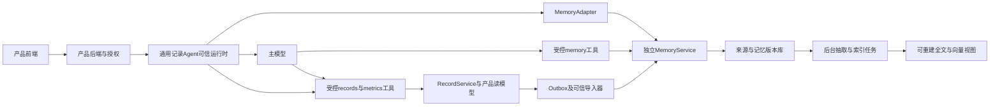
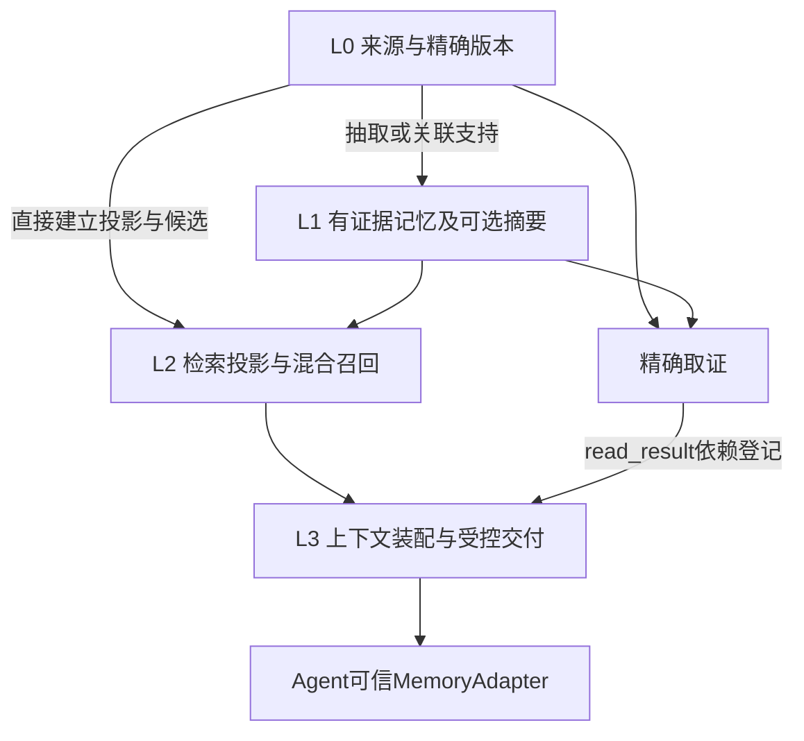

# 独立记忆服务 V1 边界与架构约定

版本：设计 V1.2 修订2。日期：2026年10月28日（America/Los_Angeles）。本文及同目录分册是待实现的开发与验收合同，不表示已完成实现、运行验证或生产容量验证。

2026-10-28补充§4.1–4.5的内部分层、快慢路径与可替换writer解释，并按修订2补齐授权及有序消费门禁；沿用既有对象、检索模型/RRF参数与发布切片，变更来由见07§5。

独立记忆服务向获授权 Agent 提供记忆来源摄取、记忆整理、相关证据召回、记忆纠正与失效。它持有自己的记忆数据与来源镜像，不取得产品正式记录的写入权。产品把一次记录请求交给通用记录 Agent；Agent 内可信适配器调用记忆 API，模型按需使用记忆工具；产品业务记录及其统计由产品工具完成。

本版收紧此前架构讨论中的边界：正式体重/饮水/账目总量、完整产品时间线、日历与图表不是记忆服务核心 API。记忆中的数值和外部记录引用用于提供证据，不能构成另一份正式台账。

## 1 文档权威与交付范围

| 分册 | 负责的合同 |
|---|---|
| 本文 | 职责、架构决策、核心不变量、授权和一致性边界 |
| [数据模型](01-data-model.md) | 实体、字段、约束、版本、证据、删除及重建 |
| [API 合同](02-api-contract.md) | HTTP、MCP、适配参数、错误、新鲜度及管理接口 |
| [Agent 时序与恢复](03-agent-sequences-and-recovery.md) | 运行步骤、状态机、故障决策和跨 Agent 接入保证 |
| [检索与验收](04-evaluation-and-acceptance.md) | 检索算法、样例金标准、合同与效果门槛、性能档位和交付顺序 |
| [持久聊天摄取与补偿](06-history-ingestion-and-repair.md) | 启用聊天连接器时的身份、补采/回填/修复/重抽、游标、删除和任务控制合同 |

同目录设计优先于此前《技术与产品方案》和《demo 完备性补充》中的接口草案。研究笔记保留来源和推导，不作为接口合同。出现歧义时按“本册不变量 → API 公共类型与字段 → 对应分册细则”解释；实现不得自行扩大权限、降低删除保证或把降级当作成功空结果。

本版产出仅为设计文档。后续开发需要实现和执行这里的验收，不以文档齐全冒充验收通过。

## 2 系统职责

| 组件 | 权威职责 | 明确不负责 |
|---|---|---|
| 产品前端 | 输入、确认/更正意图、选择记录主体、显示各阶段状态 | 持有服务端记忆凭证、任意指定 owner、判定后端是否已提交 |
| 产品后端或 BFF | 登录与业务授权、原始输入及媒体管理、页面读模型、分享授权、记录配置 | 代替记忆服务决定哪些派生证据仍有效 |
| Chat History Adapter | 宿主侧授权历史读取、稳定原消息身份、生命周期/删除控制和覆盖证明 | 直接替Memory发布无来源推断、将MySQL表结构变成通用记忆API |
| RecordService 逻辑模块 | 正式条目、发生时间与单位、提交回执、业务更正/删除、累计与趋势、Outbox | 以模型回答作为提交成功证据 |
| 通用记录 Agent 的可信运行时 | turn/operation、MemoryAdapter、工具权限、结果恢复、模型调用与数据注入 | 绕过业务权限直接改记忆数据库或记录表 |
| 主模型 | 理解自由输入、提出候选、使用证据、选择受控工具、回复或追问 | 自行授予权限、伪造已提交回执、执行任意 SQL |
| MemoryService | 来源镜像、记忆及版本、索引、预算化召回、来源/记忆失效、记忆专用偏好 | 产品权威台账、健康诊断、营养估算、周期预测、支付和提醒执行 |
| 身份与授权控制面 | 调用主体、grant、域/对象/投影范围、密钥和授权更新 | 把模型工具参数当授权来源 |

RecordService 是逻辑职责，不要求立即新建一个微服务。已有业务后端继续承担它；业务尚未实现时，可在产品后端同一部署实现。MemoryService 保持独立 API、数据所有权和授权边界，不与产品通过共享表完成集成。候选的拆分、待补/拒绝状态、candidate→正式条目映射及映射CAS归Agent/RecordService journal；MemoryService只维护来源关联与稳定外部条目绑定，不必建另一套candidate_binding状态机。

## 3 V1 包含与后置能力

### 3.1 A：首发必须完成的闭环

1. HTTP核心API与一个点滴full_lifecycle MemoryAdapter；原输入/Agent笔记sync，外部镜像统一ordered_import连续应用并区分accepted/applied，返回持久回执；异步抽取与embedding可独立落后。
2. 保存有来源的陈述、沟通偏好、约束、未完信息项及首发注册的typed证据；明确用户报告、外部已提交事实、Agent推断的区别。
3. 按owner、对象、域、时间和实际授权提供context及精确evidence补查；search/facts端点可后置。首发读路径纳入同一版本/失效保证，模型补查结果也不能成为未追踪副本。
4. 来源版本、记忆版本、CAS、幂等、连续流屏障、失效代际；删除或更正后不再引用失效版本。
5. 不主动提及、排除个性化、来源擦除三类记忆管理；记录本地失效及接入消费者的确认状态。
6. HTTP作为语义主合同；full_lifecycle与tool_only_best_effort描述宿主能力，不要求同时实现全部MCP、Hook、插件框架。
7. 可靠输入journal，接入登记时固定来源系统及接入边界；仅为接入后原消息绑定原生稳定origin与planned source_id/source_group_id。原item ID就绪前可靠排队，实时失败沿同一身份重送。已摄取及已计划会话的删除/撤权也由宿主可靠传播并持续跟踪，执行scope gate、独立ledger与ACK，不能随history开关后置。基础派生在已有source/version及逻辑slot上有界重试和去重；这些责任不要求history:run、历史发现或MySQL扫描。
8. 可重建检索索引、隔离审计、运行指标、故障注入、端到端中文时间线评测，以及04规定的P0容量和恢复验收。

### 3.2 本版由外部系统承担

| Demo 能力 | 归属 | MemoryService 的作用 |
|---|---|---|
| 体重、饮水、饮食、财务等条目提交 | RecordService 与受控 records 工具 | 镜像成功回执及授权内容，关联历史 |
| 今日饮水累计、近七日症状天数、体重曲线 | 产品 metrics/series 工具 | 提供相关原话，不能以检索结果替代全量统计 |
| 用药/补剂最近输入项、全部记录、日历 | 产品确定性读模型 | 若读取记忆偏好则提供其有版本条目；药品目录不是个人记忆 |
| 原始音频、照片、ASR、OCR、VLM | 产品媒体与识别管线 | 消费已授权的文本候选、字段及媒体 ID，保留识别版本；不下载任意 URL |
| 周期阶段与预测、营养估算 | 产品领域服务 | 分开镜像用户记录和带版本的估算结果，不把预测写成已发生事实 |
| 宝宝选择、代记关系、伴侣分享 | 产品账号/授权服务 | 执行服务端授予的对象、域、投影范围，不推导家庭账号关系 |
| 提醒和条件触发动作 | 外部任务/调度服务 | 可记住未完事项及外部任务引用，不负责定时执行或发送消息 |

完整产品因此仍需产品后端与 Agent 的工作项。本设计会列出它们必须满足的集成合同，但不会把这些模块改名后全部装进记忆服务。

### 3.3 B：可选第二切片

仅面向已登记、接入后会话，支持有界手工MySQL catch_up/backfill及已有来源的missing_derivation/stale_projection修复。它复用A的来源身份、版本、任务及删除规则；不自动发现旧会话，不承诺接入前历史身份已核对，不为任务另建聊天库或通用CDC平台。历史正文及候选仍由Agent/产品拥有，History Adapter是宿主侧受保护逻辑模块，可与现有部署同置。

任何导入内容进入生产可召回存储之前，均须通过完整分页、源当前性、持续原删除/撤权控制、预算、取消、断点及异常恢复验收。该门槛同时约束手工与自动任务；未配齐时只允许preview或封闭测试，不能完成一次手工导入后停止删除补偿。具体启用模式与H项按02/04/06的能力映射验收，不要求启用B就实现所有历史模式。

### 3.4 C：扩展验收与后置能力

接入前历史identity bootstrap、自动会话发现/周期巡检、context主动repair、pipeline reextract/巩固、多源汇总、可变消息版本和细粒度事件槽后置。MCP工具互操作、更多Agent/Hook/插件适配、search/facts、自动episode summary与可选memory_relation、完整demo领域parser、精细片段授权投影、在线双代索引迁移及P1容量可分别交付扩展验收，不阻塞A首发。首发采用单代索引及可封闭读取的重建；仍须保证重建、恢复及所有保留副本受删除门禁约束。注册schema可以保留扩展定义，未启用功能不得自报已支持。

首发发布清单冻结所支持的端点、schema、接入profile及验收；02中列出全部合同不等于每个端点、完整demo或每种接入形式都必须首发。未交付能力通过capabilities明确false/unsupported，调用返回UNSUPPORTED_CAPABILITY；不能以关闭能力裁掉首发路径必需的权限隔离、CAS/幂等、读屏障、删除、恢复或full消费者清理。

通用图数据库、模型原生矩阵记忆、强化学习记忆策略、跨用户推荐、自动心理画像、按声学推断状态、自建多级向量块、所有用户日周月季自由反思均后置。已有框架可作为内部引擎或效果对照，不能改变公共合同、事实来源或失效语义。

## 4 逻辑架构与依赖方向

前端每次发送进入Agent；结构化picker可以由可信运行时走确定性工具路径，不必重做文本抽取。MemoryAdapter持久记录本轮context决策：需要历史时在首轮模型前prepare；已确认且不依赖历史的确定性路径可以显式skip，不为保存强制串行检索。主模型有memory补查工具和产品工具，两组凭证、结果语义、授权分别控制。

MemoryService 不在召回时自行访问产品任意 URL、不发起业务工具、不回调客户端传来的任意地址。V1 只使用镜像、已注册外部流和消费者拉取变化。产品统计由 Agent 调用产品工具并入最终结果，不为此在 MemoryService 内另起一个推理 Agent。

持久聊天补偿扩展通过注册Chat History Adapter有界读取授权原消息，不让MemoryService自由扫业务MySQL。实时及启用的catch_up/backfill/repair/reextract路径共用稳定origin和planned source/group；聊天进度不冒充业务external_barrier。既有消息删除与Memory erase必须阻断旧扫描及未曾导入的迟到item；缺可靠持续删除控制或源当前性门禁时，手工和自动任务均不得将历史导入生产可召回存储。字段与首个MySQL适配范围见06，不改变正式记录/统计边界。

### 4.1 MemoryService内部逻辑分层

以下按数据归属与处理职责解释现有合同，层号不进入API。内容形态、检索算法和后台调度分别说明，避免把它们混为一条必须逐级完成的流水线。

| 层 | 回答的问题与职责 | 对应对象/行为 | 能力范围 |
|---|---|---|---|
| **L0 来源证据** | 原始依据是什么，来自谁、哪个版本、当时处于什么状态 | source_group、source/source_revision、external_binding、origin_binding；保存授权原话、确认字段及正式条目镜像 | A；B/C增加摄取方式，复用同一底座 |
| **L1 可管理记忆** | 从依据中保留哪些可使用、可修订的陈述 | memory/memory_revision、evidence_dependency；忠实statement、typed事实证据、显式偏好/约束、未完项、推断与启用后的摘要 | 基础陈述及明确记忆属A；自动episode摘要、多源巩固等按扩展能力启用 |
| **L2 检索表示与召回** | 哪些当前有效的内容与本次任务相关 | retrieval_projection、index_generation及查询策略；近期、中文词法、dense、实体/类型字段、偏好与未完项候选的融合和筛选 | A的混合召回；search/facts公共端点可分别后置 |
| **L3 上下文装配与受控交付** | 本次具体交付哪些证据，能否继续使用 | context:prepare按purpose、主体、预算及freshness选取内容；context/read_result两类bundle登记依赖，供Adapter校验和清理 | A的context、精确取证及full消费者协议；启用扩展正文读取时复用同一机制 |

图表达数据和依赖方向，不要求每次读写都经过全部节点。精确取证不强制执行全量混合召回；L3也不是新建的永久事实库。单个已确认typed来源可直接校验并形成取证投影，不必先转自然语言再抽取；原文可先经近期、已就绪词法或精确引用使用，不等待抽取、embedding或摘要全部完成。是否能交付context仍受计划通道、read_after、授权和deadline约束，缺通道按04§1.5降级或报错。

### 4.2 L1的内容形态与摘要/画像定位

结构化与非结构化是内容表达方式；事实证据、偏好、约束、推断和摘要是语义类型。它们共用01的记忆修订与证据模型，不因位于所谓“更高层”获得更高权威。

| 内容/视图 | 当前用途与约束 |
|---|---|
| 忠实陈述与typed事实证据 | 保留主体、语气、时间、确认方式和来源；typed值用于过滤、取证与展示，完整sum/avg/count、趋势与分桶统计仍归产品工具 |
| 显式偏好、约束与未完项 | 带作用范围、有效期、状态及人工保护；明确“回复简短些”等可立即修订并凭写屏障使用，不等日终摘要或画像周更 |
| derived_insight与episode_summary | 保留推断标签及可回查支持；摘要用于浓缩和导航，自动episode任务可关闭，多源汇总/巩固按扩展验收 |
| 小型画像投影 | 指有来源的适用偏好、约束及明确标记的归纳集合；复用上述对象和权限，不新增独立权威profile或一份无来源的永久人格描述 |

长历史超出上下文预算，由L2选择候选、L3有用性门控与预算共同处理；启用的摘要可以辅助导航，不要求所有用户先生成日/周/月/季摘要，也不只读取最高一级摘要。摘要的支持闭包必须能追到原始依据；摘要、被召回内容和模型回答不能循环成为新的独立用户披露。结构化字段、画像片段或摘要使用某来源信息时，该来源及其支持闭包均为required；失去支持先停用，再决定缩小陈述或重算。

### 4.3 跨层写入、失效与运行边界

- 实时输入及启用的历史Adapter向L0摄取，正式镜像走同一注册ordered_import；显式remember/revise可直接管理L1，并校验来源或允许的session lineage。各路径复用身份、CAS、人工slot、任务及删除门禁，不另建“离线记忆层”。
- 授权、精确版本、证据依赖、幂等、连续屏障、使用策略、人工保护和独立控制日志横贯L0–L3。更正/撤回/erase/撤权先限制旧依据及受影响派生，再异步重建；旧索引、摘要或画像尚未刷新不能成为继续返回旧值的理由。
- L3交付后仍追踪context及补查正文，Adapter经validate/changes/ack/reset处理工具历史、压缩摘要、缓存和原消息自动重建。宿主runtime/context epoch按03继续执行；MemoryService的新鲜度由来源/记忆版本、visibility_generation、policy_epoch、read_after及bundle依赖表达，不绑定某个宿主的contextEpoch。画像不规定进入不可变system前缀；宿主若另有缓存/epoch机制，应在适配层映射并验证清理，不能替代本合同。
- 层号不对应独立进程、数据库或必须实现的类。部署仍按API/worker、PostgreSQL与可重建检索视图组织；“可重建”要求使用当前有效输入及固定表示版本，不保证付费重算免费或模型逐字复现，也不能从旧缓存复活已删依据。

### 4.4 分层说明不扩大的能力

时间沿用01的发生、生效、上游记录及服务知晓/修订语义；实体沿用可信主体引用与注册字段，不按同名自动合并或创造亲子关系。领域/schema与现有别名词典可用于检索，不因此增加通用人物/地点/组织图谱或任意开放标签接口。

用户自述情绪可保留为mood域的有来源statement；当前没有冻结valence/arousal量表schema。自动心理画像、声学状态推断仍后置；原音频及识别归上游，声学数值若将来接入须另注册schema和来源/版本，不能以“确定性计算”替代准确性与来源验收，也不增加首发媒体处理职责。

检索沿用04的BGE-M3 1024维dense对照、BM25与RRF基线，不因分层直接改成256维，或默认引入MMR/reranker。后续算法、模型和摘要策略通过版本化实验及适用验收选择，不靠层级图冻结新参数。跨层验收映射见[04§5.1](04-evaluation-and-acceptance.md#51-逻辑分层的验收映射)。

### 4.5 快慢处理、更新轨迹与可替换writer

快速路径保证可靠来源、明确记忆修订、回执和失效门禁；后台路径在精确来源版本上做抽取、embedding和按能力启用的归纳。这里的快慢按一致性与时延职责划分，不规定白天/夜间运行，也不把同步保存改成每条先调用LLM。认知层级中的画像、对长期意图的模型归纳或跨域模式属于L1可选派生内容，不是替代L0–L3的另一套服务分层；高层归纳仍保留推断性质、时间/适用范围与完整支持闭包。用户明确表达的计划/愿望继续按既有statement_type=intent保存，不因上述派生划分被后置。

记忆writer、检索器与回答reader可分别比较和替换。writer可以采用通用模型或专用记忆模型，但只提出注册schema内的候选内容/变更；发布仍由服务校验可信身份、证据、源当前性、CAS、slot人工保护、预算及删除门禁。学习得到的策略不能直接改授权、推进流屏障、重执行产品工具或跳过消费者清理。没有证据只给候选/缺口，不以模型“更懂用户”创造正式事实。

派生压缩率与原来源保存完整性分开评价；“减少冗余记忆”的目标不能筛掉应可靠保存的用户来源、撤权或删除控制事件。后台归纳不能成为来源首次可读、显式约束生效或失效门禁的前置条件。

已有修订和替代引用用于解释状态演变；“记错后更正”“偏好在某时刻改变”和“两次独立真实事件”按各自语义处理，不能因相似而共用一条覆盖链。关联/画像若后续扩展，仍由01的依赖及失效管理，不要求A先建设通用图、双向链或跨域因果引擎。对照实验见04§6.4；外部资料与适用边界见[Hy-Memory定向核对](../../research/targeted-gaps-notes.md#6-2026-10-28-hy-memory官方资料核对)和[上下文与RL研究](../../research/papers-frontier-notes.md#11-2026-10-28-上下文退化与学习策略补核)，研究分数不是本服务验收。

## 5 核心不变量

| 编号 | 不变量 | 直接验收含义 |
|---|---|---|
| B01 | 记忆写入与业务记录提交分开 | memory 写成功不能返回“体重条目已保存”；正式回执来自 records 工具 |
| B02 | 来源、记忆、外部条目、卡片有不同身份 | 一份输入五张卡不会计为五个来源；重复工具回执不产生第二份正式观测 |
| B03 | 权限先于召回，输出前再核验 | 跨用户、跨宝宝和越域内容在证据正文、ID、摘要、计数中均不可泄漏 |
| B04 | 信任等级来自可信通道 | 模型不能声明 user_confirmed 或 external_committed 以提升自身文本权威 |
| B05 | 每条派生陈述有版本化证据 | 能定位 source/version/span；失去支持时失效或重算，不能循环自我引用 |
| B06 | 时间与语气保留不确定性 | “妈妈失眠”“担心血糖高”“想运动”不改写为本人确诊或已完成运动 |
| B07 | 原文持久可见不等于所有索引就绪 | 回执及 context 区分 base、embedding、抽取、摘要的处理状态 |
| B08 | 屏障只认可连续已应用前缀 | 外部 1、3 已到但 2 未到，不能宣称 through_seq=3 已追上 |
| B09 | 更正/删除优先于缓存及幂等重放 | 不因旧 bundle 或旧请求成功过就重新返回失效正文 |
| B10 | 异步任务不得复活旧数据 | 发布前比对 source_version、visibility_generation、policy_epoch 和任务版本 |
| B11 | 检索为空与检索失败不同 | 正常无证据、超时、屏障落后、权限失败有不同结果/错误 |
| B12 | context 允许不交付历史 | 不要求每次提到记忆，不能为提升引用率而增加无关/重复回应 |
| B13 | 正式数值只认产品权威条目 | memory facts 返回镜像行或推断，不能声明完整 sum/avg/count |
| B14 | 擦除服务本地与清除远端上下文分开 | 返回 local_enforced 与 consumer 状态，不能替任意第三方 Agent 宣称已遗忘 |
| B15 | 一次请求的重试保持身份和输入 | 未知结果先查 operation/条目，不换 key 重做付费模型或重复记录 |
| B16 | 外部系统未通知的变化不能凭空感知 | 跨系统保证起点明确；未追上外部屏障时停止相关历史或明确降级 |

正文规范中的“必须”对应这些不变量或分册验收项；不得仅用 prompt 要求模型遵守。

## 6 统一身份 版本与信任

### 6.1 授权空间与记录对象

`tenant_id` 是接入组织，`owner_subject_id` 是被授予个人记忆空间的所有者；二者由服务端身份和 grant 绑定。`about_entity_id` 是这份记忆涉及的人或对象，例如本人、宝宝 A、宝宝 B，不能代替 owner，也不自动等于某个账号。

grant 限定 agent/client、可用操作、域、about entities、时间与投影范围。模型参数只能缩小范围。不同 Agent 共享同一 owner 空间必须有明确 grant；同邮箱、同名、“妈妈”或相同项目路径不触发跨空间合并。

首发默认按完整来源的主体/域标签授权：混合原文须全部标签获授权，否则不返回原文；无可靠字段投影时相应证据也不交付。精细片段投影属扩展能力，只有通过独立越域验收后才可向健康工具返回同条输入的饮食片段并隐藏金额。模型不能自动降低标签；摘要和派生项继承支持输入的权限并集，不能借摘要洗掉标签。

窄域或窄主体授权下的原文/片段首次可读前，须有绑定该来源版本的可信上游完整标注，或同步策略核验能证明全源的域及主体标签完整；请求自报domains/subject或尚未完成的异步抽取不构成该证明。完整性未知时，原文只可向具有owner_space及全部当前注册域权限的调用者交付，否则拒返；已能证明安全且独立获授权的typed投影按自身权限判断，不靠待分类原文推断可见性。后续补标签按版本/代际规则失效旧视图，不追认已泄漏正文为合法。控制面grant可显式枚举最多32个注册域，查询筛选与单来源的8域限额另行适用；owner_scope操作仍须完整目标授权，不能绕过领域校验。

### 6.2 身份与版本的职责

| 名称 | 分配者与用途 |
|---|---|
| product operation / turn / tool action | Agent/产品稳定执行身份，不由 MemoryService 接管 |
| source_id | 可信接入方提供稳定、无 PII 的来源镜像身份；重复输送同一来源复用 |
| source_group_id | 关联同一次输入及其外部提交回执，不表示组内只能有一个事件 |
| source_version | MemoryService 发布来源修订时分配的递增整数；客户端用 expected_source_version 做 CAS |
| memory_id / memory_version | 记忆条目与修订身份，独立于来源与外部记录版本 |
| external_record_ref | 外部系统、正式条目 ID 与外部版本，仅可信 importer/connector 可证明 |
| stream_id / stream_seq | 注册外部流的连续输入顺序；不是 embedding 顺序 |
| write_token | 对已应用内存库变更的 opaque 读取屏障，绑定授权空间；不得当可转让凭证 |
| visibility_generation | 来源更正、失效或删除的门禁代际，V1 可保守使相关 owner 的旧 bundle 失效 |
| policy_epoch | grant/访问策略变化的版本，live check 不接受旧 token 自报仍有效 |
| representation_version | embedding/分词/抽取/摘要/schema 版本；不能混用不同向量空间 |

### 6.3 三类权威语义

`user_reported` 表示有可验证用户输入来源，包括当下短句；它不证明业务台账已提交。`external_committed` 表示可信产品连接器提供了外部成功回执与条目版本；它不表示服务已独立验证医学真实性。`agent_inferred` 是模型或 Agent 的解释，只可作为带标签的候选或派生辅助。

picker 确认、OCR 候选、设备观察、第三方转述另保留其来源与确认字段。不能把单个 authority 枚举当作覆盖所有质量问题的置信概率。模型生成的“我已经帮你记录”不属于外部提交回执。

## 7 一致性及失效的保证起点

### 7.1 两种摄取路径

user_input/agent_note的同步upsert在单个MemoryService数据库事务里写来源头、不可变修订、证据门禁、操作回执及后台任务；成功返回内部source_version与write_token。它保证来源基础数据已应用，不保证抽取和向量已完成。external_record不能绕过下述有序路径同步换头；快速通知只加速投递同一注册流事件。

ordered_import 接收注册流的 event_id、stream_seq 和完整来源变更，先进入持久 inbox。202 只表示已接收，尚无已应用 write_token；按连续前缀应用后，operation 才返回 applied。导入器不需要猜内部 source_version，内部应用器依据当前头执行 CAS。外部流必须按 owner 分配序列，或提供不泄漏其他 owner 的等价投影序列；不能把过滤掉别人的全局 seq 留成永久缺口。

合法外部事件命中本服务既有erase抑制时，可按01/02记录policy_suppressed并在连续位置安全消费：不物化正文、不新建source修订或派生，但推进已处理水位。该applied及可选write_token证明事件与门禁已处理，不证明新镜像可读；缺序、身份/载荷冲突或无法核对抑制依据仍不得跳过。这样既不复活被删镜像，也不让它的后续更新永久阻塞无关事件。

`read_after` 可包含 write_token、external_barriers 及 required_sources。读取要么满足屏障，要么在期限内等待后返回未追上；不能静默返回旧个人事实。向量未完成时允许近期原文/词法/已应用事实降级，必须说明哪些表示未就绪。

### 7.2 跨产品与记忆的更正或删除

产品提交与 MemoryService 失效不是一个数据库事务。V1 采用有回执的变更传播：产品提交 → 持久 Outbox/同步通知 → Memory 应用与失效回执 → 完整适配器失效依赖会话。严格产品路径在同步通知失败或外部屏障未满足时保留 pending 状态，阻止受影响的个性化历史使用；产品指标仍可直接查询已提交的正式数据。

MemoryService 本地“不再可查询”的保证始于其 applied/失效事务提交；产品“记忆删除完成”不能只以业务库删除成功或 inbox accepted 为依据。跨系统变化尚未通知 Memory 时，Memory 无法承诺所有独立 Agent 已看到新状态。完整接入方应把已知外部提交屏障带入下一轮；工具模式接入不得声称同等强保证。

### 7.3 读取并发与旧副本

失效事务完成后开始的新读取不得返回失效版本。与失效并发的读取在输出前检查代际；改变则重建一次或返回冲突/降级，不发布已知失效正文。网络上先前已发送的内容无法收回，因此不能用服务端响应顺序宣称终端绝无旧字节。

context bundle 有 5 分钟有效期，完整适配器在使用前与后续模型 step admission 时验证来源版本和策略。新追加记录不自动否定旧快照，但同轮明确需要新提交时须带读取屏障刷新。更正、擦除、撤权使旧 bundle 即刻不再可用，优先级高于幂等重放。

同一外部事件的旧原始主张、镜像及派生不能各自独立成为“当前事实”；更正传播需覆盖已关联的原始证据，无法精确关联时保守阻止旧主张用于当前个性化。完整适配器入模的context、search、取证、facts及其工具结果均须登记依赖并受相同失效/清理约束，不能只追首次context包；细则见01/02/03。

## 8 记忆管理与消费者保证

| 用户意图 | V1 语义 | 对业务原记录的影响 |
|---|---|---|
| “别总提这个” | suppress_proactive，阻止自动关联，允许明确历史查询 | 无 |
| “别用于了解我” | exclude_personalization，正常个性化读取排除其来源与派生链，管理接口仍可定位 | 无 |
| “从记忆中删掉这段” | 擦除明确 source/source_group 的服务副本与依赖，返回本地/后台/消费者阶段 | 不自动删除 RecordService |
| “删除这条正式记录” | Agent 调产品记录删除工具，随后镜像失效 | 由产品工具回执确定 |

仅删除一个 memory_id 而保留支持原文，不能承诺从此不会再提炼同一事实。V1 擦除以来源、来源组或完整 owner 范围为单位；memory_id 只能用于解析需明确确认的来源范围。不主动提及与排除策略持久作用于来源 lineage，后台换新 memory_id 不得绕过。

`exclude_personalization` 仍允许用户明确提出的直接历史查询；若要求本服务不再为任何目的使用该段内容，应使用 erase。erase 是针对稳定来源身份及其全部版本的隐私命令，不要求调用方提交某个旧 source_version：独立控制日志中的 intent 持久化后，内部 owner/target 门禁串行化擦除及并发更正，避免旧版本条件使应删来源漏删。普通来源/记忆编辑及 clear_policy 仍按对应 expected_version 执行 CAS。

owner 范围擦除作用于命令时点的既有历史快照，不等于关闭记忆空间。此后真实新输入可正常接收；旧历史回填、旧外部条目及其改名重送默认不得恢复，不能仅因新 stream_seq、新 source_id 或新导入器就当作新输入。明确再授权导入必须走受控流程，规则和覆盖截止点见01/02。

同一事实有独立其他来源时，删除一个来源不代表其他来源也消失。产品和 Agent 应展示目标范围；服务不承诺从全网或所有用户空间语义删除同一概念。

完整生命周期适配器维护 bundle→session/turn 依赖，拉取失效事件、阻止旧上下文继续入模，必要时取消活跃请求、隔离旧会话并建立净上下文，再确认消费者处理结果。无法验证取消完成或尚有旧快照时返回 pending/blocked。仅工具接入可停止未来工具读取，但服务无法证明其已清除宿主历史。

## 9 授权 网络与运行部署

V1 由 Memory API 进程、后台 worker、PostgreSQL 与对象引用管理组成；pgvector 与选定中文词法能力是可替换的表示实现。源数据与记忆、操作回执、inbox/outbox、失效事件持久化；进程本地状态不是唯一回执。队列初版可使用同库任务表，避免为了阶段隔离额外引入多个中间件。

首发暴露受保护HTTP API；启用MCP扩展后提供`/mcp`。服务端调用采用绑定tenant/owner/agent的凭证与当前grant；浏览器无此凭证。远程MCP的授权与传输兼容性按固定官方协议版本验证，stdio仅是带受保护本地配置的薄桥。两种传输共用同一授权与业务合同，不把工具annotation或MCP session当作个人身份。[MCP传输规范](https://modelcontextprotocol.io/specification/2026-07-28/basic/transports)、[HTTP授权规范](https://modelcontextprotocol.io/specification/2026-07-28/basic/authorization)

grant 以持久目录保存，控制面 `access:apply` 通过 expected_policy_epoch 改动状态/范围并发布失效；普通调用和模型工具不可修改 grant。stream 与 consumer 绑定由控制面预置/注册，不能通过模型参数绑定别人的流。未知 issuer、失效签名、权限缩小、外部目录不可验证时均不得回退成共享默认 owner。

erase、撤权和缩权先写入独立故障域的耐久 control ledger，再在主库应用门禁与失效；两者核对后才能返回 applied/local_enforced。intent 已成功而主库失败时保留 pending 并拒绝受影响读取，不能回滚日志后继续使用旧数据。控制日志不可验证时拒绝相关读取。主库从备份恢复后必须先封闭读取，追平最新擦除/授权日志、流检查点和索引代际，完成消费者 reset 门禁后才开放；主库 RPO 不允许回滚已承诺的删除或撤权。实现细则见01/03/04。

数据库查询以 tenant/owner 强制过滤，应用在候选与最终输出双重校验。数据、索引、日志及备份加密；凭证不写入原文或 context。审计默认只留 opaque ID、版本、策略、数量与耗时，调试正文需单独受控且有保留期限。

## 10 开发启动条件与冻结决定

以下选择作为 V1 默认，不把未知生产规模留给开发自行猜：

- 核心服务采用来源镜像与记忆模式，不托管产品正式台账；产品连接器与 RecordService 是独立交付项。
- 单 owner 内召回，支持多个 about entities 和域授权；不实现跨 owner 自动合并或伴侣分享 UI。
- 文本和确认结构化字段优先；接受上游语音/图片文本候选及媒体引用，不实现 ASR/VLM。
- 无同步 LLM 查询规划/reflect；基础召回采用近期、词法、dense、实体/结构化候选与确定性预算。有用性门控允许空结果。
- HTTP核心与点滴完整适配器先完成；MCP等扩展按声明分别验收，不能用tool-only替代首发所承诺的full_lifecycle。
- 首发可靠journal及接入后原生origin绑定先建立，同身份实时失败重送和基础派生修复不依赖history:run。手工MySQL导入属于可选B，自动巡检、接入前历史bootstrap与pipeline重抽属于C；验收按04的能力映射执行。
- 精确统计通过产品工具，memory facts 的分页及 freshness 不能暗示台账完整性。
- 内部任务可重试，外部模型/业务动作未知结果不自动重跑；故障策略与数值目标见对应分册。

后续可通过有版本的设计变更扩大范围。改变业务台账所有权、擦除粒度、授权语义、CAS/幂等、read_after 或接入保证等级属于协议变更，需要更新对应验收，不以更换开源框架为理由隐式改变。
