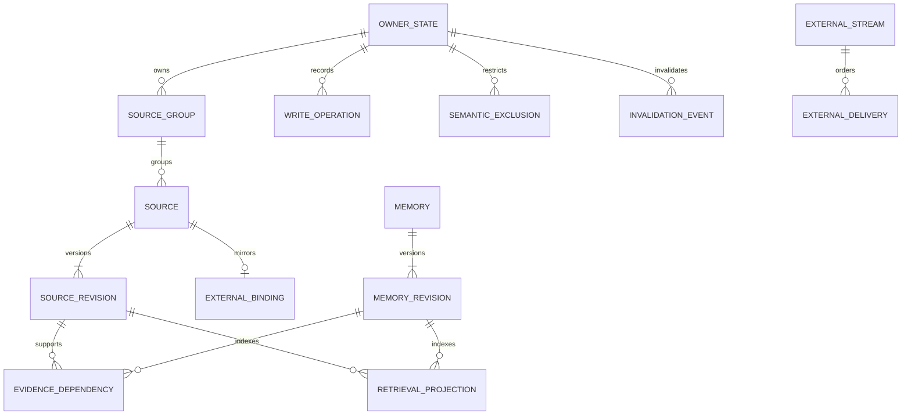

# V1 数据模型与一致性约束

版本：设计 V1.2 修订2，2026年10月28日整体审查修订。

本文是独立记忆服务的开发规格，和 [API 合同](02-api-contract.md)、[Agent 时序与恢复](03-agent-sequences-and-recovery.md)、[评测与验收](04-evaluation-and-acceptance.md)共同使用；启用持久聊天连接器时同时遵守 [聊天摄取与补偿合同](06-history-ingestion-and-repair.md)。本文定义逻辑对象、类型、关系与事务，不提供 DDL 或实现代码。日期：2026-10-28（America/Los_Angeles）。

## 1. 数据归属先于存储设计

MemoryService 保存**来源镜像与带证据的记忆**，不保存第二套正式业务台账。RecordService 代表产品现有或待建的权威记录模块；它不要求本轮额外部署成一个独立进程。

| 对象 | 权威与写入方 | MemoryService 中的形态 |
|---|---|---|
| 用户发来的文本、确认的 picker 字段、上游 ASR/OCR 候选 | 产品持久接收模块；其他 Agent 也可记录其获授权的用户输入 | 有来源版本的镜像；存在不等于正式条目已提交 |
| 饮水、体重、症状、财务等正式事件和数值 | RecordService；Agent 的 `records.*` 工具调用它 | 已提交外部条目的引用、版本及必要检索镜像，不再生成可计量事件 |
| 正式 sum / avg / count、日历、时间线、完整图表序列 | 产品 `metrics.*` 与记录读模型 | 可保存算法结果的有版本引用作为证据；不由记忆检索重算正式结果 |
| 偏好、约束、近期关联、推断、摘要、未解决事项 | MemoryService；明确用户陈述与 Agent 推断必须区分 | 可追加、修订、撤回、过期的记忆对象 |
| 营养估算、经期预测、医疗或财务领域算法 | 产品领域服务或受控知识/计算工具 | 输出作为 `agent_inferred` 或外部派生证据，带算法版本，不能写成已发生事实 |
| 产品账号、宝宝档案、分享邀请、UI 状态、提示曝光频控 | 产品后端 | 只镜像获授权的主体引用、访问限制；不承担账号或分享管理 |
| 原始音视频、照片 | 产品媒体服务或接入方媒体服务 | 只持授权引用和摘要；V1 不下载持久保存原始媒体，不运行 ASR/OCR |

其他 Agent 没有 RecordService 时，仍可直接 `remember` 用户陈述和自己的有证据推断。这样的来源可以成为有效个人记忆，但绝不会因为保存在 MemoryService 就变为 `external_committed` 或进入点滴的正式统计。

### 1.1 必须维持的八条不变量

1. 所有内容、查询、派生和缓存均受 `(tenant_id, owner_subject_id)` 隔离；`about_entity_id` 表示内容关于谁，不替代授权空间。
2. `source_id + source_version`、`memory_id + memory_version` 指向不可变修订；删除可清空敏感载荷，但不复用标识或版本。
3. `authority_kind` 由可信来源和服务端规则决定。模型填写“用户确认”“已经保存”不能升级事实权威。
4. 用户原输入、抽取候选及其产品提交结果保留共同的 `source_group_id`；它们可以是多条证据，不是多次生活事件。
5. 外部正式条目按 `external_record_ref` 及其权威版本关联；候选映射不得在后台富化时再生成第二份正式条目。
6. 更正、撤回、删除、语义停用和撤权先使旧证据不可返回，再异步重建；索引落后不是继续返回旧值的理由。
7. 连续水位描述连续处理完成的外部事件；处理过的最大序号不能替代连续水位。
8. 向量、词法索引、摘要、重排特征均可从仍有效的来源和显式记忆重建。检索得分不能成为事实、授权或提交依据。

## 2. 公共类型、标识和时间

### 2.1 字段约定

下表中 `!` 为对象存储必填且非 null，`?` 为可空。内部派生字段由服务补全，不表示客户端要提交全部列；可写字段以 API 合同为准。V1 的完整修订请求不能靠省略必填字段隐式继承旧值；显式 null 仅在该字段允许清空时表示“清空”。不可更新字段即使传入相同值也不能借机改变归属。API 对省略与 null 的具体编码见 API 合同。

| 类型/字段 | 含义与约束 |
|---|---|
| `id` | 不透明字符串；可信调用方预生成并永久复用，或由服务 SDK 分配后保存。长度 1–128 字节，具体字符规则见 API；不从格式推断身份、时间或分片。预生成不代表调用方能指定归属或覆盖已有对象 |
| `version` | 数据库用 64 位正整数，V1 API 限制为 JSON safe integer `1–9007199254740991`；新建 CAS 期望为 `0`；临近上限需升级协议，禁止静默溢出 |
| `seq` | 非负整数，API 同样限制为 JSON safe integer；仅在指定 `stream_id` 内有序，不同 stream 不比较大小 |
| `timestamp` | RFC 3339 UTC 时刻，存储精度至少毫秒；比较采用时刻，不比较输入字符串 |
| `date` | `YYYY-MM-DD`；日级精度事实不能自动补成当天 00:00 的精确事件 |
| `timezone` | IANA 时区，如 `Asia/Shanghai`；用户时区变化不改写既往事实的原始时区 |
| `decimal` | 十进制字符串，计算和标准化使用精确十进制，不用二进制浮点保存金额/剂量/规范数值 |
| `payload_hash` | 对 schema 版本、规范化输入和权限相关字段计算的摘要；只用作重放/损坏检查，不作为内容脱敏方案 |
| `schema_id + schema_version` | 已注册且不可变的 schema 名称及版本，例如 `health.weight` 的版本 1；API 结构为 `{schema_id,schema_version,data}`，不接受任意 JSON 字段冒充已注册语义 |

`tenant_id`、`owner_subject_id`、调用主体、允许的 `about_entity_id` 和授权范围来自认证上下文及受信代理声明，不能直接相信模型参数。业务传来的同名字符串在验证之前仍只是请求值。

### 2.2 授权空间与对象身份

| 字段 | 类型 | 必选 | 解释 |
|---|---|---|---|
| `tenant_id` | id | ! | 租户；跨租户永不隐式关联 |
| `owner_subject_id` | id | ! | 记忆授权空间，通常对应一个账号或产品定义的私人空间；并非“一定是被记录的人” |
| `about_entity_id` | id | ? | 内容关于本人、宝宝 A、宝宝 B 等；null 仅代表空间级偏好、混合输入或尚未解析主体，不能解释成“所有主体” |
| `recorded_by_ref` | id | ? | 记录者的受限引用；由来源镜像携带，不授予访问权 |
| `actor_ref` | id | ! | 本次调用的认证主体，可为用户代理、可信适配器、连接器、后台作业 |
| `agent_instance_ref` | id | ? | 宿主 Agent/会话归因；不作为租户、所有者或关于谁的替代值 |

`entity_reference` 保存上游实体 ID、类型 `self/person/child/other`、最小展示名（可空）、上游版本和 `active/disabled/deleted` 状态。产品拥有档案权威，MemoryService 不创建亲子关系、年龄或分享权限。其他 Agent 可在自己的授权空间注册最小实体引用；主体合并或拆分必须显式迁移，并触发相关派生失效，不能按同名自动合并。

null 主体的未知原文只有 owner 宽授权可读；混合原文只有在片段/字段主体与安全标签可靠时才可向窄grant做安全投影，不能通过选 null 绕过 grant 的主体限制。未知症状不能自动套到self。`fact_evidence` 必须最终解析到非空主体；空间级偏好/约束只有注册schema显式声明space scope才可应用，不能把所有null内容当空间偏好。

同一个宝宝可能被不同账号分别记录；没有上游授权与身份关联时，两个空间不自动共享。共享投影由产品授权服务和受信适配器约束，不能仅凭相同 `about_entity_id` 合并数据。

### 2.3 四类时间分开

| 字段 | 类型 | 必选 | 语义 |
|---|---|---|---|
| `occurred` | temporal object | ? | 用户陈述或外部事实的发生时间/范围，未知可空 |
| `valid_from` / `valid_to` | timestamp/date | ? | 偏好、约束等陈述的业务生效范围；`valid_to` 为排他上界；null 表示未知或开放，不代表永远正确 |
| `recorded_at` | timestamp | ! | 上游何时接收/记录；接入方没有可靠值时使用服务接收时间，并标记 `recorded_at_basis=service_received` |
| `created_at` / `revised_at` | timestamp | ! | MemoryService 内部首次写入与本修订完成时间 |

API 以 `occurred_from`、`occurred_to`、`time_precision`、`timezone` 表达发生时间；数据库可存为一个复合 temporal 值。`time_precision` 和字段语义如下：

- `minute/second`：`occurred_from` 为明确时间点，`occurred_to` 可空；只知分钟不得声称秒级精度。
- `day`：`occurred_from` 为 `YYYY-MM-DD`，可选排他日期上界 `occurred_to`；不捏造当天 00:00 或时分秒。
- `interval`：from/to 表示半开范围，至少一侧已知；每个边界沿用该来源已确认的精度。
- 相对/近似表达通过公共 `Occurred` 对象携带 `original_expression`、`anchor_at` 与解析范围，例如“昨晚”；不能把近似范围标成精确时刻。
- `unknown`：from/to 均空，保留原句；不得参与依赖精确发生日期的产品指标。

公共 `Occurred.basis` 为可选闭枚举 `user_explicit/client_selected/external_record/relative_resolved/inferred`，缺省为保守的inferred，且不能单靠该字段提升来源权威；可信适配器证明仍须校验。`known_from/known_to` 由服务端维护本修订被本服务视为当前有效版本的时间范围；旧版本历史可审计不代表可继续用于当前回答。V1 服务不重新解释已经确认的上游时间；发现矛盾返回问题，不把记录时间替换成发生时间。全文片段“昨晚 3 点”在凌晨日期歧义未解决时可以保留为候选范围。

known区间属于服务端头变更事件/独立知晓区间投影，不修改不可变revision的内容载荷；切换头时原子关闭旧known_to并打开新known_from，二者使用同一服务提交时刻。source.recorded_at保留上游原记录接收时间，不被重新索引/重抽时间覆盖。

记忆的`recorded_at`由服务计算为当前修订全部required支持source的recorded_at最小值；仅有记忆级引用时沿来源闭包计算，不能取摘要生成日或known_from冒充旧生活记录的新记录日。多来源摘要采用相同最早支持时间，完整描述时间范围使用occurred.interval。无source_refs的Agent推断/未完事项必须有session_ref，服务登记agent_note来源lineage，以其真实宿主接收时刻为recorded_at，不自行伪造用户来源。

查询`time_basis`固定为`occurred/recorded_at`，默认occurred：前者按发生时间/范围，后者按上述来源记录时间。新抽取一条十年前记录不会因今天跑worker而命中“今天记录”的窗口。时间未知的行可以通过recorded_at基准取证，但不能因此宣称知道其发生日期。

`valid_from/valid_to`使用YYYY-MM-DD时，只在全部required来源闭包具有同一个可靠的已保存来源时区（sources:upsert的timezone）时接受；缺时区、跨多个时区或无source的笔记须改传含偏移的RFC3339时间点，返回422 SCHEMA_VALUE_INVALID而不猜服务器/当前会话时区。按该IANA时区的本地日界归一，valid_to仍为排他边界；日界无法唯一解析时同样要求明确时间点。服务保存使用的时区和归一结果，后续旅行、重抽或服务器时区变化不能改变既有生效点，已知两端须from<to。

## 3. 逻辑对象和关系

关系图表达逻辑归属，不规定必须一对象一张数据库表。首期采用 PostgreSQL、pgvector 与经中文实测选定的词法索引。身份、版本、依赖、幂等和失效状态必须保存在事务数据库；搜索引擎不是这些状态的唯一载体。

2026-10-28补充分层映射，完整职责见[00§4.1–4.5](00-boundaries-and-invariants.md#41-memoryservice内部逻辑分层)：

| 逻辑层 | 本册对象及依赖含义 |
|---|---|
| L0来源证据 | source_group、source/source_revision、external_binding及origin_binding，保留稳定依据、修订和生命周期门禁 |
| L1可管理记忆 | memory/memory_revision及evidence_dependency；statement、typed证据、偏好/约束、推断、摘要等并列，摘要/画像不另设更高权威 |
| L2检索表示与召回 | retrieval_projection及index_generation；source_revision与memory_revision均可直接建立投影，不要求先有结构化记忆或摘要 |
| L3上下文装配与受控交付 | context_bundle及消费者依赖，统一context/read_result；是受用途、预算和有效性约束的使用快照，不是另一份永久记忆 |

上述映射不增加memory_kind、schema、表或API字段。纯Agent推断允许的session lineage仍按§5处理；所有语义支持的精确版本闭包、权限继承及失效规则适用于各层。显式记忆和保留来源是重建依据；检索表示与启用的摘要是受门禁约束的派生物，不能反过来取代其依据。

## 4. 来源镜像与产品提交映射

### 4.1 `source_group`：同一次输入及其后续解释

| 字段 | 类型 | 必选 | 语义与约束 |
|---|---|---|---|
| `source_group_id` | id | ! | 可信编排器或服务 SDK 预分配并稳定复用的共同来源身份 |
| `tenant_id` / `owner_subject_id` | id | ! | 创建后不可变 |
| `origin_namespace` | id | ! | 受信接入命名空间，例如产品连接器或 Agent 安装实例 |
| `origin_group_key` | string | ! | 上游稳定输入/operation 标识；唯一范围为授权空间 + origin_namespace；V1可由可信source_group_id映射，不要求再传一个同义公共参数 |
| `origin_kind` | enum | ! | `product_input/agent_input/import` |
| `root_source_id` | id | ? | 最早原始输入源；提交镜像先到时允许暂空，随后经验证补链 |
| `product_operation_ref` | opaque string | ? | 产品操作引用，只作追踪；MemoryService 不负责其产品状态机 |
| `created_at` | timestamp | ! | 首次出现时间 |

同一 `source_group_id` 可以含原文一条、转写一条、两项正式条目的镜像。原文“面条＋300ml 水”共组，但不意味着只存在一个业务事件。组仅帮助来源归并和展示，不作正式计数键，也不授权一键删除所有组成员。

### 4.2 `source`：稳定身份和当前头指针

| 字段 | 类型 | 必选 | 语义与约束 |
|---|---|---|---|
| `source_id` | id | ! | 全生命周期稳定 |
| `source_group_id` | id | ! | 共同来源组；跨空间引用禁止 |
| `caller_source_key` | string | ! | 内部来源定位键；V1 公共 source_id 已由可信调用方稳定生成时直接映射它，不另要求同义请求参数 |
| `source_kind` | enum | ! | 公共枚举 `user_input/external_record/agent_note`；转写、OCR候选、用户更正、导入文本属于内容的注册 schema / 来源元数据，不扩展顶层权威类别 |
| `head_source_version` | version | ! | 当前头修订；创建为 1，此后仅递增 |
| `lifecycle` | enum | ! | `active/retracted/deleted`；`retracted` 表示不再作为有效事实，`deleted` 还启动数据清理 |
| `external_record_ref` | object | ? | `{system_id,record_id,external_version}`；仅经验证的正式条目镜像可有。稳定身份只含 system_id+record_id，external_version 为 opaque 权威版本 |
| `created_at` / `updated_at` | timestamp | ! | 服务时间 |

`source` 只保存头指针与定位字段。内容和事实权威在不可变 `source_revision` 中；头指针不允许指向别的 source、将来版本或未提交修订。

origin_namespace、actor_ref、授权空间和内部定位键均由 grant/认证连接派生；模型和前端不能自定义 namespace。表中同时列出公共字段与内部列只为开发映射清晰，不允许把内部列整体开放成通用写接口。

### 4.3 `source_revision`：不可变内容、权威与来源

| 字段 | 类型 | 必选 | 语义、null 与枚举 |
|---|---|---|---|
| `source_id` / `source_version` | id / version | ! | 联合唯一；版本由服务分配：sync 在 CAS 事务中分配，ordered_import 由连续流应用器在事务中分配，调用方不指定新版本 |
| `tenant_id` / `owner_subject_id` | id | ! | 必须与 source 相同 |
| `about_entity_id` | id | ? | 原始混合输入可空；每个派生记忆分别定位主体 |
| `authority_kind` | enum | ! | `user_reported/external_committed/agent_inferred`；见下方权威规则 |
| `content.text` | string | ? | 可检索文本；若仅结构化输入可空；不是允许无内容写入的理由 |
| `content.structured` | registered JSON object | ? | picker、外部条目镜像或上游候选；带 schema_id/schema_version，不运行任意代码 |
| `source_metadata` | registered JSON object | ? | 独立的source.input_metadata信封，携带模态/确认/上游识别版本/媒体引用；与content.structured并列，不占用typed内容槽，不作为memory/facts正文索引 |
| `media_refs` | array | ! | 默认 `[]`；每项含授权 asset_ref、media_type、上游版本、有效期与转写/OCR引用；不得持久化带长期访问密钥的 URL |
| `language` | string | ? | 如 `zh-CN`；未知为空，不靠字段假装已完成中文分词 |
| `confirmation` | enum | ! | `explicit_user/upstream_committed/candidate/not_applicable`；ASR、OCR 和模型解析默认 candidate |
| `source_evidence_ref` | object | ? | 公共source_attestation经验证后的受限引用，指向认证用户消息证明、输入服务回执或外部提交证明；不接受模型自签，不把证明token存入检索文本 |
| `occurred` / `recorded_at` | temporal / timestamp | ? / ! | 遵守第 2 节时间语义 |
| `sensitivity_labels` | string array | ! | 服务或上游策略附加的受控标签；客户端不能降低标签 |
| `external_source_version` | opaque string | ? | 内部列，映射公共 `external_record_ref.external_version`，不另公开同义字段；不等同内部 source_version，不通过字符串大小判定先后 |
| `caller_revision_key` | id | ? | sync 必填，同 source 内唯一；ordered_import 禁止，改用受信外部事件身份 |
| `origin_ref` | object | ? | `{source_system_id,conversation_id,item_id,origin_revision}`；仅已注册聊天来源的`source_kind=user_input`且`mode=sync`可有，身份绑定、修订与删除门禁见§4.5；不是external_record_ref，不提升authority |
| `upstream_change` | object | ? | `{stream_id,stream_seq,event_id}`；ordered_import 必填，sync 禁止 |
| `input_evidence_refs` | source ref array | ? | external_record事件可附，最多8项；把正式条目关联到已使用的原输入片段/字段，结构与门禁见§4.4；不接收候选状态 |
| `input_origin_binding` | object | ? | `{origin_ref,source_id}`；仅可信external_record同流事件可有，预约该原消息的计划来源身份，`source_group_id`取外层；不是已存在原文或用户陈述证明，见§4.5 |
| `revision_reason` | enum | ! | `create/correct/retract/delete/reconcile/reprocess_metadata` |
| `supersedes_version` | version | ? | 新建为空；其他修订必须指向当前头的前版 |
| `payload_hash` | string | ! | 幂等与损坏检查；删除后按生命周期策略清除潜在敏感派生摘要 |
| `created_by` / `created_at` | actor ref / timestamp | ! | 审计归因 |

`content.text`、`content.structured` 至少一项有实际内容；仅媒体引用不能触发 V1 识别任务，删除 tombstone 是例外。媒体元数据通过独立source_metadata信封传递，`media_refs` 是其受控内部投影，不进入memory/facts内容索引。原始媒体引用不能独立赋予 MemoryService 或 Agent 访问权，每次解引用仍检查有效授权。V1 只消费上游 ASR/OCR 输出，并保留其版本、置信度及用户是否修订；转写质量分不能代替用户确认。

**权威规则：**

- `user_reported`：有可信用户输入来源的自述，或忠实转述该来源的抽取；表示用户这么说过，不表示客观测量已验证。
- `external_committed`：连接器验证产品签名回执、受信事件或读取权威 API 后生成的条目镜像；绑定外部条目身份与版本，V1一律经该条目绑定的注册ordered_import流发布。只有此类镜像能声称“产品已保存”；提交回执直达服务也只是同一流事件的加速投递，不能以sync另换来源头。
- `agent_inferred`：模型生成的解释、估计、关联、规划或无法证明来自真实用户的 Agent 自报内容。引用已提交条目不会把推断升级为 committed。

接入方可以申请某种权威，服务只授予其凭证能力允许的级别。`confirmation=explicit_user` 自报不能替代认证用户消息证明；未具备该证明的任意 Agent 调用仍可写自己的推断/笔记。

服务另保存绑定source/version的完整域/主体标签核验依据及策略版本。尚未核清的自由文本不能因请求只填food而向窄food grant交付“牛肉面26元”的原文/片段，也不能把“妈妈失眠”暂标self后向仅self授权者先行交付；按00§6.1拒返或仅交付独立可证安全的投影。此为既有授权门禁的内部状态，不增加调用方可自报的“已分类”字段；标签/元数据变更仍遵守不可变修订、CAS与失效代际。

### 4.4 `external_binding` 与原输入证据关联：只保留纠正所需映射

| 对象/字段 | 类型、必选 | 约束 |
|---|---|---|
| external_binding.system_id | id ! | 受信产品/数据提供方；来自公共 external_record_ref.system_id |
| external_binding.record_id | id ! | 提供方内稳定条目 ID；与授权空间、system_id 联合唯一；版本不参与稳定身份唯一性 |
| external_binding.source_id | id ! | 对应一个 external_record 来源；一条外部条目始终映射同一 source |
| external_binding.external_source_version | opaque string ! | 已镜像的权威版本；通过受信 event/读取合同判断新旧 |
| external_binding.stream_id | id ! | 该条目唯一发布流，须符合注册system/owner绑定；V1不接受同条目多流竞争或sync绕序更新 |
| external_binding.record_status | enum ! | `committed/retracted/deleted`，由上游决定；候选不占用 committed 身份 |
| external_binding.verified_at / verification_ref | timestamp / ref ! | 验证时间与可审计证明引用，不存 bearer token |
| external_binding.input_evidence_refs | source ref array ! | 每事件默认[]、最多8项，联合定位为`{source_id,source_version,span?,field_paths?}`；随权威修订持久化，当前binding可追溯该条目历次修订使用过的关联，历史累计不受单次8项上限截断 |
| external_binding.input_origin_binding | object ? | 可信同流事件的原消息预约`{origin_ref,source_id}`及其审计关联，group取外层；保存计划身份但不代替具体输入证据，见§4.5 |

候选ID、未决/拒绝/提交状态、候选拆分合并及产品动作回执属于Agent/RecordService的journal，MemoryService不复制candidate_binding或候选状态机。后台记忆抽取没有创建正式条目的权限，即使生成了新候选也不能再记一笔业务记录。

`input_evidence_refs`只保存更正与撤回门禁所需的证据关联：引用必须属于同owner和source_group；`span={start,end}`为原修订Unicode code point半开区间，0≤start<end；`field_paths`最多16项，只允许该来源注册schema字段。span和field_paths至多出现一种，均省略表示整个来源。服务验证引用及范围；来源尚未镜像时可持久化为pending关联，不披露未知正文，源到达后验证并立即应用已有门禁，不能因到达顺序漏掉旧原话。

正式条目**更正、撤回或删除applied**时，同一事务除失效其旧external_record修订，还须把其累计绑定的旧原断言标为`historical_only`，推进generation并失效依赖这些原断言的记忆、摘要、检索结果与bundle。原输入正文不改写、不整段删除；当前有效外部修订另行提供新值。普通context、facts及后台重抽不能用被限制片段重新断言旧值；search与精确取证只有在用户明确询问原话/更正历史的用途下才可返回，并附已更正/撤回/删除、关联当前可见引用与`historical_only`用途限制，不能返回为当前有效事实。该标记不授予读取被隐私erase内容的权利。

权威事件未带可靠精确关联时，服务持久化`(source_group_id,about_entity_id,domains)`的保守门禁，将同组相应主体/领域的原主张限制为historical_only；其余主体和领域不受影响。同组about_entity_id=null的混合输入也受其已知片段/投影的主体门禁约束，不能凭null绕过。混合原文无法安全拆出受影响部分时，普通召回不返回整段原文，只交付可证明安全的其他字段/片段。门禁同时约束晚到的原输入、其新派生ID及旧worker；关联纠正依同一有序事件流更新，不靠异步模型猜测消除限制。

例：“午饭面条，喝了300ml水”的正式饮水条目后来改成100ml，只限制原输入的饮水片段；无精确片段时保守限制该组hydration主张，food仍可使用。原300ml可以作为明确的更正历史取证，不能被重新抽成当前喝水证据。

公开读取由02的purpose及search/evidence专用include_historical_assertions控制：后者默认false，只有可信宿主确认用户明确想看原话/更正历史才开启；普通answer_history不能使旧300ml成为当前事实。

### 4.5 聊天原消息身份、预约与会话门禁

接入原生聊天身份时（A的在线可靠摄取也适用），`origin_binding`以`(tenant_id,owner_subject_id,source_system_id,conversation_id,item_id)`为稳定唯一根，不含原修订、pipeline、run或正文hash。`origin_ref`前三个字段为id，`origin_revision`为正整数version；上游身份和owner映射来自注册可信连接，不由模型声明。实时、补采、回填均绑定同一原消息，不能按文本相似度合并两条真实消息。可选补采合同见[06](06-history-ingestion-and-repair.md)。

| 对象/字段 | 持久语义与约束 |
|---|---|
| origin_binding.planned_source_id / planned_source_group_id | 由可信宿主消息/operation journal在首次写入前持久计划，在线与离线复用；不是扫描worker随机分配的新组 |
| origin_binding.state | `reserved/materialized/blocked`；reserved仅预约身份，无source正文/修订可读，也不能作为user_reported证据；来源实际applied后才materialized；blocked保存不可用/冲突/抑制原因 |
| origin_binding.origin_revision / fingerprint | 受信上游修订与原始content完整性指纹；预约时fingerprint可空，未知正文不等于已证明用户陈述；实际来源接受时验证原文与证明 |
| origin_binding.authorization_generation | 当前受控导入授权代次；普通run/pipeline变化不推进它，不解除erase；特权重新授权保留旧绑定与抑制审计，不能用普通upsert换身份 |
| origin_binding.created_at / verified_at / audit refs | 记录预约、物化、核验及旧绑定审计；指纹不是匿名化，正文不另存第二份 |
| origin_scope_gate | 按`(tenant,owner,source_system_id,conversation_id)`保存生命周期/控制位置、gate版本和terminal删除或阻断原因；终态session删除覆盖从未见过的item，不仅当前binding集合 |

live来源尚未applied而正式回执先到时，可信external_record事件可带`input_origin_binding={origin_ref,source_id}`，其中source_id是原输入计划ID、不是外层external_record的ID，group取外层`source_group_id`。同一流事件在应用正式镜像及其断言门禁的事务中预约原origin→计划source/group；原文稍后到达时必须命中该身份并立即继承已存在的historical_only、erase和主体/领域门禁。此预约不创建空用户source、不假造source_version，也不等同`input_evidence_refs`的具体证据证明。所有预约都须由可信journal计划核对；未预约且无法证明原计划身份时保持identity_unresolved/gap，不能另建新组绕过旧断言限制。已绑定其他ID的冲突须核对canonical身份，不静默改绑或新建副本。

首发聊天补采是**create-only**：未绑定但有可靠journal计划时，以该计划在同一事务中创建origin绑定、source及首个revision；已有reserved时在同一门禁下核验并物化同一计划身份。已有materialized且原修订/指纹一致时，只更新受控核验元数据并计already_present，复用当前来源回执，不把扫描页重新作为replace请求，不回填旧payload中的主体、时间、确认状态或其他元数据。并发创建失败后重新只读解析canonical绑定和当前回执；不得把读到的latest source_version代入旧payload后重试。reserved本身始终不构成source证据。接入前没有journal或可核对别名的历史属于后置受控bootstrap，首发不能由扫描worker随机建立source/group；发现此类项记录identity_unresolved及覆盖缺口。

同origin的修订当前性独立于Memory source CAS：旧origin_revision不能携最新expected_source_version覆盖新正文；同原修订异原文指纹隔离。首个MySQL Adapter只支持原用户content append-only及origin_revision=1；检测同ID原文变化时阻断相关来源及派生，等待权威对账，不按hash、updated_at或新run自动升级为可变来源。角色allowlist、原文与compaction区别、当前性验证和受控可变Adapter合同由06定义。V1.2的origin_ref路径只摄取真实用户消息，其他Agent可按同一合同提供获授权用户原话；assistant/compaction及agent_note不走该路径，不因助手文本存于聊天库而晋升user_reported。

接收权威session删除时，先持久conversation级terminal gate，再在同一串行门禁下失效已有来源及依赖，按既有删除流程核对后才ACK。origin首次预约/物化、source接受和派生发布均在本地提交前校验gate及版本；删除前取得的旧页不能在gate生效后新建尚未绑定item。源控制断档/当前性未知的持久阻断也约束既有记忆读取与发布，不能只让下一轮扫描跳过它。恢复、晚到消息和备份恢复均须重放该门禁；只有明确受控再授权流程可建立新授权代次，普通历史run不能解除终态删除或erase。

该conversation gate只管理绑定的原聊天user_input lineage及使用其信息的派生依赖，不把同source_group的正式业务镜像一并erase。聊天session已删而正式回执后来到达时，external_record仍按自己的注册流、权限及删除门禁独立应用；其input_origin_binding仅保存blocked的元数据关联与原断言门禁，不物化已删聊天，不因这条关联已blocked而阻塞业务流。若某派生记忆确实required依赖已删原话，仍须失效；仅由独立且有效业务镜像支持的内容按其自身规则判断，不能借共同group扩大或缩小删除范围。

## 5. 记忆对象、修订和证据

### 5.1 `memory` 与 `memory_revision`

`memory` 保存稳定 `memory_id`、授权空间、当前版本、生命周期与创建时间；内容放入不可变 `memory_revision`。每个记忆仅有一个关于谁；空间级偏好可空，多主体关联通过有证据的关系另存，不能放一个“全家”主体绕过权限。

| 字段 | 类型 | 必选 | 语义与限制 |
|---|---|---|---|
| `memory_id` / `memory_version` | id / version | ! | 联合唯一；CAS 分配版本 |
| `about_entity_id` | id | ? | 单一主体；空间级偏好才可为空，未明确主体的候选不可自动用于具体个人断言 |
| `memory_kind` | enum | ! | `fact_evidence/explicit_preference/explicit_constraint/derived_insight/episode_summary/unresolved_item` |
| `authority_kind` | enum | ! | 依第 4.3 节；摘要/推断的 authority 不因被重复引用升级 |
| `content.text` | string | ? | 短而可理解的中文陈述；与 structured 至少一项；不能把整段聊天塞成一个不可审计事实 |
| `content.structured` | registered typed object | ? | 可选结构化语义/数值；只为召回过滤和证据展示，不能作为产品累计台账；typed memory 必填 |
| `occurred` | temporal | ? | 事件证据的发生时间/范围；未知留空 |
| `recorded_at` | timestamp | ! | 服务按§2来源闭包计算的记录时间，不是记忆抽取/修订时间 |
| `session_ref` | object | ? | agent_inferred的derived_insight/unresolved_item无source_refs时必填；服务登记出处lineage，不升级成user_reported |
| `valid_from` / `valid_to` | time | ? | 偏好、约束、持续状态的生效范围；事件证据通常为空 |
| `confidence` | decimal [0,1] | ? | 仅为抽取/推断的已校准置信度；null=未校准，不使用伪精确默认值 |
| `confirmation` | enum | ! | `explicit_user/upstream_committed/candidate/not_applicable`；不得由confidence换算 |
| `lifecycle` | enum | ! | `active/superseded/retracted/expired/deleted` |
| `revision_reason` | enum | ! | `create/user_correction/source_change/source_retraction/expiry/delete/rebuild` |
| `replaces_memory_ref` | id + version | ? | 显式替换对象；仅同授权空间，必须记录依赖与原因 |
| `extractor_ref` | object | ? | 自动生成时必填：策略、prompt、模型、schema版本；人工显式记忆可空 |
| `write_policy` | enum | ! | 内部`auto_managed/user_managed`；自动派生默认auto_managed，API显式写默认user_managed，用户显式修订保护原自动slot；服务赋值，不开放模型自行切换 |
| `review_after` / `expires_at` | timestamp | ? | 复核建议和硬过期分开；review_after 到期不自动认定事实为假 |
| `sensitivity_labels` | array | ! | 实际支持片段/字段标签并集加推导标签；只有可靠安全投影时可细于整段原文，不能比被使用的支持内容更宽松 |
| `created_by` / `created_at` | actor ref / timestamp | ! | 审计归因 |

`fact_evidence` 表示“某来源报告/提交了某事”的证据描述，不是可独立用于财务、剂量或饮水累计的事件。用过某药一次不生成“正在长期服用”；“最近三次咖啡后没睡好”只能是带时间范围与证据的 `derived_insight`，不能变为诊断或因果事实。

用户明确纠正记忆主体时，允许trusted_adapter在CAS修订中原子替换about_entity_id：旧/新主体均在当前grant内，有本次可信纠正来源，旧主体依赖与新主体读视图同时失效/更新；同memory_id在任一当前版本仍只有一个主体，旧修订仅供获授权审计。模型工具默认不能自行改主体；原支持为external_committed且产品条目主体仍错误时，先调用records更正并镜像，再修正记忆，不能只改memory掩盖台账错误。

显式偏好和约束允许用户立即修订。V1 不安排“必须周更”的统一画像计划，不把回复风格偏好写成健康事实。用户要求“不再主动提醒喝水”，可记录显式反馈偏好；产品具体提示曝光时间仍由产品或 Agent 交互状态管理。

显式revision改变支持source、schema或subject时，同一事务检查旧/新全部slot与guard；新范围已有另一memory的当前头则409 MEMORY_SLOT_CONFLICT，不自动合并或抢占，旧槽保护不丢失。引用可见性及回执限额遵守02§4/§5。

`write_policy`管理谁可改写记忆内容，不改变来源权威、确认状态或可见性：API显式写默认user_managed也不把agent_inferred变成用户事实。有source的显式remember创建时，同一事务必须登记并保护全部相关coarse slot及schema通配guard（§7.3），不能只保护“显式修订已有自动记忆”的情形。若任一槽或guard范围已有另一memory身份的当前auto或manual头且无法可靠区分，返回409 MEMORY_SLOT_CONFLICT，并仅在授权内给当前引用；客户端复用或revise该记忆，不另建副本。用户显式修订自动条目时，同一CAS事务把当前头改为user_managed，并持久保护其既有slot及修订后的全部关联；主体或schema变化不能丢掉原slot保护。后台只可CAS发布auto_managed头，不得换memory_id、pipeline或同义slot再造一条来绕开manual_override。恢复自动管理须新的明确受控决定；来源失效、更正、撤权、expires_at及erase仍优先执行，不能因user_managed而保留已无有效证据或已删除的正文。

### 5.2 `evidence_dependency`：发布和回溯的基础

| 字段 | 类型 | 必选 | 语义 |
|---|---|---|---|
| `dependent_kind` / `dependent_ref` | enum + id/version | ! | `memory_revision/retrieval_projection/context_bundle` 等派生对象；context_bundle统一覆盖context及read_result两类使用包 |
| `dependency_kind` | enum | ! | `source_revision/memory_revision/external_result` |
| `dependency_ref` | exact id + version | ! | 必须是精确版本，禁止只写“最新” |
| `relation` | enum | ! | `supports/contradicts/derived_from/replaces` |
| `evidence_span` | object | ? | 文本使用 Unicode code point 的 `[start,end)` 与片段 hash；音频用毫秒范围；图片使用上游区域引用；全来源支持时为空 |
| `external_record_ref` | object | ? | `{system_id,record_id,external_version}`；可追到 canonical 产品条目，但不泄漏读者无权访问的原始条目 |
| `dependency_role` | enum | ! | `required/optional`；语义支持证据一律required，失效任一支持即停止返回派生对象；optional只允许不贡献陈述内容的导航/可有可无展示指针 |

同一个 dependent + dependency + relation 唯一。反向索引必须能从来源版本找到所有受影响记忆、索引投影和 bundle。支持来源被删除后不能只删向量；先阻止派生对象返回，再决定重算、删除或缩小陈述。V1不允许任何调用者把实际语义支持标成optional以逃避失效：若正文、结构化字段、摘要或反馈使用了该来源的信息，该引用及其支持来源闭包均为required；optional不能成为另存被删信息的通道。source erase必须使使用其信息的内容停用，不因还有其他支持来源或导航角色而继续原样返回。

文本偏移以所引用修订保存的原始 Unicode code point 为准，不以 UTF-8字节或UTF-16下标混用。词法规范化、繁简/大小写折叠、单位归一只用于检索投影；若展示原文片段，必须保留到原始文本的映射并验证片段hash，不能在正文变化后继续引用旧偏移。

记忆引用另一条记忆时，服务保留可回溯的来源闭包并检测循环。摘要只能帮助定位，数值、身份、更正和当前约束的返回仍需可核对原始来源。自动摘要不能成为唯一且不可回查的支持。

### 5.3 关系、冲突和语义去重

可选的 `memory_relation` 保存 `from_memory_ref`、`to_memory_ref`、`relation_type=same_topic/possible_duplicate/contradicts/supersedes`、证据和策略版本。`possible_duplicate` 仅折叠召回展示，不触发业务合并；两杯水即使文本、时间相同，也可能是两次真实事件。

优先规则为：明确指向目标的用户更正/权威修订高于旧版本；不同时间的陈述先尝试解释为时间变化；仍矛盾则并列返回冲突与时间范围。不能用“多来源支持数更多”覆盖用户刚做的更正，也不能以新记录接收时间直接覆盖旧的发生时间。

解释更新轨迹时，区分纠错、真实状态/偏好变化与新事件；例如“以前喝咖啡，现在不喝”不证明旧时陈述是错误，“今天又喝一杯”也不因数值相同而替代上一杯。沿用修订、有效时间及已有replaces/supersedes引用，不增加公共链表字段或强制启用memory_relation；任何链路展开仍受当前grant、用途、historical_only、erase与来源闭包约束，不能借轨迹恢复已删除正文。学习型writer同样只提交候选，不能自动用最新CAS抢占人工头。

此说明不新增任意旧revision正文或known_at时光回溯读取；普通接口仍只返回当前有效可见revision，historical_only仅沿用02§2.6限定的原话/更正历史取证条件，不能将“尚未erase”等同于所有旧修订可读。

state_change保留旧有效区间供受控审计/来源解释，但当前memory头更新后，facts.valid_at只筛当前可用修订，不重建被替代旧头。过去状态可对仍有效且获授权的原来源取证；空投影不证明当时无该状态。完整的结构化历史状态投影若后续需要须另行设计，不能借valid_at放开旧revision正文。

## 6. 数值 schema 与 V1 注册表

V1 支持记忆中的类型化值，避免所有内容都只能字符串检索；同时禁止它成为产品正式指标的隐藏来源。

下表为内部语义族，用于抽取与转换，不是另一套允许客户端自由选择的schema。V1 公共字段以§6.2冻结的注册表为准。

| 内部 value 语义族 | 所需语义 | 额外规则 |
|---|---|---|
| `quantity` | 原始值/单位、规范值/单位、所用来源与转换策略 | 标准化必须可重现；原表达可在来源正文/可信外部证明，不要求公共data含original_value；缺失不能填0 |
| `money` | 金额、币种、方向、来源方式 | ISO 4217币种；没有汇率来源、时刻、版本不得归一成另一货币；收入/支出方向不靠正负号猜测 |
| `category` | 分类码、词表版本、原文 | 无法识别时保留other与原文，不强配到相近类别 |
| `boolean` | 明确true/false及其证据 | 不知道与false分开；未记录某症状不能生成false |
| `range` | 已知边界、开闭性、单位 | 至少一个边界；估算区间不能当精确测量 |
| `text_assertion` | 带语气和主体的原始/忠实短陈述 | 适合无法安全归一的短陈述；以后可重抽，不覆盖原文 |

`value_basis` 为 `user_stated/user_confirmed/external_measured/estimated/derived`。体重、金额、药量等不同领域由 schema 声明量纲、允许单位、数值精度、合理性校验、发生时间要求和主体要求；越界值是待确认或异常标志，不自动纠成“正常”值。用量没有单位时不能猜 mg；金额没有币种时保留待补。

注册新 schema 的必要项：名称与不可变版本、JSON 字段合同、合法单位/词表、转换规则及版本、null/unknown 语义、权限标签、证据要求、兼容性迁移、至少一组中文正反样例。`schema_version` 始终是递增整数：任何公共字段、枚举、单位、空值或解释变化均登记新整数版本；兼容/不兼容、旧到新转换、读取兼容范围另以注册元数据描述，不使用major/minor字符串。不能把某产品领域的 schema 固定成所有 Agent 的顶层列。

每个结构化对象均由公共 `{schema_id,schema_version,data}` 信封携带。`fact_evidence` 中 300ml 的 quantity 仅支持找回“哪次提到 300ml”。“今天共喝多少”需要 Agent 调 `metrics.*`，由 RecordService 按有效 committed 外部条目计算；不是把全部 quantity 记忆相加。任意 SQL、模型生成 SQL 和任意聚合表达式均不在 MemoryService V1 合同中。

### 6.1 所有 V1 schema 的共同合同

- 下表的schema_version均为整数 **1**。字段之外一律拒绝，不能把“其他业务字段”偷偷塞入data；原始表达保存在source或content.text。非必填字段可省略，只有明确列为nullable的字段才可传null；省略/null都不会变成0、false、默认药量或默认币种。
- 类型 `Text(n)` 指非空UTF-8文本、最大n字节；`Enum` 为区分大小写的闭合枚举。`Decimal(s)` 为最多s位小数的十进制字符串，无指数、NaN、Infinity和千分位；V1统一最长32字节。数值超限不是事实为假，只是不满足该typed schema，保留原来源并以statement候选/澄清处理，禁止截断、自动改单位或丢弃来源。
- about_entity、authority_kind、confirmation、occurred、valid_from/to、source_refs、外部条目身份、模型/转换版本均在公共对象元字段或服务来源元数据中，不重复藏入data。注册表列的domain由服务验证；调用方不能通过把health文本贴personal标签降低访问限制。
- 只有explicit_preference/explicit_constraint的已注册space scope允许about_entity_id=null。下表`scope`缺省为entity且要求非空主体；`scope=space`才允许空主体，并且只适用于授权空间的沟通/使用偏好，不能把某人的饮食禁忌套到全部宝宝。
- 数值typed memory的`measurement_method`只表达来源方式，不能替代authority/confirmation。`user_confirmed`须有可信确认来源，`device_reported`须有对应设备/外部来源；typed memory中`estimated`仅允许derived_insight且保持agent_inferred，不能写成明确测量事实。外部source镜像可以证明“产品已提交一条估算结果”（authority=external_committed），其载荷仍标estimated；提交成功与测量真实性分开，生成记忆时不得把该估算转成真实测量。

### 6.2 可直接实现的最小公共 schema 清单

以下注册表同时允许来源镜像携带相应结构化内容、允许记忆存储相应投影；它是Memory的证据schema，不是RecordService的正式台账schema。

| schema_id / memory_kind | data字段、类型、必选和null | 固定语义及主体/domain |
|---|---|---|
| `memory.statement` / `fact_evidence`或`derived_insight` | `text:Text(3072)`必填；`statement_type:Enum(report,state,intent,third_party_report,estimate)`可省略，缺省report，不可null | 未单列typed的症状、用药、睡眠感受、饮食、育儿等均可保留短陈述；fact_evidence主体必填；third_party_report不得自动套本人；domain为实际来源域，不允许generic标签洗权限 |
| `personal.reply_preference` / `explicit_preference` | `reply_length:Enum(brief,balanced,detailed)`必填；`scope:Enum(entity,space)`可省略，缺省entity，不可null | domain固定`personal.preference`；space允许空主体；02示例`{reply_length:"brief"}`作用于明确本人，完全合法 |
| `personal.constraint` / `explicit_constraint` | `constraint_kind:Enum(dietary,communication,other)`必填；`text:Text(2048)`必填；`scope:Enum(entity,space)`可省略，缺省entity | domain为实际约束域加personal.preference；dietary仅entity且主体非空；“不吃花生”不补成“花生过敏”或临床诊断；space仅communication/other的明确空间使用约束 |
| `memory.open_item` / `unresolved_item` | `question:Text(2048)`必填；`status:Enum(open,resolved,dismissed)`必填 | 主体非空；domain与待补内容一致；状态只表示记忆事项，不代表外部提醒任务；context默认只主动返回open，resolved/dismissed可按明确查询取证 |
| `memory.summary` / `episode_summary` | `text:Text(3072)`必填 | 主体非空；authority固定agent_inferred；domain为支持证据投影的权限并集；仅可信后台/adapter可发布，模型工具不能直接声明总结为权威事实；至少一条可回查来源 |
| `health.weight` / `fact_evidence`或显式请求的`derived_insight` | `value:Decimal(4)`必填，工程范围`0 < value <= 2000`；`unit:Enum(kg)`必填；`measurement_method:Enum(user_reported,user_confirmed,device_reported,estimated)`必填 | 主体非空；domain固定health.weight；数值已用kg规范化，范围是存储校验而非正常体重标准；原值/单位可回查source.content.text或受信外部记录/证明，规则版本由内部extractor_ref保存，不向source_metadata增加未注册conversion字段；02的72.4kg样例合法 |
| `hydration.beverage` / `fact_evidence`或显式请求的`derived_insight` | `value:Decimal(3)`必填，工程范围`0 < value <= 10000000`；`unit:Enum(ml)`必填；`beverage_kind:Enum(water,coffee,tea,milk,other)`必填 | 主体非空；domain固定hydration；仅描述该来源的一次量值，不代表饮水总量、净水量或推荐摄入；无单位/主体时不能生成typed fact |
| `finance.expense` / `fact_evidence`或显式请求的`derived_insight` | `amount:Decimal(8)`必填，工程范围`0 < amount <= 1000000000000000`；`currency:Enum(CNY,USD,EUR,JPY,HKD)`必填；`category:Enum(food,transport,housing,health,education,shopping,other)`可省略且nullable；`description:Text(1024)`可省略且nullable | 主体非空；domain固定finance.expense；金额保持原报告精度不舍入；category=null/省略=未分类，不等于other；description=null/省略=无说明；负数退款、未知币种先statement，不自动抵扣账本；V1不换汇 |

`memory.statement`保留完整陈述所需语气。`derived_insight`不论采用哪种typed schema，均为agent_inferred，不因data结构化而升级。直接用户/外部条目抽取的fact_evidence须保持对应来源等级；所有来源字段与confirmation仍需校验。

注册域的V1闭合allowlist为：`health.weight/health.symptom/health.medication/health.supplement/health.temperature/health.menstruation/health.stool/health.discharge/health.intimacy/health.sleep_feeling/food/hydration/mood/finance.expense/personal.preference/personal.life/agent.note/child.feeding/child.diaper`。personal.life用于其他生活陈述，agent.note用于Agent推断/工作笔记；含健康/财务内容仍继承实际领域标签，不能以通用标签洗权限。这是记忆授权和检索域，不承诺每域都有产品指标、typed parser或专业建议。V1未单列typed的域采用memory.statement；新增域需注册新控制面配置版本并通过越域测试，模型不能临时发明域。

另冻结一个**只用于来源摄取**的schema：`source.input_metadata`、schema_version=1。它通过独立公共字段`source_metadata={schema_id,schema_version,data}`提交，与content.structured并列，所以同一OCR确认来源可以同时携带health.weight的typed值。它只可用于source_kind=user_input的sources:upsert，不能用于memories:remember、facts:query或声明生活事实，不作为记忆正文索引。data字段如下：

| 字段 | 类型/必选/null | 合同 |
|---|---|---|
| modality | Enum(text,picker,asr,ocr,import)，必填不可null | 上游输入类别；asr/ocr只表示已有文本候选，不发起识别 |
| confirmation | Enum(candidate,explicit_user)，必填不可null | 必须与可信证明吻合，值本身不能升级authority；用户未确认的ASR/OCR默认candidate |
| upstream_revision | Text(128)，可省略且nullable | asr/ocr必须非空，定位上游识别输出修订；text/picker可空 |
| media_refs | 数组，必填，0–4项 | asr/ocr至少1项；text/picker/import可[]；同asset_ref+asset_version不重复 |
| media_refs[].asset_ref | ID，必填不可null | 产品媒体服务授权引用，禁止URL、文件路径或内嵌二进制；Memory不下载内容 |
| media_refs[].asset_version | Text(128)，必填不可null | 定位上游资产版本，不替代source_version |
| media_refs[].media_type | Enum(image/jpeg,image/png,image/webp,audio/mpeg,audio/wav,audio/mp4)，必填不可null | V1闭合类型集，其他格式先由上游处理后提供文本；不解释为服务具备解码能力 |
| media_refs[].expires_at | timestamp，可省略且nullable | null/省略表示上游未声明引用可用期限，不等于无需授权；过期仍可保留已获授权的文本证据，不能继续解引用媒体 |

asr/ocr使用该schema时source.content.text必须非空，保留转写或OCR候选正文；仅source_metadata/media_refs不能通过V1内容校验。text/picker可使用实际content.text或content.structured。验证后，服务将metadata中的confirmation、模态、识别版本及媒体授权引用投影到§4内部字段；不会让模型读取证明token。结构化picker如使用health.weight等typed schema，可以并列附metadata，其确认方式必须由同一source_attestation证明。混合ASR若有多个事实，来源保留一份正文及metadata，后台抽取再生成多个有来源记忆，不在一个source中塞多份任意typed blob。

### 6.3 facts允许字段、过滤算子与时间元字段

字段名使用下表列出的短名称，不接受JSONPath、SQL表达式或隐式嵌套路径。每行的data字段可投影；未列可过滤的文本仅可返回与走词法/语义搜索，不能借facts实现任意全文扫描。

| schema_id | 可投影data字段 | 可过滤字段/算子 |
|---|---|---|
| memory.statement | text,statement_type | statement_type：eq/in |
| personal.reply_preference | reply_length,scope | reply_length,scope：eq/in |
| personal.constraint | constraint_kind,text,scope | constraint_kind,scope：eq/in |
| memory.open_item | question,status | status：eq/in |
| memory.summary | text | 无data过滤 |
| health.weight | value,unit,measurement_method | value：eq/lt/lte/gt/gte；unit,measurement_method：eq/in |
| hydration.beverage | value,unit,beverage_kind | value：eq/lt/lte/gt/gte；unit,beverage_kind：eq/in |
| finance.expense | amount,currency,category,description | amount：eq/lt/lte/gt/gte；currency,非null category：eq/in；V1不支持is_null/null过滤 |

所有schema共同可投影的**元字段**为 `occurred_at/occurred_from/occurred_to/time_precision/timezone/recorded_at/valid_from/valid_to/known_from/known_to`，以及API始终附带的ID、版本、authority和来源引用。occurred_at是为02查询示例提供的便捷元投影，只在minute/second的明确point且无范围上界时等于occurred_from；day/interval/unknown返回null，绝不补当天00:00。occurred_from/to仍保留原精度，unknown可为null。time_precision/timezone取自occurred；occurred缺失时time_precision=unknown，timezone使用该修订保存的记录时区，不据此生成发生时间。valid/known的空边界按第2节处理。

facts的时间限制通过公共time_range/time_basis/valid_at指定，不通过data里的伪occurred_at字段过滤。time_basis=occurred时，time_range与day按其timezone映射的日区间做重叠判断，仅用于检索；未知发生时间不命中发生时间窗，响应coverage披露当前grant内unknown_time_projection_count，不把它当“该期间没有记录”。time_basis=recorded_at时按服务计算的记忆recorded_at过滤，不要求发生日期已知。同一行的occurred_at可以为空，但其精确来源和时间精度始终可查。跨页排序按请求选择的时间基准，发生时间用其已知下界，末尾加稳定memory_id；unknown不推断为最新。

### 6.4 规范化映射与最小验收样例

- 用户确认“108.4斤”：原值/原单位来自source.content.text中的精确原句及片段，或受信外部记录/提交证明中可回查的原始字段；并不新增未注册的source_metadata.original_value、original_unit或conversion字段。上游/可信规范化规则`cn_jin_to_kg:1`按`1斤=0.5kg`生成health.weight.value="54.2"、unit="kg"、measurement_method=user_confirmed；服务在内部extractor/转换证明引用中保存规则版本及所用来源。若“斤”的地域语义未确认，仅保留原句并待补。只有规范化值、无法取得原表达/受信转换证明时，只能声称来源提供了54.2kg，不能编造它原为108.4斤。
- 用户说“喝了300ml”：hydration.beverage的data为value="300"、unit="ml"、beverage_kind=water，前提是饮品种类在输入/确认中明确；否则beverage_kind=other并保持原文，不凭默认把咖啡当白水。value的normalized语义映射到内部quantity，original值来自source而非另一个公共schema。
- “午饭花了35，币种不知道”：保留memory.statement，不能写finance.expense(currency=CNY)；明确“35元人民币”才可写amount="35"、currency=CNY，未分类category可null。两次输入/两条记忆仍不能用来替代产品正式费用计数。
- 客户端向health.weight.data提交occurred_at、把value传JSON浮点、将unit传斤或提交未知measurement_method，均422/400按API规则拒绝typed载荷；原始输入接收状态不因此丢失。查询fields=[value,unit,occurred_at]是合法元投影，和data禁止occurred_at不矛盾。

## 7. 写回执、外部连续水位与异步发布

### 7.1 `write_operation`：Memory 写入自己的幂等状态

| 字段 | 类型 | 必选 | 约束 |
|---|---|---|---|
| `operation_id` | id | ! | MemoryService 操作身份；不替代产品 operation |
| `idempotency_key` | opaque string | ! | 唯一范围：授权空间 + grant + mutation endpoint；grant 内的来源 namespace 由服务校验 |
| `request_hash` | string | ! | 相同 key 不同载荷返回冲突，不启动第二次写 |
| `state` | enum | ! | 公共status映射`accepted/running/applied/completed/failed/cancelled`；accepted只表示持久接收，running为执行中，applied表示本地变更/门禁生效或有序事件安全抑制消费，completed表示该操作声明的后台阶段已完成；cancelled不回滚已经applied的阶段；普通写不等待任意宿主清理 |
| `write_token` | opaque string | ? | 本地变更已applied或安全抑制消费完成才可有，后续状态仍可带，accepted不提供；公开回执token不暴露数据库序号，绑定空间、操作、最低可见条件及有效期，不保证目标仍可读 |
| `result_refs` | exact ref array | ! | 成功写入/复用的来源或记忆版本；未应用或外部事件policy_suppressed时为`[]`，后者可已安全消费但无新来源可读 |
| `error_code` | enum/string | ? | failed 时必填；不在错误文本附完整敏感内容 |
| `created_at` / `applied_at` / `expires_at` | timestamp | ! / ? / ? | 幂等保留和 token 有效期独立；不能 token 过期就自动重放写入 |

单个同步 mutation 的状态、头版本、依赖、失效事件和成功回执必须同事务提交。超时后调用方用原 key/token 只读核对；不能以新 key 无条件重记。批量写若允许逐项结果，每项有稳定子 key；不把部分成功伪装为全成功。

applied之后的抽取、物理清理或消费者故障记录在独立phase/progress中，不把canonical变更降回“未写入failed”，也不撤销已经生效的失效门禁。failed表示尚未应用的写已知失败，或该操作明确声明的失败阶段；响应必须保留local_enforced及成功refs，让调用方能分辨已应用但后续未完成。

写入的“stored”“可供精确证据读”“完成向量索引”“完成归纳”分别可观测。`write_token` 可以要求读到指定来源或记忆版本，不承诺所有异步归纳已完成。token 过期时应让调用方重新获取有效版本条件，不能默默当作没有一致性要求。

### 7.2 `external_stream` / `external_delivery`：不拿最大值当完成水位

| 对象/字段 | 类型 | 必选 | 语义 |
|---|---|---|---|
| stream.stream_id | id | ! | 受信提供方在某授权空间的有序事件流；每条流自行定义初始序号 |
| stream.system_id / owner scope | id | ! | 固定绑定，不接受 Agent 动态声称自己是产品流 |
| stream.applied_through_seq | seq | ! | 截止该序号的所有事件均完成镜像/门禁或有证据的erase抑制消费；连续值 |
| stream.highest_received_seq | seq | ! | 收到的最大值，仅诊断，不可当 barrier 满足条件 |
| stream.health | enum | ! | `healthy/gap/quarantined/reconciling` |
| delivery.stream_id + seq | id + seq | ! | 联合唯一，事件同号同 hash 幂等；同号不同载荷隔离并报警 |
| delivery.event_id / payload_hash | id / string | ! | 提供方稳定事件身份及完整性检查 |
| delivery.state | enum | ! | `received/waiting_for_predecessor/applying/applied/superseded/quarantined` |
| delivery.source_refs | array | ! | 应用后的精确来源版本；未应用或policy_suppressed为空 |
| delivery.import_outcome / suppression_ref | enum / ref | ? | applied时outcome为source_applied或policy_suppressed；后者必须绑定当前独立ledger/擦除范围的可核对证明，无新正文/修订 |
| delivery.received_at / applied_at | timestamp | ! / ? | 用于延迟与积压观测 |
| delivery.reconciliation_ref | ref | ? | superseded 必须有权威对账/快照证明，不能人为跳过毒消息凑水位 |

`external_barriers=[{stream_id,through_seq}]` 只在所有相应 `applied_through_seq >= through_seq` 时满足。例：收到了 10、12，10 已处理，12 必须留在 waiting_for_predecessor，水位仍为 10，直到 11 成功或被权威对账证明合法替代；V1 不提前发布缺口后的事件。每个流分别判断；不把不同 stream 的 seq 相加或取最大。

V1的external_record创建、更正、撤回、删除均只经该条目绑定的同一注册ordered_import流发布。可信commit adapter可以把正式回执对应的原事件直接送入inbox以减少Outbox延迟，并等候applied，但必须保持相同stream_id/stream_seq/event_id和payload，不允许另以sync越过缺口换头。external_version只作出处与相同版本冲突检查，不进行字符串或数值大小比较；新旧次序唯一取注册流连续顺序。user_input与agent_note仍可sync，不能伪装外部条目抢先发布。

同一个外部稳定条目、同一个 external_version 和同一载荷的重放不增加source_version，但该事件仍可记为applied并推进连续流。相同外部版本携带不同载荷必须隔离/对账，不能任选其一覆盖；更高stream_seq也不能为这种冲突自动背书。流必须是单owner序列或等价授权投影序列，不能过滤全局流后遗留其他owner事件造成永久缺口。

隐私erase后产品仍可能更新同一条目。身份、版本/hash及顺序合法且命中可核对本地erase/owner历史抑制的事件，沿delivery.state=applied、import_outcome=policy_suppressed终结；核抑制证明、无正文消费回执和连续水位推进同事务提交，不建立新source_version、可读result_refs或派生。写token若返回仅证明该事件处理和门禁，required_sources/精确读取仍反映来源不可用。已知应抑制的入站事件只持久最小身份、hash、顺序与控制证明，不重新保存正文；不能用普通410让后续无关事件永久等待。真正缺序、坏载荷/身份冲突、无权导入或抑制范围不可证明仍等待/隔离，不用policy_suppressed跳过；普通sync复活仍410。

安全抑制不是忽略事件全部副作用：仍核对并保留最小外部身份/版本/hash及受信关联，按§4.4同事务执行累计原断言的historical_only/失效门禁和必要的blocked origin关联。仅外部镜像被擦除、raw仍在时，后来的300→100更正不得让raw中的旧300继续当作当前事实；新100镜像仍不物化。控制关联不含新旧正文，不解除任何erase。

该水位表示**来源镜像/失效门禁或有证明的策略抑制消费**到位，不表示每条事件都产生可读镜像，也不表示 embedding、摘要、画像全部完成。检索响应还需给出 `indexing_status/coverage`；向量未完成时可由当前有效来源的词法、精确引用或受控候选通道降级，不能用旧来源补足。

事件尽量携带权威条目的完整当前快照与外部版本；增量事件若缺前序版本只能等待，或由可信连接器向权威 API 对账后提供证明；MemoryService 不自行调用产品业务工具或任意外部 URL。内部 source_version 始终由本服务分配；外部版本即使不是整数也能保留，不假定它与 seq 一一相等。权威删除 tombstone 到达后，晚到旧更新不能使条目复活；上游显式恢复也不能越过本服务已经执行的erase抑制键，须经新授权与受控重新导入、使用新来源身份。仅语义撤回retracted的恢复与隐私擦除deleted分开。

### 7.3 `derivation_job`：只发布仍有效的结果

作业至少记录 `job_id`、授权空间、kind、输入精确版本集合、策略/模型/schema/index版本、稳定 `derivation_slot_key`、attempt、状态 `queued/running/published/superseded/failed`、租约、错误码与时间。首发冻结coarse slot为`(tenant,owner,source_lineage,memory_kind,schema_key,about_entity)`：source_lineage是稳定source身份（不含source_version），schema_key为structured的schema_id、纯text时为`memory.statement`，不含schema_version。slot不含memory_id、模型、pipeline、run、模型输出数组序号或原文hash；版本和策略升级不能建立新槽逃逸既有头。有多个required支持来源的显式remember，解析其来源闭包并在同一事务中占用/保护每个相关槽，不能仅挑一个来源避开人工保护。无source的agent note继续按既有session lineage管理，不将coarse slot泛化成全会话语义去重。

手工保护另保存`(tenant,owner,source_lineage,memory_kind,about_entity)`的schema通配guard，并与coarse slot共用串行准入门禁。live纯text“体重72.4”与离线health.weight不能因schema不同而分别发布为两份。手工create须检查该保护范围内的所有当前auto/manual条目；已有另一身份且无法可靠区分时返回MEMORY_SLOT_CONFLICT，复用/revise当前条目。人工头建立后，同一guard范围的自动发布记录manual_override；换schema、schema版本或表示形式均不能逃逸。首发宁可保守返回gap，不实施通用语义去重或任意事件匹配。

slot持久保存当前memory/version、write_policy及manual_override关联；显式remember、revise和自动发布使用相同slot gate及CAS，多个槽按稳定顺序串行准入。自动头先存在时，新memory_id的remember返回409 MEMORY_SLOT_CONFLICT，引导复用/revise；人工头先存在时，自动作业记录manual_override并停止发布；同memory身份的合法幂等重放沿用既有回执。两者并发时只能一个当前槽头，不能分别提交两份。用户显式修订保护既有auto slot，后续自动重抽不得覆盖该头或通过同义新slot绕过。自动pipeline升级沿用原逻辑slot，不把新的模型/任务ID作为新事实身份。存在人工保护时保留可定位差异/原因，不自动把保护解除；该保护只管内容改写，不阻止证据失效及隐私清理。

首发不为同一raw source、同主体、同kind/schema中的多个事件实现任意匹配。例如原话中两次饮水可保留完整来源并以一条忠实复合statement描述，无法安全表达则报告gap；不能用模型数组序号、文本相似度或粗槽把独立事件合并为一个业务事件，也不能为保留多条而随机增槽。产品正式多事件仍由各自RecordService身份独立保存。细粒度evidence_unit槽、跨来源自动consolidation及其匹配/拆分迁移属于后置扩展，启用前另定身份与人工保护合同。

**发布前同事务核对：** 所有 required 来源仍是可用的指定头版本；目标主体仍有效；`visibility_generation` 和 `policy_epoch` 没有使本作业的授权/事实快照失效；原输入证据关联门禁未把所用断言限制为historical_only；聊天origin修订/指纹、authorization_generation及conversation gate仍允许；目标自动slot的CAS与write_policy允许发布；显式停用规则仍允许该结果。否则标记superseded，人工冲突附manual_override原因，不可验证的暂时故障按既有失败/重试原因保存，不能发布过时结果。

### 7.4 持久聊天扫描与补偿对象

启用06时复用现有任务/操作存储，增加逻辑`history_connector/history_run/history_checkpoint`；其完整字段、模式、状态、额度和控制API以[06§8](06-history-ingestion-and-repair.md#8-任务控制与状态)为准，不新增第二套派生库。最低持久身份包括connector合同与授权范围、run固定scope/cutoff及授权代次、页manifest/opaque cursor/pending_turns、独立删除控制ACK、lease/阶段、来源与派生分别的计数、预算/调用回执及停止原因。扫描cursor不等于source-applied，更不等于derivation-published或RecordService external_barrier；超限、隔离与未知费用不得包装成全量完成。

origin_binding、origin_scope_gate及历史checkpoint均受tenant/owner隔离和现有erase/control ledger约束。任何重启接管或新run先核对页manifest、已应用来源与slot、删除门禁及既有付费调用；不能换run重新生成来源或自动重调结果未知的付费请求。后台抽取不获得records.*权限，不创建正式生活记录；完整恢复、续扫与费用归因按06执行。

## 8. 可见性、语义遗忘和删除

### 8.1 `owner_state` 与失效栅栏

| 字段 | 类型 | 必选 | 含义 |
|---|---|---|---|
| `visibility_generation` | version | ! | 当前事实与语义可见性代次；更正、撤回、删除、语义停用等阻止旧证据继续返回的 mutation 原子递增 |
| `policy_epoch` | version | ! | 当前授权/策略代次；主体撤权、共享投影/访问策略变化时由受信策略链原子推进 |
| `last_mutation_at` | timestamp | ! | 内部观测，不代替版本 |
| `deletion_state` | enum | ! | `active/deleting/deleted`；仅用于整个授权空间关闭，关闭开始即禁止常规内容读取与新派生发布；不等同“擦除现有全部历史但继续记录” |

两者由服务保存，不相信客户端填当前值。正常新增来源通过 write_token 和外部 barrier 保证读己之写；不要求每次新增都让所有会话失效。generation/epoch 变化后，缓存和 bundle 必须重新校验或重建；可以按依赖精准重验，但不能只因“这次变化大概无关”直接复用。

一个响应的所有证据应来自一致的授权检查。长查询在返回前再次核对 epoch/generation；发生变化则重验、重试或明确失败，不能让读取中途撤权的旧缓存溜出。数据库筛选与末端授权检查双重落实，向量候选阶段也必须限制授权空间，禁止先全局召回再靠模型去掉别人的内容。

### 8.2 `semantic_exclusion`：不再使用，不代表删业务记录

| 字段 | 类型、必选 | 语义 |
|---|---|---|
| policy_id / policy_version | id / version ! | 规则身份与 CAS 版本；clear_policy 仍保留审计与递增版本 |
| scope | typed object ! | 精确 source/source_group/owner 范围，及可选注册主题/使用目的；memory_id先解析为可确认的来源范围，不能把删除一个派生ID说成忘掉事实 |
| mode | enum ! | `suppress_proactive/exclude_personalization`；erase 属于下一节的删除流程，不是可逆过滤模式 |
| lineage_refs / derivation_slot_keys | stable ref array ! | 同时覆盖已知支持来源lineage和后续派生语义槽；worker生成新memory_id也不能绕开规则 |
| requested_by / source_ref | actor / ref ! | 明确用户请求或受信产品操作的证据 |
| effective_from / expires_at | timestamp ! / ? | 生效与可选过期 |
| lifecycle | enum ! | `active/revoked/expired` |

`suppress_proactive` 不主动提起但允许用户明确询问后按授权读取；`exclude_personalization` 禁用于推断/个性化，明确的事实查找仍按其目的和授权判定。公共 `action=clear_policy` 只撤销已确认 policy_id 的可逆规则，带 expected_policy_version，不能恢复 erase 的内容。模式与用户表达有歧义时先澄清。它们都不等于删除 RecordService 的业务条目。用户要删除业务记录时由 Agent 调 `records.*`，确认产品删除回执，再通过外部事件传播到记忆。

`erase` 以 source、明确的 source_group 成员集合或 owner 空间为目标。只给 memory_id 时必须先返回支持来源范围并确认：仅移除派生记忆但保留原文，后续可能从原文重新提取，不能称为彻底遗忘。组级范围确认要列出包含哪些本人/宝宝来源及产品外部引用；输入一组不自动授予删除所有成员的权限。

privacy erase不要求用户提供expected_source_version或expected_visibility_generation：它针对稳定source/source_group及其全部版本，以独立control_ledger的已验证intent作为线性化点，由内部owner/target gate锁或CAS串行化。意图之后的普通更正、晚到导入和重抽仍落在被擦除lineage内，不能因并发版本+1而漏删；必要时内部重读头版本并继续擦除。编辑source/memory以及clear_policy仍使用公开expected_version CAS；不能把privacy erase的全部版本语义泛化成普通编辑的last-write-wins。对外“已本地生效”仍须满足ledger与本地门禁可核对的applied回执。

直接删除 MemoryService 的来源镜像后，如果外部条目还存在，保存最小 opaque tombstone/抑制键（含来源lineage、外部稳定记录身份的受控摘要），至少覆盖备份恢复和允许重新导入窗口，避免下一次同步静默重建。只有显式、获授权的重新记录/重新导入流程才可创建新来源，不能用普通 upsert 或更换 memory_id 解除。业务数据删除则应同时对外部条目和镜像完成传播。

owner范围的历史erase在intent时保存 `erase_snapshot`：已覆盖来源/外部稳定身份集合、注册流的cutoff、generation和导入策略；它删除既有历史而不关闭授权空间。intent之后由可信宿主在新代际真实接收的新输入可以正常记录；未在快照中出现的历史backfill默认同样阻断，须明确再授权的受控导入。更高stream_seq、更晚同步时间或更换source_id都不能把旧来源伪装成新输入，也不能绕过外部稳定身份/组lineage拒绝键。无法证明是新输入还是旧库重导时先阻断，不猜测放行。

同一事实另有独立、未在删除范围内的来源时，该来源仍可能合法支持类似陈述；服务必须说明删除范围，不能承诺所有未来表达和全部独立来源都消失。用户要求主题级排除时，采用注册且可测试的主题规则，既覆盖来源lineage也覆盖后续派生，不依靠无限开放的“语义永远相同”判断。

### 8.3 删除生命周期与保留

擦除与授权撤回另有独立故障域的append-only `control_ledger`，不是跟业务库一起回滚的普通任务表。最少字段为ledger_event_id、owner范围、每owner连续control_seq、operation_id、event_type=`erase_intent/access_intent/local_enforced/purge_completed`、opaque目标/外部稳定身份摘要、请求hash、配置/策略版本、时间和前序校验摘要；不含正文/媒体URL。已验证权限与范围后先持久化intent，再在本地事务中推进门禁、写tombstone/代际/失效事件与applied_control_seq，关联同一operation。

公开applied前必须能核对ledger意图和本地事务。意图已写但数据库失败时，控制面pending fence阻止相关范围；读取、bundle admission和派生发布核对当前控制日志与本地连续applied_control_seq，不能从旧数据库快照绕过待执行擦除。无法验证当前控制状态时fail closed。重试保持同一intent和operation，既不自动取消擦除，也不虚报applied。control_ledger不可用时不返回耐久擦除完成。

恢复前加载最新control_ledger及current grant，再重放本地门禁、来源头、连续流checkpoint和所有索引代删除掩码，校验后才开放读取。控制日志与数据库分离的意义是防止恢复旧备份同时恢复旧权限/旧“未删除”状态；不是让两个系统双写后忽略未决阶段。

| 阶段 | 同步保证 | 后续工作与可验收证据 |
|---|---|---|
| 接受删除 | 校验对象、权限与稳定来源范围；内部串行化并持久化独立ledger intent，分配operation_id；privacy erase无用户wire CAS | 可用原幂等键核对结果；intent后未本地applied仍保留pending fence，并发更正不逃出删除lineage |
| 逻辑不可见 | 写 tombstone、推进 generation、阻止旧来源/依赖/缓存返回，与回执同事务 | 用精确读取、语义检索、冷/热缓存验证旧内容不可见 |
| 派生清理 | 依赖对象停用；生成 invalidation event | 向量、词法、摘要、画像、bundle 逐类确认清理或重建 |
| 接入方会话处理 | Memory 发失效事件并跟踪接收方回执；不能代替宿主清除已注入内容 | 宿主取消活跃 turn、禁用旧会话恢复或重建会话；不支持者只能声明服务端遗忘 |
| 物理清理 | 异步移除内容载荷、索引向量、敏感日志副本和媒体授权引用 | physical_purge 完成时间与失败重试状态 |
| 备份过期/恢复门禁 | 不宣称立即逐份改写不可变备份；恢复时先重放删除清单再开放读取 | 最长保留期限、恢复演练与 tombstone 不复活验证 |

删除修订的载荷清空后仍可按§12默认保留最小opaque定位、操作身份、版本与成功状态。审计不保存已删原句，也不把可枚举的明文内容hash当成匿名数据。本文的工程默认不代表医疗、财务或地域法规要求；部署覆盖默认时须版本化记录并重新验收，不能留下未配置的保留行为。

**跨系统生效起点：** MemoryService 的即时不可见保证始于本服务返回 invalidation/erase 的 applied 回执。RecordService 已改或删、Outbox 尚未到达时，本服务无法凭空知道。完整宿主需要在产品提交前持久化 owner/entity/domain 的 pending external mutation fence，携带对应 external_barrier 或暂停受影响历史；删除流程同步推动 MemoryService 失效至 applied，失败显示跨系统 saga pending。只接收异步 Outbox 的其他 Agent 具有最终一致性，不能承诺所有宿主在产品 commit 瞬间都已忘记。完整时序见 [03](03-agent-sequences-and-recovery.md)。

## 9. 检索投影、快照与最小审计

### 9.1 `retrieval_projection` 与 `index_generation`

投影记录 `projection_id`、精确 source/memory ref、chunk/span、about_entity、authority、时间过滤字段、敏感标签、词法内容、embedding ref、index_generation、schema版本、生命周期和校验 hash。chunk ID 稳定于父版本和分块策略；同一来源的多个 chunk 只增加检索候选，不增加事实次数。

embedding 至少记录模型及修订、维度、归一化规则、距离度量。不同维度或模型空间不得混在同一距离排名；迁移时构建新 index_generation，抽样/回归通过后原子切换读别名。迁移期间双写或按来源重放，保留可回滚旧代，删除掩码与授权门禁同时作用于两代。

`index_generation` 保存构建范围、来源快照、水位、策略版本、覆盖状态 `building/validating/active/retired/failed` 和切换记录。索引重建必须读取当前有效来源与停用/删除规则，不能从已过期缓存反推来源，更不能绕过 tombstone 重建被忘记的内容。

### 9.2 统一使用包 `context_bundle` 与消费依赖

bundle至少保存`bundle_id`、`bundle_kind=context/read_result`、授权空间、使用目的、允许主体集合、请求hash、精确证据refs、`visibility_generation`、`policy_epoch`、已满足barrier、索引覆盖、创建/过期时间和失效状态。两类包共用5分钟有效期、validate、失效、消费者清理和状态机；不额外建立另一套读取会话。持久化正文可选，默认保存依赖与最小元数据；保存正文的缓存遵守相同删除与加密策略。

context类保留02规定的canonical_injection及其确切UTF-8哈希。search、evidence:batchGet和facts:query在full受信宿主调用时，必须带`consumer_context={consumer_id,session_id,turn_id}`；服务在返回任何成功正文前，原子登记正文涉及的精确来源/记忆依赖、原输入门禁及consumer/session绑定，返回`usage_bundle={bundle_id,bundle_hash,expires_at,bundle_kind:"read_result"}`。read_result的bundle_hash是服务冻结结果快照的摘要，客户端视为opaque标识回传，不按canonical_injection算法重新计算，也不能改写正文后继续冒用原包。分页每页分别登记使用包；宿主合并使用时保留全部包依赖，不能只追踪最后一页。

full宿主在把这些补查结果用于模型、工具决策或反馈前执行同一validate和上下文清理协议；仅context:prepare受保护、search/get/facts正文未登记不能算完整接入。tool-only不传consumer_context时仍做服务端授权与末端有效性检查，但该返回副本归uncontrolled，不承诺远端清理。

注入 Agent 时登记 `bundle_id → agent_instance_ref/session_ref/turn_ref` 的依赖和租约。`invalidation_event` 保存事件 ID、受影响 refs、原因、generation、epoch；`consumer_ack` 保存宿主处理状态 `received/cancel_requested/invalidated/rebuilt/failed`，取消请求已发送不等于取消完成。宿主未支持消费回执时，API 能保证后续服务端读取不泄漏，但不能宣称已经清除宿主历史副本。

full消费者注册时还须按其grant的有效scope绑定source/group失效订阅；服务不能只通知已经取得bundle的宿主。同一注册宿主可能从产品原始消息而非Memory返回包获得文本，因此受影响订阅范围内的full宿主保守纳入清理责任，即使它没有bundle。宿主须持久记录source/group到消息、摘要、缓存的映射及抑制目录；目录可由同产品宿主共享，现有会话和未来自动重建均必须先检查。原输入尚未镜像时使用source_group抑制键，不能等到有source或bundle才阻止恢复旧原话。服务按订阅范围发失效元信息，不能借广播披露scope外来源。

无本地副本也不能仅靠“没有bundle”自动解除责任：受信宿主须确认其没有对应消息/摘要/缓存副本并已持久化source/group抑制，使用既有context_reset_receipt（discard_and_rebuild或session_terminated）及可为空的cleared_bundle_ids完成连续ack；不增加新wire清理枚举。全量reset或可核验会话终止同样可履行责任。租约过期、离线或新实例注册不自动抹去旧责任。以上是full profile的宿主接入合同；MemoryService不接管产品输入和正式账本存储，memory-only擦除不物理删除这些产品数据，tool-only也不具备此整会话自动恢复抑制保证。

尚未完成的full consumer清理义务不受普通30天审计到期规则影响：最小opaque `bundle → source lineage → consumer` 依赖、source/group订阅范围与无bundle宿主责任、责任状态及清理分母成员必须保留至取得可核验的clear/reset/terminated证明，或持续保留等价最小控制记录。离线、lease过期、detach或审计到期都不能让required_consumers分母缩小而伪报清理完成；此例外只保留责任元数据，不延长bundle正文5分钟有效期或保留其正文。

### 9.3 审计和评测日志

`retrieval_audit` 至少记录 request/trace ID、actor、授权空间、目的、策略/模型/index版本、过滤范围摘要、候选/返回 IDs、覆盖/冲突/缺口状态、延迟、tokens、成本归因和最终决策。默认不记全量用户原文、完整 prompt、媒体 URL 或 bearer token；需要抽样调试时显式配置独立权限与短保留期。

受控评测/调试进一步区分各计划通道的候选opaque引用与排名、融合位置、确定性身份去重、用途/约束/重复展示/预算等保留或排除原因，以及最终交付引用和分阶段耗时，以定位“未召到、融合靠后、门控排除或预算不足”。需要保留评分时同时记录评分类型和策略版本，不能将排序分数解释为事实置信度。此为既有内部审计的诊断细化，不增加公共debug字段或遥测平台；仅保存当前授权范围内允许审计的最小元数据，不记录越权候选ID、正文或隐藏数量，沿用§12与04的保留、擦除和访问控制。

评测标签和人工判读不回灌为用户记忆。Agent 回复、反馈卡、图表描述、检索结果的再次引用，默认 `ingestible=false`；只有用户显式提供新事实并具备真实来源时才进入新来源组，避免记忆自我循环。

## 10. 约束、索引与事务清单

### 10.1 开发必须落实的约束

| 类别 | 必须约束 |
|---|---|
| 空间一致性 | source_group、source、memory、依赖、binding、job、bundle 的所有关联均含同一 tenant/owner；不允许只按裸 ID 跨空间 join |
| 版本 | source/memory 联合版本唯一；头版本只向前；expected_version 不匹配返回冲突，不悄悄 last-write-wins |
| 幂等 | write 的作用域键唯一；同键同 hash 返回同结果，同键异 hash 拒绝；外部 stream+seq 同样约束 |
| 外部身份 | system_id+record_id 在授权空间内唯一绑定稳定 source；external_version不参与稳定身份；模型没有写 external_committed 的权限 |
| 聊天身份 | origin唯一根不含revision/pipeline/run；绑定与首次source创建同事务，补采create-only且已存在只核验；并发失败只读重解析，不latest-CAS覆盖；reserved不等于用户证据；conversation terminal gate覆盖未知迟到item |
| 原输入关联 | input_evidence_refs受同owner/group和精确片段/字段约束；当前断言门禁与外部修订同事务生效，晚到输入不得绕过；候选状态归产品/Agent journal |
| 人工保护 | coarse slot/current memory的CAS及write_policy一致；显式remember保护全部支持槽及schema通配guard，另一身份冲突报MEMORY_SLOT_CONFLICT；自动发布和人工操作共享gate，不换schema/槽绕过；来源失效与erase优先 |
| 依赖 | 精确版本引用有效、无跨空间、无循环；删除清理载荷后依赖元数据仍足以阻止旧对象复活 |
| 时间与数值 | 范围 from < to；精度对应字段互斥；十进制、单位和 schema_id/schema_version 校验；unknown != 0/false |
| 标签 | 派生敏感度不低于依赖；接入方不可通过更新标签扩权 |
| 删除 | tombstone 和对应 generation 推进、失效事件、写回执原子提交；旧作业不能再发布 |

### 10.2 V1 最小索引

- 所有主路径以 `(tenant_id, owner_subject_id)` 为首层分区/过滤键，随后按 ID/version 精确定位。
- source 的 `(owner, origin_namespace, caller_source_key)` 唯一索引及 `(source_id,caller_revision_key)` 修订唯一索引；外部绑定的 `(owner, system_id, record_id)` 唯一索引；原断言关联及group/entity/domain门禁索引。候选稳定键属于产品/Agent journal。
- 启用聊天连接器时，origin的`(tenant,owner,source_system,conversation,item)`稳定唯一索引、planned source/group反向索引及conversation gate键；history checkpoint/run按同owner/connector/scope定位。coarse slot的`(tenant,owner,source_lineage,memory_kind,schema_key,about_entity)`唯一约束、schema通配guard及当前memory/manual_override关联可反查，about_entity=null须有一致的空间级槽键，不因SQL null唯一性产生多头。
- 有效来源/记忆的 `(owner, about_entity_id, lifecycle, occurred/valid_time)` B-tree，分别支持精确证据和时间过滤；空主体独立处理。
- 双向依赖索引：按 dependent 获取证据、按 source/memory version 获取受影响派生对象。
- source/memory 的中文词法索引及 pgvector；向量候选仍必须满足空间、主体、可见性与授权过滤。中文分词实现通过样本实测选定，不能假设默认英文词法配置可用。
- job 的 `(state, next_attempt_at, lease_until)`，stream+seq、invalidation consumer 的未确认索引，write 幂等键与保留到期索引。

这些是逻辑索引要求，是否采用分区表、HNSW、精确向量扫描或热缓存以评测结果确定。没有目标业务规模时，V1 只设置设计测评档，不承诺某个单实例能承载多少用户。

### 10.3 原子事务边界

| 操作 | 同一事务内 | 可异步 |
|---|---|---|
| 新增来源/记忆 | 授权、幂等、版本、内容、依赖、head、回执/写栅栏；聊天首次绑定与source创建同事务并核origin/gate；显式记忆创建同步占用并保护全部支持coarse slot及schema通配guard | embedding、非必要抽取、摘要 |
| 更正/撤回 | 同步普通来源CAS或外部连续流准入、头修订、旧依赖及关联原断言立即失效、generation、失效事件、回执 | 重抽、重新索引、宿主回执 |
| 外部事件应用 | inbox event、镜像/绑定变更、可选input_origin_binding元关联、失效门禁、连续水位推进；已删聊天只记blocked关联，不物化原话、不因此阻塞独立业务流 | embedding、长期归纳 |
| 聊天session删除 | 在同一串行门禁下持久conversation terminal gate、精确原聊天user_input lineage/依赖失效及控制回执；不整group删除独立业务镜像，涉及erase继续遵守独立ledger流程 | 反向遍历、物理清理；Adapter独立ACK须等门禁与失效可核对后 |
| 删除 | 独立ledger intent先耐久落盘；本地事务原子提交tombstone、generation、依赖不可见、outbox失效事件、applied_control_seq、操作回执 | ledger完成事件、物理清理、备份到期、接入方会话重建；未决阶段按pending fence阻断 |
| 派生发布 | 作业租约、输入版本/generation/epoch及聊天origin/gate复核、auto slot CAS和write_policy、修订/依赖/有效指针 | 旧版本物理清理 |
| 索引切换 | 新代 validated 状态、读别名/配置版本 | 旧代退休和物理清理 |

不要求遍历数百万依赖后才给出逻辑删除回执：查询和发布的事实门禁必须能根据祖先 tombstone/版本/generation立即拒绝受影响对象，反向标记和物理清理可异步完成。若实现只靠异步标记，没有末端依赖校验，就不满足本规格。

## 11. 三组中文样例

以下 ID 和数值仅用于说明，不代表已存在业务数据；数据示例不是实现代码。

### 11.1 “午饭面条，还喝了 300ml 水”

| 对象 | 示例值 | 解释 |
|---|---|---|
| source_group | `sg_lunch_01`，origin_group_key=`product-op-42` | 一次输入的共同来源 |
| 原始 source | `src_input_01:v1`，kind=user_input，authority=user_reported，confirmation=explicit_user，about=self | 只证明用户这样说了；产品保存前不声称已正式记录 |
| 产品/Agent journal | 输入拆为meal:R81与water:R82，保留各稳定action/candidate回执 | 候选状态不复制到Memory数据库 |
| 正式来源镜像 | `src_meal_81:v1`、`src_water_82:v1`，authority=external_committed，同组，经同一注册流分别应用 | 各自绑定外部条目与权威版本，input_evidence_refs只指向各自使用的原输入片段/字段；不生成第三笔水 |
| 记忆 | `mem_water_82:v1`：“这次午饭时记录了 300ml 饮水”，quantity 原值 `300`、`ml`，证据 `src_water_82:v1` | 可以用于找回，不能加入一套独立水量台账 |
| Agent 行为 | `metrics.*` 按产品提交回执查询今天总量；产品优先展示饮食反馈 | 反馈优先级不导致漏存饮水；Memory 无权返回自己计算的正式总量 |

若Outbox尚未到water:R82对应seq，Agent可携带可信提交回执由连接器加速投递同一注册流事件，连续前缀满足后才applied；否则等待barrier或按合同降级。不能以sync抢先替换external_record头，更不能让模型把原输入手动升级committed。

### 11.2 “刚才不是 500，是 300ml；日期改到昨天”

先定位产品条目 `water:R90` 和当前版本 `4`。Agent 通过 `records.*` 执行带 CAS 的原条目修订，得到权威版本 `5`；Memory 收到 source 镜像修订后把内部 `src_water_90:v2` 设为头，前版不可用于当前断言，推进 generation。日期移动使相关记忆时间过滤和旧/新日期的产品指标分别更新；产品指标由 RecordService 处理。

更正事件经该条目同一注册流连续应用后，依赖`src_water_90:v1`的`mem_old:v1`立即不可返回；绑定原输入的旧500ml断言同时变为historical_only，即使原输入仍active也不能独立重抽为当前值。晚到抽取作业即使算出“500ml”，发布复核失败后进入superseded。新记忆引用v2的300ml和昨天日级日期；“昨天”的解析保留当时anchor和用户时区。此次修订不是第二杯水，不调用新增记录来补偿旧值。原输入另有食物描述时只限制饮水片段；无精确映射则保守限制同组相关主体的hydration域，food仍可使用。

### 11.3 宝宝语音、独立 Agent 偏好与语义遗忘

用户替宝宝 A 说：“昨晚 3 点 100ml，早上 7 点 120ml，中间换了一片尿布。”原转写 source about 可为宝宝 A，三项候选共享一组；分别映射两个喂养和一个尿布外部条目，各自保留发生时间和主体。不能因录音一条就计一次，也不能因卡片三张就把录音复制三次后再抽取。宝宝 B 不进入这三项记忆的主体过滤。

随后用户在另一个获授权 Agent 中说：“别再主动提醒我喝水。”该 Agent 无产品记录权限，仍可记一条有真实用户来源的 `explicit_preference` 或请求 `suppress_proactive`；`about_entity_id=null` 表示授权空间的反馈偏好。它不需要伪造产品 committed 记录，也不删除本人的饮水台账。用户之后主动问饮水历史时，按 mode 和授权正常读取；“不用于个性化”和“删除全部饮水记录”是不同操作。

## 12. 已冻结的部署默认与交付校验

### 12.1 上游证明与注册默认

V1使用**部署allowlist + 经过认证的可信通道**，不等待建设通用证明服务。初始化注册必须持久保存：`registration_id/config_revision`、可信issuer/credential引用、允许的actor/caller_type、tenant/owner绑定、system_id、已注册stream及其初始seq、允许source_kind/authority/schema/domain、实体映射规则、允许投影和撤销状态。变更走受鉴权控制面并产生配置revision；模型无注册或改配置入口。

- 用户输入：允许名单中的产品输入adapter在可靠接收真实用户输入之后提交；其source_attestation为可信通道生成的受限证明引用，绑定owner、source_group、输入hash、recorded_at和确认方式。服务核验调用身份、注册范围和hash后记录proof binding，不能因为JSON写explicit_user就信任。
- 外部已提交事实：只接受允许名单中已绑定system/owner/stream的importer或可信commit adapter；必须同时有external_record_ref、事件身份/顺序（ordered_import）、载荷hash及真实提交状态。可信commit adapter也只加速投递同流原事件，不另开sync发布路径；没有证明拒绝external_committed。V1无需自行访问产品API验证每条记录，信任基础是注册可信发布者，发布者必须只在RecordService提交后发出。
- proof binding至少持久化registration/config revision、actor、owner、输入/提交来源、externalref（如有）、event_id/seq（如有）、payload_hash和verified_at。校验失败、已撤销配置、同事件异hash、跨owner/stream绑定错误均拒绝或quarantine；不降级到共享默认owner。凭证/证明token不进入索引、context或调试正文。
- 首期产品实体映射按产品账号owner空间 + 显式self/child实体ID进行；Agent工具参数只能缩小已授权集合。同名、亲属称呼和客户端当前筛选不建立访问关系。没有宝宝/分享授权实现的部署也能开发本人路径，但不得伪造其他实体或声称分享已完成。

### 12.2 数据生命周期默认

以下是V1验收默认，可经显式部署政策变更加强；缩短保留、延长清理或扩大日志内容须重新验收并明确告知产品约定，不留给开发在运行时临时选择。

| 数据/阶段 | V1默认 | 到期与删除规则 |
|---|---|---|
| active来源及显式有效记忆 | 无自动到期 | 直到用户擦除、上游删除、显式expires_at或授权空间关闭；相关性下降不删除健康约束 |
| 被更正旧revision正文 | 最长30天 | 仅受控审计，永不进入普通召回；到期清正文并保留必要版本/依赖元数据，erase仍覆盖所有旧修订 |
| 普通摘要/推断 | 默认无自动到期，但来源失效立即退出可用视图 | schema允许显式expires_at；无证据不因长期存在而升级可信度 |
| 幂等回执与operation查询结果 | 30天 | 到期响应可410/不可查询；稳定来源/修订身份、防复活键继续有效，不能据此新key盲重记 |
| write_token | applied后30天 | 过期不再满足read_after；只读实体/operation并用required_sources或新只读屏障恢复一致性要求，不能重放已applied变更制造新token；token仍不授予权限 |
| metadata审计/检索trace | 30天 | 不含原句、完整prompt、媒体URL和凭证；到期物理清理；需要纠错依赖的版本/来源元数据不属于可随意删掉的trace |
| 正文调试日志 | 默认关闭 | 显式临时启用时独立授权，最长24小时自动到期，erase同样定位清理；禁止无期限全量prompt日志 |
| context/read_result使用包 | 5分钟 | 到期不再用于模型/工具/交付；两类共用失效与清理协议，失效优先于TTL；依赖审计按30天元数据保留，不保留正文供重放 |
| 未完成full consumer清理责任 | 保留至可核验clear/reset/terminated证明，或持续保留最小控制记录 | 最小opaque bundle依赖、source/group订阅与无bundle宿主责任不受30天审计到期影响；离线/lease过期不减少required_consumers分母；正文仍最长5分钟 |
| facts/search分页cursor | 10分钟 | 绑定查询、grant与快照；过期重开查询，不跨页拼成完整旧数据 |
| changes feed | 30天 | 消费者断档必须重置/全量重验，不默默跳序 |
| 服务内物理erase | applied后24小时内完成 | 逻辑不可见与applied同事务；物理失败明确pending/blocked并告警，不恢复可见性 |
| 数据备份 | 每份最多保留30天 | erase后备份副本在不晚31天内到期；恢复必须先应用最新删除清单和授权门禁再开放读；31天不是继续在线可见的宽限期 |
| 防复活tombstone/erase策略 | 默认不自动到期 | 至少覆盖备份、流重放和重导窗口；外部记录仍可再次同步时持续保留最小opaque抑制键；连接器退役且所有窗口结束后才可审计销毁 |
| consumer lease | 默认120秒，允许30–300秒 | 到期立即退出强保证活跃态，需重置/重新验证；不是到期就认定远端内容已清除 |

没有用户要求时不增加统一画像周更或日终强制反思。retention_expired操作仍按内部串行化、失效与删除链执行，不能绕过依赖清理；编辑和策略撤销继续执行公开expected_version CAS，privacy erase不额外要求用户版本。备份保留属于最大期限，不能把“保留30天”解释成必须继续保有用户已删在线内容。

### 12.3 开发交付必须提交的材料

| 交付项 | 按本规格实现的默认 | 验收材料 |
|---|---|---|
| 上游输入/提交集成 | §12.1可信注册与证明绑定、连续Outbox合同 | 有效/伪造/重复/乱序/删后旧更新样例；不再以“以后定义证明”阻塞编码 |
| 主体与授权 | owner+显式entity、nullable规则、安全字段投影 | 跨账号、宝宝A/B、未知主体、空间偏好与撤权用例 |
| typed schema | §6冻结的8类记忆schema及1类source-only元数据schema、字段/过滤白名单和版本1 | 02所有schema示例可校验；单位/未知/候选/确认/纠正反例；正式指标定义保持外部职责 |
| 检索表示实现 | 按04固定基线与评测选用的模型/分词版本 | 中文短记录、单位、药名、时间、热/冷缓存结果及可重建检查 |
| 保留与删除 | §12.2默认值写入部署配置，不靠人工记忆 | 到期清理、24h本地erase、31d备份、恢复不复活、token/分页过期测试 |
| 其他Agent | 仅工具与完整生命周期分别声明 | 预取/失效/取消/会话重建能力报告；不支持的保证明确降级 |
| 容量与资源 | 04的小/中/长历史、热/冷/并发/积压设计测评档 | 记录硬件、数据分布、资源成本和测量值；未实测档不承诺生产产能 |

开发验收必须能从任意返回记忆追到精确来源版本、从任意被删来源定位受影响派生，并证明：来源镜像存在不等于产品已提交；同组多证据不重复计量；旧作业不会复活更正/删除；不具备产品权限的Agent不能写出external_committed；连续barrier不跨缺口；语义遗忘不误删业务记录。
