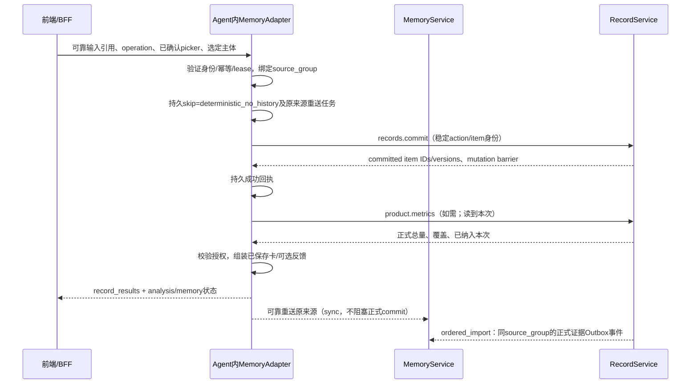
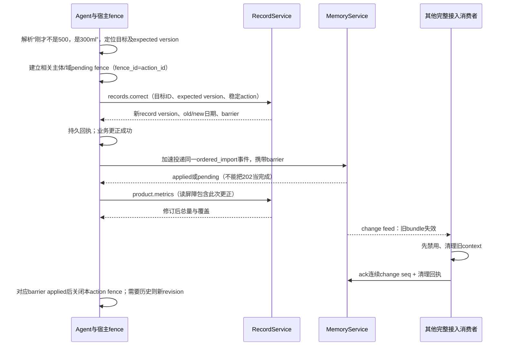

# V1：Agent 内部时序、状态机与异常恢复

版本：设计 V1.2 修订1，2026年10月27日整体审查修订。

状态：开发与验收合同草案；本文件规定目标行为，不表示现有 Agent、demo 或记忆服务已经实现。日期：2026-10-27（America/New_York）。范围、模型和接口分别以本目录其他规格为准；本文件说明调用这些接口时必须维持的运行约束。

## 1. 运行边界与不可破坏的约束

产品发送一律进入通用记录型 Agent。`MemoryAdapter` 是 Agent 应用/运行时内的可信编排组件，调用独立 MemoryService；它不是模型 prompt 中“请先回忆”的约定，也不是前端直接访问个人记忆的客户端。适配器可以使用 REST/SDK，向模型暴露的补查、记忆写入能力可以包装成 MCP 工具。传输方式不改变权限、版本、幂等和删除语义。

| 参与方 | 在本调用链中负责 | 不能据此获得的职责 |
|---|---|---|
| 产品前端/BFF | 可靠接收输入、用户状态、业务权限、主体选择、产品结果呈现 | 决定一条模型候选已成为正式事件；向模型或终端发放可伪造 owner 的记忆凭证 |
| Agent 及 MemoryAdapter | 每轮 context 决策、预算、工具编排、回执恢复、用户回应 | 在没有工具成功回执时宣称正式已记；绕过宿主身份与运行时准入门禁 |
| RecordService | 正式事件/数值、稳定条目身份、幂等提交、更正、删除、正式指标 | 依靠向量 top-k 得到完整统计；把一条输入直接等同于一个业务事件 |
| MemoryService | 来源镜像、用户陈述及偏好等记忆、召回、派生、来源依赖、失效与删除传播 | 运行 ASR/VLM；重复创建权威生活事件；代替产品统计、医学或营养算法 |

以下约束为 MUST：

1. “原始输入已接收”“正式条目已保存”“需要补充”“记忆已接收/可检索”“分析完成”分别记录。原文持久化不是正式记录成功。
2. 自然语言、ASR/OCR 解析可以有多个候选，明确部分可提交，歧义部分待补。已确认 picker 直接走类型化校验，不先转换成文本再抽取。纯查询不新增生活事件。
3. 同一业务条目仅由 RecordService 产生。后台记忆抽取可以生成 `user_reported` 线索、检索标签或候选，不创建第二份饮水/体重/支出正式观测。
4. 原始输入及后续正式提交通过同一 `source_group_id` 关联；正式回执镜像使用 `external_record_ref`，不是把工具返回文本再当一条新生活输入。召回优先采用已确认且有效的证据，并保留原始用户表达的来源等级。
5. 本次记录后的总量从 RecordService 成功回执之后查询。MemoryService 不对“今天正式喝了多少/花了多少”提供权威 metrics。
6. 每个模型 step、工具执行和结果交付前重新校验当前身份、授权与所用 bundle。已过期、撤回或删除依赖的内容不能因为幂等重放而继续交付。
7. 检索故障显式标记为 degraded/timeout/not_caught_up，不能表示“没有历史”。`no_relevant_history` 仅用于检索正常完成且在声明范围内没有适用证据。

`owner_subject_id`、`about_entity_id`、reader、Agent identity、scope 从可信宿主认证/授权派生。模型可以建议要查的业务主体，不能直接指定或扩大访问权限。同名两个宝宝、妈妈代记宝宝和伴侣只看回顾均需通过这些字段区分。

## 2. MemoryAdapter 的宿主接入点

### 2.1 目标生命周期

| 接入点 | 可信组件必须做什么 | 允许向模型提供什么 |
|---|---|---|
| `accept_turn` | 绑定产品 operation；核验身份、已选主体和 input hash；取得独占执行 lease | 当前输入及必要的已选字段，不含凭证 |
| `prepare_turn` | 持久一次 context 决策；需要历史时幂等镜像原来源并 prepare，确定无需历史时记录 skip；冻结实际取得的证据快照与 hash | 标为外部资料的 evidence、来源、时间、不确定性、缺口和降级状态 |
| `before_model_step` | 宿主原有准入检查；在线 validate 所有将使用的 context/read-result bundle，必要时清理并重新 preparation | 当前有效 bundle 加本轮已确认工具回执 |
| `before_tool` | 解析受控工具名；验证 scope、主体、参数、action identity、目标版本；在线 validate 将依赖的 bundle | 不能让证据中的指令提升工具权限 |
| `after_tool` | 先持久回执；记忆补查正文登记 usage bundle 后才可入模；新提交/更正产生读屏障 | 工具实际结果、正式条目 ID/version 和明确失败状态 |
| `before_delivery` | 再查授权，在线 validate 回应依赖的 bundle；把输入、记录、分析状态组合为产品响应 | 仅当前允许交付的结果，禁止输出撤回原文 |
| `stop/interrupt` | 记录终止原因、已提交动作与未决动作，释放 lease；不回滚已提交事实 | 产品可恢复的 operation 状态 |
| `invalidation_listener` | 消费 change feed，先禁用受影响 bundle，再清理宿主上下文/缓存并 ack | 不直接触发一条新的用户记录 |

每个有效用户 turn 做一次持久 context 决策，需要理解自由输入、指代或消歧时在首个模型请求前 prepare；不是每个模型 step 都重新跑完整检索。已确认 picker、具有可信确定性路由的纯 metrics 查询，若主体、字段及回应均不依赖历史，记录 `skip=deterministic_no_history`，不为取得空包而远程检索。正式提交不等待记忆 upsert/prepare，原输入镜像由可靠输入存储及持久重送队列补齐；后续确需个性化反馈时再 prepare。自由文本未经理解不能仅凭猜测套用 skip。仅在新提交/更正需要更新事实、显式补查、bundle 过期/失效、权限变化或证据不足时开启新的 preparation revision；重复 callback 沿用原决定或同一 revision，不重复计费检索。

V1 不以有效 consumer 租约、heartbeat 或暂未收到 change 代替在线 validate。每个新模型 step、工具执行及基于记忆的结果交付前，对实际依赖的全部 bundle 验证；有多批时全部通过才放行。没有使用记忆的确定性路径仍经过宿主身份及工具门禁，不凭空创建需要验证的 bundle。失效流负责尽早取消与清理，不能证明尚未送达的变更不存在。

“每轮做context决策”不等于每轮无条件发送远端检索。来源主体未解析时可按来源schema以null镜像，但context/search需要具体获授权主体；不能填一个猜测的self或扩大到所有宝宝。宿主将本轮记忆决策持久为未准备、reason=`subject_unresolved`（这是适配器状态，不是Memory API成功空包），以当前输入处理可明确内容或追问；主体明确后的新turn再正常prepare。空间级偏好/约束可空的范围由注册schema决定，不借此获取全空间历史。

交付门禁覆盖开始发送及后续失效事件：流式回答一旦收到相关失效立即停止未交付部分，撤销待发送队列并返回可恢复状态；不能保证收回失效前已经送达用户或第三方的字节。V1 若宿主不能对生成与发送同时实施失效取消，则涉及敏感记忆的回答先缓冲、完成当前授权校验后再交付，不以最后一刻的单次校验冒充可回收流式输出。

context 默认预算为 1,200 tokens、8 个 evidence items、1,800ms deadline；服务硬上限为 4,000 tokens、20 items、3,000ms。deadline 包含同步鉴权、版本检查、召回及组装。V1 前台不调用 LLM 规划器、Observer 或摘要生成器；后台富化可独立失败。预算是 memory 数据预算，不是主 Agent 整体输入/输出预算。

### 2.2 当前 agent-service 的落点与新增工作

已静态核对参考仓库：`LifecycleHookService` 已定义 `beforePrompt`、`beforeModelStep`、`beforeTool` 及观察阶段，但配置类型中的 `memory-injection` 只有固定 `prefix/append`；中间件只是拼接静态文本。[类型与配置](/Users/zhangguoqiang/ai-workspace/claude-workspace/meetyou/agent-service/packages/core/src/hooks/lifecycle-types.ts:50)、[静态拼接实现](/Users/zhangguoqiang/ai-workspace/claude-workspace/meetyou/agent-service/packages/core/src/hooks/middleware.ts:225)。因此，远程动态记忆不能被描述为现成 hook 功能。

V1 需要在 Agent 应用编排器新增 `MemoryAdapter/MemoryProvider` seam；需要历史的路径在第一次模型请求前取得 bundle，通过有数据边界的动态输入注入；确定性无需历史路径持久 skip。模型前、工具前和输出前在线验证实际依赖的 bundle。若随后将它做成新的 lifecycle package，须继续经过现有 server-derived owner、`authorizeSubject`、fleet 准入、tenant/runtime epoch、超时、close/drain 等门禁。独立记忆权限不授予工具执行或子 Agent 委派权限，不能用一层插件绕开这些门禁。

参考示例在外部读取 business record 后启动 turn，且 operation 状态保存在进程内 `Map`。[参考编排](/Users/zhangguoqiang/ai-workspace/claude-workspace/meetyou/agent-service/examples/record-assistant/reference.ts:108)。生产接入应把本文件所列 journal/lease/回执放入持久存储；不能照搬该 Map 作为恢复保证。

### 2.3 当前输入与历史证据分离

点滴A的实时路径即由可信宿主将稳定runtime user item、planned source/group及首写身份写入持久journal，并在实时来源带origin_ref；正式回执先到则按02预约input_origin_binding。宿主持续可靠传播已计划/已摄取会话的删除与撤权，关闭history不关闭02§3.1的生命周期通路。不能等离线发现遗漏时另造group；其他非聊天Agent不强制伪造origin。具体历史Adapter及来源覆盖合同见[06](06-history-ingestion-and-repair.md)。

同步来源 upsert 可让明确用户陈述立即具有 `user_reported` 证据身份，但初始 context 默认排除本次输入及同 `source_group_id` 下的对应镜像，避免“把当前话作为过去事实”召回。当前输入始终以独立区域交给模型；本轮正式提交回执也单独提供。

记忆包中的历史原文、检索到的卡片文本、网页片段均是不可信数据，不能成为 system instruction。不得自动将 assistant 回复、卡片、被检索到的旧证据、模型自述“已保存”写回为新的生活来源。`memory.remember` 只接受获授权的显式用户陈述/偏好或带来源的 Agent 候选，写入来源等级保持不变。

## 3. Operation、快照与读屏障

### 3.1 Agent 外部持久 journal

operation 属于产品/Agent 应用，不属于 MemoryService。最少持久字段如下；存放在同一数据库不是强制要求，持久和可核对是强制要求。

| 字段组 | 必须保存的字段/含义 |
|---|---|
| 身份 | `operation_id`、`client_operation_id`、tenant、Agent/adapter identity/version、session/turn ID、`owner_subject_id`、`about_entity_id` |
| 输入 | 不可变 `input_hash`、可靠输入存储引用、模态、转写/OCR版本、已确认字段、用户时区、发生时间解析基准；planned source_id/source_group_id、原生origin、规范化首写payload/hash及first-write key/caller_revision_key或可靠重建引用；生命周期Outbox/checkpoint与scope抑制引用 |
| 准入 | 初始及当前授权 snapshot/hash、`policy_epoch`、宿主 runtime/context epoch、scope、是否存在外部 pending mutation fence |
| 执行 | operation state、revision、lease owner/expiry、CAS version、开始/更新时间、截止时间、终止原因 |
| 记忆 | context 决策/skip reason、`source_id/source_version`、source receipt/可靠重送引用、write token、`preparation_revision`、prepare request hash、context及read-result bundle ID/hash、snapshot、expiry、memory status |
| 动作 | 稳定 `action_id`、canonical payload hash、候选 item ID、目标 ID/expected version、调用是否发出、回执/查询引用、外部流 barrier、同 action 的 fence ID/状态/关闭依据 |
| 模型与输出 | 模型 invocation ID、已发起/已确认/未知状态、usage 回执、部分/最终产品响应引用、SSE delivery cursor |
| 收敛 | record outcome、analysis status、clarification refs、view invalidations、consumer 清理回执 |

prepare请求携带 `turn_ref={session_id,turn_id}` 和独立的 `preparation_revision`（默认1，由宿主持久分配）。输入/任务改变使用新的turn/steer identity；补查刷新、失效或过期以 `preparation_revision+1` 和新幂等key表示，不能假装用户发送了新生活记录。每个已登记 turn_ref + preparation revision identity仅对应一个prepare请求hash和逻辑bundle；第一次成功的 `bundle_hash/snapshot` 冻结后，同key的网络重试在幂等保留期内返回同一逻辑结果，仍须满足5分钟正文有效期和当前授权。幂等结果至少保留30天；到期后按稳定身份核对，不保证原正文可重放。不能借“重试”改变查询、主体、输入或预算；payload不同返回conflict。授权收缩、依赖撤回和删除优先于固定重放，旧快照内容不再返回。

context:prepare 必须返回 `canonical_injection` string（最大32KiB）及 `bundle_hash`。hash是该字符串**确切UTF-8字节**的SHA-256，排除HTTP诊断字段与宿主外层wrapper；不是对items再次JSON序列化后得到的另一个摘要。整个字符串计入token预算；未知tokenizer时标记estimate，满足字节上限与所声明的估算预算，不承诺未知目标模型的精确token数。宿主核对hash后原样注入，可加受控的外部data wrapper，但不能改串、重排条目、据items重拼或继续把修改过的内容标记为原bundle。公开items/gaps和注入串必须在来源、权威、时间、使用限制及缺口上相符。journal保存hash及精确使用的bundle身份，不把这份hash当作授权或匿名化凭据。补查返回的 read-result bundle 摘要按02原样保存/回传，客户端将其视为 opaque，不套用 canonical_injection 的计算规则。

bundle 最长有效 5 分钟。context 操作仍需继续时，显式增加 `preparation_revision` 并重新准备，记录原因和父 revision；read-result 过期则重新取证并登记新 usage bundle。过期不能用同一个 prepare key 换取新的证据；旧 bundle 可保留审计元数据/hash，不得作为新模型 step 的输入。已提交动作和成功回执跨 preparation revision 保留，刷新记忆不重置业务幂等身份。

### 3.2 `read_after` 的含义

API 使用 `read_after={write_token?, external_barriers?, required_sources?}`：

- `write_token` 是 MemoryService 返回的不透明令牌，客户端不解析或自己拼接。它证明指定本地变更的屏障，不替代当前授权检查。
- `external_barriers=[{stream_id, through_seq}]` 指定权威来源变更流必须连续应用到的位置。已看到 seq=105 但缺 103 时，连续水位仍只能是 102；不得以 `max(seq)` 宣称 ready。
- `required_sources=[{source_id, source_version}]` 指定所需来源版本；新版本可满足“至少此版本”，删除/撤回必须反映为不可用，而不是偷偷回退旧版本。

`source_version` 由 MemoryService 分配。原始输入等直接 upsert 用 `expected_source_version` 做 CAS，创建使用 0。外部正式条目镜像统一走同一 registered ordered_import；`external_record_ref={system_id,record_id,external_version}` 的稳定身份只取 system_id + record_id，external_version是不透明出处版本，不冒充Memory版本。前台同步通知只是加速投递同一Outbox event并可等待applied，不另开sync镜像通路。ordered import先写inbox并返回accepted/202，只有连续顺序应用后才产生对应applied receipt/write token。存进inbox不代表来源已可检索。

屏障尚未满足时，服务在 deadline 内等待；无法安全满足时返回 `503 FRESHNESS_UNAVAILABLE` 或 `504 FRESHNESS_TIMEOUT`，不返回带历史正文的partial/empty成功包。宿主把这次记忆能力标为未追上，可使用不依赖这些旧值的当前输入和权威回执继续，或等待/追问。涉及被更正/删除的事实不能降级到旧版本。只有read_after已满足而非必需索引通道落后，才允许safe partial。正式 metrics 带 RecordService 自身读屏障；不能因为 MemoryService 追上了流就推断产品统计投影已追上，反之亦然。

### 3.3 更正与删除的跨系统边界

RecordService commit、其 Outbox、MemoryService 失效、消费者清理是跨系统 saga，不能宣称同一事务。MemoryService 对旧证据不可见的本地保证始于其失效操作 **applied 回执**，不是产品记录刚 commit、通知尚未到达的时刻。

产品/完整接入宿主在发起更正、删源、撤权时先建立 owner/entity/domain 级持久 pending fence，`fence_id=action_id`。后续相关读取按全部未关闭fence的范围并集阻断或等待各自barrier。尚未发出请求且已持久取消，或权威终态证明该动作未提交且不会迟到提交时，按该依据关闭fence；普通超时、NOT_FOUND、lease到期不构成未提交证明。结果unknown保持fence。已committed动作只有Memory应用到对应event/barrier后才能关闭其fence，不能用另一个并发动作的成功回执解除整个域阻断。

RecordService commit后同步加速通知和Outbox重试必须投递同一ordered_import事件、沿用stream/seq/event/hash；只有对应applied回执或连续barrier满足才关闭该动作fence。失败时正式记录可以已改，记忆清理仍显示pending。本产品如果承诺多个Agent在产品commit后都立即停止使用旧历史，这些宿主必须共享持久pending fence；独立第三方即便完整实现MemoryService生命周期，仍只能从通知接收/校验起停止旧包，不能凭空知道未送达的产品更正。

删除/撤权遇到网络隔离时，不能向用户宣称“所有 Agent 已忘记”。页面分别呈现业务删除完成、记忆失效/清理进度和未确认消费者。对无法控制的宿主，服务撤销后续读取凭证和 bundle 使用权，但不能证明它已删除之前复制的文本。

## 4. 代表调用时序

### 4.1 已确认 picker：无须主模型的确定性路径

picker 的领域、单位、主体和时间已经确认，可信路径确定保存和卡片均不依赖历史时，正式commit不等待记忆请求。可靠重送的source_id、caller_revision_key和source_group固定，不能每次补送新建来源；镜像未应用时memory状态保持pending。若额外反馈确需历史，在成功回执后另行prepare，不能拖延正式保存或改写已确认值。最近药名只用于补全，不能把历史用过解释成当前长期服药。输出“已记”只取决于RecordService成功回执；没有历史时不编造昨日体重或七日曲线。

### 4.2 “午饭面条，还喝了 300ml 水”：一次输入、多项保存

1. BFF 可靠保存输入，Agent 绑定同一 operation/source group，并同步镜像来源；初始 prepare 返回相关偏好、必要历史或明确空/降级包。
2. 主模型输出饮食事件和饮水 300ml 两个带稳定 candidate/item ID 的候选。它们共用输入来源，但不是同一事件；模型在工具参数中声明依据片段、主体、发生时间和单位。
3. `records.commit` 校验两个候选。饮水量及主体明确可提交；饮食可以保存“午饭面条”的用户陈述，不因缺份量推断热量。某候选歧义则逐项 pending_clarification，不丢弃明确部分。
4. Agent 先持久逐项回执，再调用 `product.metrics` 读取本次已纳入的饮水量。后台抽取不得再创建一笔 300ml。
5. 只有当前回复需要新增事实时才刷新 context/补查；当前新增量直接来自工具回执，不再作为历史检索结果加一次。
6. 按 demo 规则优先展示饮食反馈，同时两个 record_results 均可见；展示优先级不影响保存完整性。营养算法不在 V1 记忆服务内，不能把缺失估算写成确定营养事实。

两段相同原话是两次真实发送时，只有用户/客户端使用相同 operation identity 才按重试处理；不得仅凭文本近似或时间接近删除第二杯水。

### 4.3 已转写语音：两次喂奶与一次换尿布

输入示例为“昨晚 3 点喝了 100ml 奶，然后换了 1 片尿布，早上 7 点又喝了 120ml 奶”。V1 接收既有 ASR 的文本、版本和原媒体引用，不执行 ASR。

| 步骤 | 必须行为 | 不确定时的行为 |
|---|---|---|
| 绑定主体 | 使用产品已选宝宝 `about_entity_id`，每个候选显式携带 | 未选且历史不足时追问，不能默认妈妈或任意宝宝 |
| 时间解析 | 以用户时区和此次输入的 reference time 解析日期，保留原文、区间与精度 | “昨晚3点”跨日或顺序不能唯一判断时，不伪造精确日期；先保存明确项或待补 |
| 拆事件 | 两次喂奶分别稳定 item ID，换尿布单独事件，共用 source_group | 换尿布没有明确时点可保留相对顺序/时间区间 |
| 提交 | 明确三个事件可批次提交；普通新增允许逐项结果 | 未明确部分 pending，后续补充复用候选身份 |
| 统计 | 正式喂奶量 220ml、事件两次，尿布一次；按各自发生日统计 | 未确认的日期/数值不进入要求确认的正式日总量 |
| 转写修订 | 新 ASR 版本是同来源的修订，若已有正式条目则产生更正候选 | 不能以转写重跑自动增加三条新记录或静默覆盖用户已确认数值 |

原音频、转写和确认字段存在来源链；删除音频时必须依据用户选择区分“仅删媒体”“删除整段记录及关联条目”。纯删媒体不自动删除已确认条目，整段删除则需对应 RecordService 动作和记忆失效 saga。

### 4.4 更正后立即统计

目标不唯一时先追问；可用上一轮的实际 `retrieved_memory_ids`、record refs 和卡片选择帮助定位，但不得仅凭相似度直接修改。`expected version` 不匹配返回 conflict，重新读取当前版本后向用户说明冲突，不以 last-write-wins 覆盖。

更正 500→300 是修订原事件，不新增一杯。改发生日期时，旧日期、新日期的 metrics、日历和回顾都失效。跨字段需要保持一致的同一事件更正是 RecordService 的原子修订；多个无关新增事件允许部分成功，两者不能混用。

若 MemoryService 未追上，Agent 可依据正式回执及新的权威 metrics 回答“已改为 300ml，今天记录总量为…”，同时标记 memory pending；不得从旧 bundle 继续说 500ml，也不得宣称所有其他 Agent 已完成清理。

### 4.5 纯查询与无需保存的交流

“上个月体重怎样”“今天花了多少”“我上次用什么药”仍进入Agent，做一次context决策。已有可信确定性路由且仅需正式总量/完整曲线时，记录skip=deterministic_no_history，直接调用product.metrics/list，不为查询本身写生活事件或等待记忆。自由输入若仍需模型理解、指代或消歧，首个模型请求前prepare；零散原话或语义关联调用memory.search。不同主体和范围按授权过滤。

查询文本可留在操作/会话日志，若镜像为输入来源，`source_kind` 仍为 `user_input`，其 query/conversation处理方式放在注册输入schema元数据/摄取策略，不另发明顶层source_kind。纯查询不生成新的体重、支出或服药事件，也不将问句“我是不是失眠了”提取成“用户患失眠”。`memory.remember` 不是每次答完必调的尾钩。正常零历史与检索故障分别反馈；无昨日测量时显示缺失，不能用 demo mock 填补。

### 4.6 偏好、不再提及、忘记与删除

| 用户动作 | Agent/产品动作 | MemoryService 行为 | 保留/完成语义 |
|---|---|---|---|
| “回复简短些”“我不吃花生” | 将明确用户陈述作为偏好/约束写入；不是生活事件提交 | `remember` 同步持久、返回 write token；后续读取屏障确保可见 | 保存来源、生效时间、证据等级；不靠日终摘要才生效 |
| “这件事别再主动提” | 定位话题/记忆与适用 Agent/场景，写 suppress policy | 召回策略避免主动带出；显式查询是否可见按策略定义 | 不宣称原文已删除；频控/展示状态不当成新的生活事实 |
| “不用这些信息个性化” | 写 personalization exclusion，必要时清理活跃 bundle | 排除相应 personalization 用途；按政策保留直接查看能力 | 用途限制不等同硬删除 |
| “删除这条记录” | 以明确 record/source 选择执行 RecordService 删除并建立 fence | 关联来源/派生失效，消费者清理，按保留政策清理物理副本 | 正式记录删除与 Memory applied/清理阶段分别回执 |
| “删除我的全部记忆” | 确认已指定的 owner、范围；无明确范围则消歧，不猜全部产品账本 | 按 memory-only 或已授权级联范围执行 forget task，先逻辑阻断再清理 | memory-only 不删除 RecordService 正式账本；需阻止Outbox/重建重新导入 |

源级 forget 建立 durable exclusion/tombstone。删除全部 memory 时记录已覆盖的来源范围、generation 和再导入策略；默认不自动重灌历史，新增来源可以依新策略摄取。删除后晚到的工作、旧 event 重放或模型 completion 不能复活旧证据。用户另行明确重新授权导入才建立新的可审计 generation。

full宿主还须持久维护source/source_group→原消息、工具正文、压缩摘要和反馈的映射，以及自动重注入抑制。memory-only erase不删除产品可靠输入或正式账本，但会话恢复、滚动历史、自动compact、重新抽取、Outbox和历史backfill均不得从这些副本把已擦除内容自动放回模型或Memory。收到失效后先隔离受影响上下文，丢弃其派生并建立干净会话，再ack。用户以后明确要求查看产品保留历史，属于另次明确授权的产品查询用途；不等于重新授权导入Memory，也不能借自动恢复冒充该请求。

## 5. 五组状态机

以下大写状态是各组件内部持久执行状态，不直接替代API的 `status=accepted/applied`、`result_status=ready/empty/degraded`、freshness或HTTP错误。实际wire字段及错误码以[API合同](02-api-contract.md)为准。正式业务记录版本由RecordService协议定义；本文的 `memory_kind` 使用 `fact_evidence / explicit_preference / explicit_constraint / derived_insight / episode_summary / unresolved_item`，不能沿用旧稿中同名或近义的memory_type枚举。

### 5.1 Agent operation：属于产品/Agent 应用

operation 的主状态与 `record_outcome`、`analysis_status` 分开。`record_outcome` 可为 none/partial/committed/unknown；`analysis_status` 为 not_started/running/complete/degraded/failed。COMPLETED 可以同时有 partial records 和 pending clarification，不能用一个布尔 success 混淆。

| 状态 | 进入条件 | 合法下一状态/恢复条件 | 禁止行为 |
|---|---|---|---|
| ACCEPTED | BFF 可靠输入存在、hash已绑定 | PREPARING；授权/输入不合法→REJECTED | 尚无正式回执便显示“已保存” |
| PREPARING | lease有效，持久skip或镜像来源/prepare context | EXECUTING；需要等依赖→RECONCILING；无法继续→FAILED/CANCELLED | 同revision更改payload；重复callback重新收费检索；确定性保存等待无关记忆请求 |
| EXECUTING | 有有效bundle或明确降级决策 | WAITING_INPUT、RECONCILING、FINALIZING、CANCELLED | bundle失效后继续使用；由模型宣称工具已成功 |
| WAITING_INPUT | 仍有候选需要用户选择/补充 | 新输入以新operation关联旧pending item；原operation→COMPLETED | 换候选ID重新创建已提交部分；无限期持有lease |
| RECONCILING | 写入/模型调用结果未知、外部水位未追上 | 只读核对得知结果后→EXECUTING/FINALIZING；需人工处理→保持未决或FAILED | 未查明结果就新key重写或自动付费重跑模型 |
| FINALIZING | 所有可确认回执已持久，准备交付 | COMPLETED；交付前权限变更→清理/RECONCILING | SSE断线即撤销已提交记录；交付旧敏感内容 |
| COMPLETED | 持久产品结果与状态可重放 | 只读重放；旧bundle失效时返回脱敏状态/重新授权结果 | 相同operation再次执行保存动作 |
| REJECTED | 输入/权限在执行前不合法 | 终态；用户以新operation修正输入 | 使用拒绝请求的来源进行跨主体记忆写入 |
| FAILED | 已知错误、当前流程停止；仍保留已提交回执 | 读结果；显式重试可恢复同动作核对，不能抹去成功部分 | 将partial改成none；自动重新生成/提交相同事件 |
| CANCELLED | 用户/宿主中止，停止新的动作 | 核对已发出动作；结果未知仍列未决，已成功继续可读 | 把取消当事务回滚，删除已确认记录 |

同 operation 并发请求只允许一个持久 lease 执行，其他请求返回当前状态/结果。lease 过期后的接管先读取 action journal、外部回执和 bundle 状态，再推进；不得直接从 EXECUTING 起点重跑。失去 lease 的旧 worker 即使拿到迟到模型结果也不能发出新工具动作。

### 5.2 Memory source 与 ingest job：分别保存状态

source 的当前可见性与后台任务进度必须分开。源表最少持久：`source_id/source_version`、`source_group_id`、类型/来源等级、external ref、owner/about entity、payload hash/引用、授权投影、`visibility_generation`、`policy_epoch`、删除/撤回标记、当前已应用流位置。job 表最少持久：job/idempotency/event ID、精确 source version/generation、pipeline/parser/model version、state、attempt、lease、next retry、错误类别及结果引用。

| 对象/状态 | 合法迁移 | 恢复与可见性规则 |
|---|---|---|
| source `active` | 修订→active(new source_version)；撤回→retracted；擦除→deleted；授权变化推进epoch/generation | 所有更新CAS；旧版本可审计，不再被当前检索使用 |
| source `retracted` | 保持不用于当前事实；仅trusted authoritative_reconcile凭权威证明修订为active；擦除→deleted | 普通upsert/新文本修订不得恢复；语义撤回不自动启动隐私物理删除；旧worker不能令其重新active |
| source `deleted` | lifecycle保持deleted；独立purge阶段queued→running→complete/blocked | 保留最小删除凭据；旧event、upsert、重建均不能复活；重新记录用明确新来源身份 |
| import delivery `received` | 有缺口→waiting_for_predecessor；前序齐全→applying；事件冲突→quarantined | accepted/inbox不等于来源已applied或可检索 |
| import delivery `waiting_for_predecessor` | 连续前序补齐→applying；异常→quarantined | 不跳序推进stream watermark；长期缺口报警/权威对账 |
| import delivery `applying` | 事务成功→applied；有权威替代证明→superseded；冲突/不可修复→quarantined | worker接管先核对事务回执；无合法证明不能跳过毒消息凑水位 |
| import delivery `applied/superseded` | 对该event终态 | applied表示来源镜像与失效门禁已应用；superseded必须保留权威对账证明；两者不表示embedding完成 |
| derivation job `queued` | 抢lease→running；来源版本已旧/失效→superseded | worker重启后可重新抢未执行任务 |
| derivation job `running` | 有效产物持久并发布→published；输入已旧→superseded；错误→failed | 发布前CAS核对source version/generation/policy；迟到结果不能复活旧值 |
| derivation job `failed` | 可证明安全且有界重试→queued；否则保持failed并标retry_wait/dead_letter/unknown_paid_call恢复原因 | 有退避、next retry、attempt上限；付费调用未知先核对，不无条件重新调用 |
| derivation job `published/superseded` | 对该job终态；新来源版本/新pipeline建新job | 重跑使用同一输出身份或新可审计版本，不能追加正式观测；superseded不发布旧结果 |

同步来源落库后，关键用户陈述可以走轻量原文/词法路径；向量、画像和摘要可以等待后台 job。source ACTIVE 不保证所有索引ready，API必须单独报告检索覆盖与pipeline水位。

### 5.2.1 后台取消、接管与付费调用

启用06的history run时，沿用现有持久任务记录保存`cancel_requested`、`run_epoch/lease_epoch`及动作journal，不要求新增队列平台。取消事务是后续新动作准入的线性化点；扫描新页、来源首次应用、付费调用dispatch及派生发布，均须在准入时核对当前run的取消状态和epoch，准入与取消在同一run/epoch串行门禁内持久记录。失去lease的旧worker不能凭其缓存状态继续准入；接管先核对已准入动作及回执，再领取新epoch。

取消前已经准入或已经发出的动作可能完成，必须按journal核对，不冒充回滚；`200 cancel_requested=true`只确认取消请求已持久接收，不代表已经没有在飞动作。停止该run拥有的后续动作后，所有在飞动作均有确定结果或明确记录为unknown，才可把顶层状态收敛为cancelled；未知费用及未决phase仍保留。取消后到达的生成结果只可留必要受控诊断/费用证据，不自动发布新的记忆。已接受来源与取消前已发布记忆继续受正常更正/删除规则管理；原由live请求合法创建、仅被run复用的job不属于该run，不随其取消。

所有付费调用统一覆盖embedding、抽取、摘要及主Agent生成，由各自调用方负责：MemoryService管理自己的embedding/worker调用，主Agent生成由宿主管理，不扩大记忆服务边界。发出前持久分配稳定invocation身份、请求hash及预算预留，记录发送准入和attempt；provider支持时附稳定请求/幂等引用，响应后补绑定其request ID，结果/usage核对后再结算。传输超时、进程退出和provider暂时查不到请求均不能证明未执行或未收费，须标`unknown_paid_call`并保留预留/未知用量，不因换run、新lease或修复任务自动重发。仅在provider明确幂等合同或权威未执行证明支持安全重试时才重调，attempt与可能费用单列；本服务不承诺provider侧exactly-once计费。

首发在线可靠重送同样执行稳定来源身份、只读核对后复用及上述适用的调用恢复规则，但不依赖history API、批量扫描或run取消接口。history任务控制是启用相应能力后的附加合同。

### 5.3 Context 与补查使用 bundle

持久字段至少包括bundle ID/kind、context对应的operation/preparation revision或read-result的请求身份、session/turn、request hash、服务端content hash、读snapshot、水位、精确source_id/version和memory_id/version依赖、owner/entity/scope、visibility_generation/policy_epoch、创建/过期时间和当前状态。引用来源列表不是可选观测字段，而是失效和清理所需依赖。

`full_lifecycle` 的 `context:prepare` 必须传已注册 `consumer_id`，成功prepare即登记consumer→bundle→session/turn依赖，表示可能被宿主取得，尚不等于实际注入。所有full补查search、evidence:batchGet、facts:query正文请求必须由可信wrapper补入 `consumer_context={consumer_id,session_id,turn_id}`；服务在交付正文前原子登记其来源、版本、投影及派生依赖，并返回 `usage_bundle={bundle_id,bundle_hash,expires_at,bundle_kind:read_result}`。若补查响应丢失，已登记的可能持有者仍纳入清理责任，不靠模型是否引用判定已持有。

context与read-result句柄复用bundles:validate、change、ack和reset，不另造第二套失效协议。read-result的bundle_hash由服务生成，客户端按02作为opaque摘要原样保存/回传，不自行按HTTP或canonical串重算。首次正文入模、后续模型step、工具执行及交付前均在线验证所用bundle；服务在valid回执前复核consumer、bundle及session绑定，不匹配返回conflict。宿主持久依赖后才把补查正文加入工具历史。未注册/未经过validate的tool-only副本标为uncontrolled，不计入已确认强消费者清理。

| 状态 | 合法迁移 | 使用规则 |
|---|---|---|
| PREPARING | 检索与权限通过→READY；正常空结果→READY(empty)；read_after满足但非必需通道落后→DEGRADED；不可授权→REJECTED；屏障不能满足则请求失败且没有可用bundle | 未完成或屏障失败不能注入模型 |
| READY/DEGRADED | 到期→EXPIRED；依赖变更/删除/撤权→INVALIDATED | DEGRADED也有固定hash/理由；不能将其解释为空历史 |
| INVALIDATED | 终态；context用新revision、read-result用新取证生成新bundle | 立即停止新step/工具/交付引用；旧幂等重放只返失效元数据 |
| EXPIRED | 终态；context用新revision重新prepare，read-result重新取证 | 不在原prepare key下替换内容；保留审计hash |
| REJECTED | 终态 | 不返回被拒绝的正文或来源存在性细节 |

依赖更正可以使旧包失效，即便旧文本看起来与当前提问仍相关。runtime清理覆盖context与read-result注入、原消息自动滚动重放、会话缓存、工具缓存及压缩摘要；不能只删除下一轮append却把同样内容留在compacted history。operation journal中的最终feedback/部分回复/可重放响应也登记依赖；失效后保留正式业务回执与状态，但移除、重算或脱敏相关记忆正文，不能通过GET operation/SSE重放泄漏旧内容。清理后的持久自动重注入抑制不得随会话重启丢失。hash只用于一致性核对，不视为匿名数据，按相同访问和擦除政策处理。

### 5.4 Forget task

任务持久记录 `forget_task_id`、幂等hash、已授权范围/删除策略、source/memory依赖范围、generation、authority删除回执、logical fence receipt、独立控制/擦除ledger的intent ID/seq及核对状态、物理清理进度、consumer清理进度、阻塞原因和审计摘要。删除scope确认后不允许同key更换范围。

| 状态 | 下一状态 | 可向用户表达什么 |
|---|---|---|
| ACCEPTED | 核验范围并持久独立ledger intent→FENCING；范围歧义/无权→REJECTED；ledger不可用→待重试且不宣称持久完成 | 请求已受理，尚未保证不可见 |
| FENCING | 独立ledger与DB失效事务均可核对、Memory逻辑不可见applied→INVALIDATED；暂时失败→RETRY_WAIT | 产品记录可能已删；memory失效仍在处理；仅有ledger intent时保守排除pending范围 |
| INVALIDATED | 发派生/索引/缓存清理和change feed→PURGING | Memory新读取已禁止使用相关内容；已有远端副本清理未必完成 |
| PURGING | 所有服务内清理完成→WAITING_CONSUMERS；可重试错误→RETRY_WAIT | 正文/派生清理进度；备份按保留策略过期，不当场承诺物理全销毁 |
| WAITING_CONSUMERS | required full消费者清理ack全部达到→COMPLETED；其中离线/未确认者保持pending | 不可控宿主单列unverified，不阻塞指定可控范围completed，也不称其已清理 |
| RETRY_WAIT | 到期回到未完成阶段；需处理→BLOCKED | 已有逻辑fence不回滚，失败不恢复可见性 |
| BLOCKED | 外部问题修复后回到原未完成阶段 | 清理未完成及具体原因；不能自动变completed |
| COMPLETED | 终态，保留无正文审计/墓碑 | 指定可控范围已完成；声明备份保留及不可控远端范围 |

memory-only forget 和产品正式记录删除的 authority 回执要求不同。未授权删除 RecordService 时，不能执行其删除；已选择 memory-only 时，通过排除标识阻止剩余业务记录自动重灌。

### 5.5 Consumer/宿主会话

完整接入消费者持久 `consumer_id`、Agent/session身份、capability profile、state、最后校验时间、lease expiry、连续 `last_seen_change_seq`/`last_acked_change_seq`、active bundle依赖及已清理回执。服务change feed至少包含 `change_seq/event_type`、受影响source/memory版本、generation/epoch、bundle IDs和是否要求重置context。

full注册的订阅范围由grant派生，source/group失效通知和清理责任不局限于已取得bundle的宿主。picker跳过检索但保留原用户消息的会话也可能需要清理；宿主按source/group把它映射到原消息/摘要/反馈，持久抑制自动重注入，再确认处理。输入尚未镜像时使用稳定group键，后到来源不得绕过。没有本地副本也须保存该抑制并按既有reset receipt回执；不能用“没有bundle”代表整个会话已忘记。产品原始输入和正式记录仍不属于memory-only的物理擦除范围。

| 状态 | 迁移 | 行为 |
|---|---|---|
| ACTIVE | 收到相关失效→BLOCKED；feed缺口/lease到期→REVALIDATION_REQUIRED；退出→DETACHED | 每个model step/工具执行/交付前在线validate实际依赖的全部bundle，不能只靠监听器或lease |
| BLOCKED | 完成禁用/上下文清理、授权核验、连续ack→ACTIVE；无法清理→保持BLOCKED或DETACHED | 先禁止受影响bundle使用，再做慢清理；仍可处理不相关且被证明安全的范围 |
| REVALIDATION_REQUIRED | 因lease过期或feed缺口进入时，必须先全量清理并完成reset握手，仍获授权才→ACTIVE | 普通短断线仅在lease尚有效、feed可连续补齐且bundle validate通过时可补齐恢复；过期/缺口不能只validate绕过reset，更不能以max seq代替连续ack |
| DETACHED | 重新注册并核验当前策略→ACTIVE | 退出不抹去历史未清理义务；重新attach不得恢复失效bundle |

读取feed后的next_cursor仅代表服务按序交付的位置。ack必须证明through_seq之前事件已实际处理，包含cleared_bundle_ids、context reset receipt/结果；本地尚未清理不能提前ack。连续性基于服务端为该consumer授权范围提供的流/opaque cursor，不靠客户端对全局序号加一推断；过滤掉的未授权事件不泄漏其内容或存在性。ack不会使失效bundle恢复有效。

feed保留期外、cursor失效、lease过期，或一次需确认的受影响包超过ack可枚举的64个时，使用既有reset握手。后者ack返回409 CONSUMER_RESET_REQUIRED及reset_token；token绑定consumer及全部未决依赖的控制位置，不能通过截掉部分ID或分批ack越过同一事件。宿主先丢弃全部旧context/read-result正文、prompt和cache，保留自动重注入抑制，重置会话后调用POST /v1/consumers/{consumer_id}:reset，提交token、discarded_all_bundles=true及context_reset_receipt。服务原子关闭该控制位置覆盖的旧依赖并给新initial cursor/连续基点；握手期间新到失效不得被漏清，按02重新校验/要求重置。仍有权限才恢复ACTIVE，撤权保持DETACHED。不能清理则保持BLOCKED，heartbeat不能代替reset或ack。

仅MCP工具宿主没有这些生命周期能力时，服务仍撤销后续工具读取，但 consumer profile 标记 `tool_only_best_effort`；不得为其伪造清理ack，也不能向用户承诺远端会话已经忘记。

## 6. 异常恢复矩阵

所有写操作先记录稳定 action identity 和 payload hash，再发出请求；所有收到的成功回执先落journal，再允许模型或页面依赖。HTTP超时、SSE断开、客户端取消和worker崩溃均不证明外部动作没有发生。

| 故障/注入点 | 持久可核对项 | 恢复动作 | 明确禁止 | 验收可观察结果 |
|---|---|---|---|---|
| BFF输入持久化失败/回执未知 | client operation key、input hash | 只读查询接收结果；未证实则显示未确认；本地保留原输入 | 换key自动创建第二次输入，宣称正式已记 | 最多一份输入；未知状态可恢复 |
| source upsert超时/记忆服务不可达 | source group、upsert key/hash、可靠产品输入 | 同key核对/重放；记忆降级；无历史依赖的确认记录可继续，Outbox补镜像 | 假定无历史；阻塞全部正式保存；补镜像建新group | 正式数据不丢且不重复，memory状态可辨 |
| context检索超时/限流 | preparation revision/hash、deadline、返回状态 | 仅服务成功交付的safe partial可标降级使用；503/504无可用正文则不用历史；需要历史才能定主体/单位时待补 | 把超时当空历史、复用过期/已删除缓存 | 正常空和故障空可区分 |
| prepare响应丢失 | prepare key和请求hash | 同revision重放；若已失效只取失效状态；新准备用新revision | 同key变化查询或将旧快照换新正文 | 同key逻辑结果稳定，删除优先 |
| bundle过期/授权变化发生于模型前 | bundle依赖、epoch、expiry | 禁用旧包，清理上下文，新revision；无权则停止相关读取 | 用审计快照继续推理/交付 | 旧证据不再出现在新step |
| 模型请求超时、发生/计费结果未知 | invocation/provider request ID、已发出标记、usage回执 | 只读查provider/runtime turn状态；能恢复则续接；无法查则标invocation unknown、analysis degraded | 未核实就自动再付费生成、复用新call ID无限重跑 | 记录仍可保存/恢复；模型费用未知不被掩盖 |
| 模型已出候选、尚未发commit进程崩溃 | 候选及稳定item/action IDs、执行lease | 接管核实没有已发出动作后，继续相同明确动作 | 重新抽取并生成新item ID导致重复 | 同候选最多一个正式条目 |
| records.commit发送后超时 | action key/hash、外部operation reference | 优先read-only查回执；有确认幂等合同才同key重放；未知保持RECONCILING | 换key重写，凭工具超时说失败未保存 | 0或1次提交，可最终判定 |
| commit部分成功 | 逐项item ID/status/version | 成功项固定；只处理未决/失败项；补充另operation关联原pending | 重交整个批次；将全批说成成功 | 明确项目保留，歧义项目可补 |
| commit成功、模型/SSE回复中断 | 成功receipt、response cursor、operation result | 页面用operation只读恢复卡片与状态；分析可省略或明确重试 | 为获得一次文案再次提交；自动删除已记条目 | 事件/数值不重复；已保存与分析状态分开 |
| metric投影未追上本次提交 | RecordService barrier、record receipt | 权威同步读或等待/返回pending；图表稍后刷新 | 旧总量再手工加本次、用top-k算总量 | 本次最多计一次；欠缺明示 |
| 两Agent同时改同一条记录 | target ID、expected record version、各action key | 一次CAS成功；另一请求重新读并消歧 | last-write-wins静默覆盖，按自然文案猜赢家 | 冲突可见，无丢失更新 |
| 两Agent同时新增相似真实事件 | 不同operation/item IDs | 分别保存；仅显式同一operation识别重试 | 按相似度/近时间合并两个事件 | 两次真实喝水/喂奶保留两次 |
| Outbox重复、乱序、积压 | event ID、stream seq、inbox、连续watermark | 去重；缺前序等待；barrier未达返回not_caught_up；积压告警 | max seq冒充连续处理；202冒充applied | 水位不会跨缺口，旧记录不复活 |
| worker lease过期/重启 | source version/generation、job lease、产物身份 | 抢新lease；提交前CAS；复用已产出结果；旧worker结果拒收 | 旧抽取覆盖更新源；付费结果未知直接重调 | 删除后旧job不能重建证据 |
| RecordService更正成功，Memory通知失败 | record receipt/barrier、宿主pending fence、Outbox | 业务改值保留；相关历史阻断/带屏障；重试失效至applied | 宣称全局记忆同步；允许旧包参与该域回答 | 正式统计正确，记忆清理pending清晰 |
| 更正/删除在发出前取消、权威拒绝或提交结果未知 | action/fence ID、已发出标记、权威终态证明、对应barrier | 未发出且取消或权威终态无提交可关闭该fence；unknown保持；committed等对应barrier；并发其余fence独立保留 | 将404/超时当无提交，关闭整个owner/entity/domain的并发fence | 失败动作不永久阻塞；未知动作不泄漏旧历史；一动作完成不解除另一未决阻断 |
| 源删除/撤权发生于模型执行中 | 新generation/epoch、in-flight invocation依赖 | 取消可取消的调用；结果返回后再validate并丢弃敏感内容；停止未交付流片段，清理宿主再ack | 认为“请求发出时有权”即可继续交付；宣称收回已交付字节 | 失效被宿主接收/校验后无旧正文继续交付 |
| consumer离线/丢feed cursor | lease、last ack、active bundle IDs | lease过期fail closed；重连先全清reset，再重新prepare/取证与validate；报告未清理消费者 | 只validate绕过reset；没ack也把forget称全宿主完成 | 本地不可见与远端清理分别验收 |
| 持久原聊天仍在，但实时记忆镜像/抽取遗漏 | planned origin/source/group、history checkpoint、source/slot回执 | 可靠队列补采或排受控history repair，沿用同一身份；源已存在只补缺派生 | 读侧同步扫MySQL、重新执行正式记录工具、按近似文本去重或换组 | 回执区分source已接受、派生待补及真实覆盖缺口 |
| 原会话删除时离线旧页/付费任务尚在飞行，正式回执事件晚到 | conversation级origin_scope_gate、控制generation、精确输入版本、外部镜像回执 | 先持久拒收/失效并ACK；晚到聊天item及派生核门禁；独立有效业务源仍按流应用，原输入关联保留blocked | 整组erase误删独立正式镜像；因聊天预约受阻卡住整个业务流；未知旧item首次导入 | 删除控制后无迟到复活；业务流继续applied且RecordService数据保留 |
| history取消与新页/付费dispatch/发布并发，旧worker晚到 | cancel_requested、run/lease epoch、动作journal、owned/reused job关系 | 以取消事务及动作准入核定先后；拒绝取消后的新准入；核对已发动作，未决费用明确unknown，旧epoch不能继续 | 200取消回执冒充无在飞；取消复用live job；迟到结果自动发布新记忆 | run可收敛为cancelled并保留未决phase；取消后无新准入或未知付费自动重发 |
| 远程embedding/抽取/摘要发送后响应丢失、run重启或续跑 | 稳定invocation ID/hash、发送准入、provider ID、预算预留、attempt/usage | 先只读核对；未知保留预留和unknown状态；有安全重试证明才重调并计attempt/费用 | 只保护抽取而自动重调未知embedding；更换run清除未决状态；承诺provider只收费一次 | 不重复创建来源或发布；不自动重发未知调用，实际费用与未知费用可分别核对 |
| search/get/facts补查后erase，或单次失效超过64包 | consumer_context、usage bundle、来源闭包、reset token/receipt | 补查正文与context同样失效并清理；大批量走全清reset；本地持久抑制自动重注入 | 只验证初始prepare包；截掉ID提前ack；重放产品原消息复活记忆 | required消费者包含补查持有者；批量清理可完成；重启/compact后仍不自动带回 |
| 宿主不能清理压缩历史/远端provider副本 | capability profile、reset结果、provider保留约定 | 重建干净会话或阻断；标best-effort；撤销后续访问 | 声称已回收发给第三方的所有文本 | 能力限制被记录，不伪造删除保证 |
| erase/access撤权的独立ledger不可用 | 稳定操作key、已授权目标、ledger提交是否已确认 | 保持宿主pending fence；查原intent；返回未完成/服务不可用，恢复后同key推进 | DB独自提交后宣称可抗旧备份恢复的持久擦除完成 | 无成功applied假回执；ledger恢复前受影响路径被阻断 |
| ledger intent成功、DB失效事务失败/回执未知 | intent ID/seq/hash、目标generation、DB操作/事务回执 | 保守排除pending目标；只读核对两者；幂等推进DB失效后才applied | 因DB查不到operation便换key；丢掉intent并恢复可见性 | ledger pending可恢复，目标不因DB重启重新可见 |
| 从擦除/撤权前的旧备份恢复 | 备份基点、最新独立ledger head、DB applied位置、外部grant/stream检查结果、各索引代掩码 | 实例封闭；重放ledger和当前权限；补删除掩码并reset旧消费者后才开放 | 恢复DB就开放；只清当前索引而保留回滚代泄漏 | 无法验证最新控制面时fail closed，擦除数据不复活 |

有界自动重试只用于合同已证明幂等的动作，保持原身份和内容。重试次数达到上限后转dead-letter/需处理，并保留成功部分。任何“调用是否发生”“是否已计费”“是否已提交”未知场景，先只读核对，不自动开新付费调用或新业务动作。

回合终态/会话结束/压缩前可发后台提示，但提示不是唯一可靠摄取凭据；需要独立持久待处理项和有界对账。历史MySQL首Adapter扫描completed/interrupted/failed终态turn，inProgress保持待核对，不以失败turn为由漏掉已提交userMessage，也不把compaction摘要当原始历史。普通context只可基于真实缺口排队repair，前台deadline不包含整个离线任务；详见06。

### 6.1 擦除、撤权与旧备份恢复

生产部署的erase和access撤权必须先在**独立故障域的append-only控制/擦除ledger**持久化已授权intent，再执行Memory数据库失效事务。ledger只含opaque目标、操作身份、代际、单调序号和必要核对信息，不含用户原文；这些元数据仍受控、加密和审计，不视为公开匿名数据。它不能只是与主DB同时回滚的另一张表。local applied成功回执前必须能核对ledger intent与DB失效两者，操作结果记录相应位置；普通新记忆写入不因此扩大成跨系统事务。

ledger intent已持久但DB失败时，不撤销擦除意图。读取/发布门禁保守排除pending目标，后台按同一操作身份对账并完成失效；DB操作查询暂时不存在不证明intent未发生。ledger不可用或最新位置不可验证时，不宣称持久erase/撤权完成；宿主保留pending fence，相关历史与授权恢复路径fail closed。已知外部撤权也不得因ledger故障继续使用旧grant缓存。

恢复演练及实际恢复必须按以下顺序执行：

1. 恢复实例默认封闭数据API、模型/工具准入及派生发布；仅开放隔离运维检查，不因进程healthy便加入流量。
2. 取得独立ledger的最新可验证head，按备份基点重放全部后续擦除/控制intent；基点不可靠则完整核对。pending intent先保守阻断，再与DB逐项对账；不能只恢复备份内旧tombstone清单。
3. 重核当前外部grant/撤权目录、主体状态和注册外部流checkpoint。缺失事件补齐连续水位；不能把恢复前看到的max seq或备份中的grant当作当前事实。无法证明控制面新鲜时继续封闭。
4. 把删除/策略掩码应用到当前代、构建代及仍可回滚的索引代；在开放前验证查询与发布门禁都能拒绝被删祖先。物理purge可继续异步，但旧代不可绕过门禁。
5. 使恢复前bundle与消费者租约重新校验或失效，要求宿主通过reset握手清理旧prompt/缓存；禁止以旧session快照恢复已撤回内容。离线消费者可保持REVALIDATION_REQUIRED/BLOCKED，不能读取；无需把其尚未上线误称已清理。再次核验ledger head和恢复期间新到的控制变化，满足恢复验收后才开放。

审计记录ledger head、DB已应用位置、外部权限/checkpoint、各索引代掩码和消费者重置结果。验收必须实际从**擦除/撤权之前**的备份恢复并验证，正常在线删除测试不能替代此项；运维基线与故障注入门槛见[评测与验收](04-evaluation-and-acceptance.md)。

## 7. 兼顾其他 Agent 的接入等级

| 接入模式 | 能力要求 | V1可承诺 | 接入方仍需实现 |
|---|---|---|---|
| REST/SDK + 运行时adapter | 每轮入口、每step/工具/交付门禁，稳定operation与工具回执，change feed/ack、context清理 | `full_lifecycle`：每有效turn一次context决策、可验证读写屏障、可追踪bundle失效 | 产品主体/权限、业务记录工具、恢复journal、共享pending fence |
| Hook/插件 | 宿主具有上列等效能力，且不绕过原身份门禁 | 达标后同full_lifecycle；工具传输可用MCP | 声明hook时机、版本、重入/重试、清理范围；运行一致性测试 |
| MCP + 可控宿主wrapper | wrapper保证prepare及后续validate，订阅失效并清理 | 可达full_lifecycle；MCP仅是调用协议 | wrapper持久状态和consumer协议，不能把这些交给模型prompt |
| 仅MCP工具/手动API调用 | 只能让模型按需search/remember，无强制生命周期或远端清理 | `tool_only_best_effort`：单次工具调用的权限、幂等、版本和服务内删除语义 | 不保证每次自动召回、不保证外部上下文失效；需主动query/清理 |

接入注册/握手至少声明：adapter/protocol版本、profile、支持的工具、幂等与回执查询能力、bundle依赖追踪、change feed/ack、每step validate、会话重置及compact摘要清理能力、lease期限和endpoint范围。声明不足时降为best-effort；不能因为有“插件”名称就授予full_lifecycle。

独立记忆服务不要求其他 Agent 采用本产品前端、RecordService schema或主模型。通用 `source/remember/search/context/forget` 保持独立；若接入方已有业务系统，通过 `external_record_ref + source_group_id + 有序变更流` 投影。没有业务库的通用聊天 Agent 仍可保存 `user_reported` 记忆，但不得对外冒充本产品“正式已记录/正式统计”。

工具参数由服务端绑定 owner、scope 和 allowed entities；MCP server即使被多个Agent共用，也不能拿一个全局user ID搜索所有人的数据。通用工具输出保留来源等级、时间、版本、不确定性和完成阶段，避免不同宿主把accepted当committed或把模型候选当确认事实。

## 8. 本文件的开发拆分与验收入口

本轮不写实现。开发可按以下可独立验收的模块推进，不能只以模型回答“看起来合理”判断完成：

| 模块 | 可开发交付 | 最小验收点 |
|---|---|---|
| Agent可信adapter | 生命周期seam、一次context决策、预算、context/read-result注入与在线validate、降级 | 自由理解路径首模型前prepare；picker/纯metrics持久skip且commit不等记忆；重复callback不重取；补查依赖不漏登记 |
| Operation与action journal | 持久状态、lease/CAS、hash冲突、回执恢复 | 在commit前后每一故障点kill/restart；无重复条目，结果可核对 |
| 正式工具边界 | records.commit/correct与product.metrics的受控wrapper | picker无需LLM；混合输入完整保存；更正只改目标；metrics包含本次且只一次 |
| 镜像与异步回流 | source group关联、ordered inbox、Outbox、派生产物CAS | 乱序/重放/积压/旧worker不会复活旧版，不创建第二份正式观测 |
| 失效消费者 | 全部记忆读依赖、feed、连续ack、会话清理/reset、持久自动重注入抑制 | 删源/撤权后无旧正文交付；补查和>64包可清理；重启不重灌；离线full显式pending、不可控单列unverified |
| 跨Agent兼容 | full与tool-only两个reference contract profiles | 两宿主并发新增/更正、权限隔离、相同语义不同传输的契约回放 |

验收数据应覆盖本文件各时序和故障矩阵，并与评测规格的金标准ID、trace ID及release gate关联。业务准确性、少打扰、中文检索收益和性能/费用门槛由评测文件给出；本文件的状态、幂等、删除与授权不变量是前置门禁，不能以平均质量分数抵消。

## 9. 设计依据与适用限制

- [Demo源码核对](../../research/demo-product-audit.md)：已确认picker、一次语音多事件、饮食优先但喝水仍保存、睡眠感受而非时长、mock曲线和共享界面边界。
- [调用链完备性复核](../../research/completeness-audit.md)：静态memory-injection与动态adapter差异、原文/正式记录/记忆职责、阶段和故障恢复缺口。
- [定向补充调研](../../research/targeted-gaps-notes.md)：借鉴MemOS adapter的强制预取、turn内去重、前台deadline与后台摄取；借鉴MemFeedback的实际检索ID定位纠正、EverOS的accepted/派生/可搜索阶段区分。这里的具体状态、5分钟bundle、预算、saga与consumer协议是本项目的设计决策，不是对这些项目现有功能的转述。

本设计尚待实现和回放验证；它没有运行真实Agent/模型、ASR/VLM、性能基准，也不证明第三方宿主能回收已复制内容。生产准入以本目录评测与安全/一致性门禁的实测结果为准。
