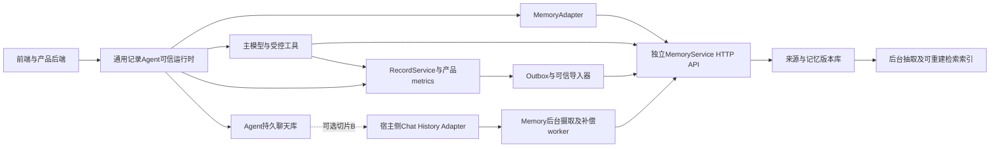

# 独立记忆服务 V1：整体方案与开发入口

版本：设计V1.2 修订1，2026年10月27日整体审查修订。状态：开发基线文档，尚未实现或执行运行验收。本轮只有文档，没有服务代码、数据库迁移或真实模型调用。

**整体方案从本文开始，架构与服务边界以[00](00-boundaries-and-invariants.md)展开；核心开发以01–04为准，持久聊天补采同时执行[06](06-history-ingestion-and-repair.md)。** A的原生聊天身份/生命周期条款已在01–03定义，06的相关共享细则同样适用；启用扫描与任务控制才增加B/C扩展要求。不需要再从旧《独立记忆服务技术与产品方案》拼接接口。本目录是同一份规格的分册，05、07是审查说明，研究笔记和旧方案只保留为依据。

本服务为通用记录型Agent及其他获授权Agent提供记忆写入、相关证据召回、更正与遗忘。点滴产品的每次发送进入Agent，由Agent内可信MemoryAdapter决定是否使用历史，再通过HTTP API调用独立服务；模型可按需使用受控记忆工具。MCP、Hook、插件和SDK是接入方式，生命周期保证取决于宿主实际能力。

核心边界是：**记忆是有来源、有版本、可撤回的证据与解释；正式记录和精确统计归产品后端。** MemoryService持有授权来源镜像、偏好/约束及派生证据，不承包前端、账号分享、日历、营养/周期算法、提醒调度或产品记录提交。

## 1 文档权威与开发依据

| 分册 | 负责什么 |
|---|---|
| [00 边界与架构约定](00-boundaries-and-invariants.md) | 系统职责、首发范围、核心不变量、权限与一致性保证起点 |
| [01 数据模型](01-data-model.md) | 数据字典、实体关系、字段、CAS/唯一约束、schema、依赖、版本与删除 |
| [02 API合同](02-api-contract.md) | 参数/限额/默认值、成功回执/错误、新鲜度、HTTP及可选MCP、消费者与控制面 |
| [03 Agent时序与恢复](03-agent-sequences-and-recovery.md) | context决策、工具编排、持久journal、状态机、故障恢复及接入能力 |
| [04 检索与验收](04-evaluation-and-acceptance.md) | 检索基线、中文金标准、合同/集成/效果验收、容量档、保留期与恢复演练 |
| [06 持久聊天摄取与补偿](06-history-ingestion-and-repair.md) | 从持久会话补采、回填、修复和重抽，Adapter、来源身份、独立进度、原删除与任务验收 |
| [07 V1.2整体审查记录](07-v1.2-review.md) | 修订1解决的问题、首发裁剪与验证边界；只解释决策，不增加另一份接口合同 |

| 开发工作 | 主要依据 | 交付边界 |
|---|---|---|
| MemoryService | 先读本文及00，再以01＋02＋04实现和验收 | 来源/记忆、查询、权限、一致性、删除、索引及恢复；03规定接入方可依赖的运行行为 |
| Agent/MemoryAdapter | 02＋03＋04，并遵守00边界 | 每轮context决策、工具与回执、所有入模证据依赖、失效清理及恢复 |
| 产品后端/RecordService/BFF | 00＋03的外部合同及04适用集成用例 | 可靠输入、正式记录/统计、业务回执、Outbox、授权与pending fence |
| 前端 | 00＋03的用户状态与回执合同 | 展示已接收、已保存、待补、分析及记忆清理阶段；不持有记忆服务凭证 |
| 聊天History Adapter及补偿worker | 01＋02＋06，04的扩展验收 | MySQL或其他持久聊天源的授权导出、稳定origin、游标、独立删除ACK、预算和补偿任务 |

建议读序：本文 → 00 → 按职责读01/02/03 → 04确认出口。01–04及启用的06共同约束同一服务版本；不能只照API字段实现而略过数据不变量或恢复门禁。歧义按00的不变量、02公共合同及对应分册细则解释；跨册修改须同步验收。

## 2 整体架构与调用关系

RecordService是逻辑职责，可留在现有产品后端，不要求再部署一个微服务。候选拆分、待补/拒绝及candidate→正式条目映射归Agent/RecordService journal；Memory只关联来源与外部稳定条目，不复制产品执行状态机。

Agent先可靠接收输入并绑定稳定operation。自由输入需要历史时，在首次模型请求前prepare，随后模型选择产品工具或补查记忆；已确认且不依赖历史的picker可以持久记录明确skip，走确定性提交。原输入和正式回执共用source_group，记忆镜像可异步补齐。正式“已保存”由records回执确定，记忆故障不能让已确认记录丢失或重复。

首发从可靠输入journal重送未完成的实时写入，复用原计划source/group及原消息origin；不需要先建设history:run或扫描MySQL。可选切片B通过注册Adapter有界读取已登记、接入后会话，补采遗漏原消息及修复已有来源的派生。接入前历史的身份bootstrap、自动巡检与新pipeline重抽属于后置能力。各路径均不把assistant回答或压缩摘要当用户新事实，不重跑正式记录工具。实际MySQL源的seq/终态/删除限制见06及源码审计。

所有送入完整适配器的记忆正文，包括补查工具结果，均登记版本/来源依赖。更正、删除或撤权使旧依赖失效；适配器阻止新step继续引用、清理会话/缓存后确认。产品与记忆采用带屏障的变更传播，不宣称跨系统同一事务；未获通知的独立Agent也不能被保证立即知道产品改动。

## 3 首发切片与后置能力

### 3.1 A：首发必须实现

1. HTTP核心＋一个点滴full_lifecycle适配器，交付来源、记忆、context及精确evidence补查、更正、删除和异常恢复；search/facts可后置。
2. 可靠输入journal，在可信接入开始时登记来源系统及接入边界；仅对接入后原消息绑定原生稳定origin与planned source_id/source_group_id。原item ID就绪前可靠排队，不猜身份。实时失败以同一身份重送；宿主持续传播已摄取及已计划会话的删除/撤权，按scope gate、独立ledger及ACK处理。可复用现有生命周期Outbox，不依赖history:run、会话发现或全MySQL扫描。
3. 基础派生重试及slot去重、业务回执有序镜像、更正与原始主张失效、删除和旧备份恢复门禁。派生失败可在已有source/version上重试，不要求为此扫描聊天。
4. 有证据陈述、显式偏好/约束、未完项及首发注册typed证据；体重/饮水/支出schema保留。owner/主体/域隔离采用整源授权，权限不足且不能安全投影时拒返。
5. 单代词法/向量视图，可在封闭读取下重建；所有保留副本受删除门禁约束。完成04中适用的合同、点滴集成、中文效果、P0容量和恢复验收。

### 3.2 B：可选第二切片

仅支持已登记、接入后会话的有界手工MySQL catch_up/backfill，以及已有来源的missing_derivation/stale_projection修复。历史正文和产品候选仍由Agent/产品持有，Adapter可作为同部署受保护模块，任务可复用现有任务表；不新增通用CDC平台、第二份产品执行状态机或另一套聊天真相。

启用生产可召回导入前，必须具备稳定身份、可证明完整的分页、源当前性核验、持续原删除/撤权控制、预算、取消、断点及异常恢复。手工执行也不能免除后续删除义务；缺任一前置条件，只允许preview或封闭测试，不能把导入内容开放生产召回。精确能力、模式和测试按02/04/06的映射启用，不要求一次实现全部H项或全部任务模式。

### 3.3 C：后置能力

接入前历史的identity bootstrap、自动会话发现/周期巡检、context主动repair、pipeline reextract/巩固、多源汇总、可变消息版本及细粒度事件槽均后置。MCP与更多Agent/Hook/插件包装、search/facts、自动episode summary、memory_relation、完整demo领域parser、精细授权投影、在线双代索引迁移及P1容量也按独立能力验收。

未交付能力不得自报支持，调用返回`UNSUPPORTED_CAPABILITY`。发布清单固定A及选择启用的B/C能力和依赖闭包；完整API目录不等于全部端点必须首发。裁减不能关闭所启用路径必需的权限隔离、CAS/幂等、读屏障、删除、恢复、受控回执或full消费者清理。精确接口切片与出口以02、04为准。

## 4 已冻结的设计决定

| 决策 | V1约定 |
|---|---|
| 权威与统计 | RecordService管正式条目及sum/avg/count；memory facts只给带覆盖说明的证据投影行 |
| 写入依据 | 用户输入、可信外部已提交记录、Agent推断分开；模型自称“已保存”不是回执 |
| 时间与对象 | owner授权空间和about entity分开；发生、记录、有效、服务知晓时间分开，未知不补当天或本人 |
| 检索 | owner内近期＋中文词法＋dense＋实体/字段；无前台LLM查询规划，允许不返回历史 |
| 一致性 | 基础数据同步应用，索引/抽取异步；CAS、稳定身份、连续外部屏障、失效代际共同约束 |
| 纠正 | 当前外部版本及关联原始主张共同处理，旧原文/worker不得重新成为当前事实 |
| 删除 | 本地不可查询、物理清理、受控消费者清理分别回执；独立控制日志防止恢复旧备份复活 |
| 离线补偿 | 授权来源Adapter＋持久任务；扫描/接受/派生覆盖分开，人工修订保护优先，删源不能靠旧聊天补回 |
| 部署 | API/worker＋PostgreSQL及可重建检索视图；队列可先用同库任务表，不要求额外中间件群 |

## 5 其他Agent与保证等级

HTTP/SDK可直接使用统一合同；MCP工具默认是`tool_only_best_effort`，保证单次调用的服务端授权、版本与本地删除语义。Hook或插件只有实际具备动态入模、受控工具、持久回执、依赖追踪、失效流、清理ack及reset能力，才可登记为`full_lifecycle`。这两个profile描述宿主能力，不是要求所有Agent采用同一种框架。

仅工具宿主不能被保证每轮自动召回，也不能由服务替其确认历史prompt已被清除。完整适配器亦不能收回已交付字节或证明不可控第三方副本已消失。MCP等扩展共用HTTP的业务语义，不能另造一套更弱的权限、身份和删除规则。

## 6 验收与启动顺序

先按A冻结首发发布清单与能力，再按04的交付阶段完成服务合同、点滴适配、中文交互效果和P0容量/恢复验收。产品与Agent并行交付可靠journal、接入后原生origin绑定、稳定operation、RecordService回执/Outbox、指标读屏障、MemoryAdapter及消费者清理；服务测试不能替代这些集成测试。B/C仅在实际启用时按04的能力映射补测，不把历史扫描或全部H项变成A的隐含前置。

硬门禁包括权限隔离、CAS/幂等、连续屏障、业务不重复、工具未知结果恢复、原始主张与镜像纠正闭环、所有入模读取可追踪、删除不复活及旧正文不能经缓存/重放再次交付。首发未包含的扩展标记未支持，不生成虚构通过报告。

04中的质量门槛、P0首发/P1扩展容量、保留期和RPO/RTO均是待执行的设计限额或验收目标。生产发布需提供实际构建manifest、适用合同及集成测试、中文金标准/盲评、费用、压测和恢复/擦除演练结果；当前文档不表示这些测试已经通过。

审查的问题、修法和对应验收见[整体审查记录](05-review-notes.md)。该记录解释决策，不新增独立接口合同。
