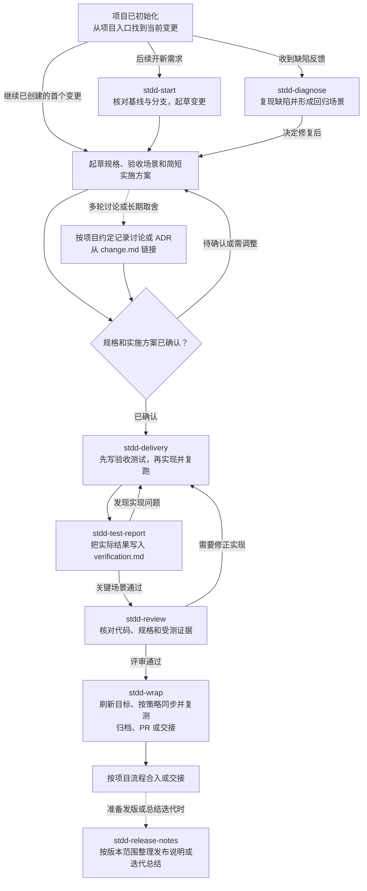

# STDD 研发工作流

产品、设计、研发和测试先从[角色导航](roles.md)打开同一份变更。按当前工具调用技能，也可以让 Agent 直接读取表中链接的 `SKILL.md`。

- Codex 使用 `$stdd-start`。

## 使用顺序

从[项目入口](project.md)找到当前变更。先明确规格和验收场景，再在 `tasks.md` 写修改位置、关键取舍和验收方式。方案确认后进入测试与实现。复杂变更可单独写技术设计。



团队先开 PR 时，可以先用 `stdd-wrap` 准备草稿，再在 PR 中用 `stdd-review`。

## 技能速查

| 阶段 | 技能 | 工作产物 |
| --- | --- | --- |
| 开工 | [stdd-start](../../.agents/skills/stdd-start/SKILL.md) | 基线 SHA、真实合入目标和同步策略、规格与简短实施方案、相关讨论和 ADR |
| 实现 | [stdd-delivery](../../.agents/skills/stdd-delivery/SKILL.md) | 按已确认方案和场景编写用例、实现并复跑 |
| 排查 | [stdd-diagnose](../../.agents/skills/stdd-diagnose/SKILL.md) | 用[诊断模板](templates/diagnosis.md)记录资料来源、发生时段、复现状态及回归场景 |
| 验收 | [stdd-test-report](../../.agents/skills/stdd-test-report/SKILL.md) | 按场景记录自动、手工、失败和待验结果，核对历史证据版本及用例数量 |
| 审查 | [stdd-review](../../.agents/skills/stdd-review/SKILL.md) | 固定目标与候选 SHA，从实际候选读取代码，给出有定位和触发条件的发现 |
| 收尾 | [stdd-wrap](../../.agents/skills/stdd-wrap/SKILL.md) | 刷新目标、按策略 rebase 或快进、处理冲突并复测，核对归档链接，按 [PR 模板](../../.github/pull_request_template.md)整理交付状态 |
| 版本 | [stdd-release-notes](../../.agents/skills/stdd-release-notes/SKILL.md) | 按[版本说明模板](templates/release.md)整理固定版本快照或明确时间窗内的变化、兼容及验收状态 |

## 脚本

在仓库根目录运行脚本，使用 Python 3.9 或以上版本。Windows 可将示例中的 `python3` 换成 `py -3`。

```sh
python3 -B scripts/new_change.py 002-source-recovery '来源恢复' --roles
python3 -B scripts/git_range.py --merge-base main HEAD
```

- `new_change.py` 创建变更、任务与验证文件。加 `--roles` 会同时生成[规格草稿](templates/spec.md)、[体验设计](templates/ux-design.md)和[验收计划](templates/test-plan.md)。复杂变更另加 `--design` 生成[技术设计](templates/design.md)。同名的在途或已归档变更会报错。
- `check_traceability.py` 面向脚手架默认的 `specs/**/spec.md` 格式，在本仓库预计报告零项。MemoryService 的评审按 [04 的场景编号](../spec-v1/04-evaluation-and-acceptance.md#5-服务与接入合同验收矩阵)核对合同引用，并在 `verification.md` 记录实际证据。
- `git_range.py` 读取本地 Git 引用和提交差异。审查分支用 `--merge-base` 查看分叉点到候选的文件变动。比较版本时传两个实际引用，文件差异取两端快照。

## 接入项目的测试与发布流程

在[工程约定](../engineering.md)记录随服务实现建立的构建、测试和 CI 入口。首个实施切片的候选验收范围见 [04 的 D1 出口](../spec-v1/04-evaluation-and-acceptance.md#9-交付顺序与责任)。

需要单独讨论或记录长期决策时，按[讨论与架构决策](decisions-and-discussions.md)选择位置，在 `change.md` 关联讨论与 ADR，归档时核对双向链接。

## 收尾时同步多人改动

准备提交或 PR 时，`stdd-wrap` 默认核对真实合入目标并 fetch，固定本轮目标 SHA，再判断是否需要快进或 rebase。已包含目标时跳过同步。未发布的本次提交或项目允许改写的个人分支按策略 rebase。按双方意图和已确认规格处理冲突，完成后同步有变化的依赖并重跑项目检查。将同步状态、受测内容和实际结果写入 `verification.md`。

工作区中已有的无关改动、共享历史和离线状态按[项目 Git 约定](git-workflow.md#收尾同步)处理。中途交接、无远端或项目要求 merge 时，注明实际处理方式及同步状态。squash、提交、推送和创建 PR 沿用项目策略及已有任务授权。

验收按项目要求核对运行记录与实际场景。预期运行测试而测试工具只发现零条用例时，记录用例发现异常。跳过场景及缺少当前候选证据的场景标为待验。

## 升级 STDD/SDD 工具

项目采用的上游标签记录在 [`.stdd-version`](../../.stdd-version)。在项目外解压新版 `init-stdd.zip`，用新版脚本运行 `--upgrade --dry-run`，再用 `--upgrade` 应用可自动更新的文件。手工合并标为 `MERGE` 的项目定制，并同步本仓库跟踪的完整 `init-stdd/`。验证通过后，如脚本保留旧版本记录，可用 `--record-version` 确认本次采用的标签。 [升级命令与状态说明](../../.agents/skills/init-stdd/references/usage.md#升级已初始化的项目)
