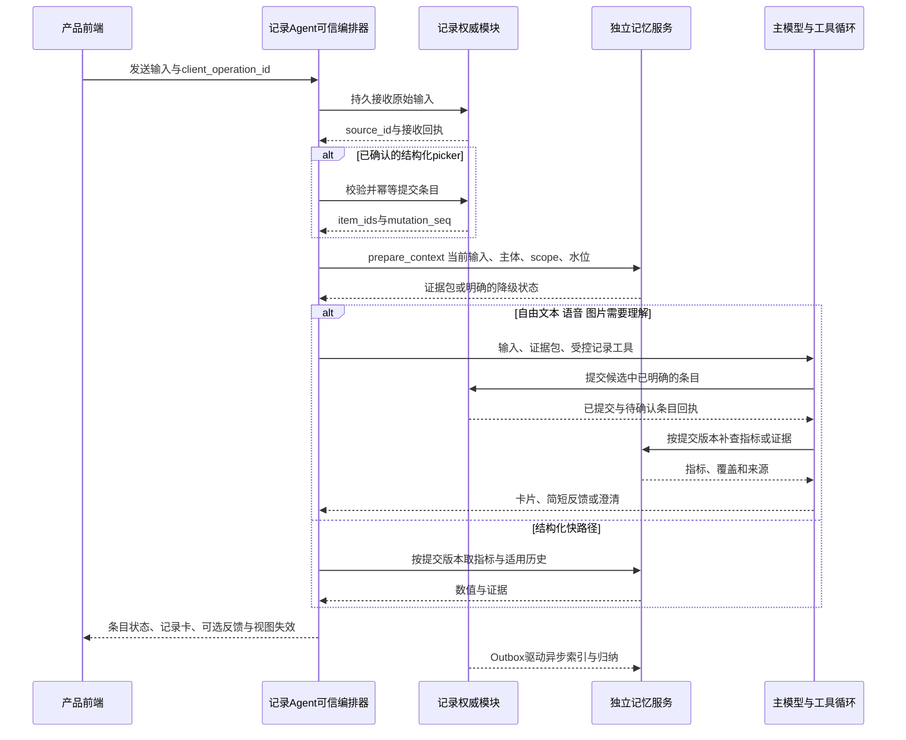

# 历史参考 点滴 demo 调用链与完备性分析

> **状态：开发合同已废止，保留为历史参考。** 2026年10月27日起由[V1.2整体方案与开发入口](spec-v1/README.md)及其00–04分册替代。下面是2026年10月26日的demo核对和缺口分析快照，“尚待冻结”“尚未形成规格”等表述不代表当前文档状态。当前已形成开发合同，实际实现及运行验收仍未完成。

本页保留demo交互证据和当时的分析，不再维护另一套调用链。当前调用、状态机和恢复以[03](spec-v1/03-agent-sequences-and-recovery.md)为准，接口以[02](spec-v1/02-api-contract.md)为准，首发范围和验收以[00](spec-v1/00-boundaries-and-invariants.md)及[04](spec-v1/04-evaluation-and-acceptance.md)为准。文档状态总览见[docs索引](README.md)。

日期：2026 年 10 月 26 日。场景输入为[点滴 demo](/Users/zhangguoqiang/Desktop/美柚产品和研发/点滴demo-1014.html)；目标链路是用户明确的“每次记录发送进入通用记录型 Agent，再由 Agent 内部调用独立记忆服务”。

目前的研究足以支持架构选择和启动受控 PoC，但尚未形成可直接实施上线的完整规格。新增 demo 不推翻原文、事件、观测、证据、版本与检索分层的基本方案；它要求进一步明确 Agent 内部编排、结构化输入、多项保存、即时统计、产品读模型与多主体权限。优先工作应转向这些闭环的协议与实测，继续扩大框架数量的收益已较低。

主方案已同步修订[接入位置和同步路径](独立记忆服务技术与产品方案.md)。源码审阅证据见[demo 场景核对](../research/demo-product-audit.md)、[完备性复核](../research/completeness-audit.md)和[定向补充调研](../research/targeted-gaps-notes.md)。本次是静态源码分析；浏览器安全策略未允许直接加载本地 HTML，未进行实际 UI 联调或真实 Agent 调用。

## 1 完备性的判断

| 层面 | 当前程度 | 仍需做什么 |
|---|---|---|
| 记忆技术与开源方案调研 | 已能支持初步选型 | 按业务任务做少量对照，避免用公开榜单替代选型 |
| 核心数据架构 | 原则与主要对象已较完整 | 冻结领域 schema、身份与变更语义，确定权威记录模块 |
| 产品与 Agent 调用 | 本次已明确目标位置和时序 | 实现 Agent 内 MemoryAdapter，验证快捷与自由输入两条路径 |
| 失败恢复与页面承诺 | 已有原则和下面的决策建议 | 定义错误码、持久 operation 状态、条目回执及交互状态 |
| 开发规格 | 尚未冻结 | API JSON Schema、状态机、索引与迁移、测试样例及 SLO |
| 生产验证 | 尚未完成 | 并发、冷读、积压、重启、删改、授权与中文效果实测 |

已有方案已经包含来源版本、事件与观测、双时间、连续处理水位、更正覆盖、删除传播、scope、受控统计和证据包。下面补的是产品具体合同，不把已有原则重复算成新发现。

## 2 Demo 带来的具体需求

### 2.1 当前版本的交互约定

HTML 尾部 `installCoreLogic` 是最明确的需求输入，见[原文件](/Users/zhangguoqiang/Desktop/美柚产品和研发/点滴demo-1014.html:66930)：

- 爱爱、便便、白带、体温沿用 picker，直接记录，不重复抽取。
- 用药、补剂有历史时展示历史名称，无历史时使用后台配置项。这里是输入补全，不是个体用药推荐。
- 当前版本睡眠主要记录主观感受；睡眠时长暂不做。前面残留的旧时长组件不能自动算作首期需求。
- 月经感受支持自由表达与三合一 picker 两种交互，仅行经期展示。
- 喝水与饮食同现时，两项都记录，反馈优先展示饮食。

这意味着“经过 Agent”与“必须调用一次或多次 LLM”应分开。结构化输入可以在 Agent 服务的确定性路径校验、保存、取数后返回；自由输入需要模型解析。现有 runner 若只接受模型驱动 turn，需要新增这种业务编排能力，不能视为当前已有功能。

### 2.2 产品能力和数据要求

| 产品表现 | 服务必须提供什么 | 不能用什么代替 |
|---|---|---|
| 原始表达与多张结构卡共存 | 一条 source 对多个事件/观测的稳定关联 | 用卡片数作为事件数 |
| 一次语音含两次喂奶和一次换尿布 | 同一操作下多事件、分主体和分时间 | 一个请求一个事件 |
| 心情、症状与经期感受拆卡 | 领域字段与共同来源，按日或事件定义计数 | 把多个卡片当独立来源再次摄取 |
| 最近药名、补剂、上次选项 | 确定性的 recent-items/current-state | 每次打开输入框都启动大模型检索 |
| 今天已喝、近七天症状 | 读取已提交版本的指标与覆盖信息 | 向量 top-k 或固定七天假数据 |
| 时间线、日历和回顾 | 分页列表、日期存在性、完整序列与分组统计 | 只有语义 search 接口 |
| 编辑内容或日期 | 定向修订、并发版本检查、旧/新日期视图失效 | 只改 UI 文案 |
| 本人、不同宝宝、伴侣分享 | 所有者、记录者、事件主体和投影授权 | 页面筛选器或全局 user_id |

### 2.3 Demo 能证明什么

这个 HTML 展示了交互和字段约定，部分计算确实遍历本地 React state，但没有发现业务脚本中的真实 Agent/记忆 API 请求。

体重的昨日对比将昨日值设为当前值加 0.5，七天曲线使用固定 offsets；饮水、亲密和睡眠也存在明确的 `*_WEEKLY_MOCK`。因此这些图是需求样例，不能作为已完成真实统计的证据。后续实现遇到没有昨日体重、没有某天记录，应显示缺失，不能保持 demo 的填充逻辑。[原始符号与位置](../research/demo-product-audit.md)

分享界面还展示“回顾可见、原始记录不可见”，但目前是本地状态演示；编辑弹层依赖另一个 `diandi_edit.html`。本次只审阅用户指定的主 HTML，不能据此宣称共享和完整编辑流程已经可用。

## 3 修订后的目标调用链

这是一条建议时序，不代表所有模型请求都固定两步。结构化快路径可以没有模型；自由输入可能需要模型抽取后调用工具，再基于回执生成回应。两者都纳入总延迟与费用测量。

### 3.1 预取放在 Agent 内部

MemoryAdapter 是可信代码，负责身份、预算、超时、快照和幂等。每个有效用户 turn 做一次 context 决策，可以返回空包；补查工具仍留给模型。默认不在每个模型 step 重做完整检索，执行后有新事实或追问需要时才刷新。

这保留原《05》“首轮模型前预检索”的价值，只调整归属位置。不能仅写一句 prompt 要求模型“每次先查记忆”，也不能假设现有静态 `memory-injection` 已支持远程读取。现有实现需要新增适配器与受控数据注入 seam。[当前中间件](/Users/zhangguoqiang/ai-workspace/claude-workspace/meetyou/agent-service/packages/core/src/hooks/middleware.ts:225)

对于只能安装 MCP 工具的其他 Agent，服务仍可用，但接入保证较弱：支持按需检索，不保证每条记录都已预取。SDK/插件接入应声明自身能力，避免用“任意 Agent 可调用”承诺“所有宿主都有相同生命周期保证”。

### 3.2 记录权威只保留一份

业务已有记录库时，受控记录工具写现有业务模块；记忆服务投影其来源和变更。业务尚无记录库时，PoC 可把权威 Records 模块与记忆服务部署在同一进程和数据库，但逻辑职责分开。没有必要先造两个独立服务再承担双写。

Agent 提出候选、记录模块校验并返回回执、记忆服务按回执建索引与归纳。后台抽取不能直接覆盖用户已确认的数值。检索证据、模型回答、分析卡片不重新成为用户生活事实，避免循环摄取后“引用越多就越真”。

正式指标只聚合权威模块 committed 的稳定条目 ID，commit-event 携带 source/version 与这些条目的映射。异步抽取只能生成候选或富化同一条目，不得把“同步已保存 200ml、后台又识别 200ml”变成 400ml。原文提及统计与估算另外定义，不能混进正式计量。

## 4 需要冻结的输入与结果合同

### 4.1 输入信封

至少包括 `client_operation_id`、输入类别、原始文本/媒体引用、`input_source`、客户端记录时间与时区、已选择的 `about_entity_id`，以及结构化字段的来源与确认状态。所有者与访问 scope 来自服务端认证，不由模型或终端自由指定。

已选择的宝宝和 picker 单位作为明确上下文传入；不要让模型从“100ml”猜是妈妈喝水还是宝宝喂奶。隐藏时间的 UI 仍保留默认发生日期、记录时间和精度，不能把未知时间填成精确时分秒。

自然语言新记录、纯查询、补充、更正、撤销是不同 operation。查询消息可以保留在交互历史中，但不会自动新增一条生活事件。

### 4.2 一次输入的多项提交

关系是 `operation → source → event/observation/assertion → view card`，每层有稳定 ID。一条录音产生三次事件，这三个事件共用 source；一次更正可以只针对其中一个 observation。

建议普通新增允许“已明确部分提交、歧义部分待确认”，并返回逐项状态。若一个更正会跨多个字段维持同一事件的一致性，则该次修订作为一个原子变更。重试使用同一操作及条目身份，只读核对已完成部分，不重新记一次。

### 4.3 返回给页面的结果

建议将结果拆成：

- `source_receipt`：原始输入接收状态。
- `record_results`：每个正式条目的 committed、pending_clarification 或 failed，附 ID/version。
- `feedback`：可选短回应或洞察，带使用的证据与指标版本。
- `clarifications`：必要的待补问题及目标条目。
- `view_invalidations`：受影响的日历日、时间线、指标和回顾模块。
- `memory_status`：正常、部分、超时或版本未追上等状态。

页面可以先展示“输入已接收”，只有记录回执成功后才显示对应条目已保存。分析失败时保留已保存状态；部分歧义时展示待补，不把整次请求伪装成全成功或全丢失。记录卡本身是展示投影，不是新增事件。

## 5 产品读模型与记忆服务的边界

发送路径统一进 Agent，并不要求每次打开输入面板或查看回顾都启动模型。这些可以走 Agent 应用的轻量读端点或已有业务 BFF，由可信代码查询获授权的读模型，前端不持有记忆服务凭证。

| 读取类别 | 建议接口或能力 | 权威位置 |
|---|---|---|
| 最近用过的药名/补剂、上次选项 | `recent_items(domain, about_entity_id, limit)` | 来源于正式记录的确定性投影；“用过”不等于当前在用 |
| 当前周期、目标、偏好 | `current_state(as_of, about_entity_id)` | 有来源与生效时间的状态；预测另列 |
| 分页时间线与全部记录 | `list_records(filters, cursor)` | 业务记录读模型 |
| 日历日期存在性 | `calendar_presence(range, timezone, about_entity_id)` | 正式记录的日期投影 |
| 今日量与周/月序列 | `query_metrics/series(metric, range, grain, min_visible_seq)` | 同一有效记录视图，带统计定义与覆盖 |
| 自然语句找回历史 | `memory_search/context` | 语义、词法、时间和实体索引 |

这些逻辑能力不必全部塞进通用记忆服务。第一版可共享存储和查询模块，但产品列表与账本不能依赖语义 top-k，Agent 所需历史也不能只能通过 UI 图表获取。

### 5.1 当前记录必须只计一次

优先对已确认条目先提交，再按回执水位取统计。需要预览时，可将草稿作为带 operation ID 的 overlay，但指标返回必须标明是否包含本次。后台转为正式视图时原子移除该覆盖。不能用“历史里已有本次，再额外加本次数值”的方式生成进度。

饮水至少区分本次新增量、对原事件的修改和“今天累计多少”的陈述，不能对三者都执行加法。统计目标、指标规则、时间窗口和用户时区也要有版本。例如目标改动是否影响历史达标天数，需要产品先定义；模型不能临时决定口径。

### 5.2 展示优先级与事实保存分开

“饮食优先于饮水反馈”只影响 feedback 选择，不影响水量保存。记忆服务返回事实、相关性和覆盖，Agent/产品策略决定展示哪张卡、是否展开及是否需要追问。

已展示的提示、已解决的问题、用户关闭的反馈类别保存在交互状态，设频控和 `last_surfaced`；这些状态不自动进入长期语义画像。用户只要记一下时，检索成功也可以不提历史。

### 5.3 多主体与分享

owner、recorded_by、about_entity 和 reader 分开。妈妈代记宝宝不意味着宝宝就是账户所有者，同名药品或数值也不能跨主体计数。

伴侣分享属于 reader grant，不能用 Agent scope 替代。至少绑定接收者、主体、模块、时间窗、投影和授权版本。只共享回顾时，原文工具、指标来源列表和缓存都必须遵守同一投影。是否首期支持多个宝宝和伴侣分享，应在 MVP 范围中明确；本轮不假设它们已经实现。

### 5.4 通用知识与个人记忆

饮水参考线、营养估算、周期预测和药品输入词库不属于从个人历史直接得到的事实。分别由产品配置、版本化领域算法或知识来源负责；个人记忆提供实际记录与明确约束。预测、估算、用户主观感受和已确认测量在数据类型与页面上分开，不让模型把推断反写成发生过的事件。

## 6 失败与降级必须可解释

| 情况 | 可继续做什么 | 需要避免什么 |
|---|---|---|
| 原始输入持久化失败或结果未知 | 保留原操作身份、只读核对或提示未确认 | 宣称“已记录”或换 key 自动重发 |
| 已确认 picker，记忆检索超时 | 不依赖历史的字段可保存；反馈说明分析暂不可用或省略 | 用故障空包声称没有历史 |
| 自由输入需要历史才能确定主体或单位 | 保存来源和待补项，追问或等待 | 猜测数值含义后写成确认事实 |
| 条目已提交，指标水位未追上 | 使用可信当前覆盖，或稍后刷新图表 | 输出旧总量，或重复加本次 |
| 保存成功，模型回复或 SSE 中断 | 从持久 operation/工具回执恢复页面结果 | 为生成一次回应重新提交生活事件 |
| 某些项目可确定、另一些有歧义 | 返回逐项状态及少量必要问题 | 丢掉明确部分，或把全部候选说成已保存 |
| 更正或撤回尚未送达派生引擎 | 先使受影响旧版本不可用，再等待/覆盖/降级 | 继续返回旧值或让晚到任务复活旧值 |
| 权限、主体或分享已变更 | 重新校验、失效相关 bundle/会话和共享缓存 | 使用旧缓存继续回答 |

另外需要区分四种“忘记”：不再主动提、不用于个性化、删除一个业务条目、删除全部个人记忆。自然语言请求含糊时先确定对象和范围；改变展示策略不等于删除数据，删除语义也不能只作用于向量索引。

## 7 原有记忆层设计的可复用部分

《05 记忆层设计》有明确可复用价值，尤其适合提供检索与统计路径的起点。采用时保留职责划分，把具体阈值和技术实现改成待验证的策略。

| 原文位置 | 可以保留什么 | 结合 demo 如何调整 |
|---|---|---|
| §1、§0① | 结构化、语义证据、摘要分层；聚合不能靠 top-k | 对应今日饮水、症状记录天数、近期相关原话、长期偏好；先定义指标口径 |
| §3.1 | 预检索加工具补查 | 放进 Agent 内可信适配器，首轮模型前执行；这是目标调用链的直接参考 |
| §3.3–§3.4 | 词法、语义、实体互补；按意图选时间窗、通道和预算 | picker 走类型化字段，纯记录可空，回顾走全量受控查询；阈值用中文数据调 |
| §2.2–§2.4 | 同步最小化、异步富化、联合抽取与摘要 | 已确认快捷字段即时保存；自由输入的必要字段当轮提取；普通标签和摘要可以微批 |
| §7.1–§7.2 | 用户时区、时间区间、转写纠正后重抽与回填 | 加多事件跨日、主体和原媒体来源；ASR 分数按来源校准 |
| §7.6 | 抽取版本、新旧版本验证与切换 | 保护统计不重复计数，允许重放与重建 |
| §5 retrieval_log、§10 | 候选、策略、延迟、token 和 usage 归因 | 与 operation、turn、tool receipt 关联，原文最小化留痕 |
| §8–§9 | 业务金标准、分层指标、先验证简单方案 | 增加 picker、混合意图、即时图表、工具回执、少打扰和多主体 |
| §4 | 稳定指令与动态数据分离、稳定序列化 | 保留缓存思想；个人事实不为画像周更或 contextEpoch 延迟更正 |
| §3.2、§5 | 用户内精确扫描和紧凑块存的实验思路 | 作为性能对照，测完整冷读、并发、增删、缓存和迁移后再选 |

不直接继承的部分包括：仅按主题与时间邻近做业务事件去重、统一按总记录数开启趋势、所有画像周更、把所有必要字段推迟日终、固定免费模型/价格、以点积微基准断言不需要数据库索引。检索展示可以折叠相似结果，底层两杯水或两次喂奶不能因此合并。

因此，原文最适合贡献查询职责、预取策略、异步版本化与评测方法；本轮补充负责把它们接到实际产品记录闭环。

## 8 还应调研和验证什么

### 8.1 定向补充研究的结果

本轮补查了三个对象，结论是局部借鉴，暂不扩大生产依赖：

- **MemOS**：最值得借鉴 Agent adapter 的强制预取、turn 内去重、前台 deadline 和后台摄取，以及使用上轮 retrieved IDs 帮助定位纠正。Python 独立服务与同仓本地插件应分开评估；MemOS 与 MemT 是不同项目。[固定版本 adapter 契约](https://github.com/MemTensor/MemOS/blob/adcb9f270c982f2b9ff8db9714792829d3bd6ab8/apps/memos-local-plugin/README.md)
- **Mastra Observational Memory**：适合研究长会话的 Observer/Reflector 和从观察回查原消息。对短生活记录，不必因此迁入完整 runtime。
- **EverMemOS 当前主线 EverOS**：提供事件、画像、foresight 与可重建索引的参考，且明确 add、flush、派生、可检索的阶段差异；不能把旧论文栈当当前实现。

各自版本、能力边界及一手源码见[定向调研](../research/targeted-gaps-notes.md)。选型对照仍以自建基线加一个 Hindsight/Mem0 为主，MemOS先用于接入和纠错对照；没有必要同时部署所有候选。

### 8.2 优先级更高的四组实验

| 优先级 | 实验 | 要回答的问题 |
|---|---|---|
| P0 | Agent 内接入与提交闭环 | 是否保证每条发送做 context 决策，输入/条目/分析状态分开，工具成功但回复失败不重复保存 |
| P0 | 中文短记录与多事件时间线 | 指代、单位、主体、补记、更正、两次真实相似事件是否正确；混合意图能否完整保存且限量反馈 |
| P0 | 即时可见和产品指标 | 当天累计、七日记录天数和改日期后的视图是否一致；积压、重试与重启是否复活旧值 |
| P1 | 多模态与有用性 | 图片/语音候选到用户确认的来源链是否完整；有历史是否减少重复追问而没有增加打扰 |

每组同时测无记忆、近期窗口与候选方案，固定 reader、可用历史和 token 预算。原始媒体/中文 ASR、多模态模型、营养/周期等领域方案只按首发需求追加实测，不作为记忆检索天然附带的能力。

## 9 下一步需要形成的交付物

建议下一阶段形成一个开发设计包，而不是再写一份更长的综述：

1. 冻结首期场景与不包含的 demo 能力，尤其本人/宝宝/分享、多模态和领域范围。
2. 确定记录权威模块，写出输入、多条目提交、更正、只查询、保存成功但回复中断的真实时序。
3. 定义输入/输出 JSON Schema、状态机、错误枚举、幂等身份和版本屏障；把上面的故障矩阵变成验收样例。
4. 在 Agent 内接 FakeMemoryProvider 和受控记录工具，先验证调用时机与恢复，不调用真实模型也能检验大部分合同。
5. 用 demo 的十个代表场景建立时间线金标准，再用具名模型预算做中文质量与费用实验，接一个现成引擎对照。

完成这些后，方案才能从“有依据的架构建议”进入“可开发、可验收的详细设计”。当前可以推进 PoC；全产品完备性和生产可靠性仍要由这些交付物与运行证据确认。
