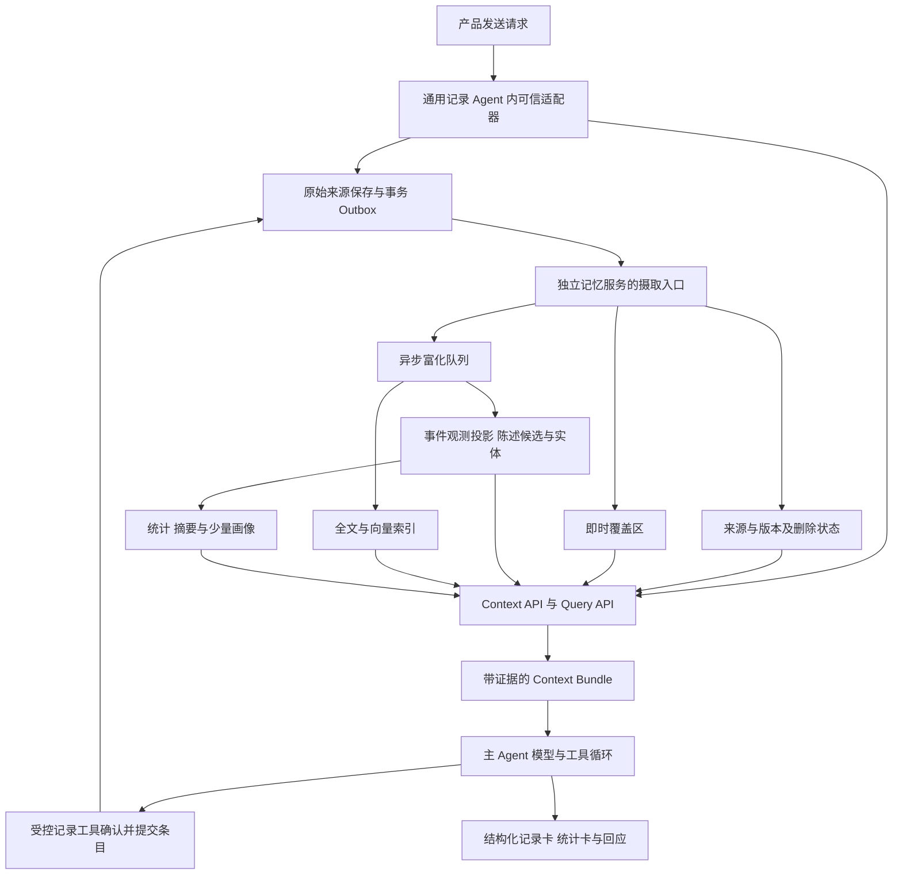

# 历史参考 个人生活记录 Agent 独立记忆服务方案

> **状态：开发合同已废止，保留为历史参考。** 2026年10月27日起由[V1.2整体方案与开发入口](spec-v1/README.md)及其00–04分册替代。不得据本文实现API、数据台账或验收。原文件名保留以维持引用；下面正文是2026年10月26日的历史快照，其中“本版”“目前”等均指当时，不再随现行设计维护。

| 历史内容 | 当前应依据 |
|---|---|
| 记忆服务持有事件台账、完整时间线、数值统计 | [00边界](spec-v1/00-boundaries-and-invariants.md)：正式条目和精确统计归产品后端；记忆提供来源镜像与证据 |
| 旧对象、字段及API草案 | [01数据模型](spec-v1/01-data-model.md)和[02 API合同](spec-v1/02-api-contract.md) |
| 首轮检索、同步镜像、更正和删除时序 | [03时序与恢复](spec-v1/03-agent-sequences-and-recovery.md)：确定性路径可skip；外部镜像统一有序流；全部记忆读取及旧原消息纳入失效 |
| 规模、阶段及验收建议 | [04评测与验收](spec-v1/04-evaluation-and-acceptance.md)：首发P0、扩展能力单独验收 |

研究推导、用户体验假设及旧方案评审仍可参考；与现行合同不同的建议不继续作为备选默认值。文档状态总览见[docs索引](README.md)。

日期：2026 年 10 月 26 日。适用对象是处理健康、心情、体重、饮食、财务及日常生活记录的 Agent，以及调用同一用户记忆的其他获授权 Agent。本版结合点滴 demo 和用户明确的“产品每次发送调用 Agent，再由 Agent 内部使用独立记忆服务”调整接入位置。

建议建设一个以原始记录为依据、能返回相关上下文和确定性查询结果的独立服务。核心资产是用户的事件时间线、观测值和有来源的事实；向量、摘要、画像和关系图都是可重建的派生视图。第一版采用关系数据库、用户内混合检索、即时记录覆盖和异步抽取，由 Agent 服务内部可信适配器在首次模型请求前预取少量记忆，再以工具支持深查。结构化快捷记录经过同一 Agent 入口，可以使用无 LLM 的确定性处理路径。

最需要验证的产品假设是：在用户发来一条新记录时，少量历史能否改善回应、减少重复询问，同时不让用户觉得被过度分析。历史问答准确率是必要指标，但不能单独证明这个假设。

本文给出设计建议；开源系统实现与论文证据分别见 [Agent 调研](../research/agent-systems-notes.md)、[记忆框架调研](../research/memory-frameworks-notes.md)和[论文调研](../research/papers-frontier-notes.md)。产品流程与本次新增闭环见[结合点滴 demo 的调用链与完备性补充](点滴demo调用链与完备性补充.md)。当前是可进入原型的架构方案，尚非已冻结并通过实测的生产规格。

## 1 产品边界和默认假设

### 1.1 服务负责什么

输入是一条新的记录、一条查询，或一个获授权的工具结果；输出是带来源和时间的证据、事实、数值统计、冲突提示及必要的信息缺口。主 Agent 决定如何回应、是否追问，以及是否调用业务工具。记忆服务不代替主 Agent 作完整回答，也不直接执行转账、预约、发送通知等业务动作。

同一用户可跨会话、跨 Agent 共享获授权的个人记忆；每个 Agent 的工作经验、提示词、技能和工具策略保存在单独空间。session_id 只是来源维度，不能作为个人记忆的主隔离维度。

这里假设查询主要发生在单用户范围内，不默认继承旧设计中的 5000 万用户规模、固定云厂商、ASR、自建模型或首字延迟要求。家庭共享、跨用户推荐和企业知识库需要另立授权及查询模型。

### 1.2 新记录触发的五种有用行为

| 新输入 | 需要提供的历史 | Agent 可以做什么 | 容易犯的错误 |
|---|---|---|---|
| “今天 72.4” | 当前在记录的指标、单位及最近一次明确观测 | 单位明确时记体重；有歧义时只问一次 | 仅因最近记过体重就把 72.4 永久认定为 kg |
| “昨晚又只睡四小时” | 最近明确报告的睡眠记录和相关未完成追问 | 简短承接；用户允许时呈现有来源的近期记录 | 把没有记录的日期当睡得正常，或诊断疾病 |
| “午饭牛肉面，26 元” | 当前记录习惯和可能相关的饮食约束 | 一条来源生成饮食事件与待确认的支出事件 | 将同一个事件重复计费；漏掉币种歧义 |
| “刚才是 72.4，不是 74.2” | 被更正的原始记录及其版本 | 建立更正关联，并让新查询立刻避开旧值 | 把它当作第二次体重测量 |
| “这个月是不是老在加班” | 时间窗内的相关记录、事件去重结果及覆盖情况 | 说“记录中提到过几次或几天”，提供例证 | 从 top-k 样本推算本月总次数 |

### 1.3 产品上优先提供的能力

第一优先是记住明确陈述、接住短语与指代、识别纠正、避免重复追问。第二优先是可靠地找回历史，并说明依据。趋势和主动洞察在记录覆盖与事实质量可解释后再上线。

“知道历史”不等于每次都要提历史。建议提供“仅保存”“必要时联系历史”“主动发现规律”三档偏好；默认只在能改善当前处理时使用历史。纯记录成功不依赖模型回复成功，用户应能清楚区分“已保存”和“分析未完成”。

跨 Agent 共享应由用户授权的 owner_subject_id 与 scope 决定。例如健康助手只能访问健康范围，财务助手只能访问支出范围；用户另行授权的综合助手才可跨域检索。一次饮食记录包含金额，不意味着任何健康 Agent 都自动获得全部财务记录访问权。权限需要细化到证据片段或字段，原文读取、摘要和统计来源也执行相同投影；不能可靠拆分时，不返回整条混合原文。

## 2 记忆对象与事实语义

### 2.1 区分来源与解释

| 对象 | 例子 | 持久化原则 |
|---|---|---|
| Source record 来源记录 | 用户原文、转写、表单或工具结果 | 保留来源、版本、记录时间和明确删除状态；按生命周期删除 |
| Event 事件 | 昨晚的一次睡眠、午饭、一次付款 | 可由多个记录描述；一条记录也可描述多个事件 |
| Observation 观测 | 2026-10-26 早晨，体重 72.4 kg | 数值、单位、发生时间、对象、来源、测量或自报方式分列 |
| Assertion 陈述 | 用户说最近不喝咖啡 | 保留主语、否定、条件、有效时间及证据，不直接当永久真相 |
| Profile item 画像条目 | 回复偏好简短；近期在控制咖啡因摄入 | 小而可编辑，保留支持来源和适用范围 |
| Open item 未完事项 | 一条记录待补单位、某次追问待回答 | 保存 open/resolved/cancelled、来源、目标对象、到期条件及 last_surfaced，避免重复追问 |
| Summary 摘要 | 某周记录概要 | 派生缓存，保留来源集合和生成版本 |
| Agent experience 执行经验 | 某工具调用参数要怎样组织 | 独立于用户生活事实，不混入个人画像 |

“我担心自己血糖高”应存成用户的担忧，不能改写成“用户患有高血糖”。“妈妈最近失眠”不能变成用户本人失眠。“要是明天跑五公里就好了”不能生成已经完成的运动。抽取 schema 需要 subject、experiencer、negation、modality 和 assertion_type；这比先造一个大而通用的知识图谱更重要。

授权所有者命名为 `owner_subject_id`，陈述涉及的对象命名为 `about_entity_id/experiencer_id`，避免同名 subject 混淆。用户记录母亲失眠，仍属于该用户的授权空间，不会因此获得母亲账户的数据权限；不同用户各自的“妈妈”也不能跨用户自动合并。

### 2.2 时间至少有两条轴

一条是事情何时发生或陈述何时有效，即 valid/event time；另一条是系统何时接收、修订或撤回这条知识，即 transaction time。`occurred_from/occurred_to` 表达事件时间的不确定区间，不能单独称为完整双时间模型。

建议每个可变陈述保留：`valid_from/valid_to`、`known_from/known_to`、`time_text`、`time_precision`、`timezone`、`source_version`。事件还区分“睡眠持续四小时”与“发生在某四小时区间”，不要把 duration 混作时间边界。用户补记和跨时区记录要用记录当时的用户时区与原始表达解析。

中文时间可先用规则或 [JioNLP 的 time_base 解析能力](https://github.com/dongrixinyu/JioNLP/blob/master/jionlp/gadget/time_parser.py)产生候选，复杂情况再用模型或追问。规则返回值也要验证；解析不出时允许 unknown，不能为了完整率捏造时间点。解析器的输出不是经校准的置信概率。

### 2.3 更新与纠正不能统一为覆盖

| 情况 | 例子 | 处理 |
|---|---|---|
| 新事件 | 今天 72.4 kg，昨天 72.8 kg | 保留两次观测 |
| 更正 | 昨天不是 72.8，是 72.6 | 新版本指向被更正项，旧值退出当前统计 |
| 状态变化 | 以前喝咖啡，现在停了 | 新有效期，历史偏好仍可用于历史问题 |
| 同期冲突 | 同一顿午餐的两个不同金额 | 标记冲突，保留证据，必要时确认 |
| 指代不明 | 刚才那个不是我的 | 建立候选关联，避免自动删掉错误对象 |
| 撤回与删除 | 那条记录不要了 | 立刻从可查询范围排除，再清理所有派生视图 |

体重不能用“新事实覆盖旧事实”的通用记忆规则处理，偏好也不能永久只追加、永远不使旧偏好失效。存储上保留证据，查询时根据问题的时间、来源和变更关系选择当前有效解释。

## 3 总体架构



如果业务端已有记录库，那里继续作为原始记录的权威源，记忆服务持有有版本的内容副本或引用和派生数据。通过事务 Outbox 传递创建、更新、删除事件，避免两个数据库的普通双写。若本项目同时承担记录存储，则这两个职责可部署在同一个服务，但接口和生命周期仍要分清。

### 3.1 同步路径

1. 产品调用通用记录 Agent。Agent 服务内部可信适配器验证 tenant、owner_subject_id、scope，登记稳定 operation/source 身份并持久保存用户输入，记录输入已接收。输入保存与正式业务条目提交是两个状态。
2. 对 picker 等已有明确 schema 的输入，确定性校验后提交结构化条目；对自由文本、语音和图片保留来源、候选或待识别状态。一次原文可对应多项条目，不因某项需澄清而丢掉已明确部分。
3. 适配器用本次输入、已选主体和结构化字段构造 cue，在首次模型请求前调用 Context API；当前输入作为消歧线索，排除其作为历史证据。每个 turn 默认预取一次，工具执行后按需要刷新。
4. 需要模型时，主 Agent 在同一轮任务里识别/抽取、追问或调用受控记录工具。工具按稳定条目 ID、expected_version 和幂等身份提交；成功回执才证明某项已保存。结构化输入无需再经一遍自由文本抽取。
5. 基于已提交版本查询数值与图表数据，或把待确认项明确显示为草稿。主 Agent 返回记录卡、简短反馈或追问；必要的多步工具循环计入延迟和模型成本，不承诺所有自然输入都能一轮模型完成。
6. 回复失败不回滚已确认的业务保存，重试从 operation/工具回执恢复；尚未提交的解析候选不会被当作已确认台账。富化、索引和摘要异步推进。

当前新输入可帮助理解查询，但不能同时作为“历史证据”证明用户过去就有此习惯。对同主题追问可以复用候选，但必须重查删除、纠正和版本失效信息。

### 3.2 异步路径

异步完成 embedding、中文全文索引、实体候选、事件与陈述抽取、别名消歧和派生视图。普通记录可以微批，摘要可以更低频；显式更正、删除及会影响当前处理的明确约束必须进入即时路径。对“今天量的体重”不必等到日终才支持查询。

产品正式指标只聚合权威记录模块 committed 的稳定条目 ID。后台从原文抽取的事件/观测是候选，或按已提交的同一条目 ID 富化；不得再创建另一条参与正式计量的观测。commit-event 必须携带 source/version 到 event/observation/item ID 的映射。原文提及统计、估算和推断性指标使用单独的指标定义与状态，不能混入正式总量。

每次派生保存 `source_version`、`extractor_version`、`schema_version` 和依赖项。任务可重试，但同一输入版本的发布必须幂等；新版本通过校验后切换，不能让重抽暂时重复计数。主 Agent 已生成的结构化结果可作为抽取候选，仍须校验来源，不能把 Agent 自己的猜测反写为用户事实。

### 3.3 一致性合同

分别返回单条来源的 `source_version`、用户空间内单调的 `mutation_seq`，以及各视图的连续完成水位 `indexed_through_seq`。这里的水位是前缀内所有变更都已处理，不能直接取已处理任务的最大序号。Context Bundle 说明使用的视图版本、未处理记录数量和降级状态。不能用一个统一的“已写入”掩盖“原文可见但数值抽取还没完成”。

业务写入回执提供 mutation_seq，Context/Metrics 接受 `min_visible_seq`。Outbox 尚未追上时，服务等待一个有限期限、应用经可信调用方确认的权威变更覆盖，或明确返回尚不可用；不能静默给出旧统计。若无法可靠应用更正或删除覆盖，则阻止使用受影响数据。这样才能明确“从哪个确认点起不再使用旧值”。后台任务发布前比较当前来源版本和删除代际，拒绝晚到旧任务复活数据。

Context 与 Metrics 使用同一有效视图：先按稳定对象 ID 排除失效、删除和被替代版本，再合入即时 upsert，最后检索或聚合；后台发布与移除对应覆盖项原子完成。不能只让检索显示更正后的 72.6，平均值里却仍保留 72.8。

水位与快照绑定授权投影；待处理数量、记录总数和来源元数据也不得泄漏其他领域。不同授权范围的 bundle 不共享缓存结果。

更正和删除先更新可查询状态与失效代际，再异步重建索引和摘要。检索后的证据在输出前再次校验权限与有效版本。响应一经发送无法追溯收回，因此接入方不能无限缓存上下文；撤权或删除后的后续轮次需要重新校验，活跃会话里的旧副本也属于需要处理的数据。

## 4 收到新记录时怎样提供历史

### 4.1 查询规划与有用性门控

先判断本轮可能需要哪些记忆：补全记录含义、避免重复询问、关联近期事件、确认更正，或回答明确历史问题。再按时间、实体、领域和数据类型检索。初期用规则与可解释路由，复杂输入再让模型产生受约束的查询计划；不预设所有请求都要增加一次 LLM 分类调用。

召回之后再判断“这条证据是否改变本轮处理”。同主题但没有新作用、近期已反复提及、事项已解决、用户只想保存的内容可不交付。保留条目赋予消歧、工具参数、最新约束、比较或情感支持等用途；必要时仅作为私下约束使用，不要求回复中提起。这个门控可以先用规则和排序阈值，不必再运行一个反思 Agent。

默认几条高度有用的证据优于固定 top-20。预算可从 800–1500 tokens 做实验；这只是起始配置，按主模型 tokenizer、任务和效果实测调整。允许返回空包。纯保存时也可以检查重复与显式纠正，但无需强行生成趋势。

### 4.2 召回的几条通道

| 通道 | 主要解决什么 | 使用边界 |
|---|---|---|
| 近期窗口 | “刚才那个”、同一天连续短记录 | 时间窗口不能代替对象消歧 |
| 全文与实体精确匹配 | 人名、药名、项目名、交易描述 | 中文分词、别名和 ASR 错字要测试 |
| Dense 语义检索 | “堵得慌”与压力、睡眠问题等语义关联 | 相似不等于同一事件或事实成立 |
| 结构化查询 | 最新体重、某时段支出、已记录的睡眠时长 | 只对定义明确、有效且有来源的数据统计 |
| 选定画像与活跃事项 | 单位偏好、简短回复偏好、正在补充的记录 | 每项有范围、来源、时效；不加载整份人生画像 |

融合可先用 RRF，再按证据有效性、语义相关、时间符合度、来源质量与多样性筛选。RRF 解决不同分数尺度的融合，不产生事实可信度。仅在跨记录关系问题上扩展相关实体的一跳；第一版不依赖全量图遍历。

对于“上次”“去年”“更正之前”的问题，应使用相应时间过滤或排序；不要对所有查询施加统一的时间衰减。体重 72.4、咖啡不耐受等明确约束是否过期也不能只由遗忘分数决定。

### 4.3 Context Bundle 合同示例

以下是合成示例，ID、日期、预算和内容仅用于说明建议接口。

```json
{
  "bundle_id": "ctx_example_01",
  "purpose": "respond_to_record",
  "snapshot": {
    "visible_mutation_seq": 42,
    "indexed_through_seq": 40,
    "invalidation_generation": 3
  },
  "recent_evidence": [
    {
      "source_id": "record_example_17",
      "source_version": 1,
      "quote": "昨晚睡了四小时",
      "event_date": "2026-10-24",
      "assertion_type": "user_reported",
      "relevance_reason": "与本次明确记录的睡眠时长相关"
    }
  ],
  "applicable_preferences": [
    {"key": "reply_length", "value": "brief", "source_id": "preference_example_1"}
  ],
  "metrics": [],
  "conflicts": [],
  "gaps": ["记录不代表每天均有覆盖"],
  "freshness": {"pending_records": 2, "mode": "recent_overlay"}
}
```

各条内容保留证据及选择原因，候选排序分与抽取质量分开。缺少经过校准的概率时，不返回一个看似精确的“事实置信度 0.93”。历史记录属于不可信数据，即使里面写“忽略所有规则”也不获得指令权限；系统指令只定义怎样消费这些数据。

Context API 可以返回有限的缺口代码，例如 `ambiguous_unit`、`conflicting_amount`；第一版不必再生成一段自然语言追问，避免形成两个 Agent 互相决定回应。主 Agent 按当前对话选择是否提问。

## 5 统计能力需要单独设计

`COUNT(record)`、`COUNT(DISTINCT event)`、`COUNT(DISTINCT local_date)`回答的是不同问题。“本月 7 条提到加班的记录”不能写成“本月加班 7 次”，更不能推断总工时。先定义指标，再设计 SQL。

每个统计结果返回：指标定义、时间窗和时区、单位、聚合函数、有效记录数、覆盖日期数、排除或冲突数量、来源 ID 及抽取版本。金额用精确十进制，币种分组；未经明确汇率与日期定义不能把不同币种直接求和。体重比较要说明测量时间与条件，睡眠跨日按产品定义归属。

SQL 的运算结果可精确，输入抽取和覆盖仍可能不完整。对抽取中的领域返回 provisional；历史已确认但用户没记的日期返回 missing，不能补成零。趋势至少取决于观察跨度、可比性、覆盖和变化幅度，不能用“总记录超过 20 条”这样的单一门槛决定。

对于开放语义的“压力大”“饮食健康”，先给记录中的主题分布、用户原话和可解释的计数；只有指标定义和抽取可验证时才聚合。不要把声学情绪或模型推测作为用户的健康事实，也不因为两类事件同期出现就写成因果关系。

## 6 API 与跨 Agent 接入

### 6.1 建议的服务接口

| 接口 | 输入重点 | 输出重点 |
|---|---|---|
| `POST /v1/records` | source_id、source_version、idempotency_key、原始内容与时间 | 接收版本、派生状态 |
| `POST /v1/context` | 新输入、purpose、当前来源 ID、min_visible_seq、时间窗、token_budget | 有来源和新鲜度的 Context Bundle |
| `POST /v1/search` | 文本、实体、领域、时间过滤及游标 | 可追溯证据，不声称返回全部匹配 |
| `POST /v1/metrics/query` | 受控指标、时间窗、分组、单位、min_visible_seq | 聚合结果与覆盖信息 |
| `GET /v1/records/{id}` | 来源 ID 与可选版本 | 授权范围内原始证据 |
| `POST /v1/corrections` | event/observation/assertion 的目标 ID、字段、替代内容、expected_version | 更正关联和新版本 |
| `DELETE /v1/records/{id}` | 删除范围与幂等身份 | 不再可见状态和后续清理进度 |

所有接口的 tenant、owner_subject_id、可用 scope 来自认证上下文。模型或客户端传来的 user_id 不可扩大权限。跨租户同一个邮箱或名字也不能自动合并成同一人。通用写入、搜索、统计与删除的权限应分别授权。

Metrics API 使用受控 DSL 或类型化参数，服务端执行确定性计划；不要把任意生成的 SQL 直接交给数据库。使用方需要深查时再分页获取证据，不能把用户全集作为默认工具返回值。

### 6.2 Agent 内部适配与工具补查

1. **目标接法为 Agent 内可信适配器**：产品只提交到通用记录 Agent；其接收/prepare 阶段在首次模型请求前调用 context，注入有来源的本轮数据。预取是服务端确定性编排，不依赖模型是否主动调用，也不要求产品前端认识记忆 API。
2. **MCP 或原生工具补充**：提供 `memory_search`、`memory_get`、`memory_metrics` 和受控更正工具。适用于明确历史问题或预取不足；调用是否发生仍取决于主模型。
3. **插件与 hook 是适配器封装方式**：宿主已有受控动态 hook 则使用；现有 agent-service 未实现该远程能力，需要新增明确接口。外置业务后端预取仅保留为兼容路径或对照实验，不能与内部预取同时重复执行，也不再作为本产品的目标链路。

摄取生命周期来自业务记录提交，而不是依赖 Agent 的 Stop hook；工具成功、turn 失败、用户中断等情况下，实际记录是否已经提交需要由业务事务回答。对于其他 Agent 不走本业务后端的情形，提供 SDK ingest 和明确授权的事件入口即可。

### 6.3 与现有 agent-service 的真实衔接

本地源码核对基于 `5d38b2cd6307aab9c8dec2c475b1bebf886d8283`。现有记录助手参考在 `startTurnStream` 前读取一条明确版本的业务记录，并将其作为数据加入输入，可以作为外置兼容路径；它位于调用方，不是现成的 Agent 内预取实现。`metadata` 本身不负责装配上下文，业务仓储也是合成 fixture。见 [reference.ts](/Users/zhangguoqiang/ai-workspace/claude-workspace/meetyou/agent-service/examples/record-assistant/reference.ts:124) 和[集成说明](/Users/zhangguoqiang/ai-workspace/claude-workspace/meetyou/agent-service/examples/record-assistant/README.md)。

现有生命周期类型有 `UserPromptSubmit`、`Stop`、`beforePrompt` 和 `beforeModelStep`，但配置注册表是固定包；`memory-injection` 只有静态的 `prefix/append`，实际拼入 systemPrompt。它不是现成的远程动态记忆 hook。模型中间件还校验 messages 不变，不能假设配置一个 URL 就能注入检索结果。见 [lifecycle-types.ts](/Users/zhangguoqiang/ai-workspace/claude-workspace/meetyou/agent-service/packages/core/src/hooks/lifecycle-types.ts:60)、[middleware.ts](/Users/zhangguoqiang/ai-workspace/claude-workspace/meetyou/agent-service/packages/core/src/hooks/middleware.ts:225) 和 [host.ts](/Users/zhangguoqiang/ai-workspace/claude-workspace/meetyou/agent-service/packages/core/src/session/host.ts:3186)。

Agent 内部首次接收 operation 时固化预取的 `bundle_id/content_hash/snapshot`，与来源版本和工具回执关联。相同客户端请求重放已有 operation，不重新取一份不同上下文后伪装成原执行。状态未知时先查原 turn；外置兼容路径也不能沿用同一 key 重发不同 input。快照已删除或撤权时进入显式失效处理，不因“精确重试”重新使用禁用内容。

因此第一版需要新增 Agent 内部可信 MemoryAdapter 的 prepare/context 与 commit-event 连接，并保留 MCP 补查。接口专门定义身份、超时、体积、失效、重试、来源和数据权限合同；不能把频繁修改静态 prefix 配置当作动态检索实现。本轮只完成设计修订，尚未对 agent-service 实现该扩展。

## 7 存储选型与成本

### 7.1 第一版建议

一个关系数据库作为记忆元数据与派生事实存储，配合对象存储和异步 worker；向量索引作为可替换模块。独立新服务可先选 PostgreSQL 加 pgvector，减少数据库种类；如果团队强依赖既有 MySQL 运维，也可保留 MySQL 加独立检索组件，通过同一评测比较。无需为了调用 agent-service 而把两者放在同一数据库或共享表。

[pgvector](https://github.com/pgvector/pgvector#filtering)同时支持精确和近似搜索。对单用户几千条向量，可以先以 tenant/owner_subject_id 索引缩小集合再计算精确距离；是否需要 ANN 由实际数据分布和执行计划决定。中文全文能力也必须选定分词或检索扩展验证，PostgreSQL 内置全文排序不能不经检查就称为中文 BM25。

不要一用户一物理数据库、一集合或一套 HNSW 索引；使用共享表、强制 owner_subject_id 过滤和受控逻辑分区。跨用户过滤必须在查询服务与数据库权限层保证，不能先搜全局再由模型剔除别人的结果。

### 7.2 核心表的最小集合

| 表或逻辑对象 | 关键内容 |
|---|---|
| source_record_version | tenant、owner_subject_id、来源、版本、原文或内容引用、recorded_at、timezone、content_hash、查询状态 |
| event 和 observation | 稳定 event_id/observation_id、数值与单位、发生时间、about_entity_id、事件类型、去重/冲突状态 |
| assertion | assertion_id、about_entity_id/predicate/object、否定与语气、有效时间和获知时间、版本、变更关系 |
| evidence_link | 来源 ID/version/span、派生对象 ID、支持/撤回状态、字段权限标签 |
| embedding 和 lexical_index | 来源版本、表示版本、维度、索引版本、删除代际 |
| profile_item 和 summary | 内容、适用范围、支持来源、依赖版本、生成时间、失效状态 |
| open_item | 待补充记录或未完成追问、目标 ID、来源、状态、有效期、last_surfaced |
| outbox 和 processing_job | 来源事件、任务阶段、重试状态、发布版本、去重身份 |
| context_trace | 视图版本、候选 ID、选择原因、降级及成本；原文最小化留存 |

第一版不需要把所有关系都做成通用 EAV 或图数据库。数字领域采用稳定、可验证的 schema，开放生活描述用有来源的 assertion 与事件。实体别名不是天然一对一：“妈妈”“王老师”“同事小王”都有上下文，自动消歧保留候选与合并可撤销能力。

来源记录与事件、观测、陈述通过 evidence_link 建立多对多关联。只改午餐金额，不撤销同条记录里的饮食事实；删除一个来源后，对多来源支持的事件重算支持，不直接删掉其他来源独立支持的内容。源数据副本的删除和派生事实支持的重新计算是两个不同动作。

### 7.3 什么时候考虑用户向量分块

用户向量块加内存点积是值得做的对照实现，但需要处理增量写、删除掩码、并发更新、模型维度迁移、块版本、冷加载、缓存淘汰与恢复。它是在自建检索子系统，不能仅因点积快就认定整体更便宜。

例如 3000 条、256 维、float32 的纯向量约为 3.07 MB；int8 约 0.77 MB，均未含 ID、比例因子、索引、元数据和复制。如果假设每秒 1000 次冷读且每次传输约 3 MB，就已经约 3 GB/s 的数据流量。相同点积内核的亚毫秒数字无法证明服务的 p95/p99、冷缓存吞吐或成本。

只有实测数据库方案成为主要瓶颈，且访问局部性、数据分布和更新模式适合时，再把热用户向量块作为缓存或检索实现。无论采用哪种方式，embedding 模型升级都需要双版本索引与切换，不可把新旧向量放在同一距离空间比较。

### 7.4 成本模型应覆盖整个周期

设每天新增记录数为 N，处理后的微批数为 B，上下文请求数为 Q，复杂读请求比例为 r。成本至少包含：

`N × embedding 单价 + B × 抽取调用成本 + Q × 查询 embedding 成本 + Q × r × 规划或重排成本 + 注入主模型的 tokens + 存储索引复制备份 + 队列缓存与运维`。

批量只在 B 显著小于 N、或可获得可核实的批价折扣时节省调用；需要更长历史帮助消歧也会增加输入成本。把 LLM 从写移到读，会把成本乘数从 N 换成 Q，不能一概更便宜。日终批处理、逐条抽取和主 Agent 顺便输出候选应放进同一个端到端成本及效果实验。

容量可用 `用户数 × 每用户记录数 × 每条存储字节`估算，然后加派生倍数、索引、复制、备份和音频。旧设计的 5000 万用户可作为远期容量情景，不能因此现在就锁定 1024 分片或量化维度。SLO 分别测保存、context、富化新鲜度及删除可见性，不用一个平均检索延迟代替。

## 8 画像 摘要与权限

画像不应成为每轮加载的整份心理描述。第一版只保留明确且有用的偏好、单位、用户正在追踪的目标及少量近期状态，每项可查看、修订、停用。摘要只帮助导航，涉及数字、发生时间、更正和约束时重新引用底层证据，避免层层摘要把猜测固化成事实。

静态的 Agent 指令、工具 schema 与技能目录适合稳定前缀；动态个人记忆默认作为本轮数据。长期条目更新频率由事实变化与用户纠正决定，不能为了 prompt cache 等一周才更新。若采用画像快照，使用独立的 memory_version；runtime 的 contextEpoch 继续负责其既有指令和工具配置身份，不把它当用户记忆一致性的替代品。

删除或撤回至少影响原文副本、观测与陈述、向量和全文索引、摘要与画像、Context Bundle 缓存，以及接入 Agent 会话中的副本。派生数据需要有反向依赖，才能从来源定位受影响项。备份、恢复和日志也需有生命周期处理，恢复不能重新使已删除记录可查询。第一版就建立失效链，比上线后给所有存储补删除更可控。

第一版接入方维护 bundle 与 session 的依赖映射。删除或撤权使某个已注入 bundle 失效时，阻止受影响会话继续或恢复；活跃 turn 请求取消并确认终止，必要时重建只含有效数据的会话。取消请求发出不等于已完成，也无法收回已经发送的响应；物理清理进度另报。现有 agent-service 参考不会自动删除 Runtime 历史，因此没有这项适配前不能宣称端到端遗忘完成。

日志不默认保存全部个人原文，第三方模型只接收任务需要的最少字段。这里的权限和生命周期是跨 Agent 共享个人数据的产品与工程边界；具体地区及行业要求应在确定市场与服务承诺后单独核对。

## 9 对原有记忆层设计的评审

参考输入为 `/Users/zhangguoqiang/Desktop/meetyou/agent-runtime-方案/05-记忆层设计.md`。以下评审针对其推导，不把其中价格、微基准、模型版本或竞品结论当作本次验证结果。

| 原判断 | 评审与调整 |
|---|---|
| 用户内查询是重要简化 | 保留；补上 tenant、owner_subject_id、scope 和跨 Agent 授权。 |
| 聚合应独立于语义 top-k | 保留；进一步定义记录、事件、天数和覆盖，SQL 精确不等于真实世界计数完整。 |
| 原文、结构化、摘要分层 | 保留；补事件与观测、纠正关系、派生依赖及读取视图版本。 |
| 所有现成框架都是检索型 | 过宽；Graphiti 有时间事实失效，Hindsight 有 retain/recall/reflect，LangGraph 有状态与存储抽象，但它们仍不自动等于可靠生活台账。 |
| 写入零 LLM，LLM 全部移到读取 | 文中其实包含模型意图分类和日终抽取；建议描述为“同步最小化，按必要性抽取”，并比较 N 与 Q 的总成本。 |
| 日终抽取足够 | 普通富化可延迟；更正、删除、明确单位与当前约束需要即时覆盖。 |
| 精确向量搜索 recall 为 100% | 仅对给定表示与距离的 top-k 成立，不代表相关事件或回答证据都已找到；量化后与原浮点排序还可能不同。 |
| 不要一条记录一行向量 | 不是通用结论；行存有更新、过滤与删除优势，块存有局部性优势，应端到端测量。 |
| 按固定记录条数决定冷启动与趋势 | 改为按字段可辨识度、时间覆盖和可比性决定；第 1 条明确的过敏陈述也可能值得保存和供后续检索。 |
| 画像必须周更以保护缓存 | 不应约束纠正与事实新鲜度；动态记忆不进稳定指令前缀可减少耦合。 |
| 声学数值无模型误差，可安全纵向比较 | 计算确定不代表解释可靠；设备、距离、环境、VAD 与 ASR 都会影响，不能自动当心理状态变化。 |
| 现成 benchmark 基本不可信 | 改为研究任务、版本、提示、预算和 judge 不同，不能直接比较；可用于机制与回归，选型还需业务评测。 |
| 竞品争论与刷星指控支撑选型 | 不作为架构依据；未独立验证的指控不复述为事实。 |
| API namespace 等于一个付费知识库 | 不成立；逻辑授权空间、物理 collection 和厂商计费单元必须分别确认。 |

## 10 评测与分阶段交付

### 10.1 先建立能证明产品价值的任务集

建议构造 50–100 条用户时间线，每条 30–200 条记录，覆盖中文短语、语音错字、补记、否定、指代、更正、多人主体、多单位与跨币种。先以人工编写和授权数据建立金标准，合成数据只辅助扩展；训练、调参与最终评估按用户时间线隔离，查询时只提供当时已经发生和接收的数据，避免用未来信息泄漏答案。

评测应同时包含无历史、无关历史和不能回答的输入。尤其测试：有相关历史但不该主动提，新增纠正后立刻查询，删除后缓存命中，以及两个 Agent 并发写入和检索。

### 10.2 比较六个递增基线

1. 无长期记忆，仅最近会话。
2. 最近窗口加小用户全量原文，在相同或明确报告的 token 预算下比较。
3. 原文全文检索加 dense 混合召回。
4. 第 3 项加明确数值和事件时间查询。
5. 第 4 项加有来源陈述、纠正与少量画像。
6. 选择 Mem0、Hindsight 或 Graphiti 中适配的实现，作为同协议外部对照。

全量原文不是生产默认，但小规模时是很强的参照；各方案同时报告总输入 token、调用数、写入费用、读取费用与 p95 延迟。抽取到未来才可用的信息不能倒灌到早期查询。

在同一召回器上单独比较固定 top-k 与可空的有用性门控，确认减少无关或重复提及没有同时丢掉关键约束。

### 10.3 核心指标

| 层面 | 指标 |
|---|---|
| 记录处理 | 保存成功率、幂等、纠正准确率、单位和时间解析准确率 |
| 证据检索 | evidence recall、来源片段正确性、错误主体率、过期事实率 |
| 数值查询 | 按指标定义的数值准确率、重复事件计数、覆盖说明正确性 |
| 主动使用历史 | 有帮助率、不必要提及率、敏感跨域泄漏、用户纠正率 |
| 拒答与追问 | 无证据时不捏造、必要追问率、重复追问率 |
| 生命周期 | 删除后仍可见率、跨用户泄漏、重抽/恢复后旧数据复活 |
| 工程成本 | p50/p95/p99、冷缓存延迟、索引滞后、每新增记录和每次回应总成本 |

事实证据、数值、权限和删除用确定性 oracle 与人工标注；回应是否自然、主动关联是否打扰由盲评和用户反馈判断。LLM judge 可以辅助，但不独自裁定事实与隐私正确性。

### 10.4 建议的实施顺序

| 阶段 | 可交付能力 | 进入下一阶段的依据 |
|---|---|---|
| A 需求与评测 | 明确服务边界、时间线金标准、无记忆与全量原文基线、API 草案 | 问题和成功指标可重复判断 |
| B 最小服务 | 原文版本与删除、用户内混合检索、即时覆盖、context、Agent 内可信适配 | 比近期窗口有可验证增益，纠正/删除不失效 |
| C 可靠台账 | 体重、睡眠、支出等少数领域 schema，事件去重与 metrics API | 数值结果及来源可核验，覆盖不完整时表述正确 |
| D 长期记忆 | 小画像、活跃事项、时间失效、带依赖的摘要，第二个 Agent 接入 | 跨会话有效，权限隔离成立，无明显过度提及 |
| E 按瓶颈优化 | 微批、reranker、热用户缓存、可选图查询或检索策略学习 | 评测能定位现有方案的具体不足 |

不要同时把自定义向量块、通用图谱、全领域抽取、多级摘要、强化学习记忆策略与多 Agent 自动共享都塞进第一版。近期最值得做的 PoC，是让现有记录助手接上同一份 context 合同，在一组带纠正与数值的用户时间线上，比较“无记忆、近期窗口、混合检索、混合检索加观测”的真实效果。
