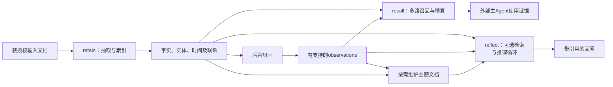

# Hindsight专项调研与现行方案评估

核查日期：2026-11-16（America/Los_Angeles）。本项目基线为 `main / 547c659fd6be3af97d59292b7fa83cbd7fe2103b`、V1.2修订2；Hindsight固定源码为 [`b92ceb180e349a456d2b5454575067b6ff0f6306`](https://github.com/vectorize-io/hindsight/tree/b92ceb180e349a456d2b5454575067b6ff0f6306)，`hindsight-api-slim` 1.2.1、MIT许可。公开源码只读下载至临时目录，未安装、启动或调用模型。[版本与依赖][package]、[许可证][license]。

2026-11-18补充§1.1–1.2的核心架构理念与组件关系，并增加[开源自部署Handbook](../docs/handbooks/hindsight-self-hosted-deployment.md)和[agent-service接入Handbook](../docs/handbooks/hindsight-agent-service-integration.md)。手册继续采用上述固定版本，操作命令供后续执行；本轮不实际部署或开发服务。

远程数据库、API/worker分离及多实例配置另见[生产环境部署Handbook](../docs/handbooks/hindsight-production-deployment.md)。原版已有的共享PG队列与多worker能力、具体运维前置及仍待开发的授权/生命周期保证分别说明，不据部署拓扑推论完整协议符合度。

**Hindsight有较高参考价值，适合优先作为完整派生记忆引擎的对照；目前没有证据要求替换本项目架构或修改首发合同。** 最值得借鉴的是具体的抽取与更新规则、归纳的新鲜度处理、时间范围召回，以及按处理阶段组织的真实模型评测。当前缺口主要在可执行实现和效果证据，不能把合同已经写明的能力再次列成设计缺失。

本仓此前已在[框架研究](memory-frameworks-notes.md)核对Hindsight 1.1.0，并在[04§6.1](../docs/spec-v1/04-evaluation-and-acceptance.md#61-对照组)列为可选对照。本次补核1.2.1；旧研究保留其版本语境。本报告只提出候选优化，同步研究入口与交接，不修改现行API、schema、检索基线、数值门槛或A/B/C范围。

## 1 Hindsight的学习机制

Hindsight的主要运行机制是**外部记忆随新证据演化**。模型从输入提炼事实，后台把相关事实归纳为可更新的观察，再按问题召回和推理。这个流程没有要求每次写入都训练基础模型权重；可选decision model是部署好的判断模型，用于分流或筛选证据，不能由此推论服务会自动训练主Agent。[归纳实现][consolidator]、[decision分流][triage]。

| 机制 | 做什么 | 对本项目的含义 |
|---|---|---|
| retain | 可保存输入文档，抽取带说话人视角、实体、时间和叙事情境的事实，建立检索联系 | 可参考writer实现；来源可靠接收仍不能依赖模型筛选 |
| recall | 语义、词法、图、时间多路召回，融合、可选重排，按token预算返回 | 对应L2及部分L3；默认作为主Agent的证据输入更合适 |
| observations | 后台汇集事实，维护一个主体某一侧面的观察、支持证据和更新轨迹 | 对应L1可选归纳，不是新权威层 |
| mental models | 为一个预设问题保存可重复读取的主题文档，按范围变化刷新 | 可参考高复用主题缓存，不必为所有用户生成整套画像 |
| reflect | 在记忆上运行证据搜索与生成循环，产出带引用的解释或答案 | 是服务内额外推理，不能与普通recall等价计价或直接加入每轮前台 |

依据：[retain][retain]、[检索][retrieval]、[mental models][mental]、[reflect][reflect]。当前`Document.original_text`和事实的`document_id`、`occurred_start/end`、`mentioned_at`可在[数据模型][models]核对；原始正文默认保存，`store_document_text`可关闭，不能因首页强调“抽取事实”就断言它不保留原始文档。[正文配置][config]。

两个分类容易误用。`world`指关于外部世界的陈述，用户说“我头痛”属于关于用户的world fact；`experience`指bank所属Agent自己的经历。它们区分视角，**不证明陈述客观为真**，也不替代本项目的用户自述、正式回执、推断及确认等级。论文2025年12月的四网络包含opinion/belief表述；当前接口以world、experience、observation等组织记忆，并另有mental models/pages，不宜拿论文类型原样描述当前接口。[retain分类][retain]、[原始论文](https://arxiv.org/abs/2512.12818)。

### 1.1 核心架构理念

Hindsight把记忆视为一个**可持续积累、更新并参与推理的外部知识状态**。保存聊天是输入环节，系统还要解决同一主体的信息如何连接、较早和较新陈述如何区分、哪些内容值得合并，以及本次问题应读取哪些依据。因此它既有面向写入的知识构建，也有面向读取的证据检索与可选推理。[架构概览][overview]。

| 设计选择 | 为什么这样做 | 使用时的含义 |
|---|---|---|
| 分开事实陈述与归纳观察 | 一次披露与多次证据形成的概括具有不同来源和更新过程 | 归纳保留支持；重复数量不能自动变成客观真值 |
| 为事实补实体、时间及联系 | 相同问题可能依赖字面、语义、关系或时间，单条向量无法覆盖全部路径 | 写入会做抽取与索引建设，读取采用多路召回；图是系统内部关系表示，不要求另部署图数据库 |
| retain、recall、reflect分别提供接口 | 写入、找证据和形成回答的成本及控制需求不同 | 自有Agent可只用retain/recall，让主Agent负责回答；reflect单独启用 |
| 后台巩固并预计算常用主题 | 同样的事实和问题反复出现时，每次重做归纳成本高 | observations与mental models/pages按范围维护；刷新期间仍需关注来源和归纳是否落后 |
| 先融合候选，再按阅读预算组织 | 不同通道评分不可直接比较，模型可读上下文也有限 | RRF、重排及token预算分别处理排序与交付量，不把top-k当完整历史 |
| 用bank组织长期状态 | 同一用户/Agent跨会话复用记忆，又能有各自的任务配置 | bank不能每轮随机创建，也不能仅凭bank名称证明业务权限 |

这是“会学习”的主要来源：**外部事实、观察和主题内容随新证据变化，后续Agent行为因读到这些内容而变化。** 模型负责语义抽取与生成，程序组织任务、引用、时间比较和持久化；可选decision model分流部分判断。它并未因此承诺在线训练主模型、自动感知现实变化，或把业务执行结果变成权威回执。[抽取][retain]、[多路检索][retrieval]、[观察规则][prompts]、[主题模型][mental]。

### 1.2 数据处理与运行组件

图表示职责及主要数据关系，不要求每次写入先生成主题文档，也不保证每次recall只返回原始事实；类型、chunks和支持事实的返回取决于请求配置。reflect通常按主题、观察、事实逐层找证据，可选decision-model编排会改变检索形态；它与调用方自己的主Agent是两次不同的推理职责。[Recall API][recall-api]、[Reflect机制][reflect]。

运行组件主要是API、worker、PostgreSQL及可选Control Plane界面。API对外提供读写，后台任务使用PostgreSQL持久队列；小型部署可让API同时运行内置worker，需要独立扩容时再拆出worker。关系、全文和向量等默认可保存在同一PostgreSQL体系中；模型服务负责抽取、embedding、重排及启用的生成。Control Plane用于管理和检查bank，不是本项目的授权控制面或独立删除ledger。[运行服务][services]。

“服务自托管”和“模型本地推理”是两项选择。自托管API和数据库仍可以调用外部模型；采用本地模型时需准备权重、缓存、计算资源及对应配置。实际部署还应区分数据库、模型缓存和可选附件/日志的持久化，不能从逻辑组件图推导所有副本都已纳入备份与擦除。配置及操作见相关Handbook。

## 2 自动更新的价值与边界

当前归纳prompt把新事实逐一判断为独立内容、重复、改变或结束。不同时间的另一场事件要独立保存；新增一个成员不能让模型自行计算总数；较早陈述迟到导入时应保存为较早状态，不能因为最后处理而覆盖较新陈述。程序还参与时间比较、局部引用映射和动作转换，不只依赖一句“请更新记忆”。这些是值得研究的实现细节。[当前归纳规则][prompts]、[动作转换][consolidator]。

固定版本的observations文档与源码有一处差异：文档仍把默认mission描述为持续成立的偏好、技能、关系和重复模式；源码的默认mission已经包括事件、数字、日期和主张等，仍过滤短暂闲聊。默认筛选范围应以固定实现核对，也不能把其中的“值得记住”放到本项目L0之前。[固定观察说明][observations]、[固定prompt][prompts]。

“事实变了会更新”仍有条件：变化必须先被可靠提供给服务，再经抽取、归纳和读取路径使用。它不会凭空感知产品数据库或现实变化。归纳prompt强调`mentioned_at`；程序实际取`mentioned_at`、`occurred_start`和`occurred_end`中的最大有效时间，排序并生成较旧事实标记。这套通用规则仍不能直接代替本项目的时间语义、正式回执、显式更正目标和人工保护。[归纳时间规则][prompts]、[程序时间比较][time-comparison]、[批次排序与标记][time-ordering]。源码最多保留最近3条旧状态文本括注，支持事实仍可被引用；不能据括注或“保留历史”推论完整双时间数据库或任意时点重建。[历史实现][history]。

以本项目的饮水和偏好为例，应保留以下语义：

| 新输入 | 应发生的事 | 借鉴时要防止什么 |
|---|---|---|
| 又喝了300ml水 | 新增独立正式事件，记忆引用该事件 | 按文字相似合并成上一杯 |
| 刚才那杯不是500，是300ml | 核对指定事件，经RecordService更正并传播失效 | 只改归纳文字，正式记录仍为500ml |
| 以后回复详细一些 | 新来源支持长期偏好修订；applied后限制旧偏好 | 等待后台画像刷新才生效 |
| 这一次解释详细些 | 只作用于当前任务 | 自动覆盖长期偏好 |
| 今天补录上个月的旧说法 | 保留原时间及来源，核对它与当前状态的关系 | 把今天处理等同于今天发生或最新有效状态 |

这些语义已有[01§5.3](../docs/spec-v1/01-data-model.md#53-关系冲突和语义去重)、[03§4.7](../docs/spec-v1/03-agent-sequences-and-recovery.md#47-通用偏好写入简短偏好后续召回改为详细)及[04§5.5](../docs/spec-v1/04-evaluation-and-acceptance.md#55-记忆触发偏好与事件身份的固定变体)约束，Hindsight主要提供可比较的具体实现。

## 3 与现行方案的对应

| 主题 | 当前合同已有内容 | 真正可参考或验证的部分 |
|---|---|---|
| 来源与派生分层 | L0来源、L1有证据记忆、L2索引、L3受控交付；原文可直接召回 | 文档到事实的输入组织、语境保留与抽取质量 |
| 后台写入 | 同owner微批、固定输入输出预算、schema、CAS/slot、人工保护 | 可运行prompt、候选转换、异常样例与模型回归 |
| 更新与冲突 | 纠错、真实状态变化、独立事件分开；矛盾可并列 | 多个旧陈述同时受影响时的覆盖率和误改率 |
| 混合检索 | 中文BM25、dense、实体/typed、近期通道，RRF和预算 | 长时间窗分散覆盖、图或重排的增量收益 |
| 归纳与画像 | 带推断标签与支持闭包；源失效先停用；巩固按C | 高复用主题范围、刷新触发及零复用成本 |
| 当前性与删除 | applied/连续屏障、依赖验证、Host清理及恢复门禁 | 派生落后与删除阶段的可读诊断，不能用模型提示替代门禁 |
| Agent消费 | prepare/skip、工具补查、step及交付前校验 | 薄SDK和接入样例；现成插件不等于full_lifecycle |
| 验收 | 服务合同、完整Adapter、中文交互收益分开 | 按操作与错误类型组织的可重复真实模型评测 |

本项目依据：[00分层与机制](../docs/spec-v1/00-boundaries-and-invariants.md#41-memoryservice内部逻辑分层)、[01证据与更新](../docs/spec-v1/01-data-model.md)、[03接入流程](../docs/spec-v1/03-agent-sequences-and-recovery.md)、[04检索和验收](../docs/spec-v1/04-evaluation-and-acceptance.md)。

这里比较的是本项目的**待实现合同**与Hindsight的**已有源码机制**。不能因本项目的生命周期要求更广就声称实现更可靠，也不能因Hindsight已有服务和SDK就认定它已满足本项目全部合同。

## 4 优先借鉴的实现与实验

### 4.1 把writer规则做成可执行基线

沿用已在[Mem0设计对比§3.2](mem0-design-comparison.md#32-实现一个有界且可审计的writer基线)提出的工作，重点参考Hindsight的主体与侧面拆分、局部F/O引用、否定与语气保留、迟到旧材料、独立事件和禁止推算count。先实现本项目自己的注册schema、输入版本、引用校验和既有6000/1000 token预算，再比较提示策略；不要把Hindsight整段prompt和其时间裁决照搬成业务合同。

模型的JSON、引用ID合法只能证明结构及引用范围；语义忠实仍要评测。用户明确修订、正式更正和删除继续走已有快速控制路径，不能依赖自动归纳判断。首发coarse slot的同源同类多事件粒度取舍仍保留；只有实测影响关键召回或精确更正时，才评审细粒度事件槽及迁移。[01派生发布](../docs/spec-v1/01-data-model.md#73-derivation_job只发布仍有效的结果)。

### 4.2 明确区分派生落后与依据失效

Hindsight会向reflect提供待归纳数量及stale提示，促使其回查事实；mental model不够新鲜时也不应短路下层检索。但源码明确这类freshness可使用一次请求内的提示快照，不是精确一致性门禁。[观察读取][reflect-tools]、[freshness实现][engine]。

本项目可以借鉴其可解释性：在已有审计中说明“来源已应用，但抽取、索引或归纳尚未就绪”，并展示本次用了哪层依据。不要增加一套替代source_version、read_after和bundle的公共stale状态。**仅派生尚未生成时，可按现行通道合同用有效原文；旧来源已被更正、删除或撤权时，先阻止旧内容使用，再重算。** 这也适用于Host已缓存或已压缩的内容，不能交给主模型自行判断是否忽略。

### 4.3 单独比较长时间窗的覆盖

Hindsight在时间范围内先找相关候选，再按时间桶轮流选择入口，避免“全年回顾”只取记录最密集的几天。固定实现是有限候选池上的覆盖，不保证所有时间段完整，也不提供正式统计完整性。[时间召回实现][temporal]。

这是本轮较具体的新实验候选：用“年初少量关键事件＋年底大量相似记录”比较现行RRF基线与时间分散变体，分别看关键证据召回、无关内容和最终回答。仅用于明确的范围回顾，不给普通新记录强塞全年历史；不直接替换当前排序基线或照搬其桶数、候选数。图和cross-encoder同样逐项消融，只有实际收益才进入实现选择。

### 4.4 高复用主题再考虑预计算

Mental models按预设问题及范围保存答案，可在读取时免去重复生成；这是可选摘要/主题投影的参考。可先考虑稳定且常用的问题，例如“用户明确的回复偏好及其适用范围”，而非自由推断人格或健康结论。使用时仍需准确的来源闭包、当前授权和版本核验；刷新任务完成不等于所有消费者已清理。[主题模型][mental]。

优先按已有[04§7.3.1](../docs/spec-v1/04-evaluation-and-acceptance.md#731-可选派生的维护成本与摊销)衡量生成、维护、失败、清理、读取和零复用成本。自动巩固继续按[06§7.3](../docs/spec-v1/06-history-ingestion-and-repair.md#73-定向派生复核c扩展)属于C，不因为第三方有pages就扩大A。

### 4.5 复用分阶段质量评测的方法

Hindsight把stub模型的确定性system-tests与真实模型system-evals分开，并按retain、recall、consolidation、reflect、refresh-pages及错误类别报告结果。其用例覆盖相似主体、数字、否定、陈述时间、中文和旧值在文档多处出现等具体陷阱，适合参考用例组织。[评测包说明][evals]。

本项目已有合同与真实收益分层、writer消融、G14/G15及反馈归因要求。应把上述反例映射到现有用例和报告，保留错误发生阶段：未抽取、抽错、没召回、预算淘汰、失效拦截、reader误用。无需再建一套同义验收编号，也不能把上游自报通过率当成本项目结果。

### 4.6 用任务与发布实现落实已有可靠性合同

Hindsight将父子任务原子入库，worker以锁和串行键协调执行；在增量文档更新路径中，抽取可以在事务外耗时计算，发布时再锁定并核对文档hash及chunk状态，发现并发变化则放弃该增量计划、回退full retain。这是对增量计划的保护，不等同本项目source_version CAS。这些适合参考D1/D2的持久入队、过期计划处理、重试终态及竞态夹具，尤其能减少“任务已接收却不可执行”或“依据旧chunk计划写入”的实现错误。删除受影响观察后，将幸存共同支持重新排队的处理则可参考D3的失效与重建流程。[任务与删除实现][engine]、[抽取前重核][orchestrator]、[增量写事务重核][delta-publish]。

这些机制落实现有合同，不要求照搬其worker架构，也不替代本项目的独立控制日志、未知付费调用核对、人工slot保护或取消/删除发布门禁。

## 5 接入和生命周期需要逐项核验

当前Hindsight已经有调用方operation ID、后台任务协调、来源删除及派生处理，评价时应承认这些已有能力，同时核对其保证范围。

| 机制 | 固定源码可确认的内容 | 与本项目的差别 |
|---|---|---|
| 异步幂等 | async retain可接收operation_id，重放既有batch_retain任务 | 相应重放检查bank和操作类型，不等同本项目完整payload hash冲突检查、稳定来源身份及连续业务屏障 |
| 文档身份 | document_id用于定位及更新文档及其事实 | 同ID更新/内容去重不等同source_version CAS、原生origin和人工slot保护 |
| 后台协调 | 有持久任务与并发领取机制 | 仍需单独核对未知付费结果、重试、取消及发布门禁，不能由“有队列”推导exactly-once |
| 删除传播 | 删除document会处理依赖observations，并尝试刷新受影响自动pages/mental models | 后续刷新存在best effort及配置边界，不能等同我方同步逻辑失效、物理清理、Host ACK及恢复控制 |
| 鉴权和范围 | 有tenant扩展及服务端读写tag scope钩子，可把范围约束施加到多类读取/写入 | bank或调用方tags本身不授予业务权限；仍需可信tenant/scope实现与owner、主体、域的逐项映射 |

依据：[async重放][async-replay]、[来源与观察删除][document-delete]、[自动主题刷新][refresh-after-delete]、[operation validator与服务端范围][validator]、[tenant实现][tenant]。这些是静态核查，不构成故障、删除或隔离实测报告。默认tenant扩展没有鉴权；共享API key也不自动表达每个业务owner的授权，但不能据此否认它已有可扩展的服务端范围控制。

主题新鲜度还有读取路径差异：单个主题的检查会核对是否引用了已不存在的支持，批量管理列表则不执行同样的逐项检查，可能短暂显示“up to date”。因此列表状态和已排队刷新都不能作为正文可继续交付或清理完成的证明。[主题陈旧性检查][topic-stale]。

如进入PoC，建议保留自有Memory API、来源和控制面，把Hindsight接在派生侧：可信当前来源输入到retain，recall返回候选后映射回精确来源版本，再由本项目的L3决定是否交付；正式记录与统计仍调用产品工具。无法映射到完整支持或当前授权的生成内容不能直接通过该路径交付。reflect单独作为可选能力对照，不嵌入每轮主Agent前再跑一套推理循环。

“套一层适配器”能否满足上述控制还要验证，尤其是来源更新、删除与后台任务竞争。依赖闭包或失效能力缺失时标为unsupported；不要在包装层补齐协议后把保证归功于原引擎，也不要据此宣称现成插件已支持full_lifecycle。

## 6 中文对照应怎样进行

当前文档的默认embedding仍是英文`BAAI/bge-small-en-v1.5`；默认native词法是PostgreSQL英文配置及`ts_rank_cd`，并非真正BM25。中文需要明确选择多语言embedding与合适的词法后端，例如PGroonga或配置中文tokenizer的pg_search；当前默认`hs-rerank-1`已列出中文支持，不能套用旧的英文reranker印象。[多语言配置][multilingual]、[词法后端][retrieval]。

固定源码还有显式中文时间规则，可作为“上周、去年、某月”解析的参考。但中文LLM能输出、存在中文规则、官方有少量中文case，都不足以证明中文短记录整体效果；尤其要核时区、晚补记和不明确时间。时间解析失败时Hindsight可降为无时间信号；本项目严格时间查询不能因此越窗返回内容。[中文规则][chinese-time]、[时间解析][time-extraction]、[04查询策略](../docs/spec-v1/04-evaluation-and-acceptance.md#12-查询策略)。

对照复用04已有数据与预算要求，先做以下固定变体：

1. **归属与忠实性**：我与妈妈、用户自述与助手建议、否定、猜测、单位不明。
2. **事件与更新**：同文两杯水、指定更正、临时与长期偏好、较早旧材料迟到。
3. **新鲜度**：写入后归纳未完成、旧依据失效、后台任务晚发布、历史上下文仍含旧值。
4. **召回**：无共同关键词的关联、相似主体干扰、长时间窗稀疏关键事件、少历史与无关历史。
5. **生命周期**：两owner/主体/域隔离，删除后观察/主题/Host副本及恢复时不得复活。
6. **收益与成本**：相同主Agent、授权历史前缀、输入时间、查询、记忆token预算，记录写入/后台/读取/失败/清理总成本及延迟。

先比较“现行混合检索基线＋同一reader”与“Hindsight recall＋同一reader”；再单独比较observations、主题缓存、图或重排。reflect若参加，单列其额外模型、轮次、token、延迟和费用，不能把额外推理收益解释成纯召回优势。不同writer不用强制产出同样条数；缺协议能力与回答质量分开报告。

原论文的LongMemEval、LoCoMo结果支持其长对话QA价值，但不直接证明中文个人记录、克制使用历史、精确统计或本项目生命周期合规。论文、当前网站结果及本次1.2.1源码是不同实验/版本边界，本轮没有复现分数。[论文](https://arxiv.org/abs/2512.12818)、[官方评测入口](https://benchmarks.hindsight.vectorize.io/)。

## 7 是否调整方案及推进顺序

| 时点 | 建议 | 是否改现行合同 |
|---|---|---|
| 当前设计阶段 | 保留自有职责、L0–L3、快慢路径、D1–D4和A/B/C；记录本次版本及差异 | 不需要 |
| D1 | 交付本服务的工程入口、迁移、稳定操作客户端与来源合同夹具，冻结控制边界 | 落实现有要求；control ledger与完整生命周期按D3交付 |
| D2 | 参考具体prompt和反例实现writer、最小可读诊断与有界上下文 | 先按现有schema/slot/预算；内部策略版本化 |
| D2–D4选型实验 | 把Hindsight作为优先完整引擎对照，先recall，同reader、同权限、同预算 | 04已允许对照，不新增首发义务 |
| 出现明确收益后 | 时间分散、reranker、图、主题缓存、细粒度事件或完整历史状态查询 | 按实际改变同步01/02/03/04及适用06 |

本次最值得优化的是**把已有正确约束做成可运行、可诊断、可比较的流程**。保留Hindsight作为候选内部引擎；在中文效果、总成本和生命周期对照之前，不直接决定迁入它、不改变正式记录归属，也不增加每轮reflect或全库后台巩固。

[package]: https://github.com/vectorize-io/hindsight/blob/b92ceb180e349a456d2b5454575067b6ff0f6306/hindsight-api-slim/pyproject.toml
[overview]: https://github.com/vectorize-io/hindsight/blob/b92ceb180e349a456d2b5454575067b6ff0f6306/hindsight-docs/docs/developer/index.mdx
[services]: https://github.com/vectorize-io/hindsight/blob/b92ceb180e349a456d2b5454575067b6ff0f6306/hindsight-docs/docs/developer/services.md
[recall-api]: https://github.com/vectorize-io/hindsight/blob/b92ceb180e349a456d2b5454575067b6ff0f6306/hindsight-docs/docs/developer/api/recall.mdx
[license]: https://github.com/vectorize-io/hindsight/blob/b92ceb180e349a456d2b5454575067b6ff0f6306/LICENSE
[models]: https://github.com/vectorize-io/hindsight/blob/b92ceb180e349a456d2b5454575067b6ff0f6306/hindsight-api-slim/hindsight_api/models.py#L104
[config]: https://github.com/vectorize-io/hindsight/blob/b92ceb180e349a456d2b5454575067b6ff0f6306/hindsight-api-slim/hindsight_api/config.py#L2094
[retain]: https://github.com/vectorize-io/hindsight/blob/b92ceb180e349a456d2b5454575067b6ff0f6306/hindsight-docs/docs/developer/retain.md
[retrieval]: https://github.com/vectorize-io/hindsight/blob/b92ceb180e349a456d2b5454575067b6ff0f6306/hindsight-docs/docs/developer/retrieval.md
[mental]: https://github.com/vectorize-io/hindsight/blob/b92ceb180e349a456d2b5454575067b6ff0f6306/hindsight-docs/docs/developer/mental-models.mdx
[reflect]: https://github.com/vectorize-io/hindsight/blob/b92ceb180e349a456d2b5454575067b6ff0f6306/hindsight-docs/docs/developer/reflect.mdx
[prompts]: https://github.com/vectorize-io/hindsight/blob/b92ceb180e349a456d2b5454575067b6ff0f6306/hindsight-api-slim/hindsight_api/engine/consolidation/prompts.py#L13
[consolidator]: https://github.com/vectorize-io/hindsight/blob/b92ceb180e349a456d2b5454575067b6ff0f6306/hindsight-api-slim/hindsight_api/engine/consolidation/consolidator.py
[observations]: https://github.com/vectorize-io/hindsight/blob/b92ceb180e349a456d2b5454575067b6ff0f6306/hindsight-docs/docs/developer/observations.mdx#L196
[time-comparison]: https://github.com/vectorize-io/hindsight/blob/b92ceb180e349a456d2b5454575067b6ff0f6306/hindsight-api-slim/hindsight_api/engine/consolidation/consolidator.py#L1634
[time-ordering]: https://github.com/vectorize-io/hindsight/blob/b92ceb180e349a456d2b5454575067b6ff0f6306/hindsight-api-slim/hindsight_api/engine/consolidation/consolidator.py#L3965
[history]: https://github.com/vectorize-io/hindsight/blob/b92ceb180e349a456d2b5454575067b6ff0f6306/hindsight-api-slim/hindsight_api/engine/consolidation/consolidator.py#L1488
[triage]: https://github.com/vectorize-io/hindsight/blob/b92ceb180e349a456d2b5454575067b6ff0f6306/hindsight-api-slim/hindsight_api/engine/consolidation/triage.py
[reflect-tools]: https://github.com/vectorize-io/hindsight/blob/b92ceb180e349a456d2b5454575067b6ff0f6306/hindsight-api-slim/hindsight_api/engine/reflect/tools.py#L395
[engine]: https://github.com/vectorize-io/hindsight/blob/b92ceb180e349a456d2b5454575067b6ff0f6306/hindsight-api-slim/hindsight_api/engine/memory_engine.py
[async-replay]: https://github.com/vectorize-io/hindsight/blob/b92ceb180e349a456d2b5454575067b6ff0f6306/hindsight-api-slim/hindsight_api/engine/memory_engine.py#L23642
[document-delete]: https://github.com/vectorize-io/hindsight/blob/b92ceb180e349a456d2b5454575067b6ff0f6306/hindsight-api-slim/hindsight_api/engine/memory_engine.py#L11616
[refresh-after-delete]: https://github.com/vectorize-io/hindsight/blob/b92ceb180e349a456d2b5454575067b6ff0f6306/hindsight-api-slim/hindsight_api/engine/memory_engine.py#L21643
[temporal]: https://github.com/vectorize-io/hindsight/blob/b92ceb180e349a456d2b5454575067b6ff0f6306/hindsight-api-slim/hindsight_api/engine/memories/pg/recall.py#L309
[evals]: https://github.com/vectorize-io/hindsight/blob/b92ceb180e349a456d2b5454575067b6ff0f6306/hindsight-system-evals/README.md
[validator]: https://github.com/vectorize-io/hindsight/blob/b92ceb180e349a456d2b5454575067b6ff0f6306/hindsight-api-slim/hindsight_api/extensions/operation_validator.py#L1222
[tenant]: https://github.com/vectorize-io/hindsight/blob/b92ceb180e349a456d2b5454575067b6ff0f6306/hindsight-api-slim/hindsight_api/extensions/builtin/tenant.py#L8
[orchestrator]: https://github.com/vectorize-io/hindsight/blob/b92ceb180e349a456d2b5454575067b6ff0f6306/hindsight-api-slim/hindsight_api/engine/retain/orchestrator.py#L4247
[delta-publish]: https://github.com/vectorize-io/hindsight/blob/b92ceb180e349a456d2b5454575067b6ff0f6306/hindsight-api-slim/hindsight_api/engine/retain/orchestrator.py#L4423
[topic-stale]: https://github.com/vectorize-io/hindsight/blob/b92ceb180e349a456d2b5454575067b6ff0f6306/hindsight-api-slim/hindsight_api/engine/memory_engine.py#L21587
[multilingual]: https://github.com/vectorize-io/hindsight/blob/b92ceb180e349a456d2b5454575067b6ff0f6306/hindsight-docs/docs/developer/multilingual.mdx
[chinese-time]: https://github.com/vectorize-io/hindsight/blob/b92ceb180e349a456d2b5454575067b6ff0f6306/hindsight-api-slim/hindsight_api/engine/chinese_temporal_periods.py#L492
[time-extraction]: https://github.com/vectorize-io/hindsight/blob/b92ceb180e349a456d2b5454575067b6ff0f6306/hindsight-api-slim/hindsight_api/engine/search/temporal_extraction.py#L79
